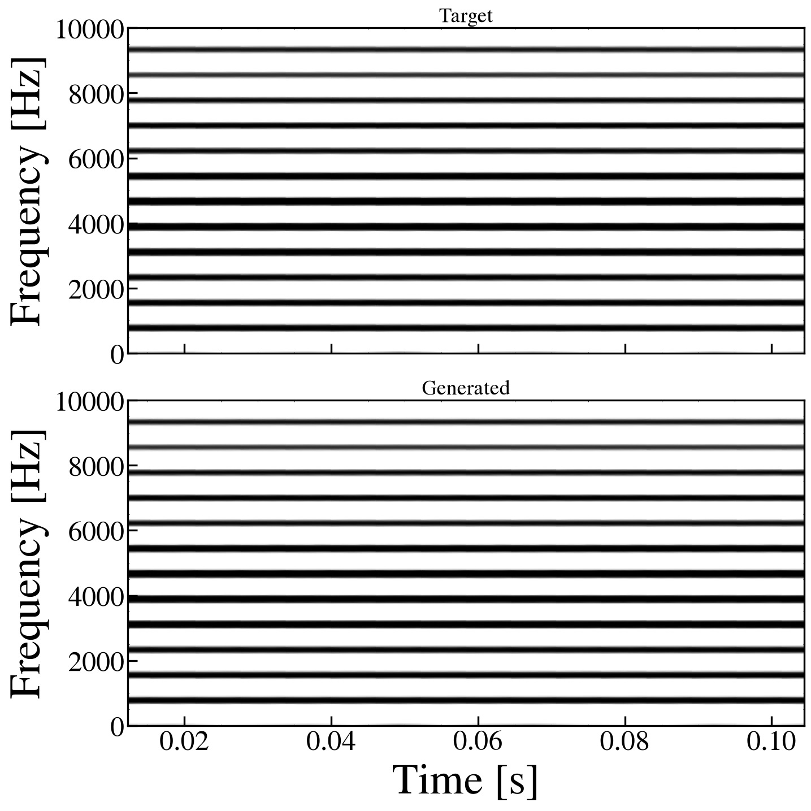
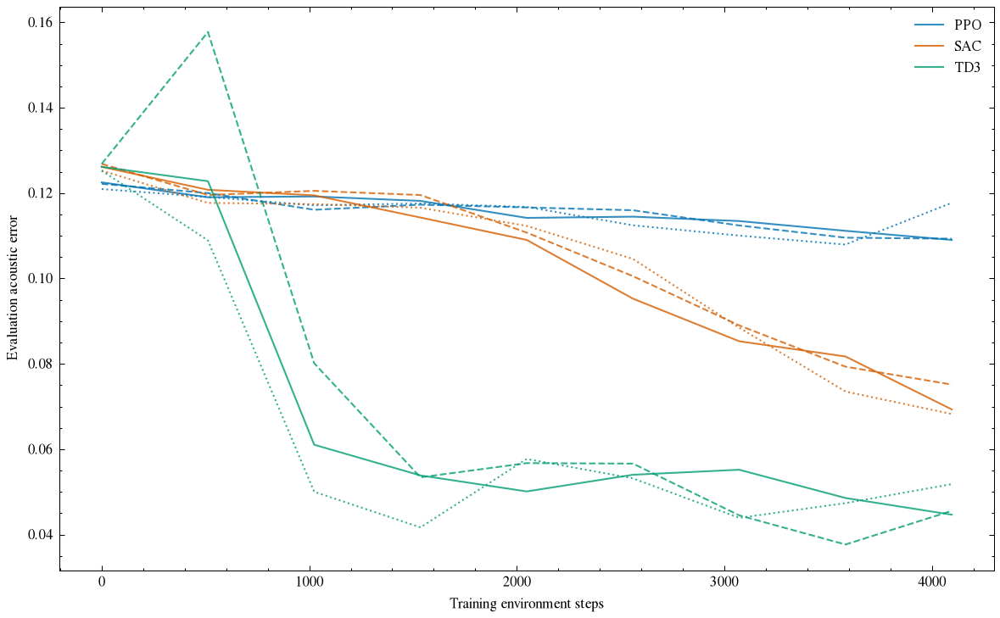
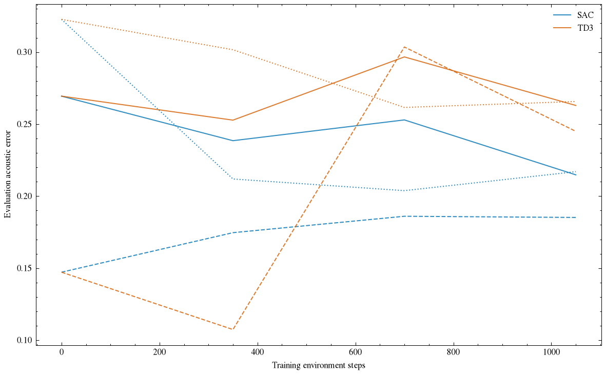
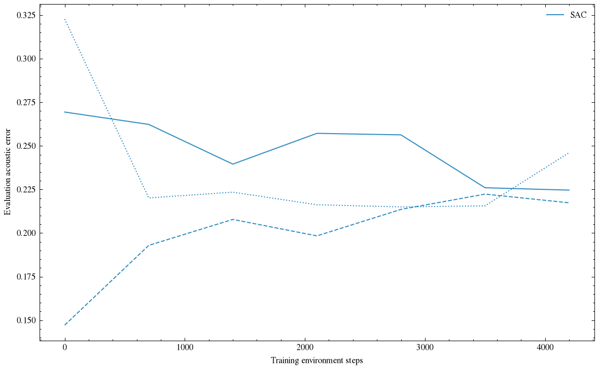

# Issue対応レポート

2026-10-30（JST）。作業場所: `Deeplearning/`。

既存モデルを変更せず、正弦波環境、C++逐次制御API、音響報酬と可視化、SAC/TD3/PPO比較、鳴管自己生成音の学習と直接最適化まで実装・実行した。ユーザーの確認済み許諾のもと、指定の0.35秒版のみで実録音のA/B/C各3 seedも実行した。

基本動作・再現性は確認できた。一方、鳴管モデルでRLが安定して良い模倣へ収束すること、実録音に対する音源条件の優位性は未確立。**実験したことと、研究上の完了条件を満たしたことを区別する。**

## Issueごとの状態

| Issue | 今回の到達点 | 残っていること |
|---|---|---|
| [#1](https://github.com/tatsukawa0353/Birdsong_tatsukawa/issues/1) | 調査文書・基準0.12秒再現・図・データ管理方針を作成 | 公開済み原音とGit履歴の是正は管理者側で対応が必要 |
| [#2](https://github.com/tatsukawa0353/Birdsong_tatsukawa/issues/2) | 正弦波の一定音・グライド、位相連続、Gymnasium環境、seed再現、oracle/ランダム比較を実装・検証 | 本Issueの基本的な完了条件をローカルで確認 |
| [#3](https://github.com/tatsukawa0353/Birdsong_tatsukawa/issues/3) | SAC/TD3/PPOを同じ4096step×3 seedで比較。継続候補TD3/SACを暫定選定 | 予算と目標を増やしたときの順位の頑健性 |
| [#4](https://github.com/tatsukawa0353/Birdsong_tatsukawa/issues/4) | C++ APIのreset/5制御値/逐次積分/波形取得を実装。A固定条件の波形・FFT回帰、0.35秒速度測定 | pybind11との実測比較、他条件の旧実装に対する追加回帰 |
| [#5](https://github.com/tatsukawa0353/Birdsong_tatsukawa/issues/5) | 秒単位STFT、共有スケールの音響誤差、図、SE/SCI参考値、ACI/HNR診断を実装 | SAPとの数値照合、ACI/HNRの実録音での妥当性、学習し直す報酬重み感度解析 |
| [#6](https://github.com/tatsukawa0353/Birdsong_tatsukawa/issues/6) | TD3/SAC各1050step×3 seed、SAC追加4200step×3 seed、既知制御・探索・差分進化を実行 | 良好な模倣への安定収束、時間変化目標へのRL学習、訓練中失敗回数の集計 |
| [#7](https://github.com/tatsukawa0353/Birdsong_tatsukawa/issues/7) | 指定の実録音0.35秒、SAC、A/B/C各1050step×3 seed。非公開の評価表・図・制御・振動診断を作成 | 短予算とPhase 1の未収束を解消し、直接最適化も含めて比較を拡充 |
| [#8](https://github.com/tatsukawa0353/Birdsong_tatsukawa/issues/8) | 今回未着手 | ユーザーが0.35秒版のみを指定したため、複数音節・個体への拡張は行わない |

Issueのクローズ、GitHubへのコメント・成果物公開、コミット・pushは行っていない。

## 1. 基準モデルと数値再現

仕様は [model_audit.md](reports/model_audit.md)。鳴管1器官内の左右音源を扱う。高頻度のRK4積分と低頻度の行動更新を分離し、既存のグリッド掃引と毎ステップCSV出力を持ち込んでいない。

`dt=1e-7 s`、遅延1142点を維持。既存の未変更C++を使った0.12秒の波形相対L2誤差は `9.04e-07`、FFT相対L2誤差は `9.04e-07`。誤差の主因は旧CSVの6桁保存精度。

10 MHzの基準波形の図は [legacy_spectrogram.png](results/reference/legacy_spectrogram.png)。2026-10-30のユーザー指定により、比較図を含めてカラースケールをgray_r・vmin=-50.0・vmax=-20.0に統一した。描画時に音声を10 MHzへリサンプリングしてnperseg=245760・noverlap=184320・Blackman–Harris窓を適用する。窓全体が音声区間内に収まるフレームのみ描画し、横軸はそのフレーム中心の範囲とする。0.35秒音声では0.012288–0.331776秒。0秒・音声終端を除外した。表示だけの修正で、音声・報酬・学習結果は変更していない。

0.35秒は3,500,000積分ステップ。各条件3回の測定は以下。CSV保存・描画・学習更新の時間は含めない。

| 条件 | 0.35秒積分の秒数（平均±標準偏差） | 有限値 |
|---|---:|---:|
| A | 0.28753 ± 0.00671 | 3/3 |
| B | 0.26855 ± 0.01295 | 3/3 |
| C | 0.25789 ± 0.00786 | 3/3 |

共有ワークステーション上で実行し、他処理と競合した時間もある。測定値を専用機上の厳密な性能比較とはみなさない。

## 2. Phase 0：正弦波

0.35秒、制御10 ms（35行動）、音声48 kHz、周波数500–3000 Hz、振幅0–1。位相を区間境界で連続積分する。一定音とグライドの両方で既知制御がランダム制御を上回ることを確認した。

学習は乱数化したグライド、評価は別の固定1000→2000 Hzグライド。観測に現在の目標周波数・振幅を与える追従課題である。鳴管環境と難易度・観測の意味は異なる。

全手法が同じ4096訓練ステップ・seed 0/1/2・報酬・制御周期。評価は探索なし。評価に使った環境呼出数は訓練予算から分離した。誤差は対数PSD距離と包絡誤差の和で、小さいほどよい。

| 手法 | 最終誤差（平均±seed標準偏差） | 0.08以下へ到達 | 訓練＋途中評価秒（平均） | 評価環境step/seed |
|---|---:|---:|---:|---:|
| SAC | 0.07081 ± 0.00307 | 3/3 | 14.64 | 350 |
| TD3 | 0.04389 ± 0.00487 | 3/3 | 9.37 | 350 |
| PPO | 0.10945 ± 0.00466 | 0/3 | 4.40 | 350 |

この予算では最終誤差の中央値が小さい順にTD3、SAC、PPO。TD3とSACを鳴管環境へ継続した。閾値0.08は実験用の暫定値で、知覚上の模倣成功を保証しない。実際の到達stepと全seedの誤差は [summary.json](results/phase0/summary.json)。

周波数と振幅の追従誤差は [tracking.csv](results/phase0/tracking.csv)、実際の制御は各実験の `controls.png` とNPZに保存した。

## 3. Phase 1：モデル内生成音

条件A。目標は左epsilon=4.1e7、共通ps=3.4e6、左右f0=4.9e4で生成した0.35秒。左右の状態・遅延履歴はゼロから開始し、初期過渡も含める。学習の可動値は左epsilonと共通psの2個。

| 学習法 | 予算step/seed | 最終誤差（平均±seed標準偏差） | 0.08以下へ到達 |
|---|---:|---:|---:|
| TD3 | 1050 | 0.25631 ± 0.01093 | 0/3 |
| SAC | 1050 | 0.20531 ± 0.01819 | 0/3 |
| SAC追加 | 4200 | 0.22953 ± 0.01452 | 0/3 |

追加学習は短い実験を見た後にSACだけを選んだ探索的な実験である。最終誤差はseed依存で、長く学習すれば一貫して改善するという結果ではない。

| 比較法 | 最終評価誤差（平均±seed標準偏差） | 探索に使った環境step/seed |
|---|---:|---:|
| constant | 0.20787 ± 0.00000 | 35 |
| random_step | 0.37179 ± 0.00097 | 35 |
| oracle | 0.00000 ± 0.00000 | 35 |
| random_search | 0.22632 ± 0.07425 | 1050 |
| differential_evolution | 0.14530 ± 0.03638 | 1050 |

主比較のランダム探索・差分進化は、RLと同じ即時報酬の平均を最小化し、30候補×35step=1050step。最終表には選ばれた方策の終端全体誤差を示す。直接探索は2個の**定数**を探索し、RLは時変制御を出力できるため探索次元は異なる。oracleは生成パラメータ既知の検証であり、学習成績ではない。

初回は終端全体誤差を直接最適化していたため、即時報酬と目的関数が異なることを確認し、同じ報酬による比較を再実行した。初回の結果は `results/phase1_terminal_baselines/` に目的関数の注記とともに残した。

ランダム行動よりは小さい誤差を得たが、定数制御や直接探索に対するRL固有の優位性は示せていない。既知制御でほぼゼロにできるため、この目標をモデルが表現できないという説明は当てはまらない。最適化・観測・報酬設計を見直す余地がある。

時間変化目標は生成と既知制御による追従まで確認したが、RL学習は未実施。制御周期5/10/17.5 ms、変化ペナルティ0/0.01/0.1の診断は [evaluation_sensitivity.json](results/diagnostics/evaluation_sensitivity.json)。これは同じ学習済み方策の**評価時**の感度で、条件ごとの再学習実験とは区別する。

## 4. 音響評価

Blackman–Harris窓24.576 ms、75%重複。短区間はゼロパディングし、目標と生成音を同じフレームへ置く。音量の比較には共有スケールだけを使い、各音声の独立最大値正規化を避けた。包絡は5 msの二乗平均平方根。即時報酬はPhase 0では10 ms区間、鳴管では最大30 msの直近文脈、終端指標は全0.35秒。

同一音で誤差ゼロ、周波数・音量・タイミングのずれで正の誤差となること、無音/雑音/非有限値/長さ不一致、サンプルレート変更に対する秒単位窓、アンチエイリアスをテストした。

SE、既存SCI定義に対応するf_MSF/f_AFF、ACI、自己相関HNR診断は学習後に別途計算した。SCIはSAPとの照合済み値ではなく、HNR・ACIも学習報酬として有効性を確認したものではない。雑音様の目標を自動除外しない。単一の値を複雑さ全体の尺度にせず、時間変動・スペクトル図と併記する。合成音の記述量は [descriptors.json](results/diagnostics/descriptors.json)。

## 5. 実録音0.35秒

ローカル利用許諾はユーザーが確認済み。ユーザーの追加指定に従い0.35秒版のみを使用した。原音を上書きせず、同一の正確な0.35秒区間でA/B/Cを各3 seed、SAC・1050stepで実行した。左右が同時に更新される制御であり、A/B/Cの自由度は3/4/5と異なる。

詳細な評価表・学習曲線・スペクトログラム・生成音・制御値・全積分ステップで再測定した左右速度RMSは [非公開レポート](private_runs/phase2/REPORT.md) にまとめた。Git管理対象外なので、公開コミットやIssueへ添付しない。

Phase 1の未収束、自由度の違い、未知の録音振幅・位相・声道フィルタの影響があり、実録音の成績だけから音源条件の普遍的優位性やモデル表現力の限界を結論しない。主張の対象はモデルでの到達可能性と学習効率であり、鳥の神経学的学習機構ではない。

## 6. 検証・再実行

検証ログは [validation.txt](reports/validation.txt)。19テストを実施した。Gymnasium契約、新旧C++回帰、分割積分、reset履歴、制御値と閉鎖済みモデルの検証、連続音声フィルタ、A/B/C行動数、発散停止、最終区間の発散を正常得点にしない処理を含む。描画についても、10 MHzへのリサンプリング、端のフレーム除外、指定カラースケール、音声が短い異常終了でもゼロ埋めの図を作らないことを検証した。最新の表示レンジ[-50,-20] dBでの描画4テストは [plot_validation.txt](reports/plot_validation.txt) に記録した。

実行コマンド・依存関係は [README.md](README.md)。固定設定は `configs/`、ライブラリ版は [requirements-lock.txt](requirements-lock.txt)、基準コミット・コンパイラ・旧コードのハッシュは [environment.json](results/environment.json)。

保存したRL実験はPhase 0が9本、Phase 1が6本＋追加3本。実録音9本を含めた訓練予算は計65,214環境ステップ。直接探索と途中評価の環境呼出はこの値とは別。

## 7. 残作業の優先順

1. 公開済み原音と履歴の扱いを管理者・許諾元と調整する。追跡解除は済ませたが過去履歴は消えない。詳細は [DATA_POLICY.md](reports/DATA_POLICY.md)。
2. Phase 1でモデル内目標への安定した模倣を確立する。定数の直接探索との比較を続け、発声可能なf0範囲、観測の遅延履歴、即時/終端報酬の関係を調べる。
3. 訓練途中の数値発散回数を専用ログに追加する。今回のfailed欄は最終・途中の評価失敗であり、訓練途中の失敗率ではない。
4. 実録音に対する直接最適化と学習予算の拡大、複数指標による再評価を行う。
5. 複数音節・個体への拡張は、今回の0.35秒限定指定を超えるため次回の対象とする。

## Issue #9 の追加診断

発声が持続しない問題、外力の写像、実適用制御値の保存と表記について [ISSUE9_REPORT.md](reports/ISSUE9_REPORT.md) に追加調査をまとめた。実録音に由来する同予算比較の詳細は `private_runs/issue9/REPORT.md` に保存した。持続発声の回復と模倣精度の改善を区別している。

## Issue #10 の合成報酬診断

無音・誤った有声音・既知制御の報酬順序、即時報酬と全体損失の不一致、差し替え可能な候補、SAC/TD3の同条件比較は [ISSUE10_REPORT.md](reports/ISSUE10_REPORT.md)。合成音だけを用い、旧指標と新損失のトレードオフ、発声持続と模倣収束を分けて記録した。
