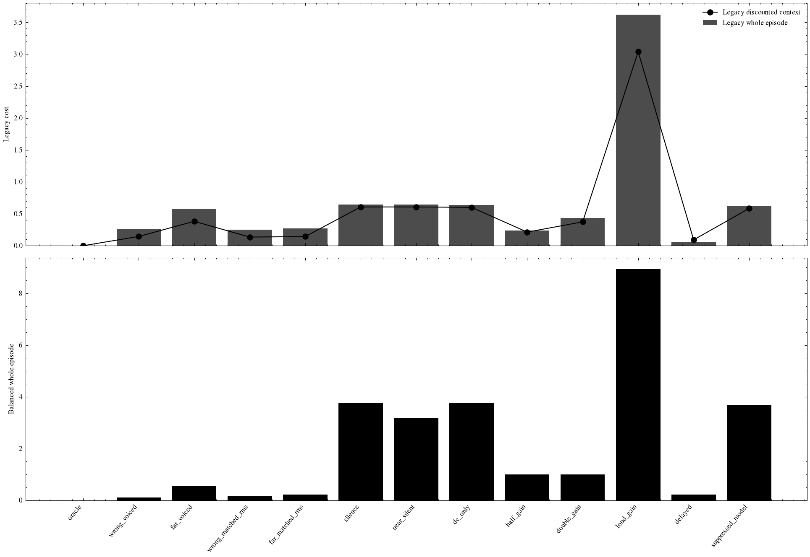
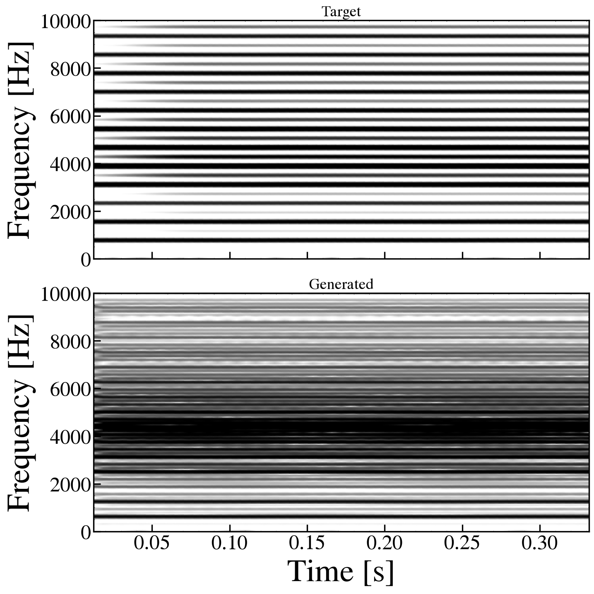
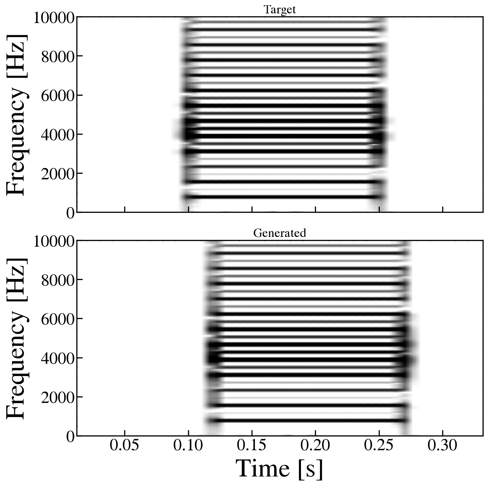
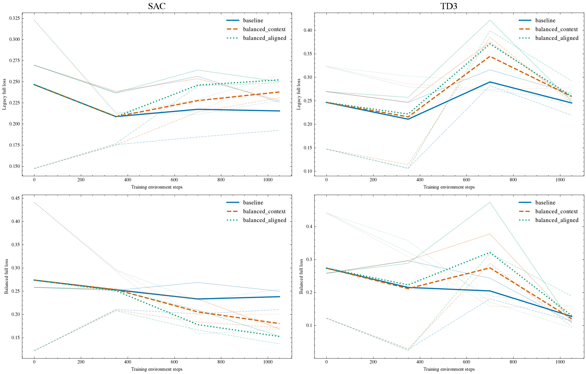
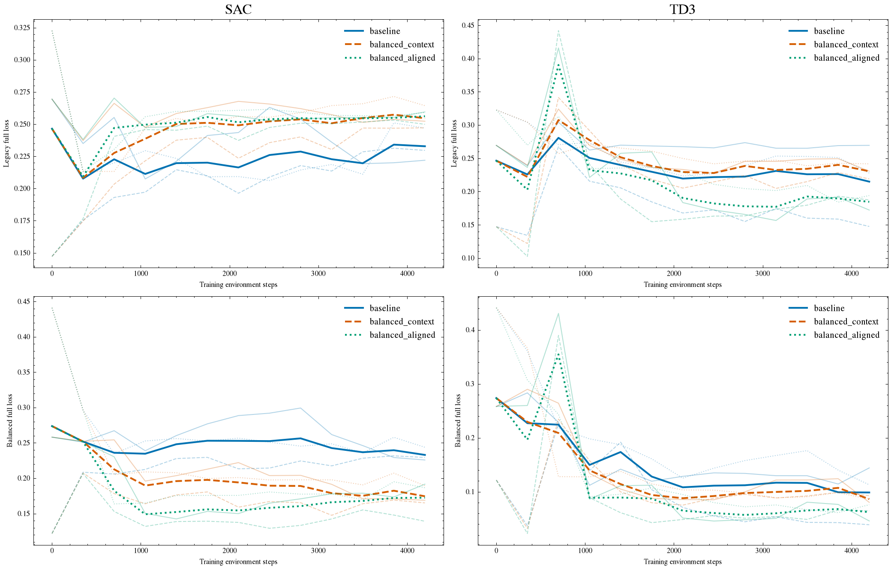
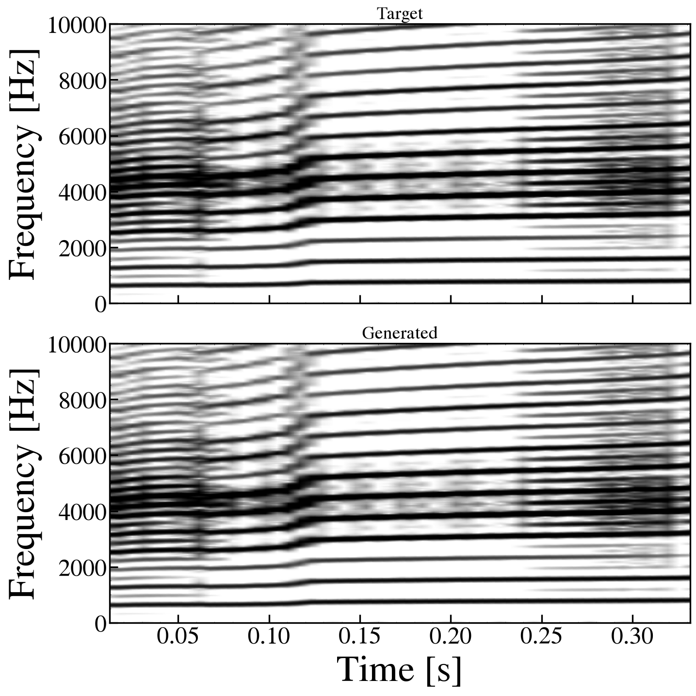

# Issue #10 対応レポート

2026-10-30 JST。対象: [Issue #10](https://github.com/tatsukawa0353/Birdsong_tatsukawa/issues/10)。

合成音の固定診断、差し替え可能な報酬候補、SAC/TD3の同条件比較、直接探索、回帰検証を実施した。今回のPhase 1定数目標・既定設定では、現行報酬が通常の周波数ずれ有声音より無音を優遇する仮説は再現しなかった。ただし窓を延ばす感度診断では、より遠い有声音との順位逆転が起きた。即時報酬と全体誤差の順位逆転も再現した。

最終の従来誤差0.08以下は全36学習中0本、持続発声は36/36本。発声の成立と模倣収束を分けて扱う。新損失上の改善だけを理由に従来報酬を置き換える根拠は得ていない。

実録音を読まず、Case Aの既知モデル制御で生成した0.35秒だけを使用した。今回の数値・図・WAV・モデルは全て合成由来。`private_runs/` の過去結果は再計算・転載していない。GitHubへの投稿・push・Issueクローズは行っていない。

## 1. 学習前の固定診断

全条件に目標ピークの共通スケールを使用。oracleは同一配列、wrong_voicedはε_l=3e7・p_s=3.4e6、far_voicedはε_l=5e7・p_s=4e6。正解はε_l=4.1e7・p_s=3.4e6。外力は49,000固定。matched_rmsは音量差の影響を見る固定診断用の波形だけを目標RMSへ合わせたもので、学習・通常評価の独立音量正規化ではない。DCは目標の平均値だけを出力する。遅延は先頭20 msをゼロにして末尾を切り、位相合わせ・伸縮はしない。suppressed_modelのみ診断用に左外力を5e5へ上げた。これはRLの行動自由度へは加えていない。

| 固定波形 | 従来log PSD | 従来包絡 | 従来全体 | 従来30 ms平均cost | 従来割引cost | 新全体 |
|---|---:|---:|---:|---:|---:|---:|
| oracle | 0.00000 | 0.00000 | 0.00000 | -0.00000 | -0.00000 | 0.00000 |
| wrong_voiced | 0.24386 | 0.02094 | 0.26479 | 0.17134 | 0.14472 | 0.11695 |
| far_voiced | 0.29058 | 0.27946 | 0.57005 | 0.45194 | 0.38210 | 0.55563 |
| wrong_matched_rms | 0.24625 | 0.00722 | 0.25347 | 0.15986 | 0.13518 | 0.17308 |
| far_matched_rms | 0.25414 | 0.01635 | 0.27050 | 0.16959 | 0.14325 | 0.23220 |
| silence | 0.26349 | 0.38271 | 0.64620 | 0.71716 | 0.60714 | 3.77664 |
| near_silent | 0.26349 | 0.38271 | 0.64620 | 0.71716 | 0.60714 | 3.17829 |
| dc_only | 0.25957 | 0.38012 | 0.63969 | 0.70908 | 0.60030 | 3.77657 |
| half_gain | 0.04785 | 0.19135 | 0.23920 | 0.25191 | 0.21332 | 1.01193 |
| double_gain | 0.05077 | 0.38271 | 0.43347 | 0.44085 | 0.37332 | 1.00505 |
| loud_gain | 0.17841 | 3.44437 | 3.62278 | 3.59075 | 3.04063 | 8.93866 |
| delayed | 0.03041 | 0.02415 | 0.05456 | 0.09873 | 0.09170 | 0.22193 |
| suppressed_model | 0.25187 | 0.37561 | 0.62748 | 0.69143 | 0.58388 | 3.68794 |

costは小さいほど良く、報酬はその負値。割引costは `-Σ γ^(t−1) r_t / 35`、γ=0.99。異なる損失の数値の大小を直接比較しない。

無音の従来全体誤差0.64620は、wrong_voicedの0.26479、far_voicedの0.57005より大きい。対数PSDは全帯域・全フレームの等重み平均なので、目標のエネルギーが少ないビンが多いと無音のスペクトル罰は薄まり得る。しかし今回の共有ゲインでは包絡の欠落も加わり、無音有利とはならなかった。極端な10倍音量は無音より悪いが、それだけで無音の抜け道とは判定しない。Issue #9の実録音・外力可変条件への一般化はできない。





全固定波形は [audit/](../results/issue10/audit/) のNPZ、全項目は [scores.json](../results/issue10/audit/scores.json)、35区間別は [step_metrics.json](../results/issue10/audit/step_metrics.json)。

### 目標の有声・無音・雑音様区間

目標のみから帯域包絡を求め、最大値の1%（振幅比−40 dB）以上を活動フレームとする。全体最大1e−8以下なら全て非活動。生成音はマスクへ影響しない。帯域フィルタと包絡の遅れ・減衰を含む操作的マスクであり、手動の真の音節境界や周期性の検出ではない。

| 目標・生成の組合せ | 目標活動frame率 | 従来全体 | 新全体 |
|---|---:|---:|---:|
| gated_oracle | 0.448 | 0.00000 | 0.00000 |
| gated_delayed | 0.448 | 0.10207 | 0.28470 |
| gated_always_voiced | 0.448 | 0.37812 | 0.56292 |
| quiet_oracle | 0.000 | 0.00000 | 0.00000 |
| quiet_wrong_voice | 0.000 | 0.64620 | 7.00472 |
| noise_oracle | 1.000 | 0.00000 | 0.00000 |
| noise_missing | 1.000 | 0.92040 | 3.54580 |

gatedは0.10–0.25秒だけ鳴る目標。正しい無音は誤差0、無音目標への誤発声・gatedに対する常時発声は正の誤差となる。雑音目標も活動として保持し、完全再現は0、欠落は正の誤差。常時発声ボーナスは加えていない。



### 旧報酬の感度と時間集計

一度に1設定だけ変えた合成診断。包絡の5 ms幅は維持し、表のenvelope_weightはその係数。shared_scaleは目標・生成に同じ倍率を適用する。主設定・初期12波形・候補の重み・窓等の感度条件は学習前に固定した。far_matched_rmsは音量と周波数差の混同を調べる追加診断であり、学習後に追加したが、学習設定・損失重み・予算や移行基準の変更には使用していない。

| 変更 | wrong voiced | far voiced | far RMS一致 | 無音 | DC | half gain | 20 ms遅延 |
|---|---:|---:|---:|---:|---:|---:|---:|
| default | 0.26479 | 0.57005 | 0.27050 | 0.64620 | 0.63969 | 0.23920 | 0.05456 |
| floor_-60 | 0.21959 | 0.53655 | 0.22791 | 0.54106 | 0.53722 | 0.23581 | 0.04342 |
| floor_-100 | 0.26979 | 0.56579 | 0.27345 | 0.73623 | 0.72483 | 0.23655 | 0.05987 |
| window_0.012288 | 0.15687 | 0.43140 | 0.14079 | 0.84325 | 0.83293 | 0.26454 | 0.06073 |
| window_0.049152 | 0.26657 | 0.62050 | 0.31520 | 0.53683 | 0.53218 | 0.22118 | 0.05525 |
| max_5000 | 0.28668 | 0.57348 | 0.27345 | 0.64756 | 0.63715 | 0.23814 | 0.05633 |
| envelope_weight_0.5 | 0.25433 | 0.43031 | 0.26232 | 0.45484 | 0.44963 | 0.14352 | 0.04248 |
| envelope_weight_2 | 0.28573 | 0.84951 | 0.28685 | 1.02891 | 1.01982 | 0.43055 | 0.07871 |
| shared_scale_0.5 | 0.30880 | 0.87268 | 0.30995 | 1.07967 | 1.06919 | 0.43347 | 0.08323 |
| shared_scale_2 | 0.22866 | 0.40437 | 0.23657 | 0.40700 | 0.40287 | 0.14018 | 0.03777 |

フロアはPSDへ加算してから対数化し、その絶対dB値で割るため、単なる表示下限ではない。STFTの窓・周波数帯域・共通ゲイン・包絡重みは物理的な区別の相対重みと順位を変え得る。窓49.152 msでは無音約0.5368がfar_voiced約0.6205より良くなる。窓を長くすると帯域ビンへの成分の広がりと対数誤差が変わるためで、全設定で無音優遇が否定されたわけではない。ただし同じfar波形をRMS一致にすると約0.3152で無音より良くなり、音量差が順位逆転に寄与していたことが分かる。純粋な周波数差だけの効果とは断定しない。表示の[-50,-20] dBはこの計算へ渡していない。感度の全成分と欠落重み0/1/2/4の診断は [sensitivity.json](../results/issue10/audit/sensitivity.json)。

旧法は10 msごとに最大30 msを切り出し、24.576 ms窓でゼロ埋めする。最初の2区間は全frameがパディングを含み、以降は6/7frameが含む。隣接区間では過去音声を再び評価し、切り出し端と包絡も毎回変わる。全0.35秒の旧誤差と同じ集計ではない。

固定群で全体と割引即時costの順位が逆転した組は `[['wrong_voiced', 'far_matched_rms'], ['wrong_voiced', 'half_gain'], ['wrong_matched_rms', 'half_gain'], ['far_matched_rms', 'half_gain']]`。wrong_voicedとhalf_gainでは全体はhalf_gainが良く、即時報酬はwrong_voicedが良い。新法は物理的な窓の重複を残すが、58個のframeをそれぞれ1回だけ割り当て、重み合計を1とする。開始前の既知のゼロは左だけに補い、未生成の未来を右ゼロ埋めしない。末尾1 sample分のframeを通常frameと等重みにはせず、1/17500で重み付けする。

## 2. 差し替え可能な候補の定義

`acoustics.distance` と既定の報酬は保持した。`ModelConfig.loss_kind` と `reward_timing` で以下を選ぶ。baselineにも診断専用の新損失を計算するが、波形・元報酬へは影響しないことを回帰検証した。

| profile | 特徴・損失 | step報酬 |
|---|---|---|
| baseline | 旧log PSD + 5 ms包絡 | 直近最大30 msの旧costの負値 |
| balanced_context | 下記の新損失 | 同じ新frame列の直近30 ms重み付き平均の負値 |
| balanced_aligned | 同じ新損失 | 新たに完成したframeの寄与を1回だけ報酬化、割引を補償 |

baseline→balanced_contextは帯域フィルタ、因果窓、正規化、重みも同時に変わる候補全体の比較。balanced_context→balanced_alignedは特徴と重みを保ち、時間集計だけを変える比較。3条件は完全な要因計画ではなく、新損失の各成分の因果効果を単独では特定しない。

### 数式と正規化

目標ピークSで両波形を割り、6次Butterworth帯域通過250–10000 Hzを因果適用する。フィルタ初期状態は先頭値に対する定常状態とし、DCだけの入力から開始過渡の帯域成分を作らない。50 kHz、Blackman–Harris窓1229 sample、hop307 sample（丸め後）、左だけゼロ補完。STFTは窓和で割り、片側powerを2倍する。末尾の追加frameを含める。

frame kの終端e_k、直前終端e_(k−1)、波形長Nについて w_k=(e_k−e_(k−1))/N。帯域power P、正規化形状q=P/Σ_f P（power総和≤1e−20ならq=0）を使う。目標のみの活動マスクをm_kとする。目標・生成の因果5 ms RMSを新たにカバーした区間で平均した値がE^T_k,E^G_k。E_ref=max(max_k E^T_k,0.05)。生波形の同区間平均をD_kとする。

```text
C_k = m_k mean_f |cumsum_f(q^T_k - q^G_k)|
J_k = m_k sum_f q^T_k |10log10(P^T_k+1e-8) - 10log10(P^G_k+1e-8)| / 80
A_k = |E^T_k - E^G_k| / E_ref
M_k = m_k max(1 - E^G_k/max(E^T_k,1e-12), 0)^2
Derr_k = |D^T_k - D^G_k|
ell_k = C_k + 0.25 J_k + A_k + 2 M_k + 0.1 Derr_k
L = sum_k w_k ell_k
```

Cは周波数累積分布の距離で、無出力にはゼロ分布を拡張使用する。Hz単位の周波数誤差ではない。Cの形状正規化は音量を消すが、絶対包絡A、目標有声時の欠落M、DC差が残る。大音量は包絡差が増え、無音目標への誤発声もAで罰する。極小出力と厳密な0のCには閾値の不連続があり得るが、欠落Mは残る。重みは今回の設計値で、知覚評価に合わせた校正値ではない。

alignedではstep tで新規frameのΔL_tを計算し、r_t=−35 ΔL_t / γ^(t−1)。したがって `−Σ γ^(t−1)r_t/35=L` が恒等的に成立する（今回の平滑化罰は0）。γ=0.99を変更せず、最大の割引補償は約1.41。単純な未割引報酬平均はLとは一致しないため両方保存する。報酬尺度も変わるためSACのエントロピー係数適応等との相互作用は分離していない。

目標frame情報は [target_frames.json](../results/issue10/audit/target_frames.json)。共通スケールS=1.27829e+06、E_ref=0.355224。実装は [objectives.py](../objectives.py)、[model_env.py](../model_env.py)。

## 3. 同一予算・seedの学習比較

Case A・ε_lと共通p_sの2行動・35step/episode・0.35秒、同一の目標配列と共通ゲイン。ε_rと左右外力は従来の既定値。SAC/TD3、seed 0/1/2、32×32 MLP、CPU1スレッド、lr=0.0003、batch64、学習開始256、毎step更新、γ=0.99。TD3探索ノイズ0.1、SACの温度係数はSB3の既定適応。評価は探索なしで0stepと350stepごと、最終評価を別に保存する。RLのstep予算に評価呼出は含めない。

1050stepを先に実施。alignedが新しい全体損失を初期値から2/3 seed以上で改善し、同予算baselineの新損失平均も下回った手法だけを追加対象とする基準と4200step予算を、初回学習前に [issue10.json](../configs/issue10.json) へ固定した。選ばれた手法は全3profile・全seedを4200stepで最初から学習する。良いseedだけの継ぎ足しではないが、初回結果による手法選択を含む探索的実験である。

追加対象: SAC, TD3。旧誤差0.08は従来と同じ暫定閾値で、知覚的成功を保証しない。表は全seedの最終評価、±は母標準偏差（ddof=0）。

| 初回の手法 | alignedが初期から改善 | aligned初期の新損失平均 | aligned最終の新損失平均 | baseline最終の新損失平均 |
|---|---:|---:|---:|---:|
| SAC | 2/3 | 0.27369 | 0.14968 | 0.23755 |
| TD3 | 2/3 | 0.27369 | 0.11919 | 0.13870 |

### 定数目標・1050step/seed

| 手法 | profile | 旧全体誤差 | 新全体損失 | 旧≤0.08 | 持続発声 | 活動20 ms区間率 | 左速度std | 右速度std | 訓練発散 | 評価step/seed |
|---|---|---:|---:|---:|---:|---:|---:|---:|---:|---:|
| SAC | baseline | 0.2144 ± 0.0158 | 0.2376 ± 0.0195 | 0/3 | 3/3 | 1.000 ± 0.000 | 81.33 ± 0.58 | 79.43 ± 0.31 | 0 | 175 |
| SAC | balanced_context | 0.2378 ± 0.0120 | 0.1802 ± 0.0144 | 0/3 | 3/3 | 1.000 ± 0.000 | 84.77 ± 0.40 | 81.80 ± 0.18 | 0 | 175 |
| SAC | balanced_aligned | 0.2503 ± 0.0050 | 0.1497 ± 0.0139 | 0/3 | 3/3 | 1.000 ± 0.000 | 88.24 ± 0.44 | 83.51 ± 0.35 | 0 | 175 |
| TD3 | baseline | 0.2480 ± 0.0146 | 0.1387 ± 0.0210 | 0/3 | 3/3 | 1.000 ± 0.000 | 85.75 ± 0.85 | 81.36 ± 1.10 | 0 | 175 |
| TD3 | balanced_context | 0.2608 ± 0.0080 | 0.1246 ± 0.0185 | 0/3 | 3/3 | 1.000 ± 0.000 | 88.06 ± 2.80 | 83.65 ± 0.22 | 0 | 175 |
| TD3 | balanced_aligned | 0.2615 ± 0.0241 | 0.1192 ± 0.0317 | 0/3 | 3/3 | 1.000 ± 0.000 | 90.05 ± 0.83 | 81.54 ± 1.34 | 0 | 175 |



細線が各seed、太線が平均。上段は旧指標、下段は新指標。学習で最適化した指標に加え、共通の評価指標を全条件で計算している。

### 定数目標・4200step/seed

| 手法 | profile | 旧全体誤差 | 新全体損失 | 旧≤0.08 | 持続発声 | 活動20 ms区間率 | 左速度std | 右速度std | 訓練発散 | 評価step/seed |
|---|---|---:|---:|---:|---:|---:|---:|---:|---:|---:|
| SAC | baseline | 0.2325 ± 0.0100 | 0.2328 ± 0.0076 | 0/3 | 3/3 | 1.000 ± 0.000 | 81.89 ± 0.05 | 79.96 ± 0.07 | 0 | 490 |
| SAC | balanced_context | 0.2533 ± 0.0080 | 0.1745 ± 0.0107 | 0/3 | 3/3 | 1.000 ± 0.000 | 86.23 ± 0.22 | 82.28 ± 0.89 | 0 | 490 |
| SAC | balanced_aligned | 0.2555 ± 0.0047 | 0.1721 ± 0.0232 | 0/3 | 3/3 | 1.000 ± 0.000 | 87.72 ± 0.59 | 83.82 ± 0.76 | 0 | 490 |
| TD3 | baseline | 0.2114 ± 0.0524 | 0.0953 ± 0.0434 | 0/3 | 3/3 | 1.000 ± 0.000 | 88.53 ± 0.29 | 81.53 ± 0.82 | 0 | 490 |
| TD3 | balanced_context | 0.2323 ± 0.0120 | 0.0904 ± 0.0051 | 0/3 | 3/3 | 1.000 ± 0.000 | 88.26 ± 1.73 | 82.61 ± 0.82 | 0 | 490 |
| TD3 | balanced_aligned | 0.1858 ± 0.0063 | 0.0626 ± 0.0104 | 0/3 | 3/3 | 1.000 ± 0.000 | 89.18 ± 0.89 | 83.01 ± 0.26 | 0 | 490 |



細線が各seed、太線が平均。上段は旧指標、下段は新指標。学習で最適化した指標に加え、共通の評価指標を全条件で計算している。

TD3 alignedは追加予算で旧誤差平均0.2615→0.1858、新損失0.1192→0.0626へ改善した。同予算baselineの旧誤差平均0.2114も下回るが、seed 1ではbaselineの方が良く、3 seedの平均差だけで優位を確定しない。SAC alignedでは旧誤差平均0.2503→0.2555と改善が続かず、手法・予算への依存がある。いずれも暫定到達閾値には届いていない。

### 定数・ランダム・既知制御・直接探索

| profile | 比較法 | 旧全体誤差 | 新全体損失 | 探索step/seed |
|---|---|---:|---:|---:|
| baseline | oracle | 0.000000 ± 0.000000 | 0.000000 ± 0.000000 | 0 |
| baseline | constant | 0.207867 ± 0.000000 | 0.247283 ± 0.000000 | 0 |
| baseline | random | 0.371789 ± 0.000790 | 0.507201 ± 0.043945 | 0 |
| baseline | DE | 0.145298 ± 0.029702 | 0.079049 ± 0.038320 | 1050 |
| balanced_context | oracle | 0.000000 ± 0.000000 | 0.000000 ± 0.000000 | 0 |
| balanced_context | constant | 0.207867 ± 0.000000 | 0.247283 ± 0.000000 | 0 |
| balanced_context | random | 0.371789 ± 0.000790 | 0.507201 ± 0.043945 | 0 |
| balanced_context | DE | 0.244703 ± 0.027350 | 0.092793 ± 0.013933 | 1050 |
| balanced_aligned | oracle | 0.000000 ± 0.000000 | 0.000000 ± 0.000000 | 0 |
| balanced_aligned | constant | 0.207867 ± 0.000000 | 0.247283 ± 0.000000 | 0 |
| balanced_aligned | random | 0.371789 ± 0.000790 | 0.507201 ± 0.043945 | 0 |
| balanced_aligned | DE | 0.243875 ± 0.027195 | 0.109491 ± 0.018198 | 1050 |

oracle/constant/randomは各35stepの評価だけで、探索予算0。constantは正規化行動0、randomは各stepで独立一様。oracleの約1e−7は制御encodeのfloat32丸めを含むが、同一配列の固定診断は厳密0。

DEは2個の定数をpopsize3×2次元=6候補、初期＋4世代=30episode・1050環境stepで探索し、各profileの実際の割引報酬costを最小化する。新全体を直接最適化するのはalignedだけである。RLは35×2の時変出力が可能で探索次元が異なる。4200stepのRLに対してDEも4200stepへ延長した対照ではない。評価回数や計算秒数も揃えた計算量比較ではない。全候補の曲線と選択制御は [constant_baselines/](../results/issue10/constant_baselines/)。

全学習で最小の旧誤差は 0.14407（TD3 / baseline / seed 1 / 4200step）。これは最良例の記述であり、手法の一貫した優位性ではない。全seedの値・左右速度std・行動変化MSE・実適用制御の平均/標準偏差は [per_seed.csv](../results/issue10/per_seed.csv)。最終評価の35区間別損失、音声、5系列の制御図、重みは各runディレクトリに保存した。

発声はIssue #9の操作的指標（後半0.1–0.35秒、基準帯域RMS比−60 dB以上の20 ms区間が80%以上）。速度stdは全10 MHz積分点の区間統計を平均差も含めて合成する。位置オフセット、源の運動、出力音声、可視性、模倣誤差を区別し、周期性だけで雑音様の音を除外しない。右速度があってもCase Aの音響出力へ右源が寄与するとは限らない。

評価用NPZは元の振幅を保持する。`generated.wav` は聴取用にrunごとのpeakを最大1へ収めたfloat32で、波形ごとの音量調整を含む。このWAVの再生音量で条件間の振幅を比較しない。学習・評価・保存誤差にはこの聴取用調整を使用していない。

## 4. glideへの移行と観測の限界

定数alignedの最終旧誤差≤0.08が同一手法・同一予算で2/3 seed以上となることを、glide学習へ進む事前条件とした。新損失が下がっただけでは移行しない。

条件を満たす手法はなかったためglideのRLは実施しなかった。ε_l=3e7→4.6e7の0.35秒目標を生成し、既知制御のみ旧誤差5.8e-05で再現できることを確認した。このoracleをRL成績には含めない。



現行観測は正規化時刻、前行動2値、現在のx_l,y_l,x_r,y_rの計7次元。遅延線の全履歴、音声フィルタ状態、目標音声の特徴は観測されず、Markov状態を完全には与えていない。固定の一目標で時刻から軌道を覚える設定であり、未知の目標に合わせる目標条件付き模倣とはいえない。今回の比較では観測を変えていない。複数目標では目標特徴と履歴を別条件として検証する必要がある。

## 5. 検証・再現・成果物

[issue10_validation.txt](issue10_validation.txt) の36テストが成功。旧C++との回帰、RK4・遅延・分割積分、異常終了に加え、oracle/無音/DC/誤周波数の順序、正しい無音・雑音、ゲイン・過大音量・音節時刻、目標マスクの不変性、因果prefix、frameの一度だけの割当て、末尾重み、奇数長窓のpadding診断、割引報酬と全体の一致、baselineの波形と報酬不変、表示設定からの独立性を確認した。

保存成果物も再計算した。36本、訓練合計94,500step、評価合計11,970step。旧誤差の再計算との差最大0、alignedの割引returnと全体損失との差最大5.55e-17。目標ハッシュ・2自由度・予算・評価回数の一致を [verification.json](../results/issue10/verification.json) に記録。DEの探索9450stepと固定方策の評価等はこの訓練合計へ含めない。

物理方程式・RK4・dt=1e−7・遅延、`acoustics.py` と表示関数は基準コミットから変更していない。[provenance.json](../results/issue10/provenance.json) にコードと設定のSHA256・基準commitを保存した。図はε_l, ε_r, p_s, f_e,l, f_e,rを使用。表示は10 MHzへリサンプル、Blackman–Harris、245760/184320、gray_r、[-50,-20] dB、0–10 kHz、端を除いた0.012288–0.331776秒を維持する。解析窓・因果報酬と表示窓は別用途として区別する。

```bash
export MPLCONFIGDIR=/tmp/birdsong-mpl
Deeplearning/.venv/bin/python -m Deeplearning.issue10 all
Deeplearning/.venv/bin/python -m unittest discover -s Deeplearning/tests -v
```

段階別に `audit`, `train`, `baselines`, `extend`, `glide`, `report` を指定できる。既存学習は同じconfigなら再利用し、設定不一致の上書きを拒否する。auditとbaselinesは合成データを再生成する。段階を単独実行するときは前提となる成果物を先に作る。`report` は学習を再実行しない。

## 6. 判断と残る課題

既定設定の固定群では無音優遇が未収束の主因という説明は支持されず、Phase 1の対照報酬を残す判断とした。感度診断では無音と遠い有声音の順位逆転も起き、目標・窓・ゲインが違う条件では再診断が必要。新候補は有声欠落を明示的に罰し時間集計も一致させられるが、旧誤差とのトレードオフがある。良好な模倣が成立したという結論には至っていない。Issueの診断・比較結果を残すことと、模倣学習の主目的の達成を区別する。

次に調べる対象は、定数2値探索に対するRLの過大な自由度、部分観測、報酬尺度とSAC温度の関係、各損失成分の独立アブレーションである。旧指標でのseed間再現性を確保してからglideのRLへ進む。候補の音響評価は250–10000 Hzを中心とし、帯域外成分の再現を保証しない。3 seed・一つの0.35秒合成目標であり、生理的妥当性、知覚的類似、実録音・他目標への一般化は示していない。
