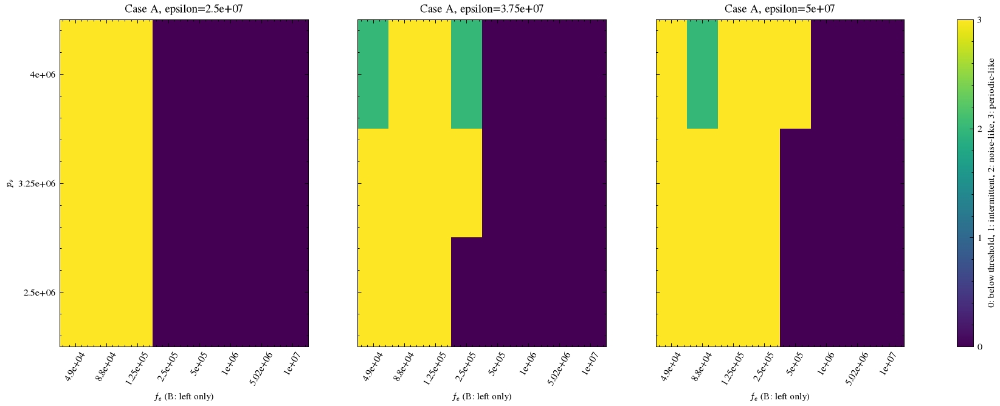
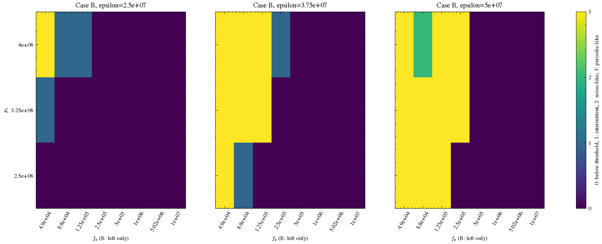
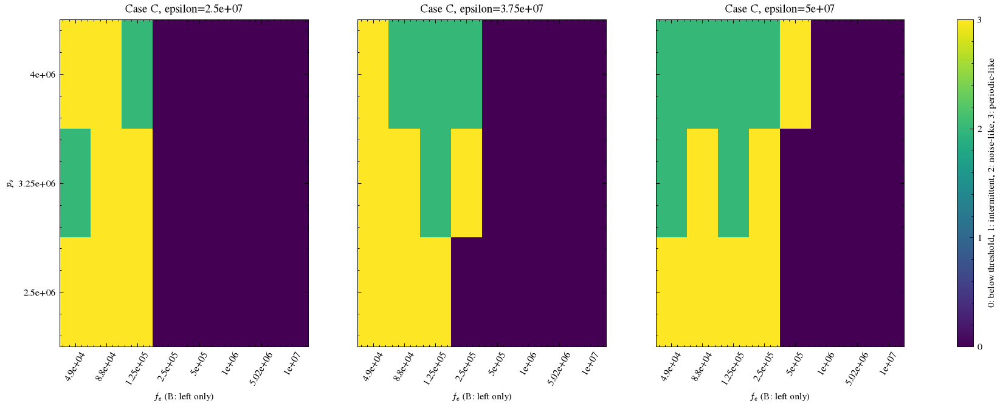
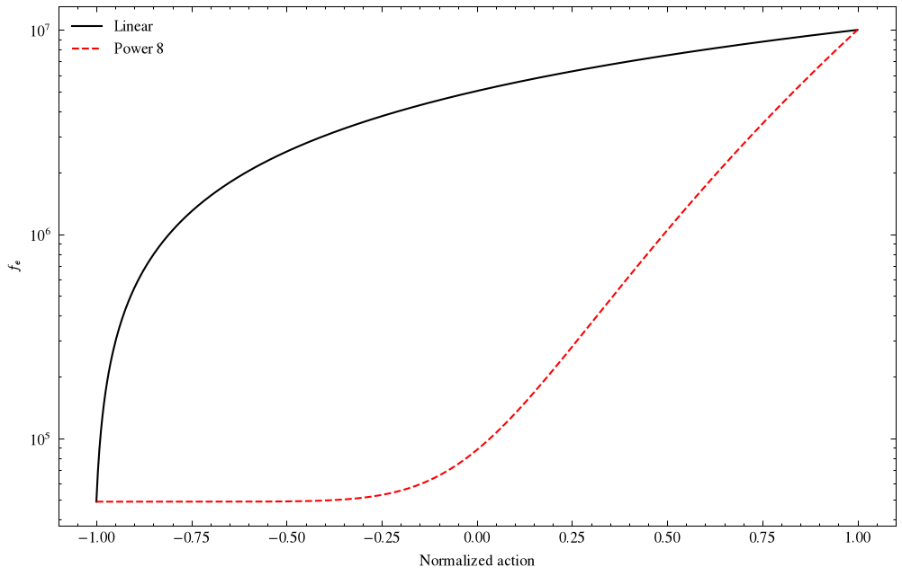

# Issue #9 対応レポート

2026-10-30 JST。対象: [Issue #9](https://github.com/tatsukawa0353/Birdsong_tatsukawa/issues/9)。

発声状態の診断、外力の写像の再設計、固定/可変の同予算比較、制御値の保存と図の修正を実施した。本Issueの診断・実装上の完了条件を満たす確認を行った。良好な模倣の獲得やCase間の普遍的な優劣の確立とは区別する。

実録音は許諾確認済みの0.35秒版のみを使用した。原音・録音由来の統計表・図・制御・WAV・学習モデルは `private_runs/` 管理を継続し、本レポートには転載しない。詳細は [ローカル限定レポート](../private_runs/issue9/REPORT.md)。GitHubへの投稿・push・Issueクローズは行っていない。

## 確認できたこと

- 従来の線形写像では正規化行動0が外力5,024,500になる。基準49,000から大きく離れ、今回の一定制御マップではこの値で持続発声が成立しなかった。これは単に表示レンジが狭いという問題ではない。
- 波形RMSが非ゼロでもDCオフセットや緩やかな過渡を含み得る。位置・速度の平均と標準偏差、音響帯域のRMS、時間区間別の統計、表示で見えるかを分けて診断する必要があった。
- Case Bではモデルが右外力を1e7へ上書きしていたが、従来の保存・図は上書き前の値になっていた。共通の制約解決処理と実適用履歴を導入し、この不一致を修正した。

## A. 発声・運動・表示の切り分け

同じPhase 2環境・フィルタで既知の一定制御を再生し、環境のstep経路と保存制御の再生経路で出力が一致することを確認した。両者は同じC++ APIを使用し、モデル方程式の独立した実装検証ではない。元の9実験についても保存制御を再生し、保存音声と `rtol=1e-10, atol=1e-12` で照合した。音声を書き換えて白い図を隠すような操作はしていない。

音声の全体RMS・最大絶対値・数学的に全ゼロか・絶対振幅の小ささに加え、0–0.05、0.05–0.1、0.1–0.2、0.2–0.35、0.1–0.35秒のRMS、平均、AC RMS、250–10000 Hzの帯域RMSを記録した。

`x_l,y_l,x_r,y_r` は全10 MHz積分点の平均と標準偏差をWelford法で測定し、区間を結合する際には区間平均の違いも含める。100 Hzの制御端点や位置RMSだけでは周期振動を判定しない。位置の平均はオフセット、標準偏差と速度変動は運動の参考値として分離する。制御が時変の場合に平均値を真の静止平衡と断定しない。

診断上の持続発声は、既知のCase A基準に対する帯域RMSが-60 dB以上、後半の20 ms区間の80%以上が同閾値を満たすことと定義した。速度標準偏差1.0を運動の参考閾値とした。これらは実験用の判定値であり、知覚上の無音・生体の開閉・厳密な分岐境界の定義ではない。雑音様でも持続帯域成分があれば除外しない。

対数図の後半で-50 dB以上の画素が見えるフレームの割合も別に記録した。音響の有無・源の運動・表示の白さ・模倣誤差をそれぞれ別の項目にした。SACの訓練中の数値発散回数と終了episode数をコールバックで集計し、評価時の失敗と区別する。

## B. 外力の役割と範囲

`f0` は内部変数名として保持し、研究上の外力 `f_e` に対応付ける。ラビアの開口幅そのもの、音響的な基本周波数F0、左右音源の器官数とは同一視しない。

現行コードの式は次のとおり（係数A=1）。

```text
dx_j/dt = y_j
dy_j/dt = -epsilon_j*x_j - b*y_j - c*x_j^2*y_j - f_e,j
          + p_s + (D*y_j-A)*(p_s-pi_tilde)
```

静止平衡では `epsilon_j*x_j = pi* - f_e,j`、`pi* = sum(alpha_j*x_j)/(1+gamma)`。`K=sum(alpha/epsilon)`, `Q=sum(alpha*f_e/epsilon)` とすると `pi*=-Q/(1+gamma-K)`。今回の範囲では分母が正で、正の外力を増やすと平衡位置は負方向へ移る。これは実装上の符号の確認であり、その向きを生体の閉鎖/開放へ直接読み替えない。`x0,h,M` は現行の微分式から参照されず、実際の開口幅をこの状態値だけから確定できない。

位置が変わると非線形減衰 `c*x^2*y` も変わる。p_sはA=1の静止式では相殺されても、速度項の係数に残る。したがってepsilon・p_s・外力の組合せで発声状態を調べた。全領域で単調に抑制するという仮定や、負の外力・未調査領域までの一般化はしていない。

### 一定制御マップ

A/B/C × epsilon 3値 × p_s 3値 × 外力8値の216条件、各0.35秒・dt=1e-7。左右epsilonは同値。A/Cは左右へ同じ外力、Bは左外力を掃引し右を1e7に固定した。初期0.1秒を除いて判定した。

| Case | 外力49,000で持続 | 88,000で持続 | 5,024,500で持続 | 1e7で持続 |
|---|---:|---:|---:|---:|
| A | 9/9 | 9/9 | 0/9 | 0/9 |
| B | 7/9 | 5/9 | 0/9 | 0/9 |
| C | 9/9 | 9/9 | 0/9 | 0/9 |

Case Bでは低い左外力でも全epsilon・p_s条件で持続するとは限らない。マップは既存の可動範囲内の粗い標本であり、発声可能域の完全な境界ではない。







全数値は [phonation_map.json](../results/issue9/phonation_map.json)、判定定義は [map_config.json](../results/issue9/map_config.json)。

### 写像の再設計

上限1e7を残し、発声停止側へも到達できる写像を用意した。

```text
u = (action + 1)/2
linear: f_e = 49000 + (10000000-49000)*u
power8: f_e = 49000 + (10000000-49000)*u^8
```

power8の行動0は87,871.09375。マップで調べた88,000に近く、行動中心を発声しやすい側へ移すために選んだ。指数8は生理学的な定数ではなく今回の数値的な設計値。旧範囲の端点は維持し、epsilon・p_sの範囲、RK4・遅延、報酬は変えていない。



実際の行動0の一定制御ではfixedとpower8がA/B/Cとも持続発声となり、linearはA/B/Cとも成立しなかった。詳細は [neutral_controls.json](../results/issue9/neutral_controls.json)。初期行動が必ずゼロになるようにSACを書き換えたわけではなく、学習前方策と探索ノイズの影響は比較実験に含めた。

### 同一予算の対照実験

fixed・linear・power8 × A/B/C × seed 0/1/2の27本を、SAC各1050環境step、同じ0.35秒目標・報酬・共通ゲイン・評価方法で実行した。評価時の探索ノイズは全て無効。fixedでは発声側の外力49,000を固定し、Bの右1e7は維持する。

自由度はfixedがA/B/C=2/3/3、linear・power8が3/4/5。固定対可変は自由度・観測次元も異なるため、外力の影響だけを単独で分離した因果推論ではない。linear対power8は各Caseで同じ自由度・seedの比較。長時間学習で問題を覆うことを避け、予算は旧実験と同じにした。

個別・集計の誤差、発声持続率、運動量、区間統計、発散回数、WAV、制御図は [非公開レポート](../private_runs/issue9/REPORT.md) に記載。実録音由来の表を公開レポートへコピーしない。固定は診断の対照であり、外力を恒久的に固定する結論ではない。

## C. 保存値と制御図

`effective_controls()` をモデル適用・decode・再生で共有し、Case Bの右1e7を必ず反映する。環境は設定要求とモデル適用後の値を別履歴として記録する。NPZの `requested_controls` が要求値、`physical_controls` が実適用値。保存時に行動から推測し直さず、実際の `model.controls` を保存する。

元の9実験は要求値を残したうえで制御メタデータを修復し、音声配列を保持した。左右の平均・標準偏差も再生から追加した。全A/B/C制御図は `$\varepsilon_l$`, `$\varepsilon_r$`, `$p_s$`, `$f_{e,l}$`, `$f_{e,r}$` の5系列とし、Bの右1e7を表示する。

軸ラベル46 pt、目盛38 pt、枠線2、内向き目盛長10、science/ieeeを共有関数で適用。5段の図で読めるよう図寸法を調整した。内部のf0名は変更せず互換性を保つ。公開の合成音の制御図も研究表記へ統一した。

スペクトログラムはユーザー指定の10 MHz・Blackman–Harris・245760/184320・gray_r・[-50,-20] dB・両端除外を維持し、表示の正規化を報酬へ持ち込んでいない。

## 検証と再実行

[issue9_validation.txt](issue9_validation.txt) に26テストの結果。既存回帰に加え、A/B/Cの設定要求と実適用値、固定/可変自由度、power写像の端点・中点・逆変換、全積分点の統計と密サンプルの一致、位置オフセットと運動の区別、雑音様の保持、訓練中の数値発散カウントを検証した。

```bash
export MPLCONFIGDIR=/tmp/birdsong-mpl
Deeplearning/.venv/bin/python -m Deeplearning.issue9 all --local-permission-confirmed
Deeplearning/.venv/bin/python -m unittest discover -s Deeplearning/tests -v
```

部分実行は `map`, `neutral`, `history`, `train`, `report`。設定は [issue9.json](../configs/issue9.json)、コードと設定のハッシュは [provenance.json](../results/issue9/provenance.json)。完了済み学習は同じ設定なら再利用し、異なる設定の上書きを拒否する。履歴修復は既存NPZの制御値・診断メタデータを更新するので、旧要求値を残す。

Phase 2にも `force_variant` を追加し、[phase2_fixed.json](../configs/phase2_fixed.json) と [phase2_power8.json](../configs/phase2_power8.json) から選べるようにした。旧phase2.jsonの既定動作は再現用に残した。診断の固定条件を研究全体へ強制していない。

## 完了条件と限界

1. 保存済み実験の区間統計・全積分点の運動・表示可視性を分離し、既知制御で同じ出力経路を検証した。
2. 式の符号、216条件のマップ、行動0の検証、固定/可変の同予算比較を残した。
3. 実適用値を保存・描画し、Bの右固定値と5つの研究表記を回帰テストした。
4. 公開可能なコード・合成診断と、非公開の録音由来結果を分離した。

0.35秒・粗い範囲・3 seedの診断であり、全ての発声開始/停止境界や生理学的な開閉を説明しない。部分観測、振幅校正、声道フィルタ差、報酬設計、学習予算の影響は残る。持続発声が戻ったことと模倣が成功したことを区別し、#6・#7の到達精度と学習効率の検証を継続する。
