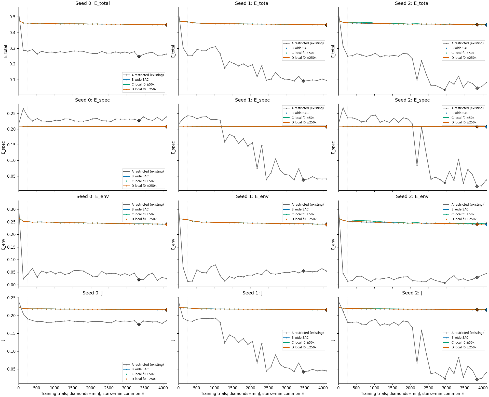
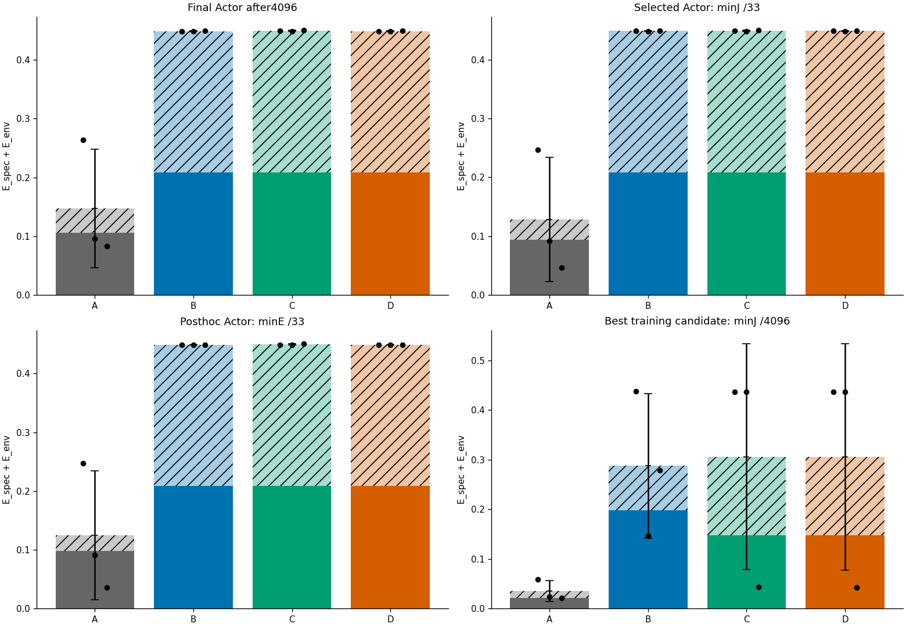
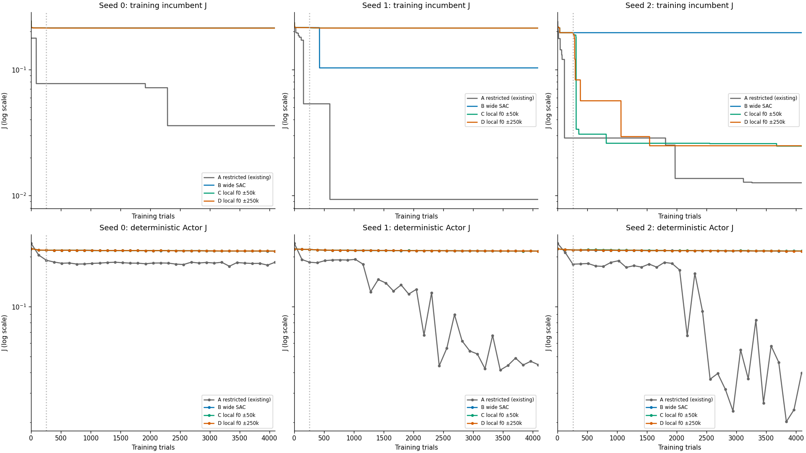
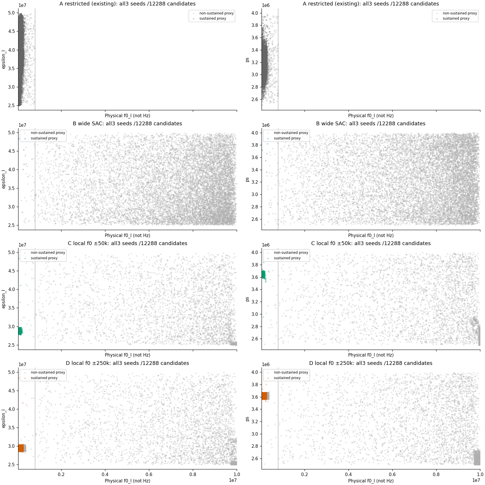
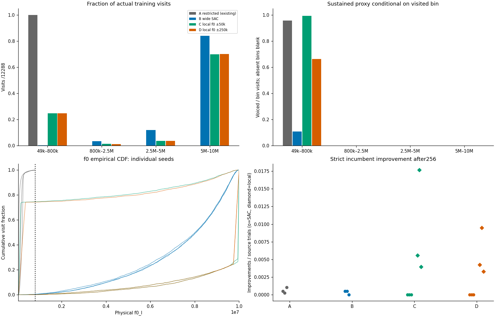
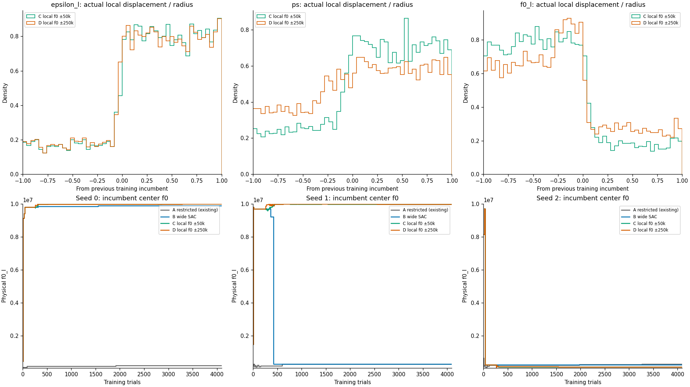
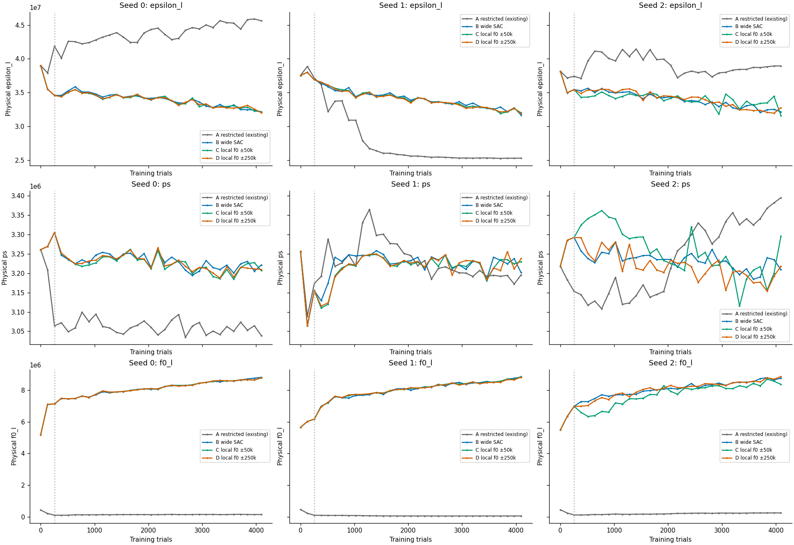
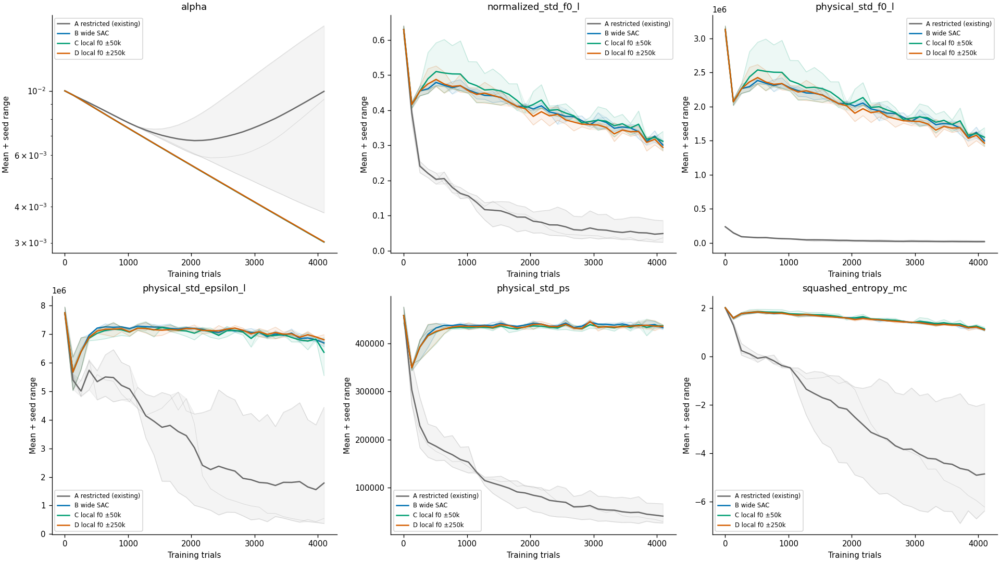
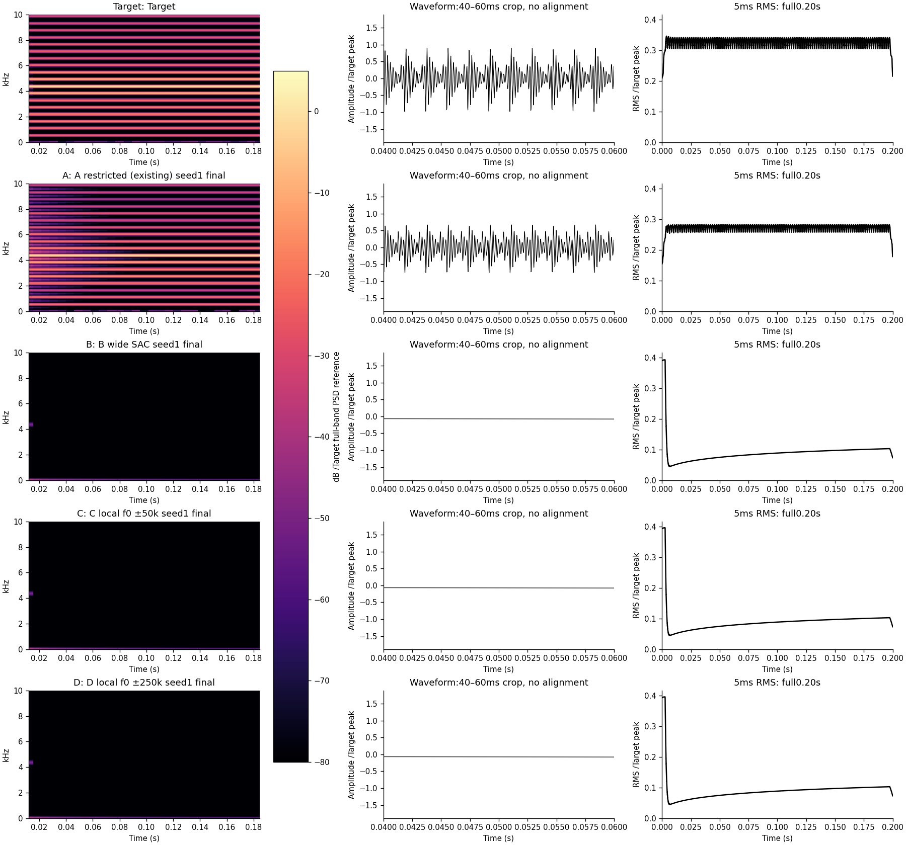
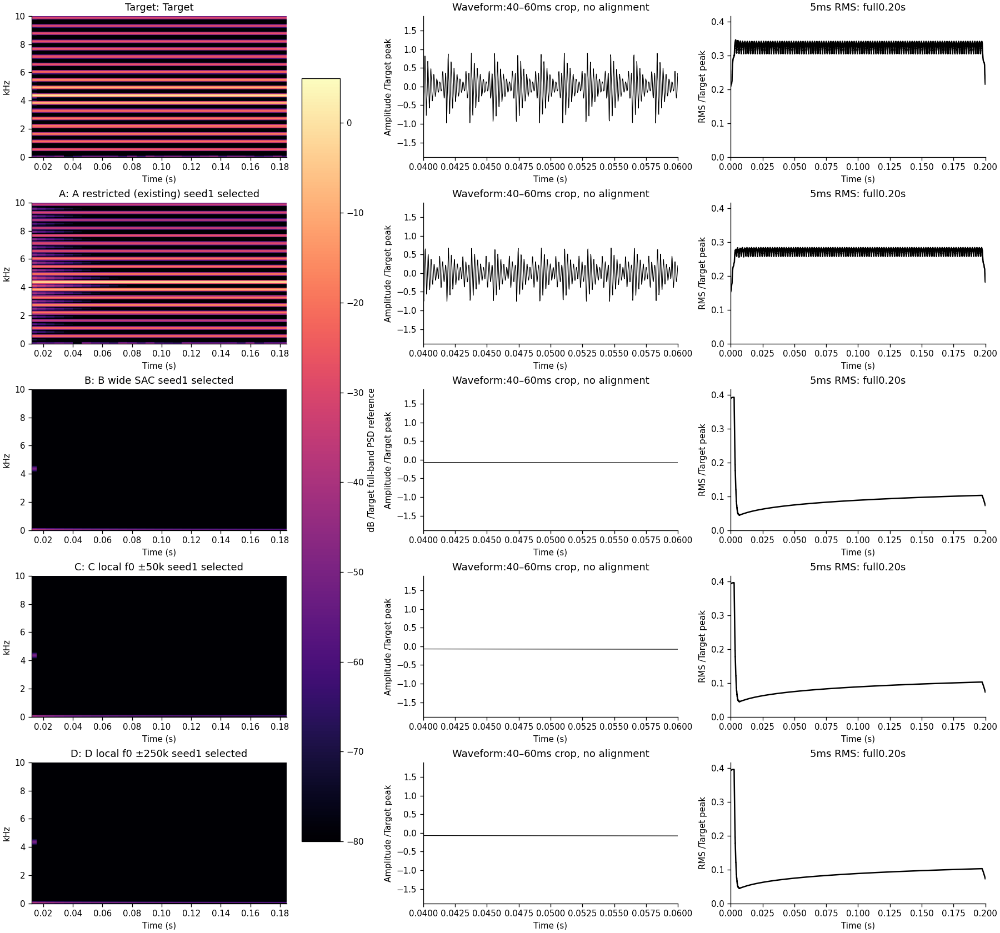

# Issue26 — Case A：f0広域探索と連続局所候補

> 2026-11-26 成果物整理：本文の計算結果・実施/未実施は当時の記録です。現在の配置・削除した再生成図・hash検証は[移行記録](../../../maintenance/20261126/README.md)を参照。旧manifest/hashは原本を維持しています。

## 結果と判断

このTarget・4096候補・3seedでは、広域通常SACと2種類の局所探索はいずれもFinal精度を改善しなかった。Final共通E平均±標本SDはA（既存制限域）0.14745±0.10074、B（広域通常）0.44885±0.00035、C（局所f0±50000）0.44948±0.00111、D（±250000）0.44894±0.00025。持続proxyはAが3/3、B/C/Dは各0/3。C/Dの小さな平均差から幅の優劣を採用判断する根拠は得られない。

**発見はseedに依存した。** B/C/D共通の最初256試行の最良候補は、seed0/1がf0約981万/970万の非持続、seed2が約22.8万の持続候補だった。C/Dのseed0/1は非持続の高域中心に留まり、最良Jは約0.2132。seed2はprefix J=0.19603からC=0.024704（3677試行、E=0.04317）、D=0.024865（1545試行、E=0.04220）まで改善した。事前の「prefix最良Jから半減」はCが312試行、Dが297試行で到達。幅を広げたDはこのseedで早く発見した一方、local候補の持続数はC3033/3034、D2023/3034だった。1seedの発見時刻・発声率を全seedの改善へ一般化しない。

**発見がActorへ移った証拠はなかった。** 広域9runの33評価点では、初期Actor Eから半減する相対基準は全run未到達。BはSelected/posthocもFinalと同じで、C/Dも保存方策の共通Eは約0.449のままだった。学習候補の低JをそのままActorが出せるとは言えず、SelectedからFinalへの劣化だけで今回の差を説明できない。prefix Jの1.25倍以内という基準は広域全seedが256時点で満たしたが、prefix自体の精度が低く、この到達は高精度模倣を意味しない。

**局所探索の停滞を保持した。** C/Dの257以降のlocal率は同じseedで79.53%／79.61%／79.01%、残りが通常SAC。後半の厳密なincumbent改善はCがseed順17/54/12件、Dが13/29/10件で、全件local由来だった。seed1の多くのhitも非持続のままの小改善であり、hit数を良い発声の発見数と同一視しない。連続試行のf0差は半径を超える例が各run1274〜2030件あり、局所幅を隣接試行差の制約にしていない。実局所偏差は全件半径・全体範囲内、丸め超過による再抽選は研究runで0件だった。

**非持続と無音を区別する。** 今回訪問したf0>800000の候補に持続proxy陽性はなかったが、generated_silent判定は全研究候補で0件だった。高域で非持続が多いという訪問結果であり、800000超の全物理領域が無音・不要という結論ではない。特にC/D seed0/1はε_lとp_sの下限近傍・f0上限近傍へ集中した。ε_l/p_sとの同時訪問と方策による標本の偏りを含めて読む。

今回得られたのは、全域へ戻すだけでは通常SACのFinalが改善せず、minJ中心のlocal80%は良い初期候補があるseedの発見を進めても、悪い中心の脱出やActorへの転写を保証しないという結果である。新規計算・救済・幅調整を追加せず、全9runを同じ凍結計画で残した。Case A全体の総括・教員共有と、Case B自身のTargetを使う仕様へのIssue20改訂は次の作業に分ける。

新規9runは完了9・失敗0。[通常SACを先に実行した記録](STAGE_B.md)の後、C/D全6runを実施した。E_total≤.10は目標・合否・追加計算のゲートに使っていない。3seed・同一Target・固定予算の範囲での比較である。

## 比較条件と固定要素

| 条件 | f0_lの全体範囲 | 257試行以降 | f0局所半径 |
|---|---|---|---|
| A | [49000,800000] | 通常SAC、Issue23読み取り専用・新規0本 | — |
| B | [49000,10000000] | 通常SAC | — |
| C | Bと同じ | local80% / 通常SAC20% | ±50000 |
| D | Bと同じ | local80% / 通常SAC20% | ±250000 |

A/Bは範囲、B対C/Dはoff-policy行動データ生成アルゴリズム、C/Dはf0局所半径だけの比較。localのε_l半径±625000、p_s半径±37500は共通。通常SAC20%は全域の候補生成可能性を残すが、一様被覆は保証しない。局所幅は格子刻み・隣接試行の変化上限・波形内の変化速度ではない。float32正規化に伴う有限精度はある。

Case A（右音響寄与α_r=β_r=0）、一定3D、1episode1行動、0.20s/50kHz/10000sample、native dt1e-7、x0=.02cm/D=.01、初期状態/遅延0。同一保存Target、ε_l[2.5e7,5e7]、p_s[2.5e6,4e6]、右ε_r3.5e7/f0_r49000を固定。f0_lはHzではなく開閉外力係数。p_s/εを実測Pa/張力と同一視しない。

r=−J、J=.75E_spec+.25E_env、係数和1・2倍補正なし。共通E_total=E_spec+E_env。Actor/Critic[128,128]、3optimizer LR3e-4、auto_0.01/target_entropy−3、batch32/buffer50000/warmup16/gamma1/train_freq1/gradient_steps1、tau/target更新/CPU1threadを維持。[凍結計画](PLAN.md) / [manifest](manifest.json) / [実効設定](runs/B/seed_0/config.json)。

## 候補・Replay・乱数の監査

最初256試行は全B/C/Dで標準SAC。warmupは16のまま、17試行目から通常更新する。事前の3seed×標準SAC/B/C/Dで行動・報酬・全重み・optimizer・Replay・RNGが一致。正式C/DもBに対して最初256件と128/256時点の全学習器署名が一致した。[事前試験](test_execution.json) / [正式prefix照合](prefix_checks.csv)。

毎試行、標準SAC提案を先に生成し、local時だけ実行行動とReplay行動の両方を置換。未実行SAC提案は別欄に記録する。中心は過去の実学習候補の最初minJで、失敗/非持続も除外せず同点は先着。独立Actor評価とTargetの既知制御は中心に使わない。各座標の[中心±半径]∩全体範囲で連続一様抽選し、クリップしない。正規化float32の丸めで区間を出たときだけ物理計算前に再抽選する。

選択PCG64 seed260026+seed、候補PCG64 seed260126+seedを分離し、学習Python/NumPy/Torch RNGを消費しない。最初256は両RNG未消費、後半C/Dは同じ選択系列。33独立評価・ログ・保存の前後で学習器/Replay/両local RNG/中心が不変。実行行動・適用物理値・Replay行動/報酬を新規36864件で検査し、全local提案と中心更新を保存ログから再構成した。[sampler監査](sampler_checks.csv) / [run会計](run_accounting.csv) / [完全ログ例](runs/C/seed_0/training_trace.json.gz)。

全更新前後でLR・勾配・重み・Adam状態を観測。非有限、負の二次moment、勾配L2>1e6、パラメータ絶対値>1e6、moment絶対値>1e12で停止し、失敗runを保持する。クリップや収束判定ではない。停滞時の再始動、幅調整、oracle初期化、追加最適化は行わない。

## Final・保存方策・学習候補

Final=4096終了後のActor。Selected=0,128,...,4096の33独立評価の最初minJ。posthoc=同33点の最初min共通E。training_best=4096実学習候補の最初minJで、Actor checkpointではない。保存方策へ復帰しない。3seed平均±標本SD（ddof=1）を示す。失敗seedを含む3seed Final平均は未定義とし、完了seedだけの平均へ置換しない。

| 条件 | 採用 | E_total平均±SD | E_spec平均±SD | E_env平均±SD | J平均±SD | 持続/3 |
| --- | --- | --- | --- | --- | --- | --- |
| A | final | 0.14745 ± 0.10074 | 0.10602 ± 0.11515 | 0.04142 ± 0.01547 | 0.08987 ± 0.08274 | 3 |
| A | selected | 0.12841 ± 0.10537 | 0.09367 ± 0.11591 | 0.03474 ± 0.01763 | 0.07894 ± 0.08415 | 3 |
| A | posthoc | 0.12484 ± 0.10961 | 0.09762 ± 0.11213 | 0.02723 ± 0.02444 | 0.08002 ± 0.08303 | 3 |
| A | training_best | 0.03499 ± 0.02112 | 0.02107 ± 0.01858 | 0.01391 ± 0.00554 | 0.01928 ± 0.01446 | 3 |
| B | final | 0.44885 ± 0.00035 | 0.20842 ± 0.00002 | 0.24043 ± 0.00033 | 0.21642 ± 0.00010 | 0 |
| B | selected | 0.44885 ± 0.00035 | 0.20842 ± 0.00002 | 0.24043 ± 0.00033 | 0.21642 ± 0.00010 | 0 |
| B | posthoc | 0.44885 ± 0.00035 | 0.20842 ± 0.00002 | 0.24043 ± 0.00033 | 0.21642 ± 0.00010 | 0 |
| B | training_best | 0.28798 ± 0.14573 | 0.19772 ± 0.06071 | 0.09026 ± 0.12134 | 0.17086 ± 0.05936 | 2 |
| C | final | 0.44948 ± 0.00111 | 0.20844 ± 0.00004 | 0.24104 ± 0.00107 | 0.21659 ± 0.00030 | 0 |
| C | selected | 0.44940 ± 0.00097 | 0.20844 ± 0.00003 | 0.24096 ± 0.00094 | 0.21657 ± 0.00026 | 0 |
| C | posthoc | 0.44940 ± 0.00097 | 0.20844 ± 0.00003 | 0.24096 ± 0.00094 | 0.21657 ± 0.00026 | 0 |
| C | training_best | 0.30587 ± 0.22751 | 0.14780 ± 0.10390 | 0.15807 ± 0.12361 | 0.15037 ± 0.10883 | 1 |
| D | final | 0.44894 ± 0.00025 | 0.20843 ± 0.00002 | 0.24051 ± 0.00024 | 0.21645 ± 0.00007 | 0 |
| D | selected | 0.44885 ± 0.00014 | 0.20841 ± 0.00001 | 0.24044 ± 0.00014 | 0.21642 ± 0.00003 | 0 |
| D | posthoc | 0.44885 ± 0.00014 | 0.20841 ± 0.00001 | 0.24044 ± 0.00014 | 0.21642 ± 0.00003 | 0 |
| D | training_best | 0.30556 ± 0.22808 | 0.14807 ± 0.10344 | 0.15749 ± 0.12464 | 0.15043 ± 0.10874 | 1 |

持続proxyは末尾1000sampleのAC標準偏差/Target peak>.05かつ数値失敗なしで、生理的有声判定ではない。[全成分・全制御](endpoints.csv) / [対応seed差](paired_differences.csv)。

| 条件 | seed | 採用 | 試行 | E_total | J | 持続 | ε_l | p_s | f0_l |
| --- | --- | --- | --- | --- | --- | --- | --- | --- | --- |
| A | 0 | final | 4096 | 0.263524 | 0.185370 | True | 45617861 | 3039182 | 160471 |
| A | 0 | selected | 3328 | 0.247292 | 0.175328 | True | 45639595 | 3041675 | 152838 |
| A | 0 | posthoc | 3328 | 0.247292 | 0.175328 | True | 45639595 | 3041675 | 152838 |
| A | 0 | training_best | 2290 | 0.059350 | 0.035877 | True | 34884590 | 3247532 | 186952 |
| A | 1 | final | 4096 | 0.095990 | 0.044527 | True | 25307700 | 3195383 | 68817 |
| A | 1 | selected | 3456 | 0.091367 | 0.041333 | True | 25334943 | 3191760 | 65837 |
| A | 1 | posthoc | 3456 | 0.091367 | 0.041333 | True | 25334943 | 3191760 | 65837 |
| A | 1 | training_best | 597 | 0.023746 | 0.009333 | True | 39673457 | 3315890 | 279397 |
| A | 2 | final | 4096 | 0.082830 | 0.039724 | True | 38948223 | 3394397 | 256772 |
| A | 2 | selected | 3840 | 0.046562 | 0.020147 | True | 38825098 | 3367463 | 257228 |
| A | 2 | posthoc | 2944 | 0.035871 | 0.023394 | True | 37912109 | 3293264 | 249177 |
| A | 2 | training_best | 3263 | 0.021868 | 0.012642 | True | 39516538 | 3359137 | 275136 |
| B | 0 | final | 4096 | 0.448948 | 0.216450 | False | 32171091 | 3221086 | 8801941 |
| B | 0 | selected | 4096 | 0.448948 | 0.216450 | False | 32171091 | 3221086 | 8801941 |
| B | 0 | posthoc | 4096 | 0.448948 | 0.216450 | False | 32171091 | 3221086 | 8801941 |
| B | 0 | training_best | 1551 | 0.438118 | 0.213480 | False | 25140629 | 2817277 | 9889950 |
| B | 1 | final | 4096 | 0.448454 | 0.216311 | False | 31683919 | 3201289 | 8818046 |
| B | 1 | selected | 4096 | 0.448454 | 0.216311 | False | 31683919 | 3201289 | 8818046 |
| B | 1 | posthoc | 4096 | 0.448454 | 0.216311 | False | 31683919 | 3201289 | 8818046 |
| B | 1 | training_best | 423 | 0.147089 | 0.103052 | True | 39994167 | 3359543 | 272811 |
| B | 2 | final | 4096 | 0.449135 | 0.216497 | False | 32140818 | 3208783 | 8754618 |
| B | 2 | selected | 4096 | 0.449135 | 0.216497 | False | 32140818 | 3208783 | 8754618 |
| B | 2 | posthoc | 4096 | 0.449135 | 0.216497 | False | 32140818 | 3208783 | 8754618 |
| B | 2 | training_best | 37 | 0.278741 | 0.196035 | True | 28533821 | 3548141 | 228165 |
| C | 0 | final | 4096 | 0.449116 | 0.216492 | False | 32159360 | 3206665 | 8761252 |
| C | 0 | selected | 4096 | 0.449116 | 0.216492 | False | 32159360 | 3206665 | 8761252 |
| C | 0 | posthoc | 4096 | 0.449116 | 0.216492 | False | 32159360 | 3206665 | 8761252 |
| C | 0 | training_best | 3286 | 0.437221 | 0.213201 | False | 25001720 | 2505835 | 9999698 |
| C | 1 | final | 4096 | 0.448606 | 0.216359 | False | 32017967 | 3229819 | 8850245 |
| C | 1 | selected | 4096 | 0.448606 | 0.216359 | False | 32017967 | 3229819 | 8850245 |
| C | 1 | posthoc | 4096 | 0.448606 | 0.216359 | False | 32017967 | 3229819 | 8850245 |
| C | 1 | training_best | 2461 | 0.437233 | 0.213204 | False | 25000094 | 2504690 | 9996158 |
| C | 2 | final | 4096 | 0.450728 | 0.216926 | False | 31625102 | 3295055 | 8363342 |
| C | 2 | selected | 3840 | 0.450484 | 0.216860 | False | 33478044 | 3155936 | 8686586 |
| C | 2 | posthoc | 3840 | 0.450484 | 0.216860 | False | 33478044 | 3155936 | 8686586 |
| C | 2 | training_best | 3677 | 0.043167 | 0.024704 | True | 28898651 | 3627266 | 113417 |
| D | 0 | final | 4096 | 0.448928 | 0.216441 | False | 32032277 | 3209395 | 8779595 |
| D | 0 | selected | 4096 | 0.448928 | 0.216441 | False | 32032277 | 3209395 | 8779595 |
| D | 0 | posthoc | 4096 | 0.448928 | 0.216441 | False | 32032277 | 3209395 | 8779595 |
| D | 0 | training_best | 3286 | 0.437226 | 0.213202 | False | 25001720 | 2506277 | 9998495 |
| D | 1 | final | 4096 | 0.448693 | 0.216382 | False | 31878406 | 3237699 | 8810268 |
| D | 1 | selected | 4096 | 0.448693 | 0.216382 | False | 31878406 | 3237699 | 8810268 |
| D | 1 | posthoc | 4096 | 0.448693 | 0.216382 | False | 31878406 | 3237699 | 8810268 |
| D | 1 | training_best | 2552 | 0.437263 | 0.213213 | False | 25031312 | 2511272 | 9996302 |
| D | 2 | final | 4096 | 0.449200 | 0.216522 | False | 32770646 | 3217593 | 8849712 |
| D | 2 | selected | 3840 | 0.448925 | 0.216433 | False | 32081474 | 3153526 | 8774576 |
| D | 2 | posthoc | 3840 | 0.448925 | 0.216433 | False | 32081474 | 3153526 | 8774576 |
| D | 2 | training_best | 1545 | 0.042204 | 0.024865 | True | 29300351 | 3632133 | 117470 |

## 発見・Actor獲得・Final保持

結果前に相対到達基準を固定した。(1)257以降の学習J≤prefix256 minJ×.5、(2)Actor E≤自身の初期Actor E×.5、(3)256以降のActor J≤自身のprefix256 minJ×1.25。Aは自身の既存prefix、B/C/Dはseed内で同一prefix。いずれも記述指標で合否・追加計算のゲートではない。「未到達」は4096候補/33観測の範囲で未観測。

prefix自体が悪いseedでは基準(3)も緩いため、これを満たすことと高精度模倣の獲得は同じではない。A/Bでは初期Eとprefixも異なる。C/D/Bは同一seedで同じprefixを使うが、絶対的な音響誤差と発声を併記して判断する。

| 条件 | seed | prefix256 minJ | 学習J半減の初回 | Actor E初期比半減の初回 | Actor J≤prefix×1.25初回 | Final J / prefix | Selected−Final E |
| --- | --- | --- | --- | --- | --- | --- | --- |
| A | 0 | 0.077389 | 2290 | 512 | 未到達 | 2.395 | -0.016232 |
| A | 1 | 0.053491 | 597 | 256 | 2432 | 0.832 | -0.004623 |
| A | 2 | 0.028640 | 1973 | 256 | 2816 | 1.387 | -0.036268 |
| B | 0 | 0.213664 | 未到達 | 未到達 | 256 | 1.013 | -0.000000 |
| B | 1 | 0.215095 | 423 | 未到達 | 256 | 1.006 | -0.000000 |
| B | 2 | 0.196035 | 未到達 | 未到達 | 256 | 1.104 | -0.000000 |
| C | 0 | 0.213664 | 未到達 | 未到達 | 256 | 1.013 | -0.000000 |
| C | 1 | 0.215095 | 未到達 | 未到達 | 256 | 1.006 | -0.000000 |
| C | 2 | 0.196035 | 312 | 未到達 | 256 | 1.107 | -0.000243 |
| D | 0 | 0.213664 | 未到達 | 未到達 | 256 | 1.013 | -0.000000 |
| D | 1 | 0.215095 | 未到達 | 未到達 | 256 | 1.006 | -0.000000 |
| D | 2 | 0.196035 | 297 | 未到達 | 256 | 1.105 | -0.000275 |

Selected−Final Eが負ならminJ保存ActorよりFinalの共通Eが悪い。J/Eの基準差を残すためJ比も[到達・保持CSV](arrivals_and_retention.csv)へ保存。良い学習候補からActorの獲得を推論せず、33点の間の未観測方策に到達時刻を割り当てない。

## 訪問領域と局所候補

| 条件 | seed | 発声数/4096 | f0中央値 | >800k 訪問数/発声数 | >2.5M 訪問数/発声数 | >5M 訪問数/発声数 |
| --- | --- | --- | --- | --- | --- | --- |
| A | 0 | 3927 | 152311 | 0/0 | 0/0 | 0/0 |
| A | 1 | 3937 | 70777 | 0/0 | 0/0 | 0/0 |
| A | 2 | 3894 | 228339 | 0/0 | 0/0 | 0/0 |
| B | 0 | 1 | 8051600 | 4082/0 | 3955/0 | 3463/0 |
| B | 1 | 1 | 8007525 | 4079/0 | 3902/0 | 3411/0 |
| B | 2 | 3 | 8067709 | 4081/0 | 3960/0 | 3462/0 |
| C | 0 | 1 | 9966247 | 4092/0 | 4056/0 | 3910/0 |
| C | 1 | 0 | 9962050 | 4093/0 | 4026/0 | 3877/0 |
| C | 2 | 3038 | 129015 | 1042/0 | 973/0 | 804/0 |
| D | 0 | 1 | 9834588 | 4092/0 | 4056/0 | 3910/0 |
| D | 1 | 0 | 9832982 | 4093/0 | 4025/0 | 3878/0 |
| D | 2 | 2025 | 264397 | 1053/0 | 999/0 | 845/0 |

f0の固定区間[49k,800k]、(800k,2.5M]、(2.5M,5M]、(5M,10M]で訪問数と条件付き発声率を集計。ε_l/p_sとの同時訪問を示す。方策に偏った標本であり一様な物理領域調査ではない。高f0を一括して無音/不要と断定しない。[分布・分位点](candidate_distribution.csv) / [区間集計](f0_bins.csv) / [全候補](training_candidates.csv.gz)。

| 条件 | seed | local件数 | 257以降のlocal率 | 再抽選数 | 連続f0差>局所半径 | 最長中心停滞 |
| --- | --- | --- | --- | --- | --- | --- |
| C | 0 | 3054 | 0.795 | 0 | 1417 | 2091 |
| C | 1 | 3057 | 0.796 | 0 | 1439 | 1636 |
| C | 2 | 3034 | 0.790 | 0 | 2030 | 1738 |
| D | 0 | 3054 | 0.795 | 0 | 1306 | 1362 |
| D | 1 | 3057 | 0.796 | 0 | 1274 | 1935 |
| D | 2 | 3034 | 0.790 | 0 | 1513 | 2552 |

localの期待率は257以降80%・全4096で75%。hitは直前incumbent Jを厳密に改善した件数で、異なる候補源の分布を調整した因果効果ではない。半径に対する実偏差、境界区間の短縮、丸め、連続試行差、中心停滞を保持する。[候補源別](behavior_sources.csv) / [局所要約](local_sampling_summary.csv) / [全局所偏差](local_displacements.csv.gz) / [中心履歴](center_history.csv)。

## Actorと探索尺度

33点でalpha、潜在mean/std、tanh後std、entropyを保存。tanh後統計は同じlocal seed220026・MC4096で推定し、学習RNGを使わない。alphaとstdは別量で、微分entropyは負にもなる。f0正規化半幅はA375500・B/C/D4975500なので、同じ正規化stdでも物理stdは異なる。local候補分布とActor stdも別量。[方策推移](policy_dynamics.csv)。

全4080 Actor更新/runの前後の正規化/物理移動量と実際のbatch lossを保存し、128試行区間の経路長と正味移動を分離した。異なる単位の物理差を直接L2合成しない。[全更新](actor_updates.csv.gz) / [区間統計](update_intervals.csv)。

## 音・独立再生・計算量

seed1は[新規結果前の表示計画](display_plan.json)で代表例に固定。FinalとSelectedを別図にし、全seedのfloat64生波形/制御は[sound index](sound_index.csv)で参照する。共通gain=1/Target peakのfloat32 [WAV一式](listening_wav.zip)と[index](wav_index.csv)を保存。個別正規化・クリップ・位相合わせはない。振幅1超もfloat値を保持する。

STFTは表示用10MHz再サンプリング、Blackman-Harris245760/overlap184320、完全窓のみ、0–10kHz。Target全帯域PSDを唯一の色基準にし、全endpoint共通の色/波形/RMS軸を使用。表示再サンプリングによる新情報はない。波形のみ40–60ms、5ms RMSは全0.20秒。[表示設定](display_settings.json)。

保存Actor39本（4条件×3seed×Final/Selected/posthoc＋B prefix256の3本）と学習best行動12件を独立再生し、行動/物理制御/波形/Jが完全一致。Aの学習best音は本成果物内へ新規保存した。[再生チェック](model_replay_checks.csv) / [監査](audit.json)。

| 計算区分 | 新規件数 |
|---|---:|
| フル学習 | 9×4096 = 36864候補 |
| 独立Actor評価 | 9×33 = 297音 |
| optimizer更新 | 各Actor/Critic/温度 36720回 |
| 研究runの生成音 | 37161音 |
| 独立再生監査 | 51音 |
| 事前native試験・限定再検査 | 121音 |
| 今回native合計 | 37333音、74,666,000,000 steps（全件正常時） |
| synthetic試験 | 6208候補、native0 |
| 純局所抽選試験 | 16384件、native0 |
| Target再生成・追加グリッド・追加最適化 | 0 |

native block数・積分時間・Replay件数は各summaryと[会計](run_accounting.csv)に保存。[wide](wide_execution.json) / [local](local_execution.json) / [全実行](execution.json)。事前試験のNumPy許容誤差表示の不備はテスト内で修正し、限定再検査分を上の件数に含めた。研究設定は変えていない。

## 来歴・保存と次の作業

Issue18/22/23/25のTargetと物理/音響コードを検査。Issue18の当時のlibrary hashはx0格納値.04→.02の変更前なので現行と異なる。既存Issue19 gateで格納のみ・保存波形一致が確認されており、旧manifest更新や旧音再生成はしていない。[参照監査](reference_audit.json)。

再生監査の完了後、CSV集計の列参照名だけを修正した。監査時の[実行ソース](sources/issue26_analysis_at_audit.py)を保持し、集計関数以外の構文木が現行と同一であることを保護検査で確認する。学習・再生監査を再実行せず、追加native音は0件。

既存6044ファイルはhash一致・変更/削除0。root READMEの索引と.gitignoreの作業ログ除外のみ変更した。[保護検査](integrity.json) / [実装hash](implementation_checksums.json) / [成果物hash](artifact_checksums.json) / [再現手順](REPRODUCE.md)。commit/push、Issueコメント/close、教員への送信はしていない。

Case A全体の総括・教員共有、Case B自身のTarget生成とIssue20旧共通Case A Target仕様の改訂は次の作業。今回はCase B、時変、実録音、別reward/LR/entropy、追加の中心救済を実行していない。

<!-- ISSUE26_STORAGE_BEGIN -->
| 対象 | 着手前 | 完了時 |
| --- | --- | --- |
| 通常ファイル数 | 7808 | 8011 |
| 論理容量（ignored含む） | 827.86 MB | 872.60 MB |
| Git新規追加候補 | 0（クリーン） | 197個 / 44.73 MB |
| 既存追跡ファイル変更 / 削除 | 0 / 0 | 2 / 0 |
<!-- ISSUE26_STORAGE_END -->
