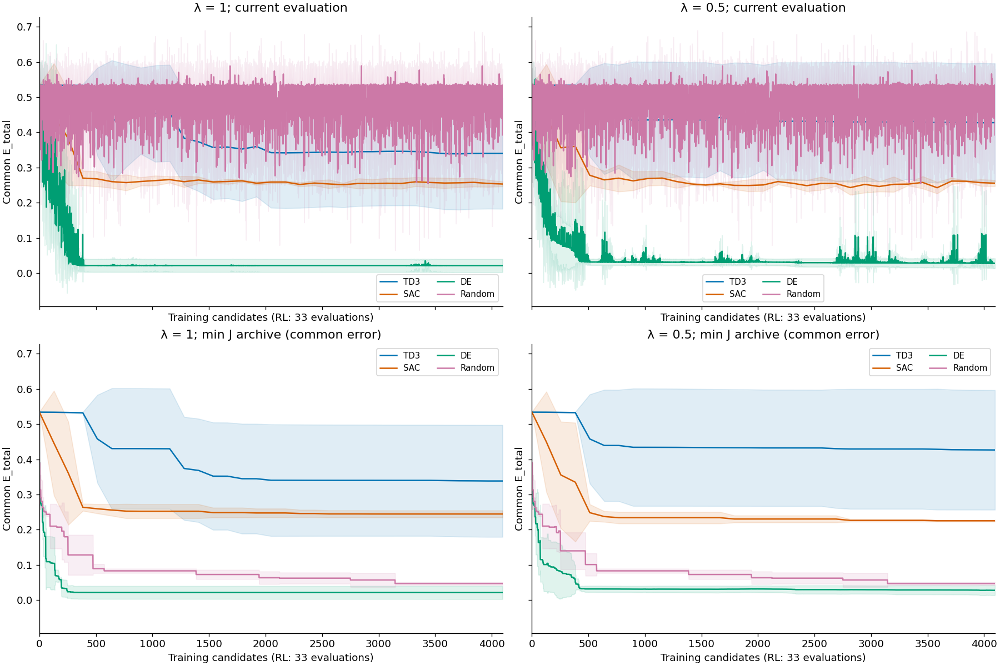
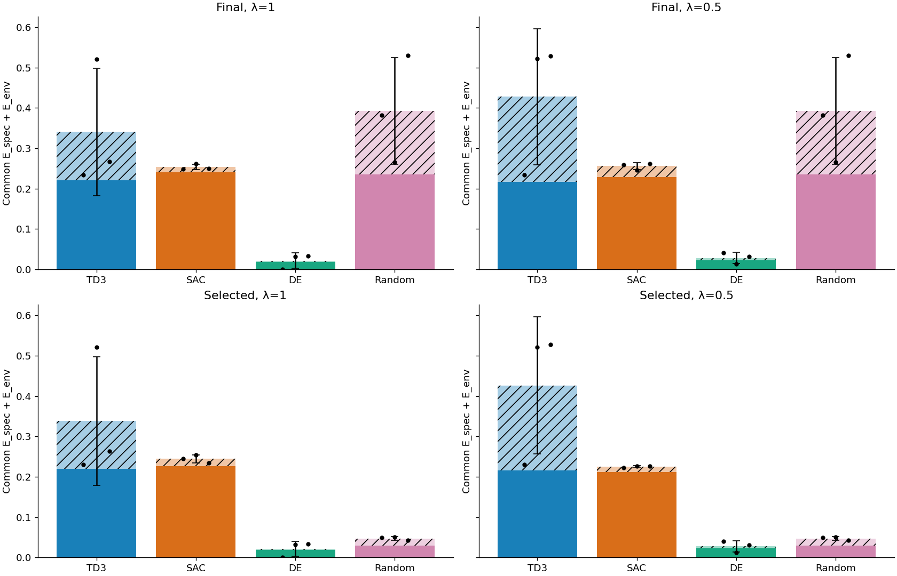
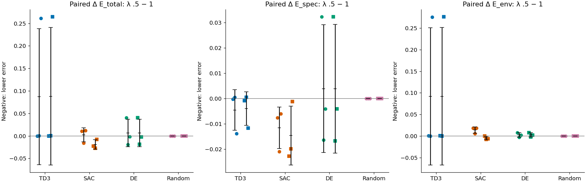
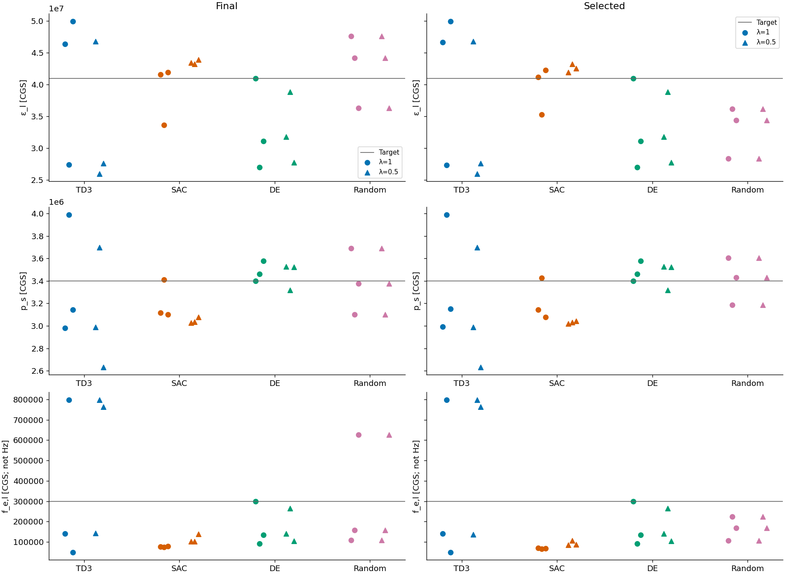
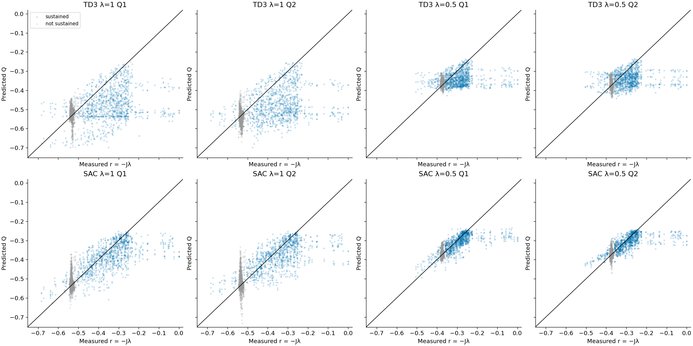
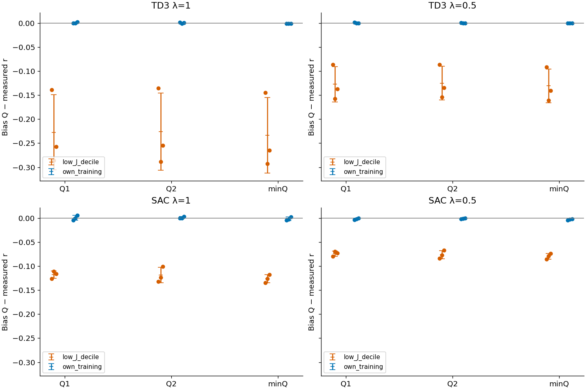
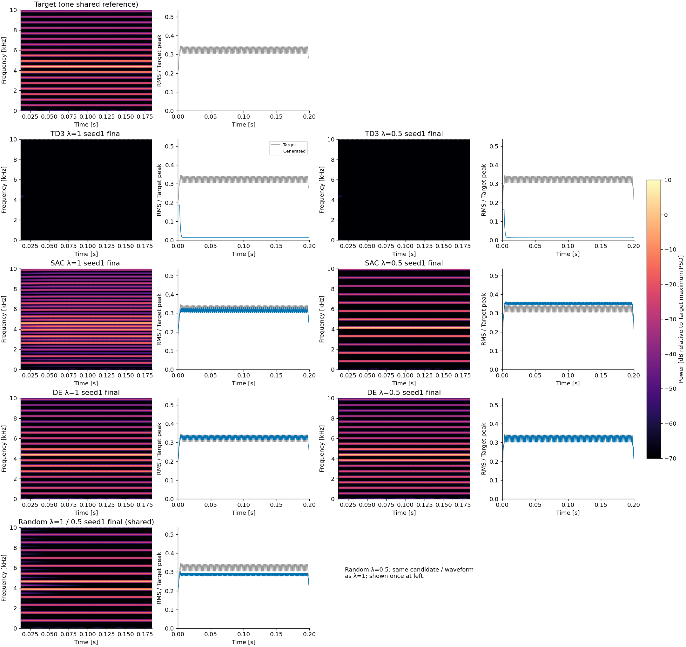
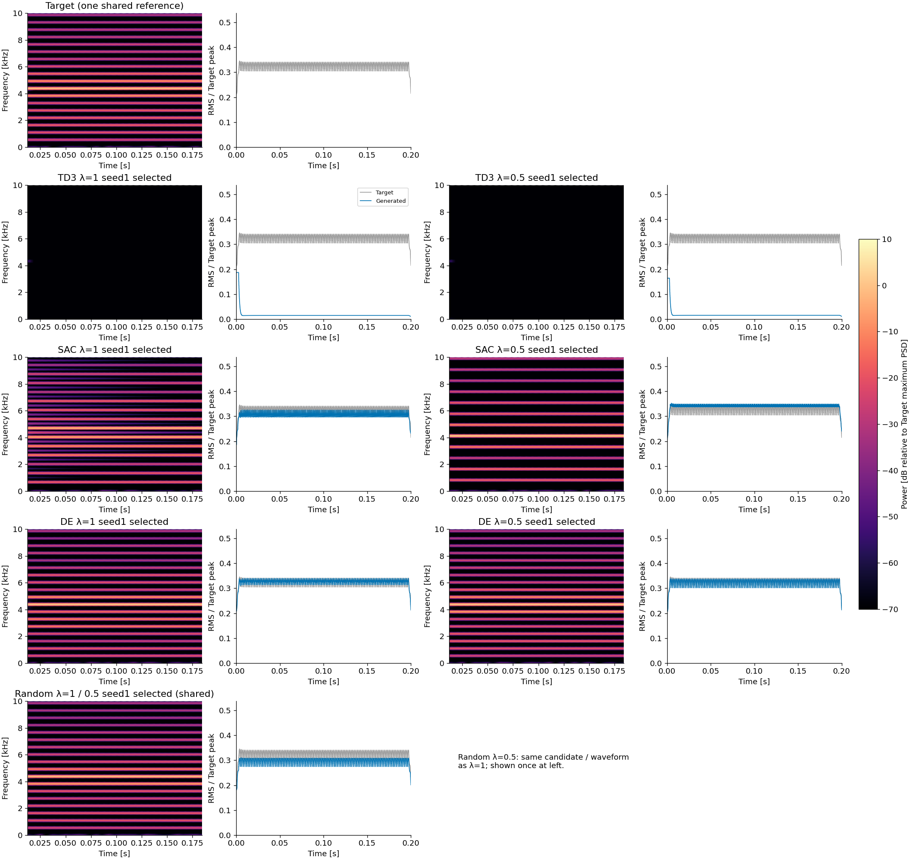

# Issue19 — 制限3Dの重み比較とActor/Critic診断

> 2026-11-26 成果物整理：本文の計算結果・実施/未実施は当時の記録です。現在の配置・削除した再生成図・hash検証は[移行記録](../../../../maintenance/20261126/README.md)を参照。旧manifest/hashは原本を維持しています。

Case A・0.20秒・一定3D。新規学習はλ=.5のTD3/SAC/DE×3 seed、各4096候補だけ。λ=1のIssue18全12 runは読み取り専用。Randomは既存4096候補/seedを再スコアしてminJを再選択した。報酬重み以外の物理条件・学習設定を維持し、初期方策・warmup16行動・DE初期人口8も対応seedで一致した。

## 固定条件とモデル整合

目標制御は `[4.1e7,3.5e7,3.4e6,3e5,4.9e4]`、初期状態・遅延履歴は0、Case Aは右側音響出力を無効化。可制御値は `ε_l,ps,f0_l`、範囲は `[2.5e7,5e7]`, `[2.5e6,4e6]`, `[49000,800000]`。f0_lは開閉外力係数でありHzではない。この制限は持続発声模倣の診断用で、将来のCase Bの閉鎖側 `f_e=1e7` を排除しない。

研究設定 `x0=.02 cm,D=.01` をC++の実際のreset代入で検証。x0は構造体に保存されるだけで、展開済みDが運動式に入る。修正前 `.04 cm` / 現行 `.02 cm` の別ビルドと実際の実行ビルドで目標および4手法の保存Final計15音を比較し、全サンプル完全一致。旧manifestのnative source/library hashが現行と異なる理由を[モデル監査](model_gate.json)に残し、旧manifestや旧監査を更新していない。旧CLIの厳密ハッシュ検査を迂回して旧結果を書き直すこともしない。

学習率3e-4、MLP[32,32]、batch32、warmup16、gamma1、buffer50000、毎step1更新、CPU1thread/worker。TD3 noise=.1、policy_delay2、SAC auto_0.01。DE人口8、mutation[.5,1]、recombination.7。4096後に4080回のCritic更新、TD3 Actor2040回、SAC Actor4080回。途中checkpointの保存を省いたことは数値条件の変更ではない。[全条件とコードhash](manifest.json)。

## 主結果

主指標は全λ共通の `E_total=E_spec+E_env`。`Jλ=E_spec+λ E_env` は同一λ内の学習と選択に用いる。異なるλのJを直接比較して改善としない。平均±SDは3seedの標本SD（ddof=1）。

| 手法 | λ | 採用 | E_total 平均±SD | E_spec 平均±SD | E_env 平均±SD | 持続/3 |
| --- | --- | --- | --- | --- | --- | --- |
| TD3 | 1.0 | final | 0.34029 ± 0.15741 | 0.22094 ± 0.00907 | 0.11936 ± 0.16460 | 2 |
| TD3 | 1.0 | selected | 0.33843 ± 0.15896 | 0.21983 ± 0.00798 | 0.11861 ± 0.16523 | 2 |
| TD3 | 0.5 | final | 0.42756 ± 0.16807 | 0.21638 ± 0.00381 | 0.21118 ± 0.17134 | 1 |
| TD3 | 0.5 | selected | 0.42654 ± 0.16984 | 0.21581 ± 0.00300 | 0.21072 ± 0.17213 | 1 |
| SAC | 1.0 | final | 0.25334 ± 0.00692 | 0.24065 ± 0.00293 | 0.01269 ± 0.00399 | 3 |
| SAC | 1.0 | selected | 0.24465 ± 0.01004 | 0.22639 ± 0.01338 | 0.01826 ± 0.00694 | 3 |
| SAC | 0.5 | final | 0.25566 ± 0.00872 | 0.22907 ± 0.00540 | 0.02659 ± 0.00334 | 3 |
| SAC | 0.5 | selected | 0.22547 ± 0.00231 | 0.21175 ± 0.00181 | 0.01372 ± 0.00334 | 3 |
| DE | 1.0 | final | 0.02162 ± 0.01871 | 0.01873 ± 0.01630 | 0.00289 ± 0.00276 | 3 |
| DE | 1.0 | selected | 0.02162 ± 0.01870 | 0.01873 ± 0.01630 | 0.00289 ± 0.00276 | 3 |
| DE | 0.5 | final | 0.02800 ± 0.01412 | 0.02262 ± 0.01155 | 0.00538 ± 0.00263 | 3 |
| DE | 0.5 | selected | 0.02809 ± 0.01396 | 0.02252 ± 0.01174 | 0.00557 ± 0.00233 | 3 |
| random_search | 1.0 | final | 0.39256 ± 0.13234 | 0.23457 ± 0.02443 | 0.15799 ± 0.14294 | 2 |
| random_search | 1.0 | selected | 0.04722 ± 0.00414 | 0.02901 ± 0.00876 | 0.01822 ± 0.01193 | 3 |
| random_search | 0.5 | final | 0.39256 ± 0.13234 | 0.23457 ± 0.02443 | 0.15799 ± 0.14294 | 2 |
| random_search | 0.5 | selected | 0.04722 ± 0.00414 | 0.02901 ± 0.00876 | 0.01822 ± 0.01193 | 3 |

FinalはRLの4096候補（4080回のCritic更新）終了後の決定論的方策、直接法は実際の候補4096。SelectedはRLの33回（0,128,...,4096）の独立評価または直接法4096候補の最初のminJ。直接法の最適化成果はSelectedで判断する。観測機会は33対4096で異なる。評価は探索ノイズなし、学習/RNGを変えないことを評価前後の署名で確認。SACの決定論的Finalと学習時の確率的行動は異なる。

同じseedのλ=.5−1（負なら改善）。λ間で軌跡が変わるため、共通の初期条件と乱数seedによる対応比較であり、全学習候補が同じという意味ではない。Randomだけは全4096候補が同一。

| 手法 | 採用 | ΔE_total 平均±SD | ΔE_spec 平均±SD | ΔE_env 平均±SD |
| --- | --- | --- | --- | --- |
| TD3 | final | +0.08727 ± 0.15099 | -0.00455 ± 0.00805 | +0.09182 ± 0.15903 |
| TD3 | selected | +0.08810 ± 0.15277 | -0.00401 ± 0.00666 | +0.09211 ± 0.15940 |
| SAC | final | +0.00232 ± 0.01551 | -0.01157 ± 0.00822 | +0.01389 ± 0.00731 |
| SAC | selected | -0.01918 ± 0.01045 | -0.01464 ± 0.01166 | -0.00454 ± 0.00407 |
| DE | final | +0.00638 ± 0.03056 | +0.00389 ± 0.02530 | +0.00249 ± 0.00539 |
| DE | selected | +0.00647 ± 0.03044 | +0.00379 ± 0.02543 | +0.00268 ± 0.00509 |
| random_search | final | +0.00000 ± 0.00000 | +0.00000 ± 0.00000 | +0.00000 ± 0.00000 |
| random_search | selected | +0.00000 ± 0.00000 | +0.00000 ± 0.00000 | +0.00000 ± 0.00000 |

[全seed](comparison_per_seed.csv) / [対応seed差](paired_lambda_deltas.csv) / [全新規学習候補のCSV](new_candidate_metrics.csv.gz)。物理値とその誤差も別列に保存。`parameter_nrmse_original` は元の全域幅を使う従来値、`parameter_nrmse_restricted` は今回の3D制限幅で再計算した値。音響誤差の小ささから物理制御値の一意復元は主張できない。

## CriticとActor

固定初期観測は `[-1,0,0,0,0,0,0,0]`。状態のVecNormalizeはない。行動は[-1,1]の3Dで、policy.scale_actionを適用（数式上は恒等、float32の丸めは最大1.2e-7）。物理写像は今回の制限幅。既存候補の実測損失は元のfloat64行動のもので、Critic推論はfloat32。この精度差を新しい測定として扱っていない。

本課題は1行動でterminated=Trueのため、SB3実装のTD targetでは `(1-done)=0`。TD3/SACのQ1/Q2は共に `r=-Jλ` を回帰する。TD3のbootstrapはtwin targetのminだがこの課題では消え、ActorはQ1のみを最大化する。SACも次状態のminQ/entropy項は終端で消える一方、Actor学習には **現在行動のminQとentropy** が残り、確率的方策を最適化する。従って決定論的Actorが診断候補のminQ最大点と一致しないことだけではActor学習の欠陥を証明しない。使用中のSB3 train実装を[実装記録](critic_execution_all.json)に保存。

診断プールは**既存の1005点**で固定。制限内の発声/非持続格子を層別抽出し、各層の低誤差点、既存Random候補の等間隔抽出、DE採用候補を含む。目標そのものに相当する既知oracle格子点も含むため、Actor表ではoracle（E_total≤1e-8）を除くbestも示す。各モデルの学習点128点は別集計。exact-training判定は保存されたfloat32行動の完全一致であり、未一致点を独立な統計的テスト集合と主張しない。診断の追加シミュレーションは0音。λ=1の保存モデルで先に推論を試し、同じ候補プールを新規λ=.5にも使用した。

以下は各seedで計算した指標の平均。順位反転は実測と予測の順位が逆の候補対の割合（同値対を除く）。低J biasは固定プール内Jの下位10%で `Q−r`、負なら本当に良い行動を過小評価。

| 手法 | λ | Critic | RMSE | Spearman | 反転率 | 低J bias |
| --- | --- | --- | --- | --- | --- | --- |
| TD3 | 1.0 | Q1 | 0.1071 | 0.4138 | 0.3493 | -0.2273 |
| TD3 | 1.0 | Q2 | 0.1072 | 0.3846 | 0.3721 | -0.2260 |
| TD3 | 1.0 | minQ | 0.1124 | 0.3650 | 0.3768 | -0.2339 |
| TD3 | 0.5 | Q1 | 0.0587 | 0.3325 | 0.3833 | -0.1272 |
| TD3 | 0.5 | Q2 | 0.0596 | 0.3263 | 0.3925 | -0.1249 |
| TD3 | 0.5 | minQ | 0.0607 | 0.3366 | 0.3877 | -0.1307 |
| SAC | 1.0 | Q1 | 0.0637 | 0.6567 | 0.2682 | -0.1177 |
| SAC | 1.0 | Q2 | 0.0666 | 0.6327 | 0.2790 | -0.1187 |
| SAC | 1.0 | minQ | 0.0669 | 0.6547 | 0.2714 | -0.1261 |
| SAC | 0.5 | Q1 | 0.0406 | 0.6738 | 0.2538 | -0.0740 |
| SAC | 0.5 | Q2 | 0.0415 | 0.7012 | 0.2409 | -0.0760 |
| SAC | 0.5 | minQ | 0.0421 | 0.6959 | 0.2426 | -0.0792 |

| 手法 | λ | seed | Actor J | 候補内best J (oracle除外) | そのQ順位/1005 | pool max Q − Actor Q |
| --- | --- | --- | --- | --- | --- | --- |
| TD3 | 1.0 | 0 | 0.23349 | 3.6996e-05 | 156 | -0.01460 |
| TD3 | 1.0 | 1 | 0.52107 | 3.6996e-05 | 295 | +0.09725 |
| TD3 | 1.0 | 2 | 0.26632 | 3.6996e-05 | 188 | -0.03109 |
| SAC | 1.0 | 0 | 0.24869 | 3.6996e-05 | 215 | +0.00095 |
| SAC | 1.0 | 1 | 0.26130 | 3.6996e-05 | 254 | -0.00243 |
| SAC | 1.0 | 2 | 0.25003 | 3.6996e-05 | 152 | -0.00028 |
| TD3 | 0.5 | 0 | 0.22686 | 3.4471e-05 | 136 | -0.00808 |
| TD3 | 0.5 | 1 | 0.36689 | 3.4471e-05 | 273 | +0.04436 |
| TD3 | 0.5 | 2 | 0.37217 | 3.4471e-05 | 272 | +0.08943 |
| SAC | 0.5 | 0 | 0.24507 | 3.4471e-05 | 133 | -0.00570 |
| SAC | 0.5 | 1 | 0.23436 | 3.4471e-05 | 244 | -0.00553 |
| SAC | 0.5 | 2 | 0.24767 | 3.4471e-05 | 117 | -0.00543 |

全候補のQ1/Q2/minQ・実測r・発声・学習点一致判定は[圧縮CSV](critic_predictions_all.csv.gz)、各seedの精度と反転率は[診断指標](critic_metrics_all.csv)、Actorの制御と位置比較は[Actor診断](actor_diagnostics_all.csv)。全体相関が正でも、低誤差領域の順位が十分とは限らない。最終モデルの回顧診断だけで、学習途中の因果関係を特定できない。

## 代表音と図

同じseed1を両λ・全4手法・Final/Selectedで固定して比較。λ=1のTD3非持続例を含む。成功例だけをλごとに選び直さない。スペクトログラムは10MHz表示、245760窓、184320 overlap、Blackman-Harris、Target最大PSDに対する共通dB範囲と共通カラーバー。RMSは両音をTarget peakで除した5ms窓の共通振幅軸。制御は1枚に集約。描画設定と音声の出典hashは[図の記録](figure_sources.json) / [元波形の参照](endpoint_sources.json)。

## 保護・計算量・整理

[変更前棚卸し](artifact_inventory.json)で旧研究ファイル5053個をhash化。[監査](audit.json)で全48 endpointの保存モデル/行動を再評価し、波形・指標・発声の完全一致を確認。新規9runの学習候補36864音、独立方策評価198音、学習後replay18音。別途モデル整合15音、監査は1回48音・実行累計96音（各実行をauditのpassesへ記録）。Critic推論0音。Random再スコア自体は0音で、λ=.5 Selectedの3音は各48監査音に含む。Random Selectedは全seedとも旧Selectedと同一だったため、音声ファイルは[元データを参照](random_audio_deduplication.json)し重複保存していない。[回数・時間](execution.json) / [各runの計算量](run_accounting.csv) / [endpoint再生](endpoint_replays.csv)。関連unittest21件も通過し、テスト用の64回のモデル評価（うち注入失敗1回）は研究runの計算量に含めず[テスト記録](tests.json)へ別記した。

Issue17のPNG 321枚、Issue18のPNG 82枚を確認。全研究成果中、同一hash PNGは71群、重複分110枚・18.95 MB。[重複の保持理由](duplicate_png_review.csv)と[保持/整理一覧](artifact_retention_review.csv)を残した。参照される旧PNGはREPORT・画像registry・過去監査のexact hashを維持するため保留。Phase0の図、中断計算に残る重み・履歴、研究資料も保持した。重要な旧科学データの削除は0。

整理は無参照のignored一時stdoutログ3本だけをbyte単位一致で1つの[圧縮記録](consolidated_temporary_logs.json.gz)に統合し、元3本を除去。[削除一覧](cleanup_changes.json)。図の削除は0なので旧リンクの読み替えは不要。旧図の再生成先は保持一覧に記録した（旧学習用の厳密hash gateを再実行する際は、その実験当時のソース/buildが必要）。新規は主要図8枚のみ、全seedのPNG/途中checkpointを生成しない。全新規seedの数値・設定・Final/Selected重み・波形は保持。ignoreはこの追試の途中出力に限定。commit/pushや過去履歴の書換えは行っていない。

[変更前のファイル数/容量](storage_before.json) / [変更後とGit追加候補数/容量](storage_after.json) / [旧hash・リンク最終照合](final_integrity.json)。容量は.gitとsymlinkを除く論理bytes、ignored環境も含む。Git追加候補は未追跡・非ignoreファイルで、stage/commit済みという意味ではない。

## 全seedの評価値

| 手法 | λ | seed | 採用 | 試行 | E_total | E_spec | E_env | Jλ | 持続 |
| --- | --- | --- | --- | --- | --- | --- | --- | --- | --- |
| TD3 | 1.0 | 0 | final | 4096 | 0.2334936 | 0.2204592 | 0.01303432 | 0.2334936 | True |
| TD3 | 1.0 | 0 | selected | 3712 | 0.2308455 | 0.2193027 | 0.01154279 | 0.2308455 | True |
| TD3 | 1.0 | 1 | final | 4096 | 0.5210673 | 0.212116 | 0.3089513 | 0.5210673 | False |
| TD3 | 1.0 | 1 | selected | 3968 | 0.5210231 | 0.2121159 | 0.3089071 | 0.5210231 | False |
| TD3 | 1.0 | 2 | final | 4096 | 0.2663199 | 0.2302327 | 0.03608723 | 0.2663199 | True |
| TD3 | 1.0 | 2 | selected | 3968 | 0.2634312 | 0.2280575 | 0.03537374 | 0.2634312 | True |
| SAC | 1.0 | 0 | final | 4096 | 0.248693 | 0.2385947 | 0.01009829 | 0.248693 | True |
| SAC | 1.0 | 0 | selected | 3072 | 0.245489 | 0.2351646 | 0.01032441 | 0.245489 | True |
| SAC | 1.0 | 1 | final | 4096 | 0.2612972 | 0.2440062 | 0.01729097 | 0.2612972 | True |
| SAC | 1.0 | 1 | selected | 2304 | 0.254243 | 0.2330206 | 0.02122236 | 0.254243 | True |
| SAC | 1.0 | 2 | final | 4096 | 0.2500312 | 0.2393391 | 0.01069209 | 0.2500312 | True |
| SAC | 1.0 | 2 | selected | 768 | 0.2342144 | 0.2109884 | 0.02322599 | 0.2342144 | True |
| DE | 1.0 | 0 | final | 4096 | 3.699679e-05 | 3.1947e-05 | 5.049794e-06 | 3.699679e-05 | True |
| DE | 1.0 | 0 | selected | 4095 | 3.699646e-05 | 3.194482e-05 | 5.051642e-06 | 3.699646e-05 | True |
| DE | 1.0 | 1 | final | 4096 | 0.03172399 | 0.02621228 | 0.005511705 | 0.03172399 | True |
| DE | 1.0 | 1 | selected | 307 | 0.03172399 | 0.02621228 | 0.005511705 | 0.03172399 | True |
| DE | 1.0 | 2 | final | 4096 | 0.03310548 | 0.02994866 | 0.003156814 | 0.03310548 | True |
| DE | 1.0 | 2 | selected | 4089 | 0.03309994 | 0.02993405 | 0.003165885 | 0.03309994 | True |
| random_search | 1.0 | 0 | final | 4096 | 0.382189 | 0.2615168 | 0.1206722 | 0.382189 | True |
| random_search | 1.0 | 0 | selected | 1943 | 0.04920684 | 0.03301758 | 0.01618927 | 0.04920684 | True |
| random_search | 1.0 | 1 | final | 4096 | 0.2657168 | 0.2283082 | 0.03740869 | 0.2657168 | True |
| random_search | 1.0 | 1 | selected | 3146 | 0.04999159 | 0.01896301 | 0.03102858 | 0.04999159 | True |
| random_search | 1.0 | 2 | final | 4096 | 0.5297766 | 0.2138815 | 0.3158951 | 0.5297766 | False |
| random_search | 1.0 | 2 | selected | 2751 | 0.04246813 | 0.03503702 | 0.007431109 | 0.04246813 | True |
| TD3 | 0.5 | 0 | final | 4096 | 0.2335321 | 0.2201893 | 0.01334272 | 0.2268607 | True |
| TD3 | 0.5 | 0 | selected | 3584 | 0.23046 | 0.2184865 | 0.01197347 | 0.2244732 | True |
| TD3 | 0.5 | 1 | final | 4096 | 0.5212089 | 0.2125632 | 0.3086457 | 0.366886 | False |
| TD3 | 0.5 | 1 | selected | 4096 | 0.5212089 | 0.2125632 | 0.3086457 | 0.366886 | False |
| TD3 | 0.5 | 2 | final | 4096 | 0.5279379 | 0.2163946 | 0.3115432 | 0.3721662 | False |
| TD3 | 0.5 | 2 | selected | 4096 | 0.5279379 | 0.2163946 | 0.3115432 | 0.3721662 | False |
| SAC | 0.5 | 0 | final | 4096 | 0.2592031 | 0.2309452 | 0.02825787 | 0.2450742 | True |
| SAC | 0.5 | 0 | selected | 384 | 0.2227986 | 0.212394 | 0.01040454 | 0.2175963 | True |
| SAC | 0.5 | 1 | final | 4096 | 0.2457295 | 0.222984 | 0.02274548 | 0.2343568 | True |
| SAC | 0.5 | 1 | selected | 3584 | 0.2268199 | 0.2131603 | 0.01365965 | 0.2199901 | True |
| SAC | 0.5 | 2 | final | 4096 | 0.2620525 | 0.2332912 | 0.02876134 | 0.2476719 | True |
| SAC | 0.5 | 2 | selected | 768 | 0.2267903 | 0.2097093 | 0.017081 | 0.2182498 | True |
| DE | 0.5 | 0 | final | 4096 | 0.04027817 | 0.03226939 | 0.008008774 | 0.03627378 | True |
| DE | 0.5 | 0 | selected | 2820 | 0.04027817 | 0.03226939 | 0.008008774 | 0.03627378 | True |
| DE | 0.5 | 1 | final | 4096 | 0.01257864 | 0.009826944 | 0.002751692 | 0.01120279 | True |
| DE | 0.5 | 1 | selected | 4092 | 0.01285295 | 0.00948883 | 0.003364117 | 0.01117089 | True |
| DE | 0.5 | 2 | final | 4096 | 0.03115651 | 0.02577224 | 0.005384263 | 0.02846437 | True |
| DE | 0.5 | 2 | selected | 4085 | 0.03113621 | 0.02578974 | 0.00534647 | 0.02846297 | True |
| random_search | 0.5 | 0 | final | 4096 | 0.382189 | 0.2615168 | 0.1206722 | 0.3218529 | True |
| random_search | 0.5 | 0 | selected | 1943 | 0.04920684 | 0.03301758 | 0.01618927 | 0.04111221 | True |
| random_search | 0.5 | 1 | final | 4096 | 0.2657168 | 0.2283082 | 0.03740869 | 0.2470125 | True |
| random_search | 0.5 | 1 | selected | 3146 | 0.04999159 | 0.01896301 | 0.03102858 | 0.0344773 | True |
| random_search | 0.5 | 2 | final | 4096 | 0.5297766 | 0.2138815 | 0.3158951 | 0.371829 | False |
| random_search | 0.5 | 2 | selected | 2751 | 0.04246813 | 0.03503702 | 0.007431109 | 0.03875257 | True |

## Phase 1の判断

結論は[判断メモ](DECISION.md)。3seedの探索的比較であり、統計的一般化やRLのDE超えは主張しない。時変制御・Case Bをこの追試に追加せず、次の課題として分離する。

<!-- ISSUE19_STORAGE_BEGIN -->
## ファイル数と容量の実測

| 対象 | 変更前 | 変更後 |
| --- | --- | --- |
| 作業ツリーの通常ファイル数（ignored含む） | 6927 | 7038 |
| 作業ツリーの論理容量 | 623.51 MB | 639.91 MB |
| Git新規追加候補 | 3個（初期スクリプトのみ） | 114個 / 16.42 MB |
| 既存追跡ファイルの変更 / 削除 | 0 / 0 | 2 / 0 |

変更前は初期3スクリプト作成後・実験前の棚卸し時点。着手時のGitツリー自体はクリーンで未pushコミットなし。通常ファイルの数・容量は.gitとsymlinkを除外し、仮想環境やignoredログを含む。新規追加候補は未追跡・非ignoreファイルで、commit予定を確定したものではない。旧研究ファイル削除0、ignoredログ3本を1つの圧縮記録へ統合した。
<!-- ISSUE19_STORAGE_END -->
