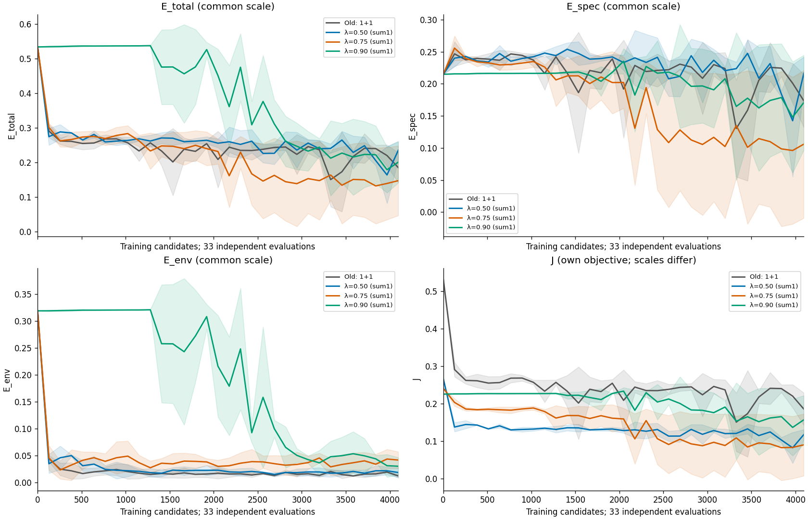
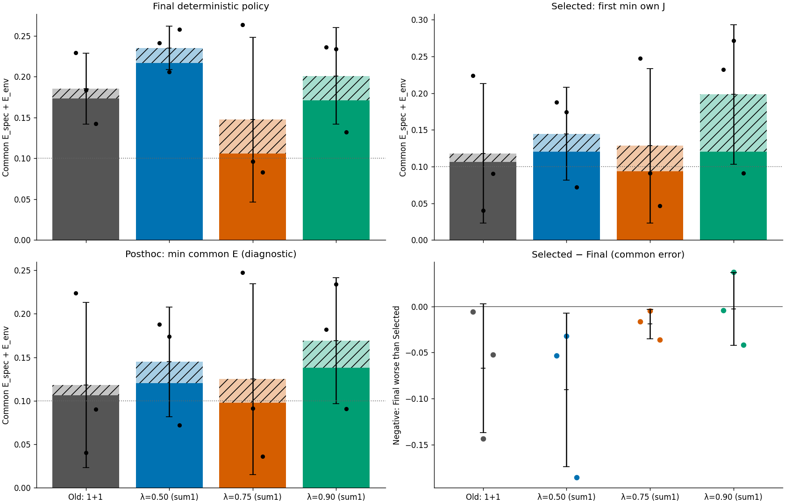
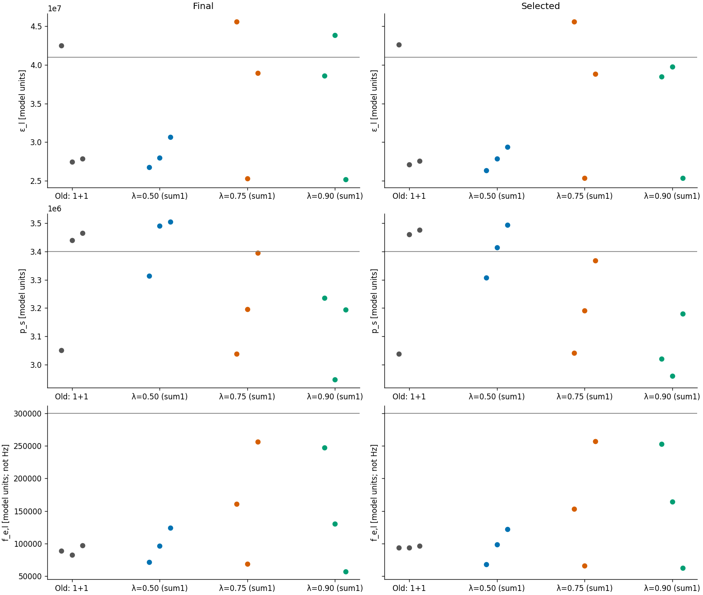
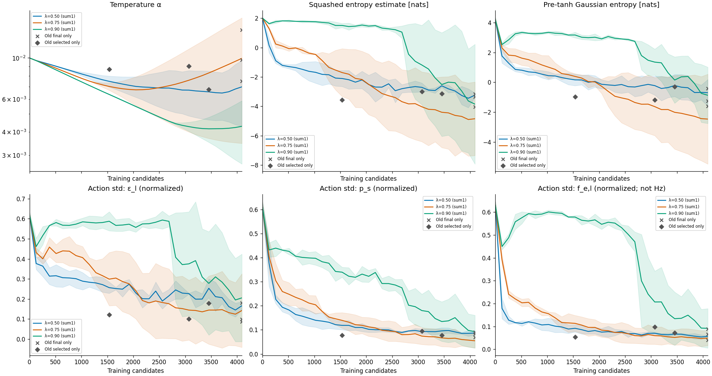
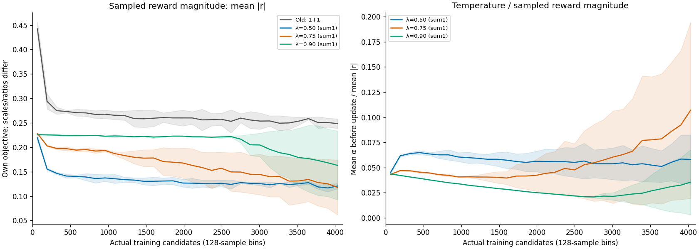
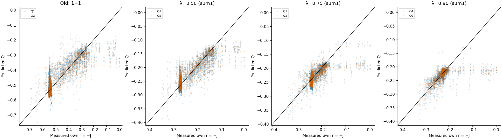
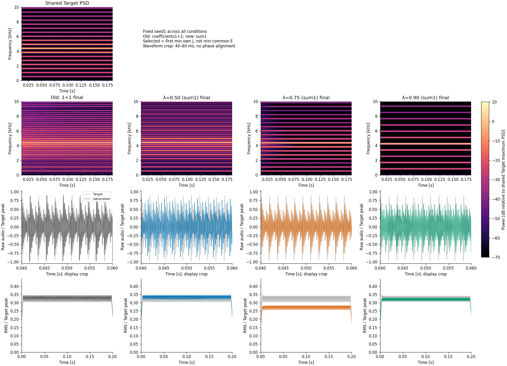
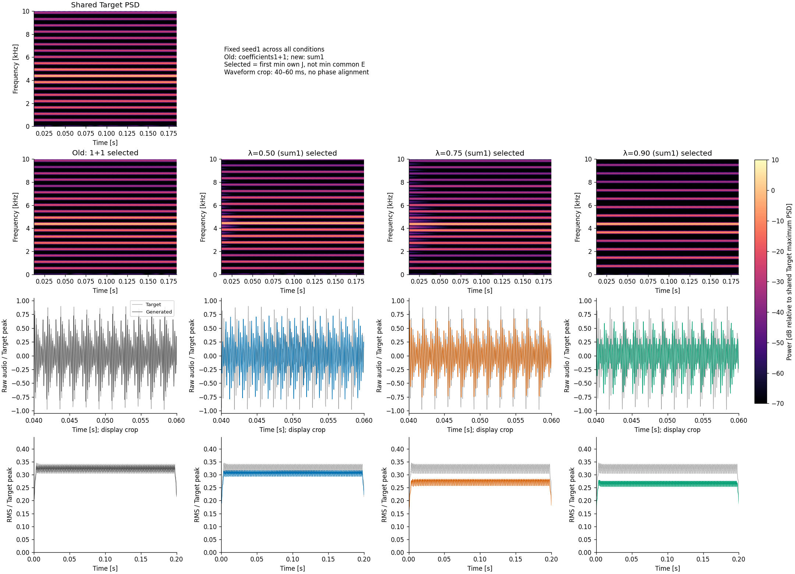

# Issue22 — SAC128・係数和1の報酬重み比較

> 2026-11-26 成果物整理：本文の計算結果・実施/未実施は当時の記録です。現在の配置・削除した再生成図・hash検証は[移行記録](../../../../maintenance/20261126/README.md)を参照。旧manifest/hashは原本を維持しています。

## 結果と採用判断

新式3条件のいずれも、Final平均E_total≤.10かつ持続発声3/3の暫定目標は満たさなかった。

新式のFinal平均が最小だったのはlambda_0p75：E_total=0.14745 ± 0.10074、持続3/3。旧報酬SAC128の参考値は0.18515 ± 0.04347、持続3/3。

新式内の次段階の比較基準候補はlambda_0p75（Final 0.14745 ± 0.10074）。ただし3seedの範囲での候補であり、一般的な最適重みや採用確定を意味しない。

今回のλ=.75は旧条件に比べてFinal平均E_specが0.17329→0.10602へ下がった一方、E_envは0.01185→0.04142へ増えた。共通誤差はseed1/2で改善したがseed0は0.26352で、平均改善と全seedの高精度は別である。λ=.90のFinal平均は0.20089で、スペクトル係数を増やすほど良くなる結果ではなかった。

同じ重み比のλ=.50でも、Final共通誤差は旧0.18515→0.23515に悪化した。一方、学習用Jは0.11758と旧Jより小さい。これはスケールの異なるJを改善指標にできない具体例であり、重み比の効果とも解釈しない。

この比較は学習報酬の定義を変えた9runだけ。Selected→Finalの差は記録するが、原因を同定したり、良い方策へ自動復帰する仕組みを導入したりしていない。次Issueでは今回の候補条件を事前固定して、必要なら安定性の診断・保持機構・探索の介入を別々に検証する。今回の結果だけから唯一の原因や一般的優位を断定しない。

## 報酬の定義とスケール

新式は `Jλ=λE_spec+(1−λ)E_env`、`reward=−Jλ`。λ=.50/.75/.90の係数は(.50,.50)/(.75,.25)/(.90,.10)、すべて和1。**補正の2倍は掛けない**。主評価は全条件共通の `E_total=E_spec+E_env`。

旧Issue21は係数(1,1)の`legacy_sum`で、旧報酬の「λ=1」やIssue19の`E_spec+wE_env`と新式λを混同しない。新式λ=.50は同じ候補について旧Jの正確な半分で、重み比は同じでも損失の大きさが違う。旧条件との差を「重み比だけの効果」と呼ばない。新式内も、成分の尺度が違うため係数和1が実際の報酬分布や温度との比まで一定にするわけではない。

1000組の成分値と実際の音で係数和・半分の恒等式を検証し、目標と旧Final3音の全サンプル・共通評価が一致した。[事前検証](preflight.json)。既存の数値失敗ペナルティ1e6は保持し、実際の研究runの数値失敗は0。テストで注入した失敗は別記する。

## 固定条件

Case A、右α_r=β_r=0、x0=.02 cm/D=.01、0.20秒・50kHz・10000sample、native dt=1e-7、状態/遅延履歴0。目標の既存波形/hashと制御 `[4.1e7,3.5e7,3.4e6,3e5,4.9e4]` を保持。可変はε_l[2.5e7,5e7]、p_s[2.5e6,4e6]、f0_l[49000,800000]、右ε_r=3.5e7/f0_r=4.9e4固定。f0_lはHzでなく開閉外力係数。モデル内部量を実測張力やPaと直接同一視しない。

SACのみ、Actor/Critic [128,128]、lr3e-4、batch32、gamma1、buffer50000、warmup16、train_freq1、gradient_steps1、ent_coef=auto_0.01、CPU1thread/worker。旧SAC128の実効設定・初期方策・最初の16行動が一致。後の行動軌道が同一とは仮定しない。各runは4096候補・4080回のActor/Critic/温度更新。評価は0,128,...,4096の33回で、4096は最終更新後。TD3/DE/Random、Case B、時変制御、実録音、範囲・entropy目標・初期温度・探索機構の変更は行わない。[manifest](manifest.json) / [各runの実効設定](runs) / [監査](audit.json)。

## Final・Selected・posthoc

Finalは最終更新後の決定論的方策。Selectedは33独立評価中で**その条件のJを最小化**した最初の点。posthocは同じ33点の共通E_total最小で、診断値のみ。posthocのための追加学習や学習器への復帰、途中重みの大量保存は行わない。posthocの行動は保存制御から再評価し、Final/Selectedと同じ行動なら検証済みの再生を共用する。

| 条件 | 採用 | E_total 平均±SD | E_spec 平均±SD | E_env 平均±SD | 自身J 平均±SD | 持続/3 |
| --- | --- | --- | --- | --- | --- | --- |
| legacy_sum | final | 0.18515 ± 0.04347 | 0.17329 ± 0.04135 | 0.01185 ± 0.00346 | 0.18515 ± 0.04347 | 3 |
| legacy_sum | selected | 0.11805 ± 0.09498 | 0.10659 ± 0.09204 | 0.01146 ± 0.00345 | 0.11805 ± 0.09498 | 3 |
| legacy_sum | posthoc | 0.11805 ± 0.09498 | 0.10659 ± 0.09204 | 0.01146 ± 0.00345 | 0.11805 ± 0.09498 | 3 |
| lambda_0p50 | final | 0.23515 ± 0.02659 | 0.21694 ± 0.02522 | 0.01821 ± 0.00914 | 0.11758 ± 0.01330 | 3 |
| lambda_0p50 | selected | 0.14469 ± 0.06315 | 0.12055 ± 0.06375 | 0.02414 ± 0.00268 | 0.07235 ± 0.03157 | 3 |
| lambda_0p50 | posthoc | 0.14469 ± 0.06315 | 0.12055 ± 0.06375 | 0.02414 ± 0.00268 | 0.07235 ± 0.03157 | 3 |
| lambda_0p75 | final | 0.14745 ± 0.10074 | 0.10602 ± 0.11515 | 0.04142 ± 0.01547 | 0.08987 ± 0.08274 | 3 |
| lambda_0p75 | selected | 0.12841 ± 0.10537 | 0.09367 ± 0.11591 | 0.03474 ± 0.01763 | 0.07894 ± 0.08415 | 3 |
| lambda_0p75 | posthoc | 0.12484 ± 0.10961 | 0.09762 ± 0.11213 | 0.02723 ± 0.02444 | 0.08002 ± 0.08303 | 3 |
| lambda_0p90 | final | 0.20089 ± 0.05931 | 0.17100 ± 0.07382 | 0.02989 ± 0.01647 | 0.15689 ± 0.06495 | 3 |
| lambda_0p90 | selected | 0.19824 ± 0.09495 | 0.12038 ± 0.08958 | 0.07786 ± 0.03126 | 0.11612 ± 0.08069 | 3 |
| lambda_0p90 | posthoc | 0.16908 ± 0.07245 | 0.13785 ± 0.09655 | 0.03124 ± 0.02447 | 0.12719 ± 0.08447 | 3 |

平均±SDは3seedの標本SD（ddof=1）。暫定目標はFinal平均≤.10かつ持続3/3で、全seedの誤差≤.10や聴覚的同一性の基準ではない。持続proxyは末尾1000sampleのAC標準偏差/Target peak>.05かつ数値失敗なし。生理学的な有声判定とは別。失敗・非持続seedを除外しない。

対応seedのFinal差（条件−参照）。Jの差で改善を判定せず、共通誤差と成分を比べる。

| 条件 | 参照 | ΔE_total 平均±SD | ΔE_spec 平均±SD | ΔE_env 平均±SD |
| --- | --- | --- | --- | --- |
| lambda_0p50 | legacy_sum | +0.05000 ± 0.05704 | +0.04364 ± 0.06078 | +0.00636 ± 0.00588 |
| lambda_0p75 | legacy_sum | -0.03770 ± 0.06375 | -0.06727 ± 0.08256 | +0.02957 ± 0.01892 |
| lambda_0p75 | lambda_0p50 | -0.08770 ± 0.10058 | -0.11091 ± 0.12175 | +0.02321 ± 0.02448 |
| lambda_0p90 | legacy_sum | +0.01574 ± 0.03130 | -0.00229 ± 0.04573 | +0.01803 ± 0.01546 |
| lambda_0p90 | lambda_0p50 | -0.03426 ± 0.08089 | -0.04593 ± 0.09832 | +0.01167 ± 0.01773 |

## 全seedとSelected−Final

**Selected−Final = E_total(Selected minJ)−E_total(Final)**。負ならFinalの共通誤差が悪化。正ならFinalの共通誤差はSelectedより良いが、採用基準は異なるので矛盾しない。`selected_minus_final_J`はminJ選択のため常に0以下。posthoc−Final/posthoc−Selectedも別列に記録する。

例えばλ=.90・seed1のSelectedは試行3200でJ=0.19595、E_spec=0.21100、E_env=0.06053、E_total=0.27153。FinalはJ=0.20005、E_spec=0.22080、E_env=0.01329、E_total=0.23409だった。SelectedはJの基準では正しく、Selected−Finalの共通誤差は+0.03744。この点を共通誤差の小さいFinalやposthocへ差し替えない。

| 条件 | seed | Final E | Selected E | posthoc E | Selected試行 | posthoc試行 | Selected−Final E | Final持続 | Selected持続 |
| --- | --- | --- | --- | --- | --- | --- | --- | --- | --- |
| legacy_sum | 0 | 0.2293956 | 0.223864 | 0.223864 | 3072 | 3072 | -0.005531633 | True | True |
| legacy_sum | 1 | 0.1835459 | 0.04017159 | 0.04017159 | 3456 | 3456 | -0.1433743 | True | True |
| legacy_sum | 2 | 0.1424988 | 0.09012543 | 0.09012543 | 1536 | 1536 | -0.05237341 | True | True |
| lambda_0p50 | 0 | 0.2413593 | 0.1878087 | 0.1878087 | 3968 | 3968 | -0.0535506 | True | True |
| lambda_0p50 | 1 | 0.2060035 | 0.1740553 | 0.1740553 | 3584 | 3584 | -0.03194816 | True | True |
| lambda_0p50 | 2 | 0.2580874 | 0.07220636 | 0.07220636 | 3968 | 3968 | -0.185881 | True | True |
| lambda_0p75 | 0 | 0.2635241 | 0.2472917 | 0.2472917 | 3328 | 3328 | -0.01623238 | True | True |
| lambda_0p75 | 1 | 0.09598998 | 0.09136702 | 0.09136702 | 3456 | 3456 | -0.004622957 | True | True |
| lambda_0p75 | 2 | 0.08283013 | 0.04656247 | 0.03587059 | 3840 | 2944 | -0.03626765 | True | True |
| lambda_0p90 | 0 | 0.2361567 | 0.2322107 | 0.1821812 | 2688 | 3968 | -0.003945987 | True | True |
| lambda_0p90 | 1 | 0.2340929 | 0.2715299 | 0.2340929 | 3200 | 4096 | +0.03743692 | True | True |
| lambda_0p90 | 2 | 0.1324198 | 0.09098001 | 0.09098001 | 3328 | 3328 | -0.04143976 | True | True |

[全成分・J・制御・物理誤差](comparison_per_seed.csv) / [対応差](paired_differences.csv) / [安定性の符号付き差](selected_final_stability.csv) / [33点の独立評価](policy_evaluations.csv)。物理量NRMSEは従来の全域幅と今回の制限幅を区別し、音響的な一致から制御値の一意な復元は主張しない。

## 温度・分散・entropy

新規runでは全33評価点でα、pre-tanh Gaussianのmean/log_std/std、tanh後の正規化行動標準偏差、Gaussian entropy、squashed entropy推定を保存。後者は固定の局所NumPy RNG・4096標準正規サンプルとSB3と同じtanh Jacobian補正（epsilon1e-6）を使う。グローバルRNG、学習器、optimizer、bufferの評価前後署名が一致し、追加の鳴管音は0。分散は条件付き方策分布の推定で、探索ノイズの設定を変えた値ではない。

entropyは正規化行動座標の連続分布の微分entropy（nats）で負になり得る。epsilon付き推定と有限MCの誤差を含む。MC SEは各点の積分誤差の目安で、3seedのSDや一般化の信頼区間ではない。同じMCサンプルを全条件で使う。旧条件には33点の温度/分散履歴がないため、保存Final/Selectedモデルから得た実測2点/seedだけを表示し、補間しない。

| 条件 | 採用 | α 平均±SD | squashed entropy 平均±SD [nats] |
| --- | --- | --- | --- |
| legacy_sum | final | 0.01048 ± 0.00339 | -3.52359 ± 0.46039 |
| legacy_sum | selected | 0.00815 ± 0.00121 | -3.23653 ± 0.30273 |
| lambda_0p50 | final | 0.00700 ± 0.00270 | -3.23865 ± 0.14551 |
| lambda_0p50 | selected | 0.00679 ± 0.00245 | -3.35151 ± 0.67575 |
| lambda_0p75 | final | 0.00996 ± 0.00648 | -4.84919 ± 2.50450 |
| lambda_0p75 | selected | 0.00876 ± 0.00445 | -4.66502 ± 2.44162 |
| lambda_0p90 | final | 0.00429 ± 0.00160 | -3.85497 ± 4.07932 |
| lambda_0p90 | selected | 0.00443 ± 0.00041 | -1.25614 ± 3.96953 |

Final平均αは旧0.01048に対してλ=.50/.75/.90で0.00700/0.00996/0.00429だった。損失が半分になるλ=.50でも、温度が旧条件の正確な半分へ自動調整されたわけではない。λ=.75のFinal平均entropy推定は−4.849 nats（旧−3.524）で、座標別の行動分散も変化した。これらは実際の方策状態の違いであり、温度・分散の変化だけを性能差の原因と断定しない。

学習サンプルと独立評価は分離。[全学習サンプルCSV](training_samples.csv.gz)には実際のfloat32報酬と当該更新前α、[方策診断CSV](policy_dynamics.csv)には評価後の方策状態を保存。報酬図は128学習サンプルのbin平均。α/平均|r|は相対スケールの記述であり、entropy支配や性能差の原因を証明する比ではない。

終端1stepなのでCritic targetのbootstrap/次状態entropyは消えるが、SAC Actorの現在行動の `α logπ−minQ` は残る。報酬の縮小はQとentropyの相対関係にも影響し、auto温度が常に同じ比を保つ保証はない。今回観測した温度・分散・安定性の関連は、重み以外を介入していない回顧的な観測であり、原因同定を先取りしない。

## 補助Critic診断

同じ既存1005候補プールに対して各条件の **r=−J** とQ1/Q2/minQを比較した。学習・新しい候補抽選・鳴管再計算は0。旧格子・Random・DEの保存診断点と既知oracleを含む層別プールで、統計的に独立な母集団や物理空間の発生確率ではない。各λの下位J10%は異なる点を含み得る。

以下は3seedで各指標を計算した平均。**raw RMSE/biasは異なる報酬尺度の間で単純比較しない**。RMSE/報酬SDも目標関数と順位が違うため、因果的な精度改善の証明にはならない。順位反転は真値/予測の同値対を除く。低J biasはQ−rで、負なら過小評価。

| 条件 | Critic | raw RMSE | RMSE/報酬SD | Spearman | 反転率 | 低J bias |
| --- | --- | --- | --- | --- | --- | --- |
| legacy_sum | Q1 | 0.0598 | 0.5297 | 0.7228 | 0.2269 | -0.0820 |
| legacy_sum | Q2 | 0.0602 | 0.5332 | 0.7272 | 0.2257 | -0.0868 |
| legacy_sum | minQ | 0.0599 | 0.5304 | 0.7228 | 0.2267 | -0.0896 |
| lambda_0p50 | Q1 | 0.0285 | 0.5048 | 0.7187 | 0.2320 | -0.0453 |
| lambda_0p50 | Q2 | 0.0286 | 0.5076 | 0.7062 | 0.2388 | -0.0425 |
| lambda_0p50 | minQ | 0.0287 | 0.5093 | 0.7128 | 0.2351 | -0.0474 |
| lambda_0p75 | Q1 | 0.0265 | 0.7406 | 0.6756 | 0.2448 | -0.0428 |
| lambda_0p75 | Q2 | 0.0276 | 0.7721 | 0.6750 | 0.2516 | -0.0448 |
| lambda_0p75 | minQ | 0.0283 | 0.7890 | 0.6582 | 0.2562 | -0.0461 |
| lambda_0p90 | Q1 | 0.0284 | 0.8848 | 0.5887 | 0.2738 | -0.0494 |
| lambda_0p90 | Q2 | 0.0279 | 0.8704 | 0.6175 | 0.2583 | -0.0482 |
| lambda_0p90 | minQ | 0.0286 | 0.8923 | 0.5957 | 0.2693 | -0.0503 |

[seed別Critic指標](critic_metrics.csv) / [全予測](critic_predictions.csv.gz) / [実行条件](critic_execution.json)。図の各パネルは自身のrの軸スケールを使う。SACの決定論的出力と確率的Actorの目的も同一視しない。

## 代表音と保存

全条件でseed1を固定し、FinalとSelectedを別図にした。Target最大full-band PSDに対する共通dB範囲・カラーバー、共通Target peak基準の5ms RMS、位相合わせなし。40–60msの波形は表示だけの切出しで、保存音/報酬は全0.20秒。PSD表示は10MHz、Blackman-Harris窓245760/overlap184320、有効窓のみ、0–10kHz。色/振幅軸は全24保存Final/Selectedで共通。[図の出所](figure_sources.json)。

新規9runのFinal/Selectedモデル、float64元振幅NPZ、全4096学習行動と33方策評価を保持。聴取は全音に同じTarget由来gainを適用した[WAV ZIP](new_listening_audio.zip) / [対応表](listening_audio.json)。完全同一WAVは共用し、旧モデル/音声は[元ファイルを参照](endpoint_sources.json)してコピーしない。posthocは保存33点の行動と数値の診断で、対応時点の追加model checkpointを後から作ったとは扱わない。

## 実行・監査・保護

新規9run×4096=36864学習音、独立方策評価297音、学習後replay18音。事前整合4音、テスト用モデル評価145回（注入失敗1回）は別枠。監査の実鳴管再生は今回26音・累計26音で、同一行動を再利用して余分な再計算を抑えた。保存Final/Selectedモデルのreload24回、posthocを含む36endpointの制御・誤差・発声を照合。Critic、温度診断、描画、WAV化は追加鳴管音0。wall時間822.87秒、worker数9。[実行記録](execution.json) / [run別時間](run_accounting.csv) / [監査](audit.json) / [再生記録](endpoint_replays.csv) / [17テスト](tests.json)。

着手前に旧成果・既存コード5479ファイルをhash化し、変更/削除0を確認。root READMEとignoreだけを更新した。途中checkpointやseedごとのPNGを大量生成せず、主要図8枚。旧Issue17〜21の図・モデル・数値・目標は変更しない。commit/push、Git履歴書換え、Issueのクローズは行っていない。[最終整合](integrity.json) / [成果物hash](artifact_checksums.json) / [変更前](storage_before.json) / [変更後](storage_after.json)。

## 限界と次Issue

新式内の次段階の比較基準候補はlambda_0p75（Final 0.14745 ± 0.10074）。ただし3seedの範囲での候補であり、一般的な最適重みや採用確定を意味しない。

3seed・固定人工目標の比較であり、聴覚的一致、物理制御の一意性、実音声への一般化や一般的優位は未確定。発声proxyとスペクトル精度を分けて読む。f0_l≤800000は人工持続音の診断的制約で、無音/閉鎖や実録音、Case Bへ一般化しない。Selected→Finalの保持・Replay優先化・変化上限・探索/entropyハイパーパラメータ変更は別Issueとし、本Issueでは追加実験していない。[元の指示](https://github.com/tatsukawa0353/Birdsong_tatsukawa/issues/22)。

<!-- ISSUE22_STORAGE_BEGIN -->
| 対象 | 着手前 | 完了時 |
| --- | --- | --- |
| 作業ツリー通常ファイル数 | 7234 | 7357 |
| 論理容量（ignored含む） | 719.71 MB | 751.68 MB |
| Git新規追加候補 | 0（クリーン） | 118個 / 31.97 MB |
| 既存追跡ファイルの変更 / 削除 | 0 / 0 | 2 / 0 |
<!-- ISSUE22_STORAGE_END -->
