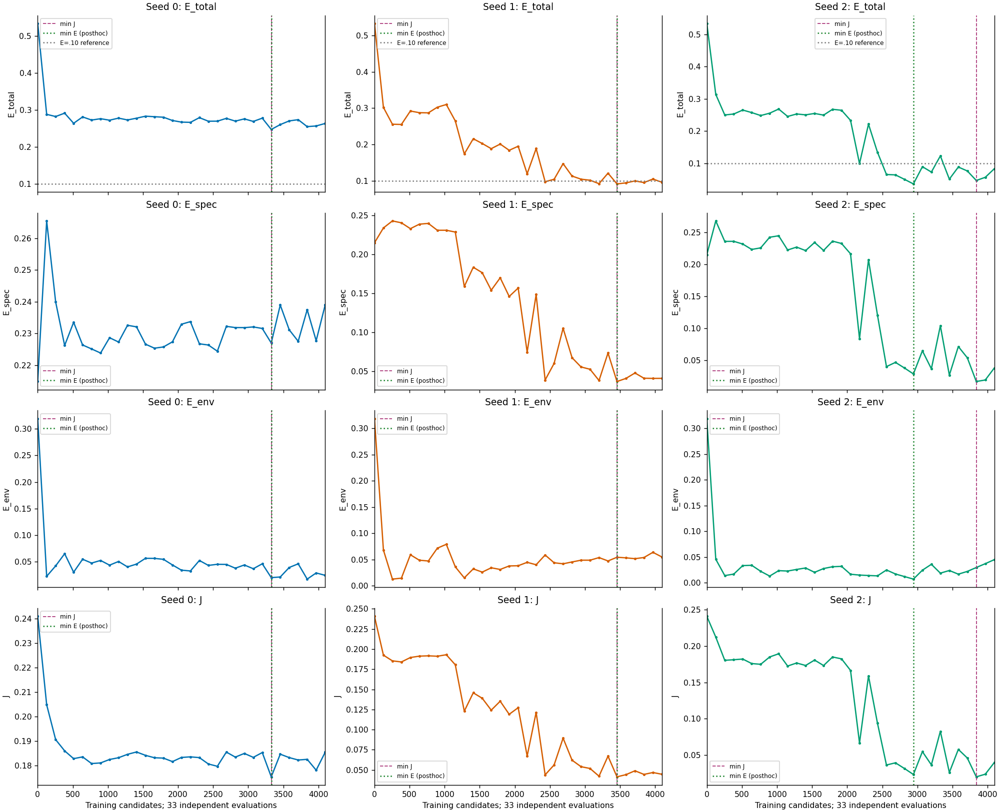
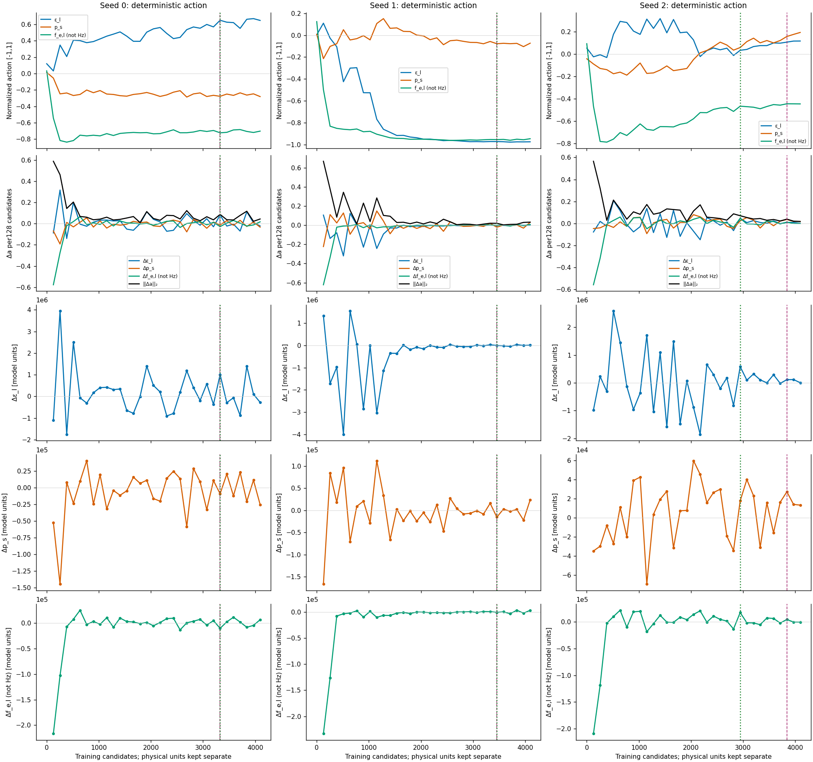
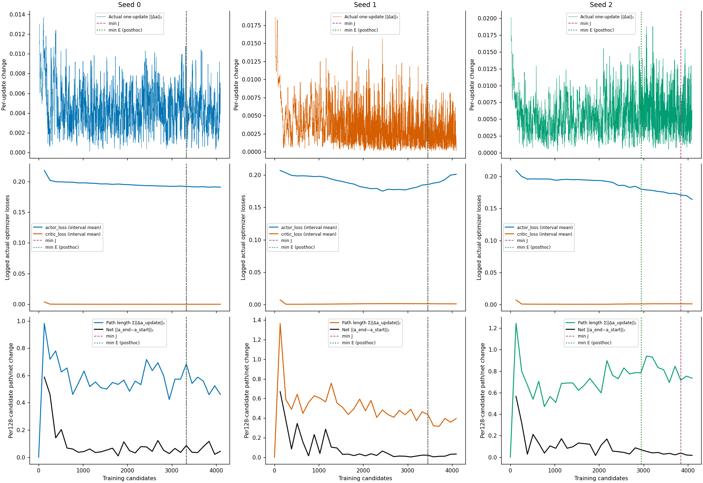
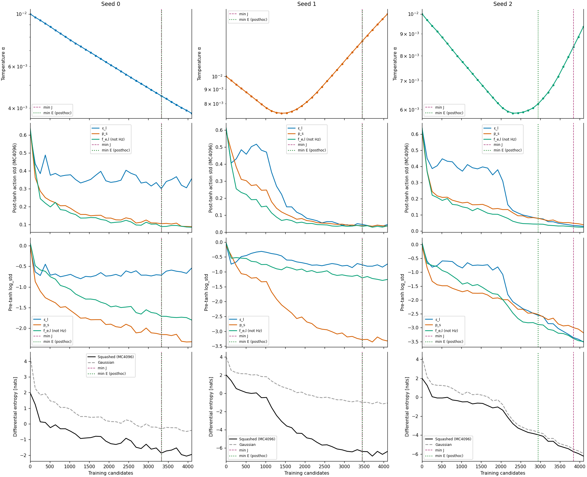
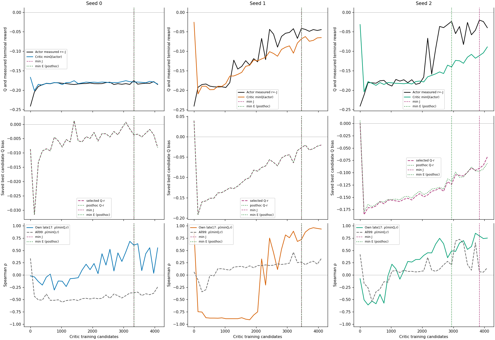
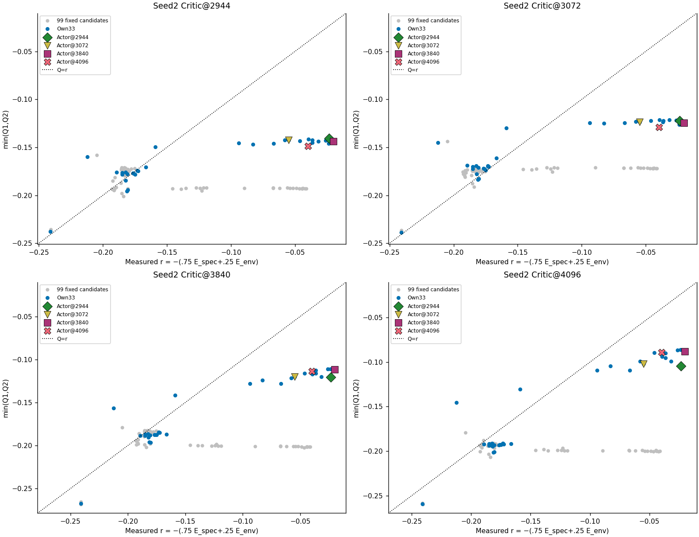
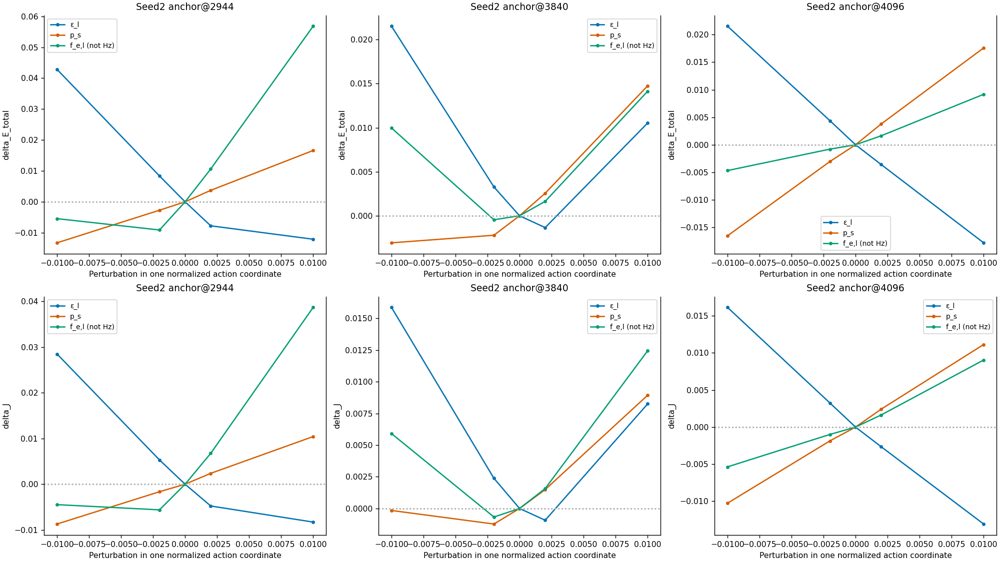

# Issue23 — SAC128・λ=.75のSelected→Final診断と方策保持

> 2026-11-26 成果物整理：本文の計算結果・実施/未実施は当時の記録です。現在の配置・削除した再生成図・hash検証は[移行記録](../../../maintenance/20261126/README.md)を参照。旧manifest/hashは原本を維持しています。

## 結果

設定を変えずに3seed×4096候補を再現し、旧Issue22の全12288学習サンプルと99独立評価が一致した。Final平均E_totalは0.14745±0.10074、持続proxy3/3で、暫定目標の平均≤.10は未達。Selectedやposthocを保持してもFinalの学習精度が改善したことにはならない。

seed0は「評価した決定論的方策の到達」が主な課題で、33点中E_total≤.10は0点、最良も.24729だった。ただし学習サンプルには2290試行のE=.05935が1個あり、良い制御値を全く探索できなかったとは言えない。Final CriticのminQは自分の後半17候補ではRMSE=.00299だが、全99候補で順位相関ρ=−.244、他seedの最良minJ候補を64位にした。自分の停滞領域に合うことと、高精度領域を正しく評価できることは別である。

seed1は2432試行からE≤.10の方策が観測され、33点中7点が到達。Selected .09137→Final .09599の悪化は.00462で、今回の3seedでは保持の問題は小さい。seed2は2176試行から到達し、33点中13点が≤.10だった。2944試行の共通E最小.03587、3840試行のminJ .04656、Final .08283を区別すると、高精度解の維持が課題だがFinal自体も≤.10である。平均目標未達をseed2だけの維持問題に還元しない。

seed2の2944→3072ではΔa=[+.00770,+.05311,−.00433]、Eが+.05344、Jが+.03143。3840→4096ではΔa=[+.00985,+.03591,−.00122]、Eが+.03627、Jが+.01958だった。後者256回のActor更新の移動量中央値は.00513、最大.01546、経路長は1.48759で、正味の移動は約.03726にとどまる。1回の大きな脱落だけでなく、更新による往復と累積移動が存在する。音響損失を全更新で測ったわけではないため、個々の更新の悪化量は不明。

Criticの局所不正確さも実測された。seed2の2944時点で、自身の良い行動の真のr=−.02339に対してminQ=−.14044（bias=−.11704）。±.002の中心差分では、真の報酬勾配がε_l:+2.519、p_s:−1.006なのに、予測は−.0122、+.0574で2座標の符号が逆だった。f0_lは符号は合うが−3.092に対して−.0281と著しく平坦だった。3840/4096時点では3座標とも符号が一致し、不正確さの程度は時点・座標に依存する。

一方、2944→3072と3840→4096の開始/終了2行動の順位は、それぞれ開始/終了Criticで正しく判別していた。従って「悪い行動を常に高く評価したため逸脱した」という単一説明では足りない。Final Criticは2944の共通E最良候補を99候補中12位とし、Finalより真の報酬が+.01633良いのに、予測では−.01549悪く評価した。正しい順位、誤順位、局所勾配の誤りが混在する。決定論的中心1点のQと、確率的行動に対する期待Q＋entropyのActor目的は同じではなく、これらは原因候補の観測である。

alpha上昇を探索幅の増加とは読めない。seed2の2944→3072はα .006184→.006364、3840→4096は.008382→.009345と増えたが、いずれも3座標のtanh後stdは縮小した。後者のstdは[.03513,.04837,.02682]→[.02987,.03963,.02404]、squashed entropyは−5.741→−6.212 nats。後半のαとEの水準相関もseed0/1/2で+.368/−.605/−.387と共通しない。温度・分散・更新は関連するが、温度の上昇だけを悪化の原因とする根拠はない。

局所36音は、更新量と比較できるスケールで損失が変わることを示した。2944のf0_lを正規化+.01（外力係数+3755）だけ動かすとEが+.05683、ε_lを−.01動かすと+.04285。3840のε_l−.01でも+.02153だった。2944→3072の1更新最大移動.01878や中央値.00680は、この局所測定の刻み.002/.01と同程度である。ただし座標ごとの感度順位は2944と4096で変わり、同時3変数の変化を各単変量差分の和で正確に説明したとは主張しない。

保持規則にも利得がある。Final平均.14745に対し、minJのSelected平均.12841、minEのposthoc平均.12484で、保持による平均差はそれぞれ−.01904/−.02261。しかし3runは旧runを再現しただけで、Finalは全く改善していない。seed2ではminJが.02015の3840時点より、J=.02339の2944時点のほうが共通Eは.01069良い。どちらを採用するかは目的の違いで、minJの保存失敗ではない。

## 次Issueの優先順位

まず**「学習率・entropy」のうちActor学習率だけを変える介入**を優先する。実際の1更新移動が感度を測った.002/.01と同程度で、Qが開始/終了の悪化順位を識別できる区間でもActorが移動したため、更新の大きさを独立に調べる価値がある。Criticと温度の学習率、entropy目標・初期α、範囲、報酬、batchは固定し、全3seedの到達時刻・Final・Selected−Final・更新経路長を同じ予算で比較する。これは低学習率が効くという結論ではなく、次に検証すべき仮説である。seed0の到達を遅らせる可能性、Criticの誤勾配を小さく反復するだけの可能性も残る。entropyの変更は同時に行わず、独立した後続条件にする。

次点は**局所近傍探索・変化量制限**。今回の36点は急な局所応答を示すが、大域的な形状や有効な上限値は決められない。保存方策を起点とする近傍探索は追加の最適化として、Actor出力の更新量制限は学習介入として、別々に予算・採用基準を事前固定する。単発の移動制限でも小さな更新の累積逸脱は防げない。近傍探索の選択解をFinal学習の改善に数えない。

**パラメータ別探索幅の変更はその後**とする。3近傍で感度順位が変わり、既に後半stdは縮小していた。現状ではf0_lやp_sの幅だけを恒久的に狭める根拠が不足する。以上の介入は本Issueでは実施していない。

## Stage Aを先行した判断と固定条件

[新規学習前に保存したSTAGE_A.md](STAGE_A.md)は変更せず、必要な中間Criticが既存成果物にないこと、追加記録、選択基準、局所36音の上限を先に固定した。Stage Aは既存CSV/JSON99行を照合し、旧Final/Selected6モデル・6音を監査。中間重みを復元できたとは主張していない。

Case A（右α_r=β_r=0）、x0=.02cm/D=.01、0.20s・50kHz・10000sample、native dt=1e-7、状態/遅延履歴0。人工TargetはIssue22と同じhash。一定3D：ε_l[2.5e7,5e7]、p_s[2.5e6,4e6]、f0_l[49000,800000]、右ε_r=3.5e7/f0_r=49000固定。f0_lはHzでなく開閉外力係数。モデル量を実測張力やPaと直接同一視しない。

SAC Actor/Critic[128,128]、lr3e-4、batch32、gamma1、buffer50000、warmup16、train_freq1、gradient_steps1、ent_coef=auto_0.01、target_entropy=-3、CPU1thread/worker。報酬はr=−J、J=.75E_spec+.25E_env、余分な2倍はない。共通評価E_total=E_spec+E_env。範囲・学習率・幅・分散/entropy目標・batch・報酬重み・1試行の変化量上限は変更しなかった。RLの学習候補は各4096、4080 Actor/Critic/温度更新。独立評価は0,128,...,4096の33回で、最後は最終更新後。

研究対象の新規学習はSAC3runのみ。TD3の過去Selected/Final差は[補助事実](other_methods.csv)として参照し、SAC固有の現象とは断定しない。Case B・時変・実録音・優先Replay・最良方策を教師にする変更は対象外。

## 全seedの到達・維持と採用規則

Final=4096候補の最終更新後、Selected=33独立評価の最初のminJ、posthoc=同33点の最初のmin共通E。posthocは学習目標とは別の事後選別で、今回はその方策も保持した。いずれも音を再生し、行動・20ブロックの物理制御・元振幅float64波形・成分別損失を照合した。

| seed | 採用 | 試行 | E_total | E_spec | E_env | J | 持続proxy |
| --- | --- | --- | --- | --- | --- | --- | --- |
| 0 | final | 4096 | 0.2635241 | 0.2389780 | 0.0245461 | 0.1853700 | True |
| 0 | selected | 3328 | 0.2472917 | 0.2270093 | 0.0202824 | 0.1753276 | True |
| 0 | posthoc | 3328 | 0.2472917 | 0.2270093 | 0.0202824 | 0.1753276 | True |
| 1 | final | 4096 | 0.0959900 | 0.0410592 | 0.0549308 | 0.0445271 | True |
| 1 | selected | 3456 | 0.0913670 | 0.0369829 | 0.0543841 | 0.0413332 | True |
| 1 | posthoc | 3456 | 0.0913670 | 0.0369829 | 0.0543841 | 0.0413332 | True |
| 2 | final | 4096 | 0.0828301 | 0.0380335 | 0.0447966 | 0.0397243 | True |
| 2 | selected | 3840 | 0.0465625 | 0.0170123 | 0.0295501 | 0.0201468 | True |
| 2 | posthoc | 2944 | 0.0358706 | 0.0288536 | 0.0070170 | 0.0233944 | True |

| 採用 | E_total平均±SD | E_spec平均±SD | E_env平均±SD | J平均±SD | 持続/3 |
| --- | --- | --- | --- | --- | --- |
| final | 0.14745 ± 0.10074 | 0.10602 ± 0.11515 | 0.04142 ± 0.01547 | 0.08987 ± 0.08274 | 3 |
| selected | 0.12841 ± 0.10537 | 0.09367 ± 0.11591 | 0.03474 ± 0.01763 | 0.07894 ± 0.08415 | 3 |
| posthoc | 0.12484 ± 0.10961 | 0.09762 ± 0.11213 | 0.02723 ± 0.02444 | 0.08002 ± 0.08303 | 3 |

標本SDはddof=1、seedは3個。持続proxyは末尾1000sampleのAC標準偏差/Target peak>.05かつ数値失敗なしで、生理的な発声判定ではない。平均目標はFinal≤.10かつ持続3/3であり、保存した途中解へ差し替えて達成としない。seed分類は評価された33点に限る。[分類CSV](seed_classification.csv) / [全成分と制御](comparison_per_seed.csv)。

## 行動の変化・更新・温度の時間関係

| seed | 区間 | ΔE_total | ΔJ | ||Δa||₂ | Δε_l | Δp_s | Δf0_l | α開始→終了 |
| --- | --- | --- | --- | --- | --- | --- | --- | --- |
| 0 | 3328→4096 | +0.016232 | +0.010042 | 0.020669 | -21734.83 | -2492.62 | +7632.51 | 0.004504→0.003804 |
| 1 | 3456→4096 | +0.004623 | +0.003194 | 0.009543 | -27243.05 | +3623.53 | +2980.01 | 0.013386→0.016728 |
| 2 | 2944→3072 | +0.053439 | +0.031431 | 0.053843 | +96230.21 | +39835.01 | -1624.77 | 0.006184→0.006364 |
| 2 | 3072→3840 | -0.042747 | -0.034678 | 0.083861 | +816757.98 | +34363.48 | +9676.12 | 0.006364→0.008382 |
| 2 | 3840→4096 | +0.036268 | +0.019578 | 0.037258 | +123125.31 | +26933.94 | -456.45 | 0.008382→0.009345 |

Δaは正規化[-1,1]座標の差、全探索幅に対する比はΔa/2。物理量の差はΔa×[12500000,750000,375500]。物理単位の違う差をそのままL2で合成しない。最終2点だけでなく128候補間の変化と4080個のActor更新前後出力を保存し、更新差の和と評価間の正味変化がfloat32換算の1.2e-7以内で一致した。折返しのため経路長Σ||Δa_update||と正味||Δa||は異なる。各更新の音響値は未評価なので捏造しない。

更新前後のフックはActor optimizerの直前/直後で、当該stepのCritic・温度optimizerはすでに更新済み。2点では同じCriticを使って出力行動のQを照会する。logged actor_lossはSACが実際のbatch32の確率的行動で計算した値で、決定論的出力1点のQや実測音響Jと同じ値ではない。

alpha、tanh後の座標別std、pre-tanh log_std、entropyを同じ評価時刻で記録した。std/entropyは局所NumPy seed220026の共通4096サンプルによる推定で、グローバルRNGを消費しない。連続分布のentropyは負になり得る。alphaはstd自体ではなく、上昇したから全座標の探索幅が増えると仮定しない。

後半17点（≥2048）でのSpearman相関。最後の列は前区間Δx→次区間ΔE（15組）であり、時間順序の記述にとどまる。水準と差分は標本数17/16。自己相関・小標本・多重比較・共通トレンドを考慮した因果検定ではない。全区間/全指標は[相関CSV](stage_a_correlations.csv)に保存した。

| seed | x | 同時水準ρ(x,E) | 同区間ρ(Δx,ΔE) | 前区間Δx→次区間ΔE |
| --- | --- | --- | --- | --- |
| 0 | alpha | +0.368 | +0.079 | -0.011 |
| 0 | std_epsilon_l | +0.451 | +0.588 | -0.411 |
| 0 | std_ps | +0.392 | +0.174 | -0.318 |
| 0 | std_f0_l | +0.583 | +0.335 | -0.246 |
| 0 | entropy | +0.598 | +0.403 | -0.375 |
| 1 | alpha | -0.605 | +0.121 | -0.089 |
| 1 | std_epsilon_l | +0.615 | +0.438 | -0.118 |
| 1 | std_ps | +0.574 | -0.224 | +0.554 |
| 1 | std_f0_l | +0.449 | -0.312 | +0.479 |
| 1 | entropy | +0.686 | -0.094 | +0.454 |
| 2 | alpha | -0.387 | +0.274 | +0.118 |
| 2 | std_epsilon_l | +0.458 | +0.532 | -0.207 |
| 2 | std_ps | +0.451 | +0.006 | +0.054 |
| 2 | std_f0_l | +0.475 | +0.465 | +0.011 |
| 2 | entropy | +0.473 | +0.426 | -0.300 |

## 中間Criticの実測と限界

固定候補は旧33評価×3seedの99行動。新しい各時点のQ1/Q2/minQを全て記録し、保存したActorの出力へのQも別に保存した。1step終端のためCritic targetは実測r=−Jで、次状態のbootstrap項は0。SAC Actorの最適化には現在方策の期待minQとentropyが残る。決定論的出力でminQが低くても、それだけでSACの更新則違反とは言えない。

以下は開始/終了の同じ2行動を、それぞれ開始/終了時点のCriticで評価した回顧比較。実測Δrと予測ΔminQが同符号なら、その2行動の順位は合う。正のΔrは真の改善、負は悪化。結果を見て候補を学習器に提示したものではなく、過去の99行動を学習前に固定して照会した。Q1/Q2の値は[イベントCSV](event_q_comparisons.csv)、全候補は[圧縮予測](critic_predictions.json.gz)、RMSE/バイアス/順位は[指標CSV](critic_metrics.csv)。

| seed | 行動の区間 | Critic時点 | 実測Δr | 予測ΔminQ | 順位の符号一致 |
| --- | --- | --- | --- | --- | --- |
| 0 | 3328→4096 | 3328 | -0.0100424 | -0.0008555 | True |
| 0 | 3328→4096 | 4096 | -0.0100424 | -0.0007971 | True |
| 1 | 3456→4096 | 3456 | -0.0031939 | -0.0009781 | True |
| 1 | 3456→4096 | 4096 | -0.0031939 | -0.0032376 | True |
| 2 | 2944→3072 | 2944 | -0.0314308 | -0.0021422 | True |
| 2 | 2944→3072 | 3072 | -0.0314308 | -0.0012475 | True |
| 2 | 3072→3840 | 3072 | +0.0346785 | -0.0010220 | False |
| 2 | 3072→3840 | 3840 | +0.0346785 | +0.0085929 | True |
| 2 | 3840→4096 | 3840 | -0.0195775 | -0.0022592 | True |
| 2 | 3840→4096 | 4096 | -0.0195775 | -0.0007159 | True |

固定候補は良い途中解を含む回顧集合で、探索領域の一様標本や独立な検証データではない。Qの局所誤順位やバイアスは観測できるが、それを取り除く介入は今回していない。Q1/Q2の差が小さいことも正確さの保証ではない。

## 独立評価とReplay経験・保持

独立評価33回/seedは学習用env/Replayへ追加しない。保存はActorとonline twin Criticの推論用state_dictと時刻/温度の小さなmetadataのみで、optimizer/Replay/target Criticは保存しない。再開学習用checkpointとは呼ばない。minJ/minE/Finalを別名で保持し、seed2の2944/3072/3840だけ追加診断重みを残した。結果は[checkpoint索引](checkpoint_index.json)、保持基準ごとの波形と重みは[runs](runs)。

| seed | 学習4096サンプル中E≤.10 | 最初の試行 | 学習サンプル最小E | その試行 | 独立評価33点中E≤.10 |
| --- | --- | --- | --- | --- | --- |
| 0 | 1 | 2290 | 0.0593497 | 2290 | 0 |
| 1 | 288 | 302 | 0.0237464 | 597 | 7 |
| 2 | 358 | 116 | 0.0200202 | 2821 | 13 |

seed0でも2290試行の学習サンプルにE=.05935の良い行動が1個あり、Replayに入った。従って「良い制御値を一度も試せなかった」とは言えない。一方、決定論的評価方策の良い解への到達は33点中0回で、sampling成功とActorへの定着を分ける。seed1/2にも独立評価での発見より前に良い学習サンプルがあり、Replayに含まれるだけで確実に採用されるわけではない。[学習サンプルと方策評価の区別](replay_success.csv)。

評価された良い行動と学習サンプルの完全一致数、最寄りの正規化距離/全域幅、半径.005/.01/.05以内の経験数は[coverage CSV](candidate_coverage.csv)に記録した。近い経験があることと良い決定論的評価の経験がReplayに入ったことは別で、完全一致0も近傍の学習信号がないことを意味しない。保持された方策へ戻す、教師にする、優先する処理は0。

## 限定した局所感度

事前に決めたseed2の3行動・3座標・±(.002,.01)の36音だけを追加評価した。境界clipは0、失敗は0。物理刻みはε_l±(25000,125000)、p_s±(1500,7500)、f0_l±(751,3755)。同じ保存Criticで近傍のQも予測した。中心差分∂r/∂aと∂minQ/∂aは近傍スケール依存で、非線形性やtwin-minの折れ点のため、中心のautogradと必ずしも等しくない。

| seed2時点 | 変数 | 刻みh | 最大|ΔE| | 最大|ΔJ| | 実測∂r/∂a | 予測差分∂minQ/∂a |
| --- | --- | --- | --- | --- | --- | --- |
| 2944 | epsilon_l | 0.002 | 0.008362 | 0.005309 | 2.519331 | -0.012182 |
| 2944 | ps | 0.002 | 0.003714 | 0.002377 | -1.005713 | 0.057384 |
| 2944 | f0_l | 0.002 | 0.010624 | 0.006754 | -3.091706 | -0.028107 |
| 2944 | epsilon_l | 0.01 | 0.042846 | 0.028491 | 1.839085 | 0.002363 |
| 2944 | ps | 0.01 | 0.016612 | 0.010426 | -0.957157 | 0.053670 |
| 2944 | f0_l | 0.01 | 0.056827 | 0.038694 | -2.158308 | -0.091845 |
| 3840 | epsilon_l | 0.002 | 0.003272 | 0.002382 | 0.827699 | 0.334479 |
| 3840 | ps | 0.002 | 0.002557 | 0.001489 | -0.679432 | -0.111274 |
| 3840 | f0_l | 0.002 | 0.001631 | 0.001570 | -0.560787 | -0.550479 |
| 3840 | epsilon_l | 0.01 | 0.021527 | 0.015871 | 0.380946 | 0.243852 |
| 3840 | ps | 0.01 | 0.014753 | 0.008936 | -0.454685 | -0.108497 |
| 3840 | f0_l | 0.01 | 0.014138 | 0.012443 | -0.326557 | -0.428399 |
| 4096 | epsilon_l | 0.002 | 0.004371 | 0.003246 | 1.473822 | 0.629527 |
| 4096 | ps | 0.002 | 0.003779 | 0.002415 | -1.068007 | -0.296246 |
| 4096 | f0_l | 0.002 | 0.001633 | 0.001634 | -0.656241 | -0.644453 |
| 4096 | epsilon_l | 0.01 | 0.021548 | 0.016138 | 1.460204 | 0.610868 |
| 4096 | ps | 0.01 | 0.017593 | 0.011131 | -1.069635 | -0.305136 |
| 4096 | f0_l | 0.01 | 0.009167 | 0.009040 | -0.720173 | -0.601983 |

[全36測定](local_sensitivity.csv) / [中心差分・中心勾配](local_gradients.csv) / [元振幅float64波形](local_audio.npz)。3近傍だけの結果を空間全体の地形や大域的な最適探索幅へ一般化しない。探索・介入の性能改善をここで評価したものではない。

## 再現・監査・計算量

Stage AのREPORTを保存してから再現を開始した（STAGE_Aのhashをmanifestと各prefixへ記録）。初期policy/実効設定/評価が一致し、最初の128候補で一致を確認後、全4096候補まで照合した。学習前だけ未使用のOS初期化training_env_rngは旧runとの比較から除外し、不一致を明記した。SB3の学習開始resetでseedが適用され、128以降は除外せず全署名が一致。初期点も含む評価/ロギング/保存の前後署名は全キーで一致した。

3runの壁時間は906.0s。研究計算は学習12288音、独立評価99音、Stage Aの旧モデル6音、Stage B再生8音、局所36音、計12437音。各0.20sのnative2,000,000stepで計24,874,000,000完了step。研究上の失敗・非有限値は0、学習のActor/Critic/温度更新は各12240。Q推論と描画に鳴管計算はない。主図は7枚。

新規4テストと共有11テストの計15テストが成功。テスト時のモデル評価は135回（うち注入失敗1件）で、研究runとは別。初回の短いテストで初期未使用環境RNGの署名差を検出し、比較方法を修正したため、32候補のSACテストを2回実行した（64候補）。共有テストには既存24候補×TD3/SACの接続検査も含むが、TD3の研究実験・条件比較は追加していない。[テスト記録](test_execution.json)。

既存5597ファイルはhash一致で変更・削除0。[Stage A監査](stage_a_audit.json) / [Stage B監査](audit.json) / [実行数](execution.json) / [元ファイル保護](integrity.json) / [全成果物hash](artifact_checksums.json) / [実装hash](implementation_checksums.json)。root READMEと.gitignoreだけに索引/作業ログ除外を追加した。commit/push/Issue更新は行っていない。

聴取用は[WAV ZIP](listening.zip)の7音（同一音は重複除去、9endpointへの[索引](listening_index.csv)あり）。全音にTarget peakの逆数という共通gainを掛けたfloat32、個別正規化やクリップは0。float64元波形は各run NPZで保持する。再現手順は[REPRODUCE.md](REPRODUCE.md)。

<!-- ISSUE23_STORAGE_BEGIN -->
| 対象 | 着手前 | 完了時 |
| --- | --- | --- |
| 作業ツリー通常ファイル数 | 7357 | 7462 |
| 論理容量（ignored含む） | 751.68 MB | 767.47 MB |
| Git新規追加候補 | 0（クリーン） | 104個 / 15.78 MB |
| 既存追跡ファイルの変更 / 削除 | 0 / 0 | 2 / 0 |
<!-- ISSUE23_STORAGE_END -->
