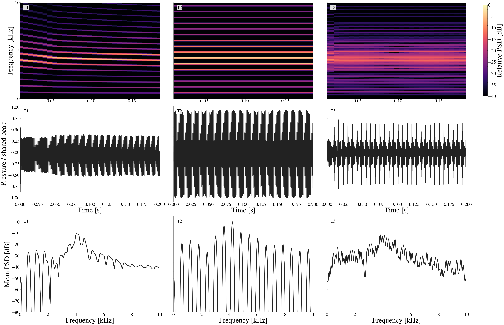
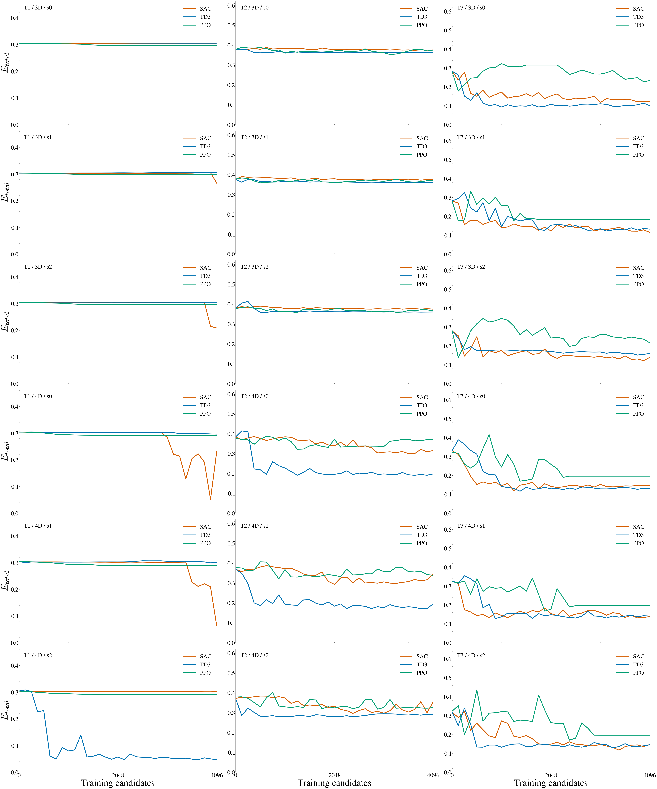
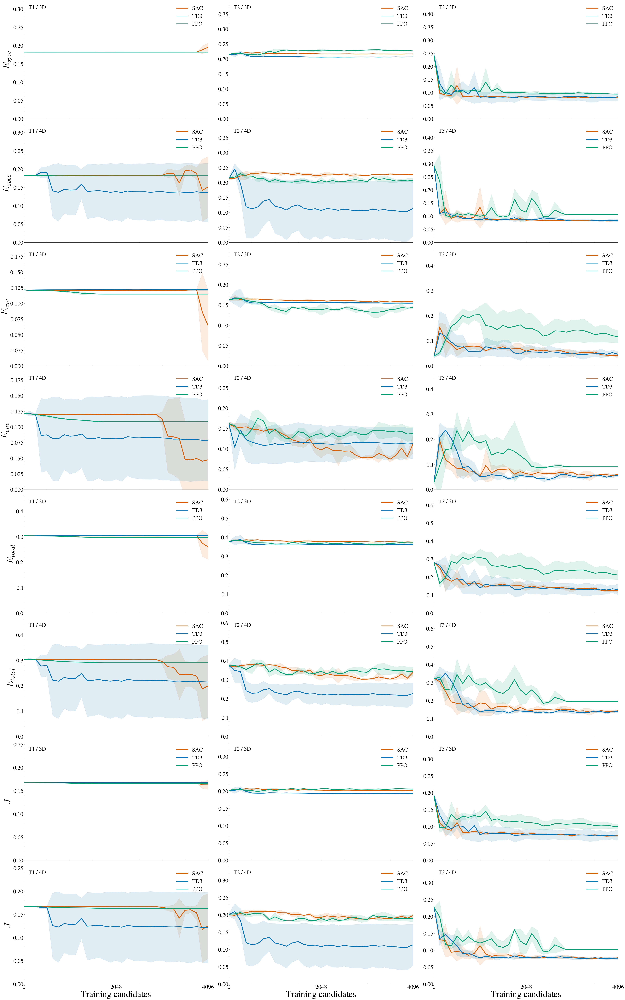
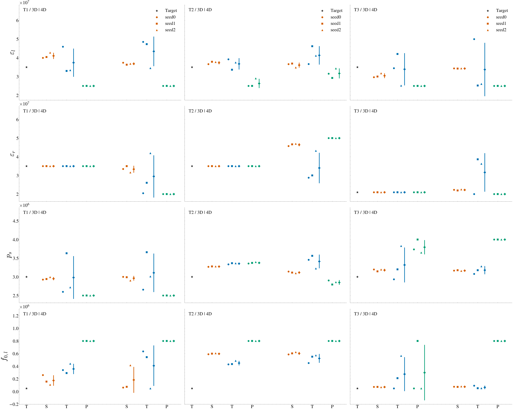
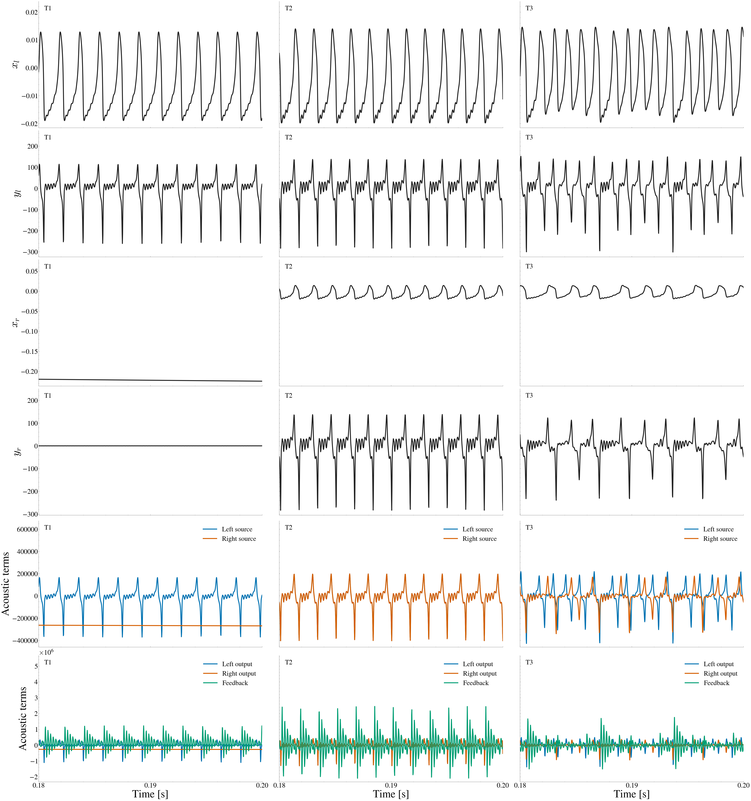

# Issue27再改訂 — 3Target×一定3D/4D・SAC/TD3/PPO

> 2026-11-26 成果物整理：本文の計算結果・実施/未実施は当時の記録です。現在の配置・削除した再生成図・hash検証は[移行記録](../../../maintenance/20261126/README.md)を参照。旧manifest/hashは原本を維持しています。

2026-11-26 JST。[今回のIssue本文](issue_snapshot.json)（[GitHub #27](https://github.com/tatsukawa0353/Birdsong_tatsukawa/issues/27)）で事前指定されたT1/T2/T3を確定し、**3Target×2次元×3手法×3seedの54runを各4096step、計221184学習音で完了した。** 独立方策評価は1782回、4役割の独立詳細再生は216回で全て一致した。

実行セッションのSIGTERMによる中断が一度あり、最初の27本の途中成果は保護して同じseed・同じ凍結条件から復旧した。中断分は正式54runと別会計で、終了stepが保存されなかったため全計算の回数は確定値と範囲を併記する。[復旧記録](RECOVERY.md)。完了54runと、中断27本を計算コスト上で混同しない。

[中断前54チェックポイントの照合](audit/recovery_prefix.json)では、復旧後の同じ評価時点の行動とE_total/Jが全件完全一致した。再計算前の誤差を利用した結果選別は行っていない。

## 3つのTarget（学習前に指定・凍結）

| Target | [ε_l,ε_r,p_s,f0_l,f0_r] | 一次持続proxy | 直線除去後 | 左右変動proxy | oracle E/J |
| --- | --- | --- | --- | --- | --- |
| T1 | [35000000.0, 35000000.0, 3000000.0, 49000.0, 10000000.0] | 0.165260 | 0.165253 | True/False | 0 / 0 |
| T2 | [35000000.0, 35000000.0, 3000000.0, 49000.0, 49000.0] | 0.302914 | 0.302906 | True/True | 0 / 0 |
| T3 | [35000000.0, 21000000.0, 3000000.0, 49000.0, 49000.0] | 0.179154 | 0.179148 | True/True | 0 / 0 |

[T1 WAV](audio/T1_Target.wav) / [T2 WAV](audio/T2_Target.wav) / [T3 WAV](audio/T3_Target.wav)。図の3列はT1/T2/T3、上段スペクトログラム、中段生波形、下段時間平均PSD。全3Targetで共通PSD基準と共通gainを用い、絶対強度を比較できる。T1は片側主導・右閉鎖側設定、T2は両側対称、T3は両側非対称の指定であり、解剖学的閉鎖や同期/非同期の証明とは呼ばない。

T1/T2は前回保存b2_c10/b3_c10のNPZをbyte同一で参照し、T3のみ新規1点を生成した。3音とも別Bインスタンスoracleを再計算し、波形、全20block状態、native運動mean/stdが完全一致、E_spec/E_env/E_total/J=0。右source/outputは非ゼロ。旧18点/9点の再探索やTarget差し替えはない。[発声ゲートと出典hash](preflight/gate.json) / [事前計画](PLAN.md) / [manifest](manifest.json)。

[初回停止REPORT](../target_diagnostics/initial_stop/REPORT.md)、[旧9点REPORT](../target_diagnostics/high_left_force/REPORT.md)、[前回18点・9run REPORT](../target_diagnostics/low_forces/REPORT.md)を参照し、今回を別実験として保存している。

発声ゲートは末尾1000sample（20ms）のAC std/自身の全期間peak>.05、線形傾向除去後ratio>.05、finite、generated_silent=False。左右変動proxyは同じ末尾traceでde-trended std/元std>.5かつde-trended std/全期間state幅>.001をx/y双方に適用した記述量。T1は左、T2/T3は左右の条件を確認した。音声そのものをde-trendしたり、周期性の数学的証明と呼んだりはしない。学習・独立方策評価の持続proxyは従来どおりTarget peak基準で、Stage Aの自身peak基準と区別する。

## 同じTarget内の3D→4D比較

T1とT2では全3手法のFinal平均E_totalが4Dで減少した。T1はSAC/TD3のseed差が大きく、Finalの音圧持続proxyは3Dが1/9、4Dが3/9にとどまった。Target自体の発声ゲート・oracleは合格しており、非持続のFinal方策を計算失敗や物理モデルの発声不能と混同しない。

T2はFinal18/18が持続proxyを満たしたが、Target模倣誤差は残った。TD3のFinal平均E_totalは3Dの0.361573から4Dの0.227417へ減少した。T3もFinal18/18が持続し、SAC/TD3は3D→4Dで平均E_totalがそれぞれ約0.01828/0.00827増加、PPOは約0.01488減少した。異なるTarget間の誤差の大小から、片側/対称/非対称構造の一般的優劣を結論しない。

| Target | 次元 | 手法 | Final E_total 平均±SD | Selected E_total 平均±SD | Final持続率 |
| --- | --- | --- | --- | --- | --- |
| T1 | 3 | SAC | 0.260088 ± 0.048663 | 0.271523 ± 0.054492 | 0.3333333333333333 |
| T1 | 3 | TD3 | 0.304500 ± 0.001306 | 0.303550 ± 0.000662 | 0.0 |
| T1 | 3 | PPO | 0.297424 ± 0.000000 | 0.297424 ± 0.000000 | 0.0 |
| T1 | 4 | SAC | 0.198860 ± 0.122112 | 0.139199 ± 0.140569 | 0.6666666666666667 |
| T1 | 4 | TD3 | 0.214795 ± 0.145147 | 0.214358 ± 0.144762 | 0.3333333333333333 |
| T1 | 4 | PPO | 0.290173 ± 0.000000 | 0.290173 ± 0.000000 | 0.0 |
| T2 | 3 | SAC | 0.375056 ± 0.000471 | 0.374613 ± 0.002141 | 1.0 |
| T2 | 3 | TD3 | 0.361573 ± 0.001742 | 0.360826 ± 0.001383 | 1.0 |
| T2 | 3 | PPO | 0.370765 ± 0.004220 | 0.361852 ± 0.005004 | 1.0 |
| T2 | 4 | SAC | 0.339118 ± 0.021075 | 0.297668 ± 0.004614 | 1.0 |
| T2 | 4 | TD3 | 0.227417 ± 0.053999 | 0.213939 ± 0.058441 | 1.0 |
| T2 | 4 | PPO | 0.344530 ± 0.022568 | 0.321509 ± 0.001371 | 1.0 |
| T3 | 3 | SAC | 0.125891 ± 0.012148 | 0.118205 ± 0.003498 | 1.0 |
| T3 | 3 | TD3 | 0.130966 ± 0.029523 | 0.125352 ± 0.027591 | 1.0 |
| T3 | 3 | PPO | 0.211113 ± 0.025032 | 0.177888 ± 0.036325 | 1.0 |
| T3 | 4 | SAC | 0.144170 ± 0.005431 | 0.122682 ± 0.007669 | 1.0 |
| T3 | 4 | TD3 | 0.139237 ± 0.007287 | 0.126631 ± 0.009091 | 1.0 |
| T3 | 4 | PPO | 0.196233 ± 0.000000 | 0.170421 ± 0.003469 | 1.0 |

平均±標本SD（ddof=1）、各3seed。音響精度は各Target自身を基準としている。以下のΔは同じTarget・手法・seedについて4D−3Dを計算し、その3seed平均と標本SDを求めた値。負ならその指標は4Dで小さい。異なるTargetの絶対誤差を構造効果として比較しない。

| Target | 手法 | 役割 | ΔE_total 平均±SD | ΔJ 平均±SD | Δ共通3変数誤差 平均±SD |
| --- | --- | --- | --- | --- | --- |
| T1 | SAC | final | -0.061228 ± 0.148364 | -0.037408 ± 0.076131 | -0.054140 ± 0.115688 |
| T1 | SAC | selected | -0.132324 ± 0.195022 | -0.079684 ± 0.082163 | -0.101261 ± 0.161951 |
| T1 | TD3 | final | -0.089706 ± 0.143854 | -0.045725 ± 0.075986 | 0.052439 ± 0.266292 |
| T1 | TD3 | selected | -0.089192 ± 0.144117 | -0.045606 ± 0.076047 | 0.124288 ± 0.335778 |
| T1 | PPO | final | -0.007251 ± 0.000000 | -0.002086 ± 0.000000 | 0.000000 ± 0.000000 |
| T1 | PPO | selected | -0.007251 ± 0.000000 | -0.002086 ± 0.000000 | 0.000000 ± 0.000000 |
| T2 | SAC | final | -0.035938 ± 0.021516 | -0.004178 ± 0.004960 | -0.047811 ± 0.018335 |
| T2 | SAC | selected | -0.076945 ± 0.002733 | -0.015999 ± 0.002590 | -0.021809 ± 0.038585 |
| T2 | TD3 | final | -0.134157 ± 0.054825 | -0.080226 ± 0.059275 | 0.094853 ± 0.117157 |
| T2 | TD3 | selected | -0.146887 ± 0.058871 | -0.089230 ± 0.064239 | 0.095937 ± 0.123244 |
| T2 | PPO | final | -0.026235 ± 0.018366 | -0.016701 ± 0.007343 | -0.122060 ± 0.025519 |
| T2 | PPO | selected | -0.040343 ± 0.006129 | -0.013365 ± 0.004082 | -0.038237 ± 0.032223 |
| T3 | SAC | final | 0.018279 ± 0.009557 | 0.004959 ± 0.002446 | -0.051935 ± 0.015714 |
| T3 | SAC | selected | 0.004477 ± 0.010703 | 0.001179 ± 0.001073 | -0.028700 ± 0.012033 |
| T3 | TD3 | final | 0.008271 ± 0.022358 | 0.001715 ± 0.012186 | -0.061880 ± 0.288049 |
| T3 | TD3 | selected | 0.001279 ± 0.019177 | 0.004702 ± 0.012068 | -0.056762 ± 0.278653 |
| T3 | PPO | final | -0.014880 ± 0.025032 | 0.001790 ± 0.006817 | 0.267869 ± 0.232180 |
| T3 | PPO | selected | -0.007467 ± 0.034751 | -0.003667 ± 0.009241 | 0.108575 ± 0.247250 |

- T1 / SAC：4D−3DのFinal E_totalは-0.061228 ± 0.148364。この3seedの平均では4Dで減少した。
- T1 / TD3：4D−3DのFinal E_totalは-0.089706 ± 0.143854。この3seedの平均では4Dで減少した。
- T1 / PPO：4D−3DのFinal E_totalは-0.007251 ± 0.000000。この3seedの平均では4Dで減少した。
- T2 / SAC：4D−3DのFinal E_totalは-0.035938 ± 0.021516。この3seedの平均では4Dで減少した。
- T2 / TD3：4D−3DのFinal E_totalは-0.134157 ± 0.054825。この3seedの平均では4Dで減少した。
- T2 / PPO：4D−3DのFinal E_totalは-0.026235 ± 0.018366。この3seedの平均では4Dで減少した。
- T3 / SAC：4D−3DのFinal E_totalは+0.018279 ± 0.009557。この3seedの平均では4Dで増加した。
- T3 / TD3：4D−3DのFinal E_totalは+0.008271 ± 0.022358。この3seedの平均では4Dで増加した。
- T3 / PPO：4D−3DのFinal E_totalは-0.014880 ± 0.025032。この3seedの平均では4Dで減少した。

上の記述は単一予算・3seedの結果に限られ、一般的優劣や統計的有意性を断定しない。右εを追加すると探索域・ネット出力・SAC target_entropy・ノイズ次元が指定どおり変わるため、次元の影響を単一要因の厳密因果効果として切り分けたものではない。

## Final/Selectedの視覚比較

次の各図は4行Target/SAC/TD3/PPO、6列3Dのseed0/1/2、4Dのseed0/1/2。同じTargetの3D/4D、全手法、全seed、Final/Selectedで時間・周波数・PSD基準と色軸[-40,0]dBを統一した。Targetのfull-band表示PSD最大が基準で、生成音ごとの正規化はしない。飽和率は[display_settings](display_settings.json)に全108生成パネル分を保存し、広域表示は補助1枚だけとした。

[広域補助：代表seed1のFinal](figures/wide_psd_reference.png)。波形の個別gain調整、位相合わせ、ドリフト除去による音の加工はしない。狭い色軸で見えない成分を報酬や保存音から除去したものでもない。

## 学習曲線・探索候補と方策の獲得

全seed図は列T1/T2/T3、行3D seed0/1/2、4D seed0/1/2。各パネルに3手法の33評価点をすべて表示した。平均図は各指標E_spec/E_env/E_total/Jについて3D/4Dを隣接行、列T1/T2/T3、中心は3seed平均・帯は標本SD。平滑化・間引き・頂点省略は行わない。

Final=4096step全更新完了後の決定論的方策。Selected=33点中最初のminJ方策。posthoc=同じ33点中最初のminE_total方策。training_best=4096学習候補中最初のminJ行動で、保存Actorと呼ばない。J=.75E_spec+.25E_envとE_total=E_spec+E_envは選択基準が異なる。

[獲得・保持・training_bestとの差](acquisition_retention.csv)には初期E半減の初回評価時点、持続proxyの初回観測点、Final−Selected/Final−training_bestを保存。[境界への張り付き](boundary_diagnostics.csv)と[探索範囲・方策分散](exploration.csv)、[3seed共通Final行動の検査](audit/common_Final_actions.json)も保存した。同じ出力になった場合もseed別重みhashと実行時clipを区別し、同一結果を複製したとみなさない。E_total≤.10を合否・延長・再試行の条件には用いていない。

3Targetとも左f0の正解49000は探索下限。SACのtanh付きGaussian、TD3のtanh Actorと学習時Normalノイズ・clip、PPOのGaussianと環境clipでは境界へ到達する性質が異なる。TD3の決定論的評価には探索ノイズがなく、学習候補で境界に達したことをActorの復元成功と混同しない。T3の右ε正解21Mも4D下限20Mに近いが、3Dでは正解値に固定した既知条件である。

## 制御値と同定誤差

列はT1/T2/T3。各パネルの横配置はTarget（黒印）、3DのSAC/TD3/PPO、4DのSAC/TD3/PPO（S/T/P）。seed点と平均±標本SDを表示。3Dの右εは各Target自身の正解値に固定されており、復元の成功例には数えない。

| Target | 次元 | 手法 | 共通3変数の幅正規化誤差 平均±SD | 右ε絶対誤差 平均±SD | 右ε幅正規化誤差 平均±SD |
| --- | --- | --- | --- | --- | --- |
| T1 | 3 | SAC | 0.146849 ± 0.025507 | 固定・推定対象外 | 固定・推定対象外 |
| T1 | 3 | TD3 | 0.298998 ± 0.056753 | 固定・推定対象外 | 固定・推定対象外 |
| T1 | 3 | PPO | 0.577778 ± 0.000000 | 固定・推定対象外 | 固定・推定対象外 |
| T1 | 4 | SAC | 0.092709 ± 0.100793 | 1655986.011028 ± 1696692.068960 | 0.055200 ± 0.056556 |
| T1 | 4 | TD3 | 0.351437 ± 0.297148 | 10136554.241180 ± 3913967.841728 | 0.337885 ± 0.130466 |
| T1 | 4 | PPO | 0.577778 ± 0.000000 | 15000000.000000 ± 0.000000 | 0.500000 ± 0.000000 |
| T2 | 3 | SAC | 0.336975 ± 0.013469 | 固定・推定対象外 | 固定・推定対象外 |
| T2 | 3 | TD3 | 0.292573 ± 0.019888 | 固定・推定対象外 | 固定・推定対象外 |
| T2 | 3 | PPO | 0.532513 ± 0.026716 | 固定・推定対象外 | 固定・推定対象外 |
| T2 | 4 | SAC | 0.289164 ± 0.009650 | 11463891.863823 ± 628552.951457 | 0.382130 ± 0.020952 |
| T2 | 4 | TD3 | 0.387427 ± 0.099472 | 6455268.561840 ± 1608122.759752 | 0.215176 ± 0.053604 |
| T2 | 4 | PPO | 0.410454 ± 0.041206 | 15000000.000000 ± 0.000000 | 0.500000 ± 0.000000 |
| T3 | 3 | SAC | 0.110506 ± 0.015299 | 固定・推定対象外 | 固定・推定対象外 |
| T3 | 3 | TD3 | 0.258819 ± 0.263879 | 固定・推定対象外 | 固定・推定対象外 |
| T3 | 3 | PPO | 0.421020 ± 0.232180 | 固定・推定対象外 | 固定・推定対象外 |
| T3 | 4 | SAC | 0.058571 ± 0.001802 | 1250002.026558 ± 266670.348695 | 0.041667 ± 0.008889 |
| T3 | 4 | TD3 | 0.196938 ± 0.034475 | 11294219.772021 ± 8997731.975331 | 0.376474 ± 0.299924 |
| T3 | 4 | PPO | 0.688889 ± 0.000000 | 1000000.000000 ± 0.000000 | 0.033333 ± 0.000000 |

各パラメータの絶対誤差と探索幅正規化誤差を[endpoints.csv](endpoints.csv)へ全216結果保存した。共通3変数誤差は|Δε_l|/2.5e7、|Δp_s|/1.5e6、|Δf0_l|/751000の平均。4D右εは|Δε_r|/3e7として別列、3Dでは推定対象外の空欄。共通3変数と4D右εを混ぜた平均で次元間の精度を主張しない。音響模倣とパラメータ同定は別で、対称条件・閉鎖側条件でも制御値が一意に決まるとは仮定しない。

## 波形・平均PSDと音源内部状態

列T1の3D/4D、T2の3D/4D、T3の3D/4D。代表seed1を学習前に固定。行は全0.20sの5ms RMS、末尾5msの生波形、全表示窓の時間平均PSD。全波形は3Target共通peakの逆数によるgain、PSDは同じTarget内の共通基準。全seed・4役割のWAVと生波形は[音声索引](AUDIO.md)に保存し、training_best/posthocの網羅的PNGは作成していない。聴取による主観評価は未実施。

T1は左の持続変動に対して右はドリフト主体だが、右source/outputは非ゼロで圧力結合へ寄与する。T2の同一係数・零初期条件での左右trace一致を、摂動下の同期安定性の証明にはしない。T3の指定非対称εでは左右traceと周波数構造に違いが観測されたが、非同期の一般的証明とも呼ばない。右の微小応答をゼロへclampしない。

T1の右ε=2e7/5e7の事前検査では実メモリ値と出力の変化を確認した。[保存データによる差の数値](preflight/right_sensitivity_saved_data.json)。これは広域2点間の音圧差であり、局所感度・一意な同定可能性を証明するものではない。追加の感度gridは実行していない。

左右のsource_j=α_j(x_j−τ_j y_j)+β_j y_j、output_j=source_j−β_j τ_j dy_j/dt、feedback=−γπ(t−T)を保存し、output_l+output_r+feedbackと未フィルタ音圧の一致を丸め誤差範囲で監査した。連成状態での代数分解で、独立に発声させた音や因果的寄与率ではない。[全役割の左右運動](endpoint_motion.csv) / [左右音響寄与](endpoint_sources.csv) / [全native block統計](endpoint_native_blocks.csv) / [全時系列NPZ](audit) / [Targetと代表結果のCSV.gz](timeseries)。

## 物理・学習条件と実ネット構造

元native/model.cpp、model.py、既存libbirdsong.soは変更していない。[同一ソース再ビルドのbyte/hash一致](native/build.json)。独立ConfiguredCaseB wrapperで入力範囲を右ε2e7まで拡げ、右f0をTargetごとに保持するだけで、native condition1と左右α1.2e6/β1500を維持。元の右εの下限2.5e7チェックや以前の35M固定を今回へ持ち込まない。全5制御の実効値・固定物理係数をreset/step/評価/再生で実メモリ検査した。

0.20s一定、2M native step/音、dt1e-7、50kHz10000sample。初期4状態・遅延・filter0、16次15kHz lowpass→200分の1デシメーション。x0=.02cm/D=.01等も不変。3D可変[ε_l,p_s,f0_l]、4D可変[ε_l,ε_r,p_s,f0_l]。ε_l25–50M、右ε20–50M、p_s2.5–4M、左f049000–800000。右f0はT1=1e7、T2/T3=49000で固定。f0は外力項でHzではない。観測は全ケース8Dの同じreset[-1,0,…]で正解制御値を含まない。

全手法LR3e-4/gamma1/batch32/CPU1thread。隠れ層128×128、SAC/TD3 ReLU、PPOはpi/vf別128×128 Tanh。SAC/TD3 buffer50000/warmup16/train_freq1/gradient_steps1/tau.005。SAC auto_0.01/target_entropy=−3または−4。TD3次元別Normal(0,.1)、delay2/targetnoise.2/clip.5。PPO n_steps128/n_epochs10/clip.2/gae.95/vf_coef.5/ent0/max_grad_norm.5/normalize_advantage=True/target_kl=None。Adam epsはPPO1e-5、他1e-8。[全実効設定とpackage版](manifest.json)、各run configに保存した。

| 次元 | 手法 | Actor/方策 | Critic/価値 | target Actor | target Critic | policy合計 | optimizer step/run |
| --- | --- | --- | --- | --- | --- | --- | --- |
| 3 | PPO | 18054 | 17793 | 0 | 0 | 35847 | {'policy_value': 1280} |
| 3 | SAC | 18438 | 36354 | 0 | 36354 | 91146 | {'actor': 4080, 'critic': 4080, 'entropy': 4080} |
| 3 | TD3 | 18051 | 36354 | 18051 | 36354 | 108810 | {'actor': 2040, 'critic': 4080} |
| 4 | PPO | 18184 | 17793 | 0 | 0 | 35977 | {'policy_value': 1280} |
| 4 | SAC | 18696 | 36610 | 0 | 36610 | 91916 | {'actor': 4080, 'critic': 4080, 'entropy': 4080} |
| 4 | TD3 | 18180 | 36610 | 18180 | 36610 | 109580 | {'actor': 2040, 'critic': 4080} |

SAC温度1parameterはpolicy合計の外。隠れ層幅が同じでもパラメータ数や更新数が同じとは言わない。SAC actor/critic/entropy各4080、TD3 critic4080/actor2040、PPO32rollout×4minibatch×10epoch=1280 optimizer step（内部epoch counter320）をrunごとに実測検査した。

## 事前検査・独立監査

6組のマッピング、上下限、正解値の逆変換、実メモリ、全54初期seed設定、実ネット構造とparameter数を検査。2次元×3手法の標準SB3と監査付き実装をsynthetic128stepで照合し、重み・optimizer・Buffer・RNGが完全一致した（計1536synthetic episode、新規音0）。方法別smokeは18本×128学習=2304音、独立評価36音、保存3方策とtraining_best再生72音、計2412音。[事前検査](preflight/tests.json)。最初の保存モデル読込試験で引数指定の不一致があり修正した。完了済み18smoke学習を再利用し、未実施だった再生検査だけを実行した。再学習による差し替えはない。

SAC/TD3はReplayに保存する正規化actionと標準unscaleによる環境実行actionの整合、PPOはraw Gaussian actionを保持するrolloutと環境clip actionの整合を全221184行で検査した。全optimizer更新のLR・有限性・既存の勾配/parameter/Adam moment停止条件を検査。PPO既定grad clip.5を保持し、追加clampはない。

独立評価は0,128,…,4096の33点/run、対応する全更新後。評価前後の学習器・optimizer・Buffer・RNG・training_best signatureが1782回すべて不変。Final/Selected/posthocの162方策とtraining_best54行動を別Bで216音再生し、波形・状態・制御・音響誤差が全て一致。[独立再生監査](audit/endpoints.json)。保存.ptは推論用方策/価値/targetネットとSAC温度で、optimizer/Replayを含む学習再開checkpointではない。

## 全指標の平均・標本SD

| Target | 次元 | 手法 | 役割 | E_spec 平均±SD | E_env 平均±SD | E_total 平均±SD | J 平均±SD |
| --- | --- | --- | --- | --- | --- | --- | --- |
| T1 | 3 | SAC | final | 0.195502 ± 0.011819 | 0.064587 ± 0.056524 | 0.260088 ± 0.048663 | 0.162773 ± 0.009851 |
| T1 | 3 | SAC | selected | 0.187862 ± 0.009289 | 0.083661 ± 0.063781 | 0.271523 ± 0.054492 | 0.161812 ± 0.008979 |
| T1 | 3 | SAC | training_best | 0.063047 ± 0.017831 | 0.018261 ± 0.011218 | 0.081308 ± 0.028833 | 0.051850 ± 0.016105 |
| T1 | 3 | SAC | posthoc | 0.195523 ± 0.011783 | 0.063740 ± 0.055219 | 0.259264 ± 0.047521 | 0.162578 ± 0.009713 |
| T1 | 3 | TD3 | final | 0.182478 ± 0.000076 | 0.122022 ± 0.001266 | 0.304500 ± 0.001306 | 0.167364 ± 0.000349 |
| T1 | 3 | TD3 | selected | 0.182465 ± 0.000051 | 0.121085 ± 0.000641 | 0.303550 ± 0.000662 | 0.167120 ± 0.000178 |
| T1 | 3 | TD3 | training_best | 0.171764 ± 0.018000 | 0.100876 ± 0.030958 | 0.272640 ± 0.048928 | 0.154042 ± 0.021226 |
| T1 | 3 | TD3 | posthoc | 0.182479 ± 0.000041 | 0.121050 ± 0.000698 | 0.303529 ± 0.000697 | 0.167122 ± 0.000175 |
| T1 | 3 | PPO | final | 0.182435 ± 0.000000 | 0.114989 ± 0.000000 | 0.297424 ± 0.000000 | 0.165574 ± 0.000000 |
| T1 | 3 | PPO | selected | 0.182435 ± 0.000000 | 0.114989 ± 0.000000 | 0.297424 ± 0.000000 | 0.165574 ± 0.000000 |
| T1 | 3 | PPO | training_best | 0.103963 ± 0.064341 | 0.012054 ± 0.004838 | 0.116017 ± 0.069062 | 0.080986 ± 0.049434 |
| T1 | 3 | PPO | posthoc | 0.182435 ± 0.000000 | 0.114989 ± 0.000000 | 0.297424 ± 0.000000 | 0.165574 ± 0.000000 |
| T1 | 4 | SAC | final | 0.151300 ± 0.083052 | 0.047560 ± 0.062729 | 0.198860 ± 0.122112 | 0.125365 ± 0.069933 |
| T1 | 4 | SAC | selected | 0.094657 ± 0.076150 | 0.044542 ± 0.064560 | 0.139199 ± 0.140569 | 0.082128 ± 0.073202 |
| T1 | 4 | SAC | training_best | 0.050763 ± 0.032254 | 0.010916 ± 0.003022 | 0.061679 ± 0.034555 | 0.040801 ± 0.024756 |
| T1 | 4 | SAC | posthoc | 0.094657 ± 0.076150 | 0.044542 ± 0.064560 | 0.139199 ± 0.140569 | 0.082128 ± 0.073202 |
| T1 | 4 | TD3 | final | 0.135882 ± 0.080097 | 0.078912 ± 0.065063 | 0.214795 ± 0.145147 | 0.121640 ± 0.076334 |
| T1 | 4 | TD3 | selected | 0.135850 ± 0.080069 | 0.078509 ± 0.064698 | 0.214358 ± 0.144762 | 0.121514 ± 0.076224 |
| T1 | 4 | TD3 | training_best | 0.122759 ± 0.083123 | 0.045450 ± 0.059815 | 0.168209 ± 0.132655 | 0.103432 ± 0.073779 |
| T1 | 4 | TD3 | posthoc | 0.136154 ± 0.079542 | 0.078109 ± 0.065391 | 0.214263 ± 0.144927 | 0.121643 ± 0.076002 |
| T1 | 4 | PPO | final | 0.181889 ± 0.000000 | 0.108284 ± 0.000000 | 0.290173 ± 0.000000 | 0.163488 ± 0.000000 |
| T1 | 4 | PPO | selected | 0.181889 ± 0.000000 | 0.108284 ± 0.000000 | 0.290173 ± 0.000000 | 0.163488 ± 0.000000 |
| T1 | 4 | PPO | training_best | 0.069971 ± 0.022667 | 0.027309 ± 0.005581 | 0.097280 ± 0.017098 | 0.059305 ± 0.015607 |
| T1 | 4 | PPO | posthoc | 0.181889 ± 0.000000 | 0.108284 ± 0.000000 | 0.290173 ± 0.000000 | 0.163488 ± 0.000000 |
| T2 | 3 | SAC | final | 0.216928 ± 0.000066 | 0.158128 ± 0.000418 | 0.375056 ± 0.000471 | 0.202228 ± 0.000146 |
| T2 | 3 | SAC | selected | 0.215515 ± 0.000833 | 0.159098 ± 0.002800 | 0.374613 ± 0.002141 | 0.201411 ± 0.000373 |
| T2 | 3 | SAC | training_best | 0.191510 ± 0.012157 | 0.031149 ± 0.009325 | 0.222659 ± 0.002841 | 0.151420 ± 0.006787 |
| T2 | 3 | SAC | posthoc | 0.216533 ± 0.000512 | 0.157196 ± 0.000820 | 0.373729 ± 0.001330 | 0.201699 ± 0.000588 |
| T2 | 3 | TD3 | final | 0.207033 ± 0.000525 | 0.154540 ± 0.002266 | 0.361573 ± 0.001742 | 0.193910 ± 0.000174 |
| T2 | 3 | TD3 | selected | 0.206412 ± 0.000287 | 0.154413 ± 0.001655 | 0.360826 ± 0.001383 | 0.193413 ± 0.000217 |
| T2 | 3 | TD3 | training_best | 0.195935 ± 0.009466 | 0.068805 ± 0.069676 | 0.264740 ± 0.078972 | 0.164152 ± 0.024415 |
| T2 | 3 | TD3 | posthoc | 0.207025 ± 0.000833 | 0.153312 ± 0.002477 | 0.360336 ± 0.001730 | 0.193596 ± 0.000233 |
| T2 | 3 | PPO | final | 0.227135 ± 0.001240 | 0.143630 ± 0.003193 | 0.370765 ± 0.004220 | 0.206259 ± 0.001625 |
| T2 | 3 | PPO | selected | 0.209312 ± 0.003028 | 0.152540 ± 0.002113 | 0.361852 ± 0.005004 | 0.195119 ± 0.002752 |
| T2 | 3 | PPO | training_best | 0.169093 ± 0.007349 | 0.064347 ± 0.001155 | 0.233440 ± 0.006326 | 0.142907 ± 0.005253 |
| T2 | 3 | PPO | posthoc | 0.234450 ± 0.001401 | 0.121907 ± 0.003579 | 0.356357 ± 0.002986 | 0.206314 ± 0.000898 |
| T2 | 4 | SAC | final | 0.226540 ± 0.002219 | 0.112578 ± 0.022252 | 0.339118 ± 0.021075 | 0.198050 ± 0.004820 |
| T2 | 4 | SAC | selected | 0.221990 ± 0.003513 | 0.075678 ± 0.002500 | 0.297668 ± 0.004614 | 0.185412 ± 0.002800 |
| T2 | 4 | SAC | training_best | 0.048833 ± 0.010835 | 0.112505 ± 0.024837 | 0.161338 ± 0.033232 | 0.064751 ± 0.013190 |
| T2 | 4 | SAC | posthoc | 0.225149 ± 0.007409 | 0.071390 ± 0.004246 | 0.296538 ± 0.003169 | 0.186709 ± 0.004496 |
| T2 | 4 | TD3 | final | 0.113659 ± 0.091409 | 0.113758 ± 0.037762 | 0.227417 ± 0.053999 | 0.113684 ± 0.059177 |
| T2 | 4 | TD3 | selected | 0.101395 ± 0.099261 | 0.112544 ± 0.042482 | 0.213939 ± 0.058441 | 0.104182 ± 0.064106 |
| T2 | 4 | TD3 | training_best | 0.096811 ± 0.100391 | 0.087106 ± 0.040538 | 0.183918 ± 0.059856 | 0.094385 ± 0.065159 |
| T2 | 4 | TD3 | posthoc | 0.101952 ± 0.100226 | 0.111375 ± 0.044471 | 0.213327 ± 0.057398 | 0.104308 ± 0.064323 |
| T2 | 4 | PPO | final | 0.206850 ± 0.006908 | 0.137679 ± 0.016241 | 0.344530 ± 0.022568 | 0.189558 ± 0.008968 |
| T2 | 4 | PPO | selected | 0.202753 ± 0.002092 | 0.118757 ± 0.001323 | 0.321509 ± 0.001371 | 0.181754 ± 0.001332 |
| T2 | 4 | PPO | training_best | 0.074475 ± 0.023368 | 0.173925 ± 0.062934 | 0.248400 ± 0.085987 | 0.099338 ± 0.033106 |
| T2 | 4 | PPO | posthoc | 0.204392 ± 0.001458 | 0.115788 ± 0.001465 | 0.320180 ± 0.002353 | 0.182241 ± 0.001252 |
| T3 | 3 | SAC | final | 0.082976 ± 0.000877 | 0.042915 ± 0.012935 | 0.125891 ± 0.012148 | 0.072961 ± 0.002654 |
| T3 | 3 | SAC | selected | 0.082564 ± 0.001614 | 0.035641 ± 0.005111 | 0.118205 ± 0.003498 | 0.070834 ± 0.000077 |
| T3 | 3 | SAC | training_best | 0.071704 ± 0.001983 | 0.031953 ± 0.003360 | 0.103657 ± 0.001609 | 0.061767 ± 0.000741 |
| T3 | 3 | SAC | posthoc | 0.082564 ± 0.001614 | 0.035641 ± 0.005111 | 0.118205 ± 0.003498 | 0.070834 ± 0.000077 |
| T3 | 3 | TD3 | final | 0.084411 ± 0.016888 | 0.046555 ± 0.012665 | 0.130966 ± 0.029523 | 0.074947 ± 0.015822 |
| T3 | 3 | TD3 | selected | 0.076279 ± 0.018272 | 0.049073 ± 0.009546 | 0.125352 ± 0.027591 | 0.069477 ± 0.016017 |
| T3 | 3 | TD3 | training_best | 0.061544 ± 0.033607 | 0.029282 ± 0.025138 | 0.090826 ± 0.058235 | 0.053478 ± 0.031312 |
| T3 | 3 | TD3 | posthoc | 0.078854 ± 0.015891 | 0.043597 ± 0.013963 | 0.122450 ± 0.029078 | 0.070039 ± 0.015128 |
| T3 | 3 | PPO | final | 0.094725 ± 0.001986 | 0.116388 ± 0.024081 | 0.211113 ± 0.025032 | 0.100141 ± 0.006817 |
| T3 | 3 | PPO | selected | 0.093951 ± 0.001424 | 0.083937 ± 0.034904 | 0.177888 ± 0.036325 | 0.091447 ± 0.009792 |
| T3 | 3 | PPO | training_best | 0.065572 ± 0.002918 | 0.036889 ± 0.003741 | 0.102461 ± 0.006528 | 0.058401 ± 0.003072 |
| T3 | 3 | PPO | posthoc | 0.112265 ± 0.019148 | 0.052293 ± 0.009667 | 0.164558 ± 0.022174 | 0.097272 ± 0.014765 |
| T3 | 4 | SAC | final | 0.083754 ± 0.001869 | 0.060416 ± 0.003629 | 0.144170 ± 0.005431 | 0.077919 ± 0.002279 |
| T3 | 4 | SAC | selected | 0.082684 ± 0.002673 | 0.039998 ± 0.010081 | 0.122682 ± 0.007669 | 0.072013 ± 0.001002 |
| T3 | 4 | SAC | training_best | 0.072369 ± 0.001138 | 0.036207 ± 0.002183 | 0.108576 ± 0.002525 | 0.063328 ± 0.001042 |
| T3 | 4 | SAC | posthoc | 0.082684 ± 0.002673 | 0.039998 ± 0.010081 | 0.122682 ± 0.007669 | 0.072013 ± 0.001002 |
| T3 | 4 | TD3 | final | 0.083706 ± 0.004173 | 0.055531 ± 0.004707 | 0.139237 ± 0.007287 | 0.076662 ± 0.003704 |
| T3 | 4 | TD3 | selected | 0.085043 ± 0.003682 | 0.041588 ± 0.005416 | 0.126631 ± 0.009091 | 0.074179 ± 0.004113 |
| T3 | 4 | TD3 | training_best | 0.077450 ± 0.000900 | 0.035438 ± 0.002415 | 0.112888 ± 0.001515 | 0.066947 ± 0.000072 |
| T3 | 4 | TD3 | posthoc | 0.086685 ± 0.005057 | 0.037936 ± 0.002395 | 0.124621 ± 0.007369 | 0.074498 ± 0.004365 |
| T3 | 4 | PPO | final | 0.105744 ± 0.000000 | 0.090489 ± 0.000000 | 0.196233 ± 0.000000 | 0.101930 ± 0.000000 |
| T3 | 4 | PPO | selected | 0.090351 ± 0.000700 | 0.080070 ± 0.003935 | 0.170421 ± 0.003469 | 0.087781 ± 0.000710 |
| T3 | 4 | PPO | training_best | 0.074697 ± 0.002574 | 0.033222 ± 0.004448 | 0.107919 ± 0.006458 | 0.064328 ± 0.002798 |
| T3 | 4 | PPO | posthoc | 0.091409 ± 0.001783 | 0.077540 ± 0.002230 | 0.168949 ± 0.001476 | 0.087942 ± 0.000989 |

[全seed全216結果](endpoints.csv) / [72群の平均・標本SDとparameter誤差](method_summary.csv) / [1782評価点CSV](learning_curves.csv) / [対応するseedの3D→4D差](paired_differences.csv) / [学習ログ・モデル・生音](runs)。全221184候補の行動・5物理値・音響指標をtraining_trace.json.gzに保存した。全候補WAVや全更新重みを保存したものではない。

## 実行時間・回数と中断分

| Target | 次元 | 手法 | seed | 学習wall秒 | 評価wall秒 | process CPU秒 | 非持続学習音 | 数値失敗 |
| --- | --- | --- | --- | --- | --- | --- | --- | --- |
| T1 | 3 | PPO | 0 | 892.547143 | 7.291209 | 900.377166 | 3901 | 0 |
| T1 | 3 | PPO | 1 | 890.320696 | 7.274752 | 898.446835 | 3953 | 0 |
| T1 | 3 | PPO | 2 | 894.311304 | 7.233780 | 902.097103 | 3960 | 0 |
| T1 | 3 | SAC | 0 | 904.154308 | 7.138871 | 912.438874 | 3819 | 0 |
| T1 | 3 | SAC | 1 | 902.585297 | 7.265500 | 911.145580 | 3700 | 0 |
| T1 | 3 | SAC | 2 | 903.788164 | 7.196759 | 912.312212 | 3693 | 0 |
| T1 | 3 | TD3 | 0 | 899.469341 | 7.142193 | 907.562785 | 4091 | 0 |
| T1 | 3 | TD3 | 1 | 910.127313 | 7.287455 | 918.249423 | 4094 | 0 |
| T1 | 3 | TD3 | 2 | 898.516529 | 7.198045 | 906.896973 | 4096 | 0 |
| T1 | 4 | PPO | 0 | 889.809252 | 7.321330 | 897.859979 | 3958 | 0 |
| T1 | 4 | PPO | 1 | 892.904479 | 7.313481 | 901.030164 | 3923 | 0 |
| T1 | 4 | PPO | 2 | 887.778348 | 7.163522 | 895.713453 | 3971 | 0 |
| T1 | 4 | SAC | 0 | 902.131766 | 7.232231 | 910.751804 | 2924 | 0 |
| T1 | 4 | SAC | 1 | 911.940423 | 7.150203 | 920.393352 | 3366 | 0 |
| T1 | 4 | SAC | 2 | 905.847842 | 7.227164 | 914.205933 | 3826 | 0 |
| T1 | 4 | TD3 | 0 | 900.396702 | 7.150968 | 908.545280 | 4092 | 0 |
| T1 | 4 | TD3 | 1 | 913.564769 | 7.382370 | 921.977498 | 4083 | 0 |
| T1 | 4 | TD3 | 2 | 908.909473 | 7.177147 | 917.072886 | 395 | 0 |
| T2 | 3 | PPO | 0 | 885.243283 | 7.220182 | 893.154813 | 8 | 0 |
| T2 | 3 | PPO | 1 | 898.341358 | 7.448521 | 906.592233 | 5 | 0 |
| T2 | 3 | PPO | 2 | 888.150466 | 7.231550 | 896.199340 | 8 | 0 |
| T2 | 3 | SAC | 0 | 913.881295 | 7.274744 | 922.082114 | 0 | 0 |
| T2 | 3 | SAC | 1 | 915.018853 | 7.292951 | 923.367535 | 0 | 0 |
| T2 | 3 | SAC | 2 | 905.048224 | 7.284863 | 913.560707 | 0 | 0 |
| T2 | 3 | TD3 | 0 | 908.457214 | 7.162845 | 916.549578 | 0 | 0 |
| T2 | 3 | TD3 | 1 | 908.918768 | 7.277524 | 917.088793 | 0 | 0 |
| T2 | 3 | TD3 | 2 | 890.956324 | 7.201769 | 899.214871 | 0 | 0 |
| T2 | 4 | PPO | 0 | 874.935878 | 7.211915 | 882.172001 | 93 | 0 |
| T2 | 4 | PPO | 1 | 880.430774 | 7.269736 | 887.596407 | 79 | 0 |
| T2 | 4 | PPO | 2 | 874.647955 | 7.138607 | 881.858506 | 63 | 0 |
| T2 | 4 | SAC | 0 | 900.024407 | 7.136808 | 907.665024 | 6 | 0 |
| T2 | 4 | SAC | 1 | 901.324740 | 7.132689 | 908.907628 | 3 | 0 |
| T2 | 4 | SAC | 2 | 902.459087 | 7.138958 | 909.987860 | 3 | 0 |
| T2 | 4 | TD3 | 0 | 890.270202 | 7.129816 | 897.579875 | 1 | 0 |
| T2 | 4 | TD3 | 1 | 894.806966 | 7.249291 | 902.274432 | 0 | 0 |
| T2 | 4 | TD3 | 2 | 892.489072 | 7.181108 | 899.871379 | 0 | 0 |
| T3 | 3 | PPO | 0 | 881.092292 | 7.207477 | 888.122953 | 61 | 0 |
| T3 | 3 | PPO | 1 | 873.682456 | 7.130471 | 880.828394 | 45 | 0 |
| T3 | 3 | PPO | 2 | 876.851208 | 7.135907 | 884.006812 | 59 | 0 |
| T3 | 3 | SAC | 0 | 907.906287 | 7.183171 | 915.118640 | 0 | 0 |
| T3 | 3 | SAC | 1 | 906.076673 | 7.204778 | 913.702167 | 0 | 0 |
| T3 | 3 | SAC | 2 | 903.612729 | 7.180418 | 911.201988 | 1 | 0 |
| T3 | 3 | TD3 | 0 | 911.063037 | 7.104655 | 918.370131 | 0 | 0 |
| T3 | 3 | TD3 | 1 | 894.319081 | 7.163619 | 901.263562 | 0 | 0 |
| T3 | 3 | TD3 | 2 | 888.289291 | 7.128212 | 895.672650 | 1 | 0 |
| T3 | 4 | PPO | 0 | 873.475628 | 7.138027 | 880.454861 | 15 | 0 |
| T3 | 4 | PPO | 1 | 884.529638 | 7.137115 | 891.547699 | 19 | 0 |
| T3 | 4 | PPO | 2 | 883.826892 | 7.195804 | 890.962967 | 20 | 0 |
| T3 | 4 | SAC | 0 | 900.405942 | 7.110278 | 907.929289 | 0 | 0 |
| T3 | 4 | SAC | 1 | 906.906947 | 7.169379 | 914.462983 | 0 | 0 |
| T3 | 4 | SAC | 2 | 898.302175 | 7.102617 | 905.923224 | 0 | 0 |
| T3 | 4 | TD3 | 0 | 905.468476 | 7.163892 | 912.742473 | 0 | 0 |
| T3 | 4 | TD3 | 1 | 893.306116 | 7.201533 | 900.663452 | 0 | 0 |
| T3 | 4 | TD3 | 2 | 895.032832 | 7.100907 | 902.221619 | 0 | 0 |

復旧後54runの並列wallは1835.959秒、27worker、各Torch1thread。学習wallは各runのlearn区間から独立評価・保存時間を差し引き、CPUはrun process全体。並列負荷下の時間で、専有CPUでの速度benchmarkではない。[群別時間平均±SD](timing_summary.csv)。

| 確認済み区分 | 完了した音生成回数 |
|---|---:|
| 新規T3と独立oracle3音 | 4 |
| T1右εの事前物理検査 | 2 |
| 方法別smoke学習/評価/再生 | 2304 / 36 / 72 |
| 正式54run学習 | 221184 |
| 正式独立方策評価 | 1782 |
| 終了後独立再生 | 216 |
| 確認済み完了音の小計 | **225600** |
| 別途発生した中断計算 | 下記の範囲で記録 |

中断27runには、完了学習候補33280〜47104、独立評価287〜395、加えて最大27音の実行途中があり得る。これはログからの保守的な範囲で、正確な終了回数は不明。**中断分を含む全native stepは518334000000〜546252000000の範囲**であり、225600音だけを全実計算と表示しない。中断27本は同じseed/条件で初期状態から再計算し、残り27本は最初の実行。異なるseedへの差し替え、精度を見た追加学習やTarget変更はない。[全会計](accounting_complete.json) / [中断記録](interrupted_attempt/interruption.json) / [逐次counter](progress) / [正式会計](execution.json)。

## 図の書式・画像整理・旧成果保護

SciencePlotsの従来実コードissue17_comparison_figures.pyのscience/ieee/no-latexを読み、実効font.family=serif/font.serif=STIXGeneral、mathtext=cm、TeX=Falseを踏襲した。代替フォントへの変更はない。軸46pt/目盛30pt/凡例29pt/カラーバー46・30pt、実線4pt、共通手法色（SAC橙/TD3青/PPO緑）、薄いSD帯。タイトル・grid・閾値線はなく、パネルIDのみ最小表示。共通設定はissue27g_style.pyの1か所へ集約し、保存時に実artistの書式をassertした。

過去の単独図15×10inch/120DPIを基準に、集約図は物理寸法を拡大して文字サイズを維持した。各図の実寸・解決font名/path・フォントサイズ・線幅・DPI・全線の頂点数/hash・色軸は[target図metadata](target_figures.json)、[学習図metadata](learning_figures.json)、[表示設定](display_settings.json)に保存した。表示STFTは従来通り10MHzへresample、Blackman-Harris245760/noverlap184320、PSD density、detrend constant、complete windowのみ、0–10kHz。報酬用50kHz STFTは変更していない。

Final/SelectedのTarget別集約図、全seed/平均学習曲線、制御、波形/平均PSD、3Target比較、必要な内部状態図、広域補助1枚だけを保存した。training_best/posthocの大量個別PNGや重複試作画像は作成していない。[画像の採否・削除記録](image_cleanup.json)。旧画像は整理対象にせず、旧Issue17〜26とIssue27の初回/9点/18点・9runの成果を全件hash照合し保護した。[最終監査](integrity.json)。追跡ソースの保護hashは開始時clean HEADを根拠に補完し、元の一覧も保持した。[補完根拠](protection_supplement.json)。

今回の目的はCase B内部で同一Targetに対する次元・手法の比較。Case Aとは異なる自己Targetのため、A/B誤差から2音源構造の優位を結論しない。TQC、DE/GA/CMA-ES、5D、時変制御、共通実録音、追加Target探索、全遅延系の安定性解析、主観聴取評価は未実施。commit/push/Issue更新も行っていない。

[再現手順](REPRODUCE.md) / [実装hash](implementation_checksums.json) / [成果物hash](artifact_checksums.json) / [保存容量](storage_after.json)。

<!-- STORAGE_BEGIN -->
| 対象 | 開始前 | 完了時 |
| --- | --- | --- |
| ファイル数 | 8585 | 10314 |
| 論理bytes | 1061614259 | 1532064959 |
| 新規Git候補 | 0 | 1727 / 470404527 bytes |
| 追跡変更/削除 | 0/0 | 1/0 |
<!-- STORAGE_END -->
