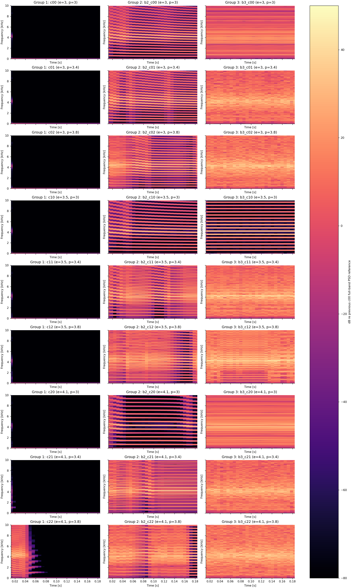

# Case B人工Targetの物理診断と予備学習

2026-11-26の成果物整理に伴う統合索引。新規の物理計算・学習・発声再判定は行っていない。数値は過去の計算結果を集約したもので、各時点のREPORT、manifest、PLAN、hash、実行コードsnapshotを保持する。

| 条件 | f0_l | f0_r | 持続proxyを満たす候補 |
|---|---:|---:|---:|
| ① | 3.0e5 | 1.0e7 | 0/9 |
| ② | 4.9e4 | 1.0e7 | 9/9 |
| ③ | 4.9e4 | 4.9e4 | 9/9 |

ε_l=3.0e7/3.5e7/4.1e7、p_s=3.0e6/3.4e6/3.8e6の格子、ε_r=3.5e7、α_l=α_r=1.2e6、β_l=β_r=1500。0.20秒、dt=1e-7秒、50kHz。元の固定物理係数・支配方程式は変更していない。右側音源の音響寄与も保存している。

[統合27条件CSV](phonation_27.csv) / [条件索引](diagnostic_index.json)。判定の閾値・初期値・遅延履歴・フィルタ・末尾窓・PSD基準は各原本の計算仕様を参照し、単なる非ゼロ音と持続発声proxyを区別する。

上図は既存の27条件比較の正本で、今回再描画していない。別色軸の試作・重複バリエーションは整理した。[元描画設定](low_forces/display_settings.json)を保持している。

## 物理的解釈

外力を下げると左ラビアの定常位置と振動状態が変わり、位置の二乗に依存する非線形減衰の寄与も変わる。①は末尾の変動が小さく、緩和/DC成分と右側の非ゼロ寄与が残っても持続proxyを満たさなかった。②は左の周期的変動が回復し、右側の変動が小さくても共通声道への音響寄与は非ゼロである。③では左右とも変動が現れる。低外力が調べた全領域で単調に有利であるという一般化や、生体の開閉状態の断定は行わない。

[非線形減衰の比較](low_forces/figures/force_damping_comparison.png)、[減衰数値](low_forces/damping_diagnostics.csv)、[末尾運動](low_forces/tail_motion.csv)、[左右音源](low_forces/source_statistics.csv)、[①の運動](high_left_force/tail_motion.csv)、[①の静止解参照](high_left_force/equilibrium_reference.csv)を保存する。

27音のNPZには音、左右変位/速度、source/output分解、diagnostic_samples/moments等があり、[①の生データ](high_left_force/preflight/candidates/)と[②③の生データ](low_forces/preflight/candidates/)に保持する。詳細時系列CSV.gzも保持し、固有の物理データは削除していない。

## 当初の学習停止と予備実験

- [初回REPORT](initial_stop/REPORT.md)：指定した1Targetが非持続だったためSACを開始しなかった。独立oracle、物理対照、結合/左右寄与の確認は実施済み。未実施の学習を完了に置き換えていない。
- [①9条件REPORT](high_left_force/REPORT.md)：0/9適格の停止条件に従いTarget確定・SAC/TD3/PPOを実施しなかった。[未開始の計算一覧](high_left_force/training_accounting.csv)。
- [②③と旧b3_c00のREPORT](low_forces/REPORT.md)：18/18の候補を確認後、b3_c00を事前確定し9run・36864学習stepと297独立評価を実施した。b3_c00は最新のT1/T2/T3とは別の予備実験である。

予備実験のFinal E_total平均±標本SDはSAC 0.204963±0.054527、TD3 0.206477±0.048037、PPO 0.403819±0.000000。[全指標/制御](low_forces/endpoints.csv)、[手法統計](low_forces/method_summary.csv)、[学習曲線CSV](low_forces/learning_curves.csv)、各runの圧縮履歴/設定/モデル、Targetと生成音を保持する。余分な個別図・描画バリエーションを削除し、固有のモデル/生データは[保留一覧](../../../maintenance/20261126/deferred_deletions.csv)へ明示した。

## 最新の主要結果との接続

主要学習は[3targets_3d4d](../3targets_3d4d/REPORT.md)の54runである。T1=b2_c10、T2=b3_c10を既存候補から引き継ぎ、T3は最新実験の新規Target。T1/T2は最新のpreflight/T1/target.npzとpreflight/T2/target.npzへ正本を移し、旧候補参照は相対symlinkで保持する。移行監査はファイルhash・波形・全配列の一致を確認する。新しい音を生成してoracleをやり直したわけではなく、当時のoracle=0の監査記録を保持した。

Case Aと異なるTargetであり、A/B誤差の大小から2音源構造の優位性を結論づけない。[全体の移行記録](../../../maintenance/20261126/README.md)。
