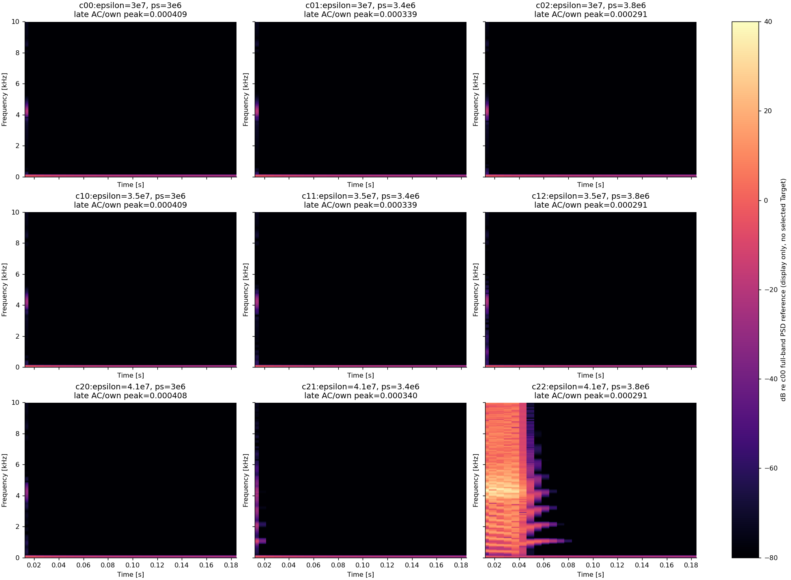
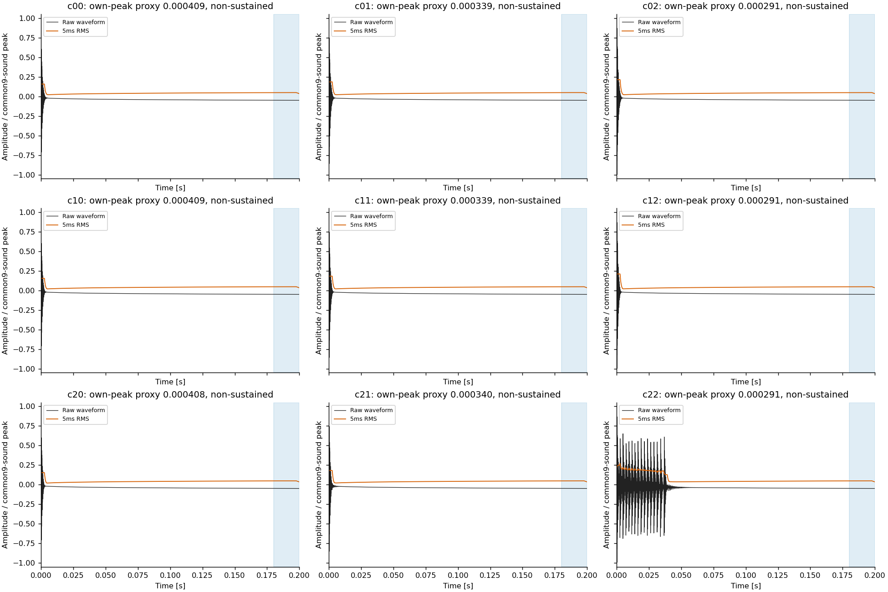
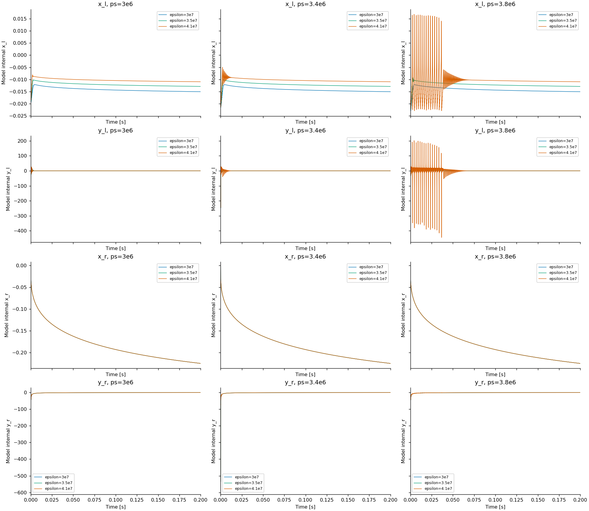
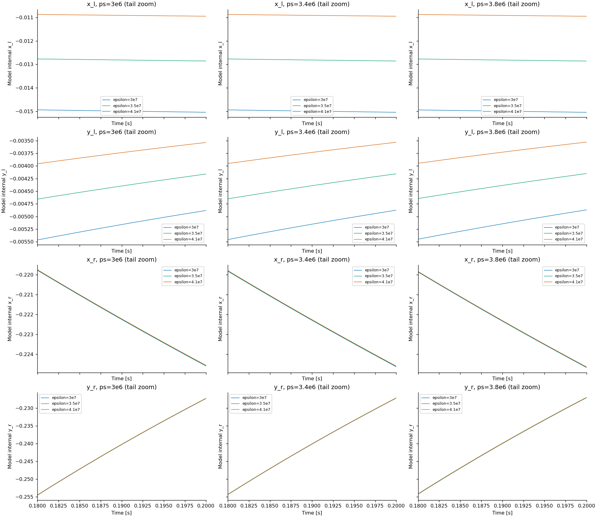
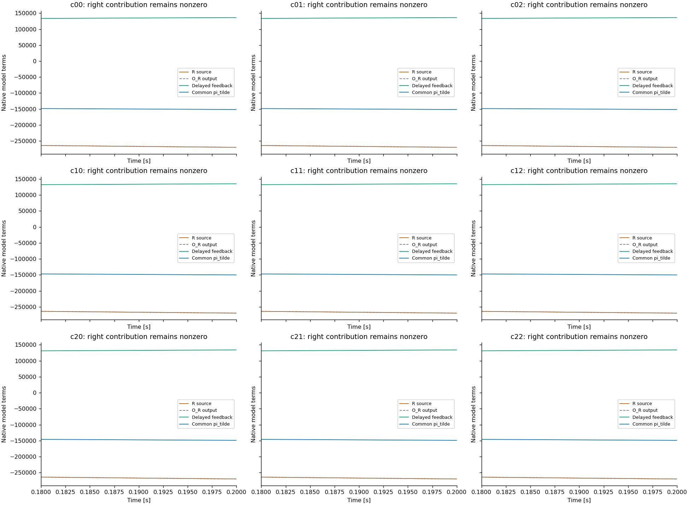

# Issue27改訂 — Case Bの9条件を診断、全条件非持続のためStage B停止

> 2026-11-26 成果物整理：本文の計算結果・実施/未実施は当時の記録です。現在の配置・削除した再生成図・hash検証は[移行記録](../../../../maintenance/20261126/README.md)を参照。旧manifest/hashは原本を維持しています。

## 結果と現在の状態

**指定のε_l×p_sの9条件をすべて計算したが、持続発声候補は0/9だった。** 末尾AC std/各音peakは0.0002911109〜0.0004094429で、全条件が事前の基準>.05を満たさない。[改訂Issue27](https://github.com/tatsukawa0353/Birdsong_tatsukawa/issues/27)の「9条件すべて非持続ならStage Bを開始しない」に従い、Targetを選ばず停止した。

SAC/TD3/PPOの手法別smoke test・本番9runは未開始。学習候補・optimizer更新・独立Actor評価はいずれも0で、Final/Selected/posthoc/training_bestや手法間の精度差は存在しない。学習器の失敗として9runを計上したり、非持続Targetを成功扱いして学習を強行していない。E_total≤.10は合否・追加計算のゲートに使っていない。

物理式・固定係数・右音響寄与は指定どおりだった。左右α=1.2e6/β1500、右ε_r3.5e7/f0_r1e7、x0=.02cm/D=.01、dt1e-7を実メモリで確認。数値失敗0、generated_silent0で、今回の結果は「無音」判定ではなく、持続振動が非常に小さくドリフト主体という診断である。

[9点の全指標](candidate_summary.csv) / [事前計画](PLAN.md) / [初回scan結果](preflight/scan.json) / [選定ゲート](preflight/gate.json) / [manifest](manifest.json)。

## Stage Aの固定条件と9点

各音はCase B、0.20秒一定、50kHz/10000sample、native 2,000,000 step。初期4状態・遅延・16次15kHz lowpass filter状態は0、200分の1に出力する。[filter係数](preflight/filter.npz)。全9点でf0_l=300000・f0_r=10000000、ε_r=35000000固定。f0は音響基本周波数Hzではない。p_s=3.0e6を優先し、その中で物理的に持続した候補を選ぶ計画だった。

| 候補 | ε_l | p_s | 末尾AC std/自身peak | 直線除去後std/peak | 持続proxy | silent | 数値失敗 | 選定可 |
| --- | --- | --- | --- | --- | --- | --- | --- | --- |
| c00 | 30000000.0 | 3000000.0 | 0.0004094429 | 0.0000059457 | False | False | False | False |
| c01 | 30000000.0 | 3400000.0 | 0.0003390299 | 0.0000049226 | False | False | False | False |
| c02 | 30000000.0 | 3800000.0 | 0.0002913396 | 0.0000042296 | False | False | False | False |
| c10 | 35000000.0 | 3000000.0 | 0.0004092065 | 0.0000059428 | False | False | False | False |
| c11 | 35000000.0 | 3400000.0 | 0.0003390738 | 0.0000049237 | False | False | False | False |
| c12 | 35000000.0 | 3800000.0 | 0.0002911109 | 0.0000042267 | False | False | False | False |
| c20 | 41000000.0 | 3000000.0 | 0.0004075957 | 0.0000059199 | False | False | False | False |
| c21 | 41000000.0 | 3400000.0 | 0.0003395006 | 0.0000049303 | False | False | False | False |
| c22 | 41000000.0 | 3800000.0 | 0.0002911362 | 0.0000042272 | False | False | False | False |

持続proxyは末尾1000sample（20ms）のAC std/その音自身の全期間peak>.05。生理学的発声判定やHNRではない。事前に、直線傾向を除いたratio>.05もドリフト除外の確認として定めたが、今回は全点が一次proxy自体を満たさず、この追加条件によって候補を落としたわけではない。p_s=3.0e6の3点も約.000408〜.000409で基準未達だった。

c22（ε_l4.1e7、p_s3.8e6）には約0.04秒まで大きい過渡振動が見える。10ms窓のAC std/自身peakは0.03–0.04秒で約.15049、0.04–0.05秒で.00949へ下がり、終盤20msは.00029114だった。これは「全期間まったく振動しない」という結果ではなく、過渡的に鳴っても0.20秒の持続Targetには至らないという区別である。音を短縮して合格扱いにする変更はしていない。

**Targetは未選定。** 図のPSD基準c00は事前の9点表の先頭を表示参照にしただけでTargetではない。全音を同じPSD基準/色軸で表示し、WAV・生波形・RMSは9音中の最大peakによる共通gainを使った。個別正規化、時間合わせ、音の直線除去やclipはしていない。[表示設定](display_settings.json) / [WAV索引](audio_index.csv)。

## 左右の過渡・末尾運動とドリフト

以下のnative stdは最終10msの100000積分刻みをすべて使った区間内標準偏差（ddof=0）。ドリフトも含む。直線除去後の別指標は50kHzで記録した末尾20ms traceに対するもので、窓とサンプリングが異なる。stdをそのまま周期振動の振幅と呼ばない。右の微小な応答・ドリフトを0へclampせず、そのまま保存した。変位の符号だけで物理的開閉を断定しない。

| 候補 | 状態 | native末尾10ms平均 | native末尾10ms std | 最終値 | 直線除去後20ms std（50kHz trace） |
| --- | --- | --- | --- | --- | --- |
| c00 | x_l | -0.015020528 | 1.4486636e-05 | -0.015045389 | 4.3372188e-07 |
| c00 | y_l | -0.0050186206 | 8.0077655e-05 | -0.0048820541 | 4.1389266e-06 |
| c00 | x_r | -0.22343439 | 0.00067461548 | -0.22459213 | 2.0246063e-05 |
| c00 | y_r | -0.23370782 | 0.0037374529 | -0.22733417 | 0.00019381009 |
| c01 | x_l | -0.015022088 | 1.4467532e-05 | -0.015046917 | 4.3286065e-07 |
| c01 | y_l | -0.0050120019 | 7.9921935e-05 | -0.0048756992 | 4.1271447e-06 |
| c01 | x_r | -0.22347508 | 0.00067423556 | -0.22463216 | 2.0232309e-05 |
| c01 | y_r | -0.2335762 | 0.0037349464 | -0.22720681 | 0.00019364328 |
| c02 | x_l | -0.015023648 | 1.4448437e-05 | -0.015048444 | 4.320009e-07 |
| c02 | y_l | -0.0050053862 | 7.976647e-05 | -0.004869347 | 4.1153992e-06 |
| c02 | x_r | -0.22351586 | 0.00067385405 | -0.22467229 | 2.0218474e-05 |
| c02 | y_r | -0.23344403 | 0.0037324252 | -0.22707892 | 0.00019347528 |
| c10 | x_l | -0.012837203 | 1.234614e-05 | -0.012858391 | 3.6919102e-07 |
| c10 | y_l | -0.0042770856 | 6.8168319e-05 | -0.004160827 | 3.5177764e-06 |
| c10 | x_r | -0.22341684 | 0.0006744959 | -0.22457437 | 2.0244426e-05 |
| c10 | y_r | -0.23366639 | 0.0037371464 | -0.22729327 | 0.00019379901 |
| c11 | x_l | -0.012838447 | 1.2331258e-05 | -0.01285961 | 3.6853112e-07 |
| c11 | y_l | -0.0042719294 | 6.8048928e-05 | -0.0041558731 | 3.5088315e-06 |
| c11 | x_r | -0.2234575 | 0.0006741163 | -0.22461438 | 2.0230689e-05 |
| c11 | y_r | -0.23353488 | 0.0037346429 | -0.22716601 | 0.00019363244 |
| c12 | x_l | -0.012839691 | 1.2316373e-05 | -0.012860829 | 3.6787179e-07 |
| c12 | y_l | -0.0042667726 | 6.7929629e-05 | -0.0041509184 | 3.4999043e-06 |
| c12 | x_r | -0.22349825 | 0.00067373508 | -0.22465448 | 2.0216868e-05 |
| c12 | y_r | -0.23340281 | 0.0037321243 | -0.22703822 | 0.00019346465 |
| c20 | x_l | -0.010930099 | 1.0493767e-05 | -0.010948109 | 3.1358457e-07 |
| c20 | y_l | -0.0036353659 | 5.7903449e-05 | -0.0035366123 | 2.9852993e-06 |
| c20 | x_r | -0.22340148 | 0.00067439192 | -0.22455883 | 2.0243015e-05 |
| c20 | y_r | -0.23363037 | 0.0037368821 | -0.2272577 | 0.00019378958 |
| c21 | x_l | -0.010931093 | 1.0482138e-05 | -0.010949083 | 3.1307708e-07 |
| c21 | y_l | -0.0036313368 | 5.7811578e-05 | -0.0035327389 | 2.9784781e-06 |
| c21 | x_r | -0.22344212 | 0.00067401253 | -0.22459882 | 2.0229289e-05 |
| c21 | y_r | -0.23349893 | 0.0037343805 | -0.22713051 | 0.00019362316 |
| c22 | x_l | -0.010932143 | 1.0469627e-05 | -0.010950111 | 3.1252465e-07 |
| c22 | y_l | -0.0036270024 | 5.7711607e-05 | -0.003528574 | 2.9710145e-06 |
| c22 | x_r | -0.22348639 | 0.00067357499 | -0.22464234 | 2.0212548e-05 |
| c22 | y_r | -0.23334735 | 0.0037313363 | -0.2269841 | 0.00019341297 |

[末尾状態CSV](tail_motion.csv) / [全20block・全12項のnative統計](native_block_statistics.csv)。各NPZには50kHzの内部state/source/output traceとnative全刻みのmean/std/min/maxも保存している。

## 右音響source/outputは全9条件で非ゼロ

R=α_r(x_r−τ_r y_r)+β_r y_r は共通π̃への右source項。O_r=R−β_rτ_r dy_r/dt は右output項で、π̃=L+R−γπ(t−T)、最終出力π=O_l+O_r−γπ(t−T)となる。末尾10msのnative全刻みの計測は次の通り。

| 候補 | 右source平均 | 右source std | 右output平均 | 右output std | feedback平均 | π̃平均 |
| --- | --- | --- | --- | --- | --- | --- |
| c00 | -268443.784692 | 804.380958 | -268443.978112 | 804.375739 | 135690.835890 | -150784.507788 |
| c01 | -268492.426080 | 803.928506 | -268492.619371 | 803.923292 | 135714.763606 | -150811.084382 |
| c02 | -268541.180190 | 803.474173 | -268541.373350 | 803.468963 | 135738.744860 | -150837.720424 |
| c10 | -268422.666475 | 804.237882 | -268422.859882 | 804.232663 | 134439.326251 | -149393.886029 |
| c11 | -268471.275821 | 803.785818 | -268471.469099 | 803.780604 | 134463.059937 | -149420.247145 |
| c12 | -268520.000732 | 803.331828 | -268520.193879 | 803.326619 | 134486.848706 | -149446.669425 |
| c20 | -268404.182114 | 804.113469 | -268404.375510 | 804.108251 | 133346.136044 | -148179.182205 |
| c21 | -268452.769752 | 803.661650 | -268452.963018 | 803.656437 | 133369.718137 | -148205.374968 |
| c22 | -268505.687404 | 803.140809 | -268505.880512 | 803.135600 | 133395.383398 | -148233.880932 |

右source/outputとも全点で非ゼロだった。Bの右係数を削除したA経路や、右側の完全固定へ退化させた結果ではない。分解の最大再構成誤差は1.4e-09。これは連成状態における代数的な寄与で、片側を取り除いて独立に鳴らした音の寄与率ではない。全てモデル内部量で、圧力や変位を実測Pa・張力などへ対応づけていない。

## 物理実装・前回結果との照合

実ロードlibbirdsong.soと、変更していないnative/model.cppを同じcompiler/flagsで別にビルドした.soのbyte/hashが完全一致した。読み取りprobeも前回と同じ保護対象のC++ソースから新成果フォルダへビルドした。積分は実libraryのbird_advance関数ポインタを使い、元運動方程式・圧力結合・遅延・音響式・固定係数を変更していない。[ビルド監査](native/build.json)。

c21（ε_l4.1e7、p_s3.4e6）は前回停止条件と同じ。今回の波形・物理制御・20block状態・native運動mean/std・全内部trace/統計は、**保存済みの前回B oracleと完全一致**した。これは既存ファイルの読み取り照合であり、比較のための追加生成はしていない。前回の3音・停止レポート・未実行記録は変更せず保持した。[診断監査](diagnostic_audit.json) / [前回の停止記録](../initial_stop/REPORT.md)。

選定候補がないため、「選定Targetの独立oracle」は未実施である。c21の過去データ一致を、今回の新Target選定やSAC等の学習成功と混同しない。

## 原因と次に検討する方向（追加計算なし）

9点とも、初期過渡の後は左右状態のゆっくりした移動が主体で、末尾の周期的成分が非常に小さい。過去のACIマップと今回のf0条件は異なるため、低いεなら必ず発声するという仮定は置けない。

参考に、現行式のA係数=1、y=dy/dt=0、遅延πが一定の定常点を解くと、π*=−(α_l f0_l/ε_l+α_r f0_r/ε_r)/(1+γ−α_l/ε_l−α_r/ε_r)、x_j*=(π*−f0_j)/ε_j。左の局所速度係数（π̃を固定した項）k_y=b+c x_l*²−D(p_s−π*)は次のようになる。

| 候補 | 定常π参考値 | 定常x_l参考値 | 局所速度係数k_y（π̃固定） |
| --- | --- | --- | --- |
| c00 | -194366.197 | -0.0164788732 | 42366.9907 |
| c01 | -194366.197 | -0.0164788732 | 38366.9907 |
| c02 | -194366.197 | -0.0164788732 | 34366.9907 |
| c10 | -192823.713 | -0.0140806775 | 27724.8587 |
| c11 | -192823.713 | -0.0140806775 | 23724.8587 |
| c12 | -192823.713 | -0.0140806775 | 19724.8587 |
| c20 | -191477.251 | -0.01198725 | 16824.0601 |
| c21 | -191477.251 | -0.01198725 | 12824.0601 |
| c22 | -191477.251 | -0.01198725 | 8824.06014 |

この参考式ではp_sは定常変位から消え、今回の全点でk_yは正となる。右の非ゼロ寄与で変化する左の平衡変位と非線形減衰c x²が、観測された減衰と整合する。これは0.20秒で既に定常に達したことや、遅延・連成全系の安定性、Case B全制御域での非発声を証明するものではない。

**次の案は、左f0_lをより小さくする方向を含む固定候補を別途定めて物理診断すること。** 定常式では左変位の絶対値と非線形減衰を減らす方向になるという仮説で、発声を保証しない。今回の許可は9点までなので、新しいf0、長時間化、追加grid、直接最適化、Target差し替えは実行していない。右α/βを0にしたり固定物理係数を変えて解決したことにはしない。

## Stage Bの予定と未実施項目

予定は同じ選定B TargetでSAC/TD3/PPO×3seed、各4096環境step＝36864学習音、独立Actor評価各33点（計297点）。全隠れ層128×128、LR3e-4、gamma1、batch32。SACはbuffer50000/warmup16/train_freq1/gradient_steps1/auto_0.01/target_entropy−3、TD3は同buffer/warmup等とNormalActionNoise(0,.1)、PPOはpi/vfをそれぞれ128×128・n_steps128/n_epochs10/clip.2を予定した。

PPOの予定は128step rollout×32回、40minibatch×32=1280 optimizer stepで、内部epoch counter320。SACのActor/Critic/温度各4080、TD3のCritic4080/Actor2040とは更新回数が異なる。**これらは予定値で、実更新は全て0。** 実ネットの層/総パラメータassert、Replay/rollout、checkpoint再生、手法別smokeと本学習は、Stage A合格後の工程なので今回は未着手。未学習モデルをFinalとして保存していない。[9runの未開始会計](training_accounting.csv) / [計画と停止status](manifest.json)。

Case Aは別の自己生成Targetに対する参考であり、今回の未実施結果と誤差を比較して構造優位や学習難易度を判断しない。最終的な2音源構造の効果は、将来同じ実録音Targetで検証する段階に分ける。TQC・DE/GA/CMA-ES・時変・5D・左右切替・実録音は今回0件。

## 会計・保存・再現

| 区分 | 実行量 |
|---|---:|
| Stage AのB物理候補 | 9条件・9音 |
| native積分 | **18,000,000 step、1.80秒** |
| 数値失敗 / generated_silent / 持続候補 | 0 / 0 / 0 |
| Target選定 / 選定後oracle / 新規A対照 | 未実施 / 0 / 0 |
| 手法別smoke / 学習run / 学習候補 / 更新 | 0 / 0 / 0 / 0 |
| 新規音を増やさない保存データ検査 | 7テスト合格 |
| 追加探索・追加物理生成 | 0 |

[生成ledger](preflight/ledger.json) / [会計](execution.json) / [テスト](preflight/tests.json)。初回scan実行時のソースは[hash](executed_source_checksums.json)と[原本](executed_sources/issue27r_prepare.py)を保存し、scan関数とnative wrapperの不変を確認。後から加えたのは停止guard・診断・報告で、9音を再生成していない。

旧Issue17〜26と初回Issue27を含む6294ファイルはhash一致・変更/削除0。新成果は本フォルダへ独立保存し、root READMEには改訂の索引だけ追加。[保護検査](integrity.json) / [実装hash](implementation_checksums.json) / [成果物hash](artifact_checksums.json) / [再現手順](REPRODUCE.md)。commit/push、Issueコメント/close、外部送信はしていない。

<!-- ISSUE27R_STORAGE_BEGIN -->
| 対象 | 着手前 | 完了時 |
| --- | --- | --- |
| 通常ファイル数 | 8064 | 8132 |
| 論理容量bytes | 877014166 | 887824649 |
| Git新規候補 | 0（クリーン） | 66個 / 10.76MB |
| 既存追跡変更/削除 | 0/0 | 1/0 |
<!-- ISSUE27R_STORAGE_END -->
