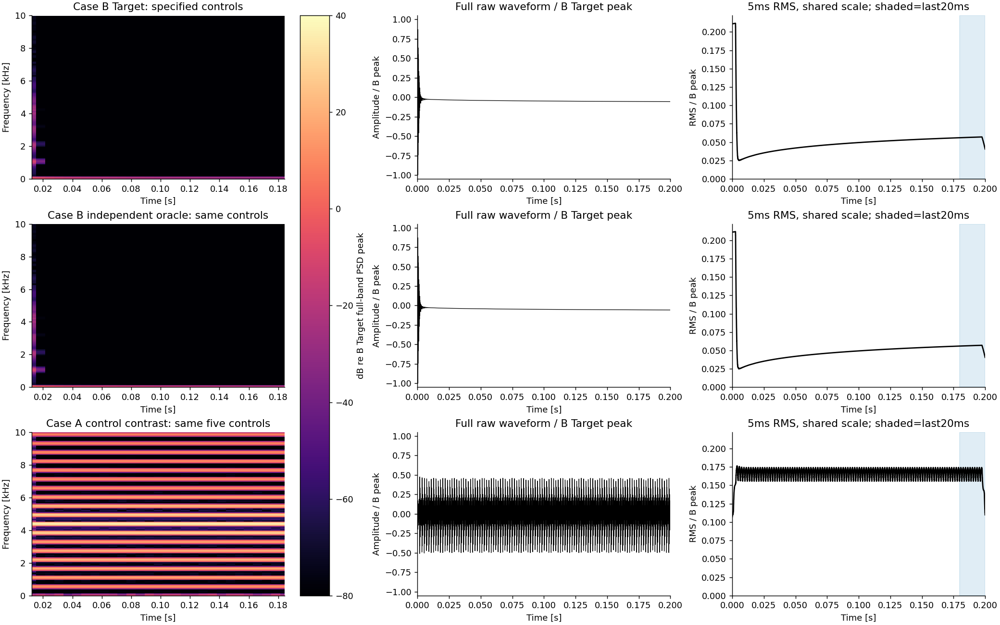
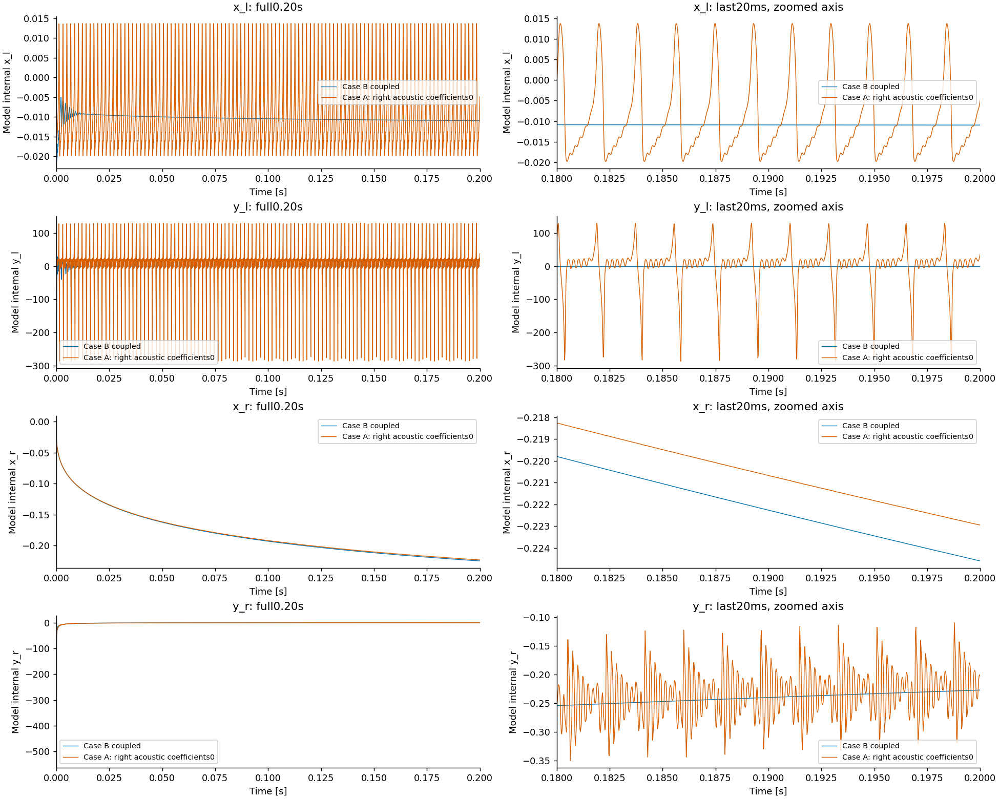
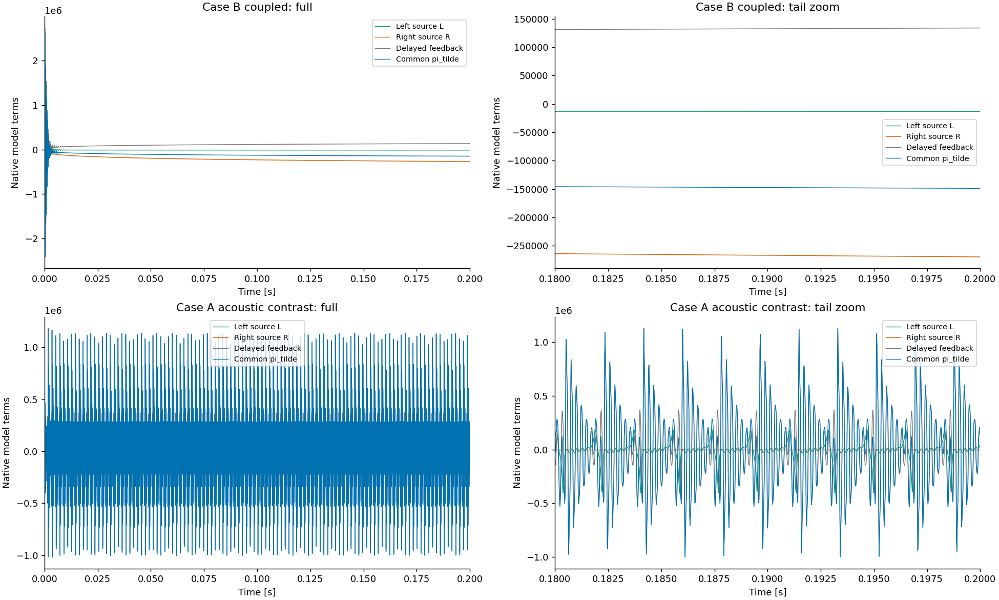

# Issue27 — Case B自己Target：事前診断で停止

> 2026-11-26 成果物整理：本文の計算結果・実施/未実施は当時の記録です。現在の配置・削除した再生成図・hash検証は[移行記録](../../../../maintenance/20261126/README.md)を参照。旧manifest/hashは原本を維持しています。

## 結論と実行状態

指定されたCase B Targetは、0.20秒内で持続発声proxyの基準を満たさなかった。[Issue27](https://github.com/tatsukawa0353/Birdsong_tatsukawa/issues/27)の「Targetの明らかな非持続発声があれば学習を強行せず事前診断を報告」に従い、**SAC学習は0run・0候補・0更新**で停止した。予定の3seed×4096候補と33評価点/seedは未実施で、Final/Selected/posthoc/training_bestの方策・誤差は存在しない。[seed別の未開始会計](training_accounting.csv)。

モデルのA/B分岐、右係数、右f0、Target生成とoracleの一致は確認できた。停止理由は実装の右係数欠落やoracle不一致ではなく、指定Targetの持続性である。E_total≤.10の合否判定や延長ゲートは使用していない。

| 検査 | 結果 |
|---|---|
| 実libraryと現行nativeソースの対応 | 同じflagsで再ビルドした.soがbyte/hash完全一致 |
| Case Bのα_l/β_l・α_r/β_r | 1.2e6/1500・1.2e6/1500、全て非ゼロ |
| 右ε_r/f0_r | 3.5e7 / 1e7、実メモリで確認 |
| x0 / D / dt | .02cm / .01 / 1e-7、実メモリで確認 |
| 初期4状態・遅延・filter | 全て0 |
| B Targetと独立B oracle | 波形・全20block状態・native運動mean/stdが完全一致、E_spec/E_env/E_total/J=0 |
| 同じ5制御のA対照 | 右source=0、Bとは出力が異なる |
| B Target末尾AC std/peak | **0.0003395006 < .05：不合格** |
| 短い学習・Replay更新試験／3本の本学習 | Targetゲート不合格により実施しない |
| 0更新での3seed初期設定・正規化・停止guard | 7テスト合格、新規音0 |

[凍結計画](PLAN.md) / [初回preflight記録](preflight/physics.json) / [完全診断](diagnostic_audit.json) / [manifest](manifest.json) / [テスト](preflight/tests.json)。

## TargetとA対照

Targetは新規のBirdModel('B')で、全期間一定の[ε_l,ε_r,p_s,f0_l,f0_r]=[4.1e7,3.5e7,3.4e6,3e5,1e7]から生成した。0.20s/50kHz/10000sample、native dt1e-7、初期状態/遅延0、16次15kHz lowpass→200分の1の50kHz出力、filter初期状態0。旧Case A Targetは入力に使用していない。[Target生波形・制御](preflight/target.npz) / [filter係数](preflight/filter.npz)。

対照Aにも**同じ5制御（右f0も1e7）**を与え、Aだけ右α/βが0になる既存分岐を使った。この1音は今回の物理対照であり、TargetをA音へ置き換えていない。B oracleは別のインスタンスをゼロ状態から再計算した。読み取りプローブから実ロードlibraryのbird_advance関数ポインタを呼び、元の物理積分を使ったまま全刻みの状態・音響項を観測した。元native/model.cppとlibbirdsong.soは変更していない。[ビルド対応](native/build.json)。

| 音 | 末尾20ms AC std | AC/B Target peak | AC/自身peak | 直線除去後std | B Targetに対するE/J |
| --- | --- | --- | --- | --- | --- |
| target | 884.010103 | 0.000339501 | 0.000339501 | 12.837722 | 0.00000000 / 0.00000000 |
| oracle | 884.010103 | 0.000339501 | 0.000339501 | 12.837722 | 0.00000000 / 0.00000000 |
| same_controls_caseA | 436654.825217 | 0.167695579 | 0.328398823 | 436654.183287 | 0.29602054 / 0.16256819 |

持続proxyは末尾20ms（1000sample）の平均を除いたstd/Target peak>.05。Bの値は約0.0003395で、基準の約1/147だった。A対照は自身peakで0.32840、共通B peakでも0.16770で基準を超える。Bの末尾音は非ゼロのゆっくりした変動であり、generated_silent判定では無音になっていない。末尾から直線傾向を除いたstdはB約12.84、A約436654で、BのAC stdの大半もドリフトによるものと整合する。直線除去は診断だけで、Target・報酬・保存音は変更しない。

[B Target WAV](audio/oracle.wav) / [B oracle WAV](audio/oracle.wav) / [同一制御A対照 WAV](audio/same_controls_caseA.wav)。全音のgainは1/B Target peakの共通値で、個別正規化・クリップ・位相合わせはない。

## 左右の運動と非ゼロの右音響寄与

| 音 | 状態 | 末尾10ms平均 | native全刻みの標本内std | 0.20s最終値 |
| --- | --- | --- | --- | --- |
| oracle | x_l | -0.0109310934 | 1.04821379e-05 | -0.0109490831 |
| oracle | y_l | -0.00363133678 | 5.78115784e-05 | -0.00353273892 |
| oracle | x_r | -0.223442118 | 0.000674012528 | -0.224598822 |
| oracle | y_r | -0.233498935 | 0.0037343805 | -0.227130513 |
| same_controls_caseA | x_l | -0.00931154172 | 0.00940051792 | -0.00483763522 |
| same_controls_caseA | y_l | 1.11025741 | 63.4520959 | 37.9800838 |
| same_controls_caseA | x_r | -0.221821602 | 0.000658688473 | -0.22295081 |
| same_controls_caseA | y_r | -0.228184894 | 0.040812364 | -0.203745912 |

stdは末尾10ms・100000 native stepの母標準偏差で、ゆっくりしたドリフトも含む。変位stdをそのまま周期振動の振幅と呼ばない。Bの右側は末尾でもx/yが変化し、完全固定や0へclampしていない。右f0が高い既存の閉鎖側設定であることと、微小な受動応答・音響寄与が残ることを区別する。物理的な開閉を変位の符号だけでは決めない。

source項を L=α_l(x_l−τ_l y_l)+β_l y_l、R=α_r(x_r−τ_r y_r)+β_r y_r、F=−γπ(t−T) と定義するとπ̃=L+R+F。最終出力はO_l+O_r+F、O_j=source_j−β_jτ_j dy_j/dt と分解できる。以下は末尾10msのnative全刻みで測った値。

| 音 | 左source平均 | 右source平均 | 右source std | 遅延feedback平均 | π̃平均 | 右output項平均 |
| --- | --- | --- | --- | --- | --- | --- |
| oracle | -13122.323353 | -268452.769752 | 803.661650 | 133369.718137 | -148205.374968 | -268452.963018 |
| same_controls_caseA | -9641.694832 | 0.000000 | 0.000000 | 3920.024539 | -5721.670293 | 0.000000 |

Bの右source平均は約−268453、stdは約803.66で非ゼロだった。Aでは右の機械状態が動いていてもα_r/β_r=0のため右sourceは0。BがAへ退化していないことを、係数と波形の両方から確認できた。出力の分解再構成誤差の最大値は9.31e-10。この分解は現在の連成状態での代数的寄与であり、右側を取り除いて再計算した因果的な独立音ではない。[全block・全項の統計](native_block_statistics.csv)。

## 減衰と整合するモデル内の説明

同じ入力制御のAでは左の持続振動が見られ、Bでは右の負のsource項を残すことで共通π̃の平均が大きく変わった。Bの左右状態は0.20秒でもゆっくり動いており、定常に到達したとは扱わない。

参考として、現行nativeのA係数=1、y=dy/dt=0、一定の遅延πという条件で定常点を解くと、π*=−(α_l f0_l/ε_l+α_r f0_r/ε_r)/(1+γ−α_l/ε_l−α_r/ε_r)、x_j*=(π*−f0_j)/ε_j となる。左右の結合を残すと左の平衡変位も変わる。π̃を固定した局所の速度係数k_y=b+c x_l*²−D(p_s−π*)は次の通り。

| 分岐 | 定常πの解析値 | 定常x_l | 定常x_r | 局所速度係数k_y（π̃固定） |
| --- | --- | --- | --- | --- |
| A | -4693.61147 | -0.0074315515 | -0.285848389 | -3001.34458 |
| B | -191477.251 | -0.01198725 | -0.291185064 | 12824.0601 |

Bの平衡変位では非線形減衰c x²が大きくなり、局所速度係数の符号変化は観測された減衰と整合する。これは現行モデルの定常点に基づく説明であり、遅延・左右連成を含む全系の安定性の証明や、全Case B制御域が非発声であることの証明ではない。今回の0.20秒を延長したり別制御を試す追加計算はしていない。x/y、音響項、p_s/ε/f0はいずれもモデル内部量で、実測Pa・張力・生理的発声判定と同一視しない。f0はHzではない。

## 学習設定とCase A参考値

予定は通常SAC128（Actor/Critic[128,128]）、r=−(.75E_spec+.25E_env)、共通E=E_spec+E_env、3optimizer LR3e-4、auto_0.01/target_entropy−3、batch32/buffer50000/warmup16/gamma1/train_freq1/gradient_steps1。ε_l[2.5e7,5e7]・p_s[2.5e6,4e6]・f0_l[49000,800000]、右ε_r3.5e7/f0_r1e7固定。3seedの初期設定・重みは既存A同seedと一致し、seed間の重みは異なることを0更新で確認した。

独立したCaseBEnvを追加し、旧Constant020EnvのA固定経路を通らずBを構築・resetする。右係数/実効f0を実メモリで検査する。Targetゲート不合格ならstepを積分前に拒否し、学習readyも拒否する。Replay行動・報酬と学習中LRの検証は未実施であり、学習済みモデルやFinalとして未学習重みを保存していない。

旧Issue23のA Final共通Eは3seedで0.14745±0.10074（標本SD）、持続proxy3/3だった。[読み取り専用の参考値](caseA_reference.csv)。Aは自身の別Target、Bは今回は学習未開始であり、分岐の優劣・学習難易度の結論には使わない。

## 会計・保存・次の判断

| 区分 | 実行量 |
|---|---:|
| B Target新規生成 | 1音・2,000,000 native step |
| 独立B oracle再計算 | 1音・2,000,000 native step |
| 同じ制御のA対照 | 1音・2,000,000 native step |
| 合計 | **3音・6,000,000 step・積分0.60秒** |
| 追加生成・Target/条件変更・追加探索 | 0 |
| SAC本学習／学習候補／optimizer更新 | 0 / 0 / 0 |
| 独立Actor評価・保存方策の再生 | 0 |
| 7テスト・初期化確認・保存データの再集計/図 | 新規native音0 |

[物理生成ledger](preflight/ledger.json) / [実行会計](execution.json) / [seed別の未開始理由](training_accounting.csv)。初回テストのLR検査呼出しにrate引数の不足があり修正後に7件合格した。両テスト実行とも積分・学習は0。初回生成に使ったソース4件を[実行時ソース](executed_sources/issue27_prepare.py)と[hash](executed_source_checksums.json)で保持し、physics関数とnative呼出し・プローブが現行と同じことを監査した。診断のために元3音を再生成していない。

既存6241ファイルをhash照合し、変更/削除0。元Case A環境・Target・モデル・グラフは不変。root READMEには索引だけ追加した。[元成果保護](integrity.json) / [全成果物hash](artifact_checksums.json) / [実装hash](implementation_checksums.json) / [再現](REPRODUCE.md)。commit/push・Issueコメント/close・外部送信はしていない。

次に必要なのは、**持続発声するCase B Targetの仕様を確定するか、この非持続Targetを模倣する課題として許容するか**の方針確認である。右α/βを0へ変えて解決したことにはしない。新しい仕様が確定してから物理ゲートを再確認し、通常SAC3seedの実装・短いReplay/更新検査・本学習へ進む。旧Issue20のA Target共用仕様は今回実行せず、別途整合を取る。

<!-- ISSUE27_STORAGE_BEGIN -->
| 対象 | 着手前 | 完了時 |
| --- | --- | --- |
| 通常ファイル数 | 8011 | 8064 |
| 論理容量 | 872598769 | 877014166 |
| Git新規候補 | 0（クリーン） | 51個 / 4.37MB |
| 既存追跡の変更/削除 | 0/0 | 1/0 |
<!-- ISSUE27_STORAGE_END -->
