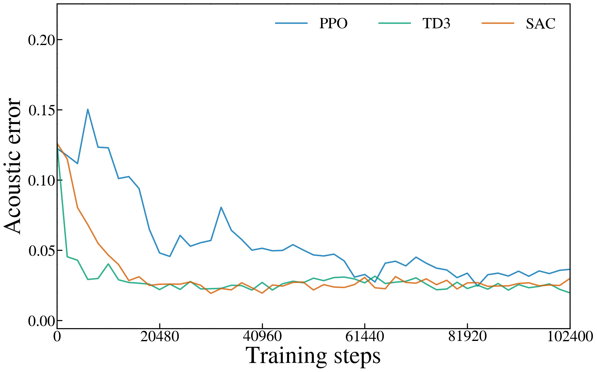

# Issue #14：固定目標正弦波の長期学習

実行日: 2026-11-14 JST。保存パスの20261108は旧実験名を維持したもので、今回の実行日ではない。

**変更内容:** 訓練予算を4,096から102,400環境ステップ、定期評価を512から2,048ステップへ変更。通常resetで行動空間をOS由来の乱数へ再seedする挙動も、今回の設定でのみ修正した。

**固定条件:** PPO・TD3・SAC×seed 0/1/2、同じ0.35秒の1000→2000 Hzグライド、既存の時変振幅・局所音響報酬・観測・行動・32×32ネットワーク・学習率0.0003等は維持。旧方策を継ぎ足さず9 runをゼロから学習した。主結果は途中最良ではなく最終更新後の方策。

**最終結果（3 seed、平均±標本SD、小さいほどよい）:** PPO 0.0308798 ± 0.00634、TD3 0.0205822 ± 0.00158、SAC 0.029 ± 0.00415。

**まず見る5図:** すべてseed 0の最終方策と対応する。

1. [3手法の学習曲線](figures/learning_curves_seed0.png)
2. [PPO最終スペクトログラム](figures/PPO_seed0_final_spectrogram.png)
3. [TD3最終スペクトログラム](figures/TD3_seed0_final_spectrogram.png)
4. [SAC最終スペクトログラム](figures/SAC_seed0_final_spectrogram.png)
5. [TD3の周波数・振幅追従](figures/TD3_seed0_controls.png)

## 最終性能とseed間のばらつき

| 手法 | 初期音響誤差 | 最終音響誤差 | 最終周波数MAE[Hz] | 最終振幅MAE |
| --- | --- | --- | --- | --- |
| PPO | 0.121877 ± 0.000822 | 0.0308798 ± 0.00634 | 95.6553 ± 45 | 0.00704468 ± 0.00348 |
| TD3 | 0.126089 ± 0.000794 | 0.0205822 ± 0.00158 | 30.5112 ± 3.71 | 0.00188519 ± 0.0005 |
| SAC | 0.126089 ± 0.000794 | 0.029 ± 0.00415 | 68.6683 ± 25.8 | 0.00174411 ± 0.00116 |

| 手法 | seed | 最終誤差 | スペクトル項 | 包絡項 | 途中最良 | そのstep | 初回≤0.08 step |
| --- | --- | --- | --- | --- | --- | --- | --- |
| PPO | 0 | 0.03641365 | 0.03027489 | 0.00613876 | 0.02451647 | 83968 | 18432 |
| PPO | 1 | 0.03225949 | 0.02505831 | 0.007201185 | 0.0246612 | 81920 | 20480 |
| PPO | 2 | 0.02396636 | 0.02076265 | 0.003203708 | 0.02396636 | 102400 | 18432 |
| TD3 | 0 | 0.01968742 | 0.01689152 | 0.002795895 | 0.01968742 | 102400 | 2048 |
| TD3 | 1 | 0.01964878 | 0.01702551 | 0.002623271 | 0.01897373 | 98304 | 2048 |
| TD3 | 2 | 0.02241031 | 0.01983868 | 0.002571637 | 0.01997427 | 100352 | 2048 |
| SAC | 0 | 0.02988648 | 0.02771028 | 0.002176198 | 0.01930448 | 30720 | 6144 |
| SAC | 1 | 0.03263431 | 0.02966696 | 0.002967357 | 0.02195161 | 32768 | 6144 |
| SAC | 2 | 0.02447913 | 0.0221215 | 0.002357623 | 0.02086875 | 43008 | 6144 |

[per_seed.csv](per_seed.csv) は初期/最終MAE・最大誤差・実更新回数等、[aggregate.csv](aggregate.csv) は全3 seed集計。到達stepは評価グリッドで初めて観測された時点で、全学習stepの真の初到達を特定した値ではない。0.08は探索的な参考値であり聴覚的同一性の合格基準ではない。発表図に補助線は描いていない。

## 同一run内の予算と収束傾向



生の51点（0, 2,048, …, 102,400）を平滑化せず結んだ。終点のみ最終更新後へ揃え、更新前の同step callback値もcallback_curve.jsonに残した。初期・途中・最終前callback・最終更新後を合わせた評価回数と、表示曲線の点数は別。

| 手法 | 4,096 | 10,240 | 51,200 | 102,400 最終 |
| --- | --- | --- | --- | --- |
| PPO | 0.115257 ± 0.0037 | 0.127307 ± 0.0207 | 0.0504074 ± 0.00355 | 0.0308798 ± 0.00634 |
| TD3 | 0.0471216 ± 0.00933 | 0.0467432 ± 0.00644 | 0.026406 ± 0.00324 | 0.0205822 ± 0.00158 |
| SAC | 0.0824824 ± 0.00377 | 0.0469003 ± 0.000556 | 0.0233167 ± 0.00142 | 0.029 ± 0.00415 |

同じrun内の4,096→最終を比較して予算増加時の推移を読む。途中点はそのstepの更新前callback、終点は最終更新後である。全51点の詳細は[convergence.csv](convergence.csv)、予算別抜粋は[budget_checkpoints.csv](budget_checkpoints.csv)。[全seed補足図](figures/learning_curves_all_seeds.png)では色を手法、○/□/△をseedとした。

- PPO: 50区間中の誤差増加回数はseed順に[21, 20, 22]。最終誤差−記録最良誤差は['0.01189718', '0.007598295', '0']。この有限予算の曲線だけで数学的収束や追加予算での挙動は保証しない。
- TD3: 50区間中の誤差増加回数はseed順に[24, 23, 20]。最終誤差−記録最良誤差は['0', '0.0006750521', '0.002436043']。この有限予算の曲線だけで数学的収束や追加予算での挙動は保証しない。
- SAC: 50区間中の誤差増加回数はseed順に[23, 20, 20]。最終誤差−記録最良誤差は['0.01058199', '0.0106827', '0.003610373']。この有限予算の曲線だけで数学的収束や追加予算での挙動は保証しない。

途中最良は初期値を含む反復in-target評価で選択した補助結果。選択バイアスを含むため主結果へ置き換えない。各runに最終agent.zipとbest_agent.zipだけを残し、全評価時点のモデルは保存していない。

## 条件・音響評価・制御追従

102,400はエピソード数ではなく制御行動数であり、2,925完走エピソード＋25部分ステップ。評価は52回×35行動=1,820環境ステップ/runを学習と分離した。

音声48 kHz、10 msごと35行動、周波数500–3000 Hz・振幅0–1。目標振幅は0.6*(0.8+0.2*cos(2πk/34))で一定化していない。resetで位相を0へ戻し、480サンプル区間間で位相連続。観測には時刻、現在の目標f/A、直前行動が含まれる。

報酬は従来どおり10 ms局所音響誤差の負値、平滑化罰0。主評価は完全な0.35秒波形の対数スペクトル誤差＋約5 ms RMS包絡誤差。35個の局所報酬和とは同一でない。ゲイン・位相合わせ・独立音量正規化は追加していない。

- PPO: [最終スペクトログラム](figures/PPO_seed0_final_spectrogram.png)、[周波数・振幅制御](figures/PPO_seed0_controls.png)。
- TD3: [最終スペクトログラム](figures/TD3_seed0_final_spectrogram.png)、[周波数・振幅制御](figures/TD3_seed0_controls.png)。
- SAC: [最終スペクトログラム](figures/SAC_seed0_final_spectrogram.png)、[周波数・振幅制御](figures/SAC_seed0_controls.png)。

図はSciencePlots、既存0–2500 Hz、10 MHzへの表示専用再サンプリング、Blackman–Harris窓、nperseg245760・noverlap184320、gray_r、−50〜−20 dB、完全な窓中心を維持。図中タイトル・seed表記は追加せず、実値の制御図とMAEを振幅一致の判断に使う。

既知の目標f・Aを直接適用するOracleは、従来のfloat32正規化行動では丸めを含むため、完全な0とは区別する。保存値は 2.652512e-07。従来精度の範囲（1e−5未満）での再現を確認し、float64の物理f・Aを直接生成する別診断と混同しない。[Oracle記録](diagnostics/oracle.json) は学習成績ではない。

## 旧4,096ステップ結果と乱数再現性

| 手法 | 旧固定目標4,096 | 今回最終102,400 |
| --- | --- | --- |
| PPO | 0.1154 ± 0.00949 | 0.0308798 ± 0.00634 |
| TD3 | 0.0443437 ± 0.00785 | 0.0205822 ± 0.00158 |
| SAC | 0.0824136 ± 0.000573 | 0.029 ± 0.00415 |

旧値は2026-11-08の保存済み固定目標実験。旧OS由来のaction-space再seed、ライブラリ版の違いも含む参考比較であり、予算だけの因果効果として扱わない。旧ランダム目標版は書き換えず、参考CSV old_vs_fixed_target.csv に保存値を引用した。

今回の設定は明示seedのresetで行動空間を初期化し、通常resetでは再seedしない。旧公開設定のdefaultは従来のまま。同一seedのTD3を2回320ステップ（warm-upと更新の両方を含む）走らせ、初期軌道・全行動/報酬・評価ログ・最終重みの一致をテストした。この回帰テストは本比較の9 runと別計上。全102,400ステップの反復実行は行っておらず、異なるハードウェア・版間のbitwise再現は主張しない。

## 計算費用・更新回数・監査

| 手法 | seed | 訓練step | SB3更新カウンタ | 実optimizer呼出 | 訓練秒 | 評価秒 |
| --- | --- | --- | --- | --- | --- | --- |
| PPO | 0 | 102400 | 2000 | {"policy": 8000} | 110.5834 | 1.753751 |
| PPO | 1 | 102400 | 2000 | {"policy": 8000} | 110.92 | 1.758229 |
| PPO | 2 | 102400 | 2000 | {"policy": 8000} | 110.6189 | 1.72901 |
| TD3 | 0 | 102400 | 102144 | {"actor": 51072, "critic": 102144} | 307.0941 | 1.871822 |
| TD3 | 1 | 102400 | 102144 | {"actor": 51072, "critic": 102144} | 306.5171 | 1.872626 |
| TD3 | 2 | 102400 | 102144 | {"actor": 51072, "critic": 102144} | 298.9013 | 1.851303 |
| SAC | 0 | 102400 | 102144 | {"actor": 102144, "critic": 102144, "entropy": 102144} | 437.6543 | 2.061734 |
| SAC | 1 | 102400 | 102144 | {"actor": 102144, "critic": 102144, "entropy": 102144} | 445.3804 | 2.063773 |
| SAC | 2 | 102400 | 102144 | {"actor": 102144, "critic": 102144, "entropy": 102144} | 436.3874 | 2.035663 |

PPOのSB3カウンタはepoch数、TD3/SACはgradient iteration数。実Adam呼出・環境step・評価回数とは区別した。CPU各1スレッド、独立6プロセスで実行。並列化と監視を含むため厳密な速度順位の測定ではない。

9 run合計: 学習921,600、評価16,380環境ステップ。全run実行wall時間555.594秒。生成音長は学習9216.00秒・評価163.80秒で実時間とは別。

関連19テストPASS、独立監査PASS（27525確認）、保護照合PASS（2156ファイル）。有限値・報酬・損失の集計は各summaryに記録。評価前後でpolicy、entropy、optimizer、利用済みbuffer内容、Python/NumPy/Torch・環境/行動空間のRNG等を署名照合した。

最終モデルを独立に読み込み、35行動を生成して最終NPZ・WAV・音響誤差・制御・曲線終点・summaryの一致を監査した。途中で保存しない波形の指標は独立再計算できないため、記録された値と不変性検査を根拠とする。

独立監査は一時成果と置換後に実施し、報告処理の修正後にも再点検した。学習・run内評価の費用とは分けた。開発中の2 runに対する監査検証も追加学習0、方策評価70ステップとして development_audit.json に別記した。

## 保存先の置換・復元・再実行

旧成果の全追跡ファイルをGitの内容と照合し、一時的な無視領域で学習・監査・報告を完了後、同じ保存パスへ入れ替えた。未追跡ファイルがあれば置換しない。失敗時は旧成果を維持/復元する。旧commit・対象ファイルhash・復元手順は[legacy_recovery.json](legacy_recovery.json)。ソース全文の重複コピーは省き、base_commit・source_hashes・source_changes.patchで実行版を記録した。

リポジトリ直下から（指定の既存結果を、検証後に更新する）:

```bash
PYTHONDONTWRITEBYTECODE=1 Deeplearning/.venv-rl/bin/python -m Deeplearning.issue14 --replace --workers 6
```

## 研究上の限界

これは目標f/Aを観測できる固定正弦波の追従制御である。学習と同じ音を反復評価するin-target成績であり、held-out評価や未知音への汎化ではない。3 seedのばらつきを含む有限予算の結果から手法の普遍的優劣、鳴管での有効性、実録音の模倣、左右2音源の相互作用は主張しない。報酬設計・パラメータ探索・事後の追加学習は行っておらず、Phase 1/2と鳴管C++モデルにも変更を加えていない。
