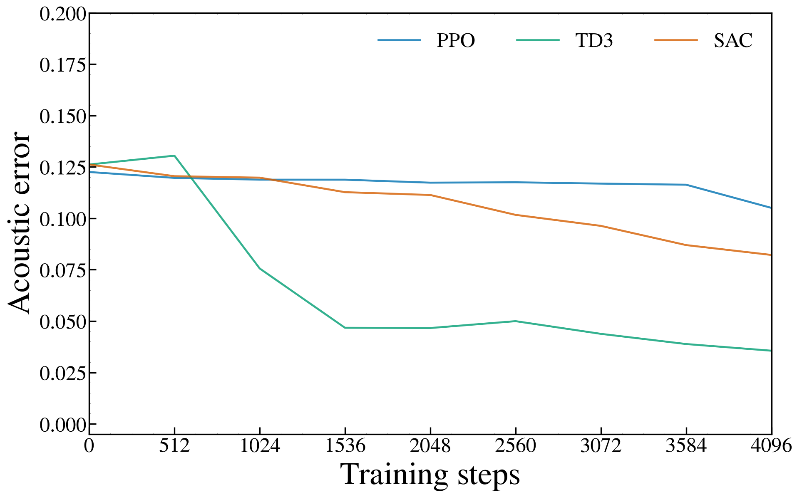

# Issue #14：固定目標音でのPhase 0再実験

**条件：** 学習・評価とも同じ0.35秒の正弦波グライド。PPO・TD3・SAC、seed 0/1/2、各4096訓練環境stepで実行した。変更の中心は学習目標のランダム化を無効にすることで、鳴管モデル・実録音は対象に含めない。目標の周波数・振幅を観測に与える単純な追従課題である。

**結果の事実：** 8/9 runで最終の全区間音響誤差が学習前より小さかった。手法別の初期→最終平均は PPO 0.1218768 → 0.1153997、TD3 0.1260895 → 0.04434374、SAC 0.1260895 → 0.0824136。全9 runの周波数MAEは 128.824〜334.8068 Hz、振幅MAEは 0.006549219〜0.1021602。音響誤差の減少を完全な追従や聴覚的同一性と同一視しない。

**旧条件との比較：** 最終音響誤差の3 seed平均（旧→固定目標）は PPO 0.1094504 → 0.1153997、TD3 0.04389215 → 0.04434374、SAC 0.0708051 → 0.0824136。差の原因や順位の一般性は断定せず、条件・乱数の制約と併せて読む。

**まず見る5図：** すべてseed 0。学習曲線の終点とスペクトログラム・制御は最終更新後の同じ方策に対応する。

1. [学習曲線：PPO・TD3・SAC](figures/learning_curves_seed0.png)
2. [PPO：最終の目標／生成スペクトログラム](figures/PPO_seed0_final_spectrogram.png)
3. [TD3：最終の目標／生成スペクトログラム](figures/TD3_seed0_final_spectrogram.png)
4. [SAC：最終の目標／生成スペクトログラム](figures/SAC_seed0_final_spectrogram.png)
5. [TD3：目標と生成の周波数・振幅制御](figures/TD3_seed0_controls.png)

発表用の説明：**「鳴管モデルへの適用前に、固定目標の正弦波モデルでPPO・TD3・SACの学習挙動を確認した」。**学習にも使う同じ目標の成績であり、held-out評価や未知音への一般化とは呼ばない。

## 条件と評価の区別

目標周波数は35区間で1000→2000 Hz。目標振幅は既存評価の時変系列をそのまま用い、一定化しない。音声48 kHz、10 msごと35行動、初期位相はresetし、区間間では位相を連続に保つ。行動は周波数500–3000 Hzと振幅0–1、観測は時刻・その区間の目標周波数/振幅・直前行動である。学習率・gamma・network・バッファ等の実効値は各runのsummary、固定設定と版・コードハッシュはmanifestを参照。

訓練は各10 ms区間の音響誤差E_kに対する `r_k=−E_k`。平滑化ペナルティは0。評価では別環境をresetし、探索ノイズなしの最終方策で35区間を最初から生成して、全0.35秒の音響誤差を評価する。**35個の局所報酬の和と全区間誤差は同一ではない。**主指標は従来の対数スペクトル誤差（80 dBで正規化）＋5 ms移動RMS包絡誤差で、共有スケール・微小値・窓は変更せず、表示用ピーク正規化と分ける。

4096はepisode数ではなく制御行動数で、117完了episode＋次episodeの1step。評価は初期・512stepごとのcallback・learn終了後に計10 episode=350環境stepを別に実施する。方策更新のタイミングは手法ごとに異なる。評価前後の署名が一致する記録と、評価中のtrain/addを禁止するテストを保存した。署名はpolicy・optimizer・RNG・更新数等と、バッファのpos/full/sizeを確認するもので、バッファの全内容のハッシュではない。SACのpolicy外にあるentropy係数本体もpolicy fingerprintには含まれないため、全内部状態の完全な同一性を署名だけで証明したとは述べない。

## 学習曲線と最終方策の対応

図1：seed 0の各手法1本。横軸は訓練step、縦軸は全区間音響誤差。記録された9点（0,512,…,4096）をそのまま結び、平滑化・間引きはしない。最終点4096は最終更新完了後の評価へ置き換えた値で、summary・保存方策・最終音・制御に対応する。置換前の更新前callback値は `callback_curve.json` に残す。曲線9点と独立評価10本を混同せず、途中の最良だけを結果に採用しない。

| 手法・seed 0 | 4096 callback時の更新数 | 最終更新後の更新数 | callback誤差 | 最終誤差 |
| --- | --- | --- | --- | --- |
| PPO | 75 | 80 | 0.1117236 | 0.1050478 |
| TD3 | 3839 | 3840 | 0.03738887 | 0.03557914 |
| SAC | 3839 | 3840 | 0.0813813 | 0.08215949 |

## 全3 seedの数値

平均±標本標準偏差。Hzは周波数の制御追従誤差、振幅はモデルの無次元制御値。

| 手法 | 初期音響誤差 | 最終音響誤差 | 周波数MAE[Hz] | 振幅MAE |
| --- | --- | --- | --- | --- |
| PPO | 0.121877 ± 0.000822 | 0.1154 ± 0.00949 | 277.357 ± 51.7 | 0.083503 ± 0.0164 |
| TD3 | 0.126089 ± 0.000794 | 0.0443437 ± 0.00785 | 148.858 ± 17.5 | 0.00956301 ± 0.00275 |
| SAC | 0.126089 ± 0.000794 | 0.0824136 ± 0.000573 | 305.703 ± 7.96 | 0.0363667 ± 0.00332 |

| 手法 | seed | 初期誤差 | 最終誤差 | 最終スペクトル項 | 最終包絡項 |
| --- | --- | --- | --- | --- | --- |
| PPO | 0 | 0.1225147 | 0.1050478 | 0.05467738 | 0.05037045 |
| PPO | 1 | 0.1221669 | 0.1174493 | 0.06319969 | 0.05424964 |
| PPO | 2 | 0.1209487 | 0.1237019 | 0.05166064 | 0.07204126 |
| TD3 | 0 | 0.126157 | 0.03557914 | 0.03073842 | 0.004840721 |
| TD3 | 1 | 0.126848 | 0.04672629 | 0.03925328 | 0.00747301 |
| TD3 | 2 | 0.1252634 | 0.05072579 | 0.04213333 | 0.008592462 |
| SAC | 0 | 0.126157 | 0.08215949 | 0.0584719 | 0.02368759 |
| SAC | 1 | 0.126848 | 0.08307005 | 0.05766258 | 0.02540747 |
| SAC | 2 | 0.1252634 | 0.08201125 | 0.05383791 | 0.02817334 |

個別の追従最大誤差・実時間等も含む [per_seed.csv](per_seed.csv)、[aggregate.csv](aggregate.csv) に全値を保存した。seedは同じ固定目標での初期化・探索の乱数差であり、目標音の多様性を表す標本ではない。0.08は聴覚的同一性の合格基準として扱わない。

## 目標と生成のスペクトログラム・制御

スペクトログラムは**上段Target／下段Generated**、すべてseed 0・最終4096step更新後。画像に上部タイトル・seed表記を加えず、従来のPhase 0表示帯域0–2500 Hzを維持した。表示のみ10 MHzへ再サンプリングし、Blackman–Harris、nperseg=245760、noverlap=184320、gray_r、−50〜−20 dB、窓全体が含まれる中心時刻を使用する。表示用ピーク正規化の濃淡から振幅一致を判断せず、f/Aの重ね描きと追従数値を確認する。

- PPO：[最終スペクトログラム](figures/PPO_seed0_final_spectrogram.png)、[目標／生成のf・A制御](figures/PPO_seed0_controls.png)、[最終音・制御NPZ](PPO_0/rollout.npz)
- TD3：[最終スペクトログラム](figures/TD3_seed0_final_spectrogram.png)、[目標／生成のf・A制御](figures/TD3_seed0_controls.png)、[最終音・制御NPZ](TD3_0/rollout.npz)
- SAC：[最終スペクトログラム](figures/SAC_seed0_final_spectrogram.png)、[目標／生成のf・A制御](figures/SAC_seed0_controls.png)、[最終音・制御NPZ](SAC_0/rollout.npz)

seed 0で最大の制御ずれが残る区間を示す。区間は10 msの操作区間で、最悪1区間だけを全体性能の代わりには扱わない。同じ最大値がある場合は最初の区間を示す。

| 手法 | 周波数最大誤差[Hz] | その区間[s] | 振幅最大誤差 | その区間[s] |
| --- | --- | --- | --- | --- |
| PPO | 630.3711 | 0.00–0.01 | 0.1408283 | 0.18–0.19 |
| TD3 | 258.911 | 0.33–0.34 | 0.01344409 | 0.34–0.35 |
| SAC | 789.3912 | 0.00–0.01 | 0.0886221 | 0.16–0.17 |

全seed・全35区間の値は [control_tracking.csv](control_tracking.csv)。制御図は各値をその10 ms区間に保持して描き、補間・平滑化は追加していない。

## 旧ランダム目標学習との比較

旧条件はepisodeごとに学習グライドを乱数化し、固定1000→2000 Hz音で評価していた。新条件はその固定評価波形を学習にも使用する。旧最終値は保存済み各runのsummaryの `error` （最終更新後）から読み、旧学習曲線の4096 callback値を代用しない。旧成果は再生成していない。

| 手法 | 旧初期誤差 | 新初期誤差 | 旧最終誤差 | 新最終誤差 |
| --- | --- | --- | --- | --- |
| PPO | 0.121877 ± 0.000822 | 0.121877 ± 0.000822 | 0.10945 ± 0.00466 | 0.1154 ± 0.00949 |
| TD3 | 0.126089 ± 0.000794 | 0.126089 ± 0.000794 | 0.0438922 ± 0.00487 | 0.0443437 ± 0.00785 |
| SAC | 0.126089 ± 0.000794 | 0.126089 ± 0.000794 | 0.0708051 ± 0.00307 | 0.0824136 ± 0.000573 |

全seedの比較値・新旧差・旧summaryの出典ハッシュは [old_vs_fixed_target.csv](old_vs_fixed_target.csv)。旧結果もcallback末尾と最終summaryが異なる場合がある。今回の図は最終点をsummaryと一致させたため、旧PNGの末尾と新PNGの末尾だけを比べて結論しない。条件変更の前後で得た事実と原因の説明を分け、固定しただけで必ず改善する、学習不足、モデルが再現不能といった原因を今回の結果だけで断定しない。

**乱数再現性の制約：** 旧環境の `reset(seed=None)` が行動空間をOS由来の乱数で再seedする挙動も維持した。このためseed番号だけではTD3/SACのwarm-up行動列の完全再現を保証しない。各runの `training_trace.npz` は4096stepの要求/生行動と報酬・doneの記録である。PPOの生行動は環境へ渡す前の[-1,1]へのclipより前で、環境ではfloat32化・clipを行う。TD3等でも環境のfloat32化より前の値の場合があり、適用後の物理f・Aと同一とは扱わない。manifest末尾のactual training actionsという記述も、このraw/requested記録を指す。この制約を隠して、旧条件との数値差の全てを目標固定の因果効果と断定しない。詳細はmanifestの `reproducibility_limit`。

## 計算時間と検証

| 手法 | seed | 訓練step | 評価step | 訓練実時間[s] | 評価実時間[s] | 総実時間[s] |
| --- | --- | --- | --- | --- | --- | --- |
| PPO | 0 | 4096 | 350 | 4.066201 | 0.3260753 | 4.412822 |
| PPO | 1 | 4096 | 350 | 4.09251 | 0.3051401 | 4.421268 |
| PPO | 2 | 4096 | 350 | 4.089279 | 0.3362682 | 4.448445 |
| TD3 | 0 | 4096 | 350 | 8.53293 | 0.3070417 | 8.874008 |
| TD3 | 1 | 4096 | 350 | 8.712907 | 0.3088053 | 9.043286 |
| TD3 | 2 | 4096 | 350 | 8.493509 | 0.306621 | 8.823843 |
| SAC | 0 | 4096 | 350 | 12.7713 | 0.3413944 | 13.14783 |
| SAC | 1 | 4096 | 350 | 13.19092 | 0.3386382 | 13.55 |
| SAC | 2 | 4096 | 350 | 12.5644 | 0.3239449 | 12.91135 |

訓練で生成した音声長は40.96秒/run、評価は3.5秒/run。これはwall-clock時間ではなく生成音の長さの合計。描画は訓練・評価とは別の処理で、共有計算機上の実時間を厳密な速度順位として扱わない。

既知の目標f・Aを直接適用するOracleは、従来のfloat32正規化行動では丸めを含むため、完全な0とは区別する。保存値は 2.652512e-07。従来精度の範囲（1e−5未満）での再現を確認し、float64の物理f・Aを直接生成する別診断と混同しない。[Oracle記録](diagnostics/oracle.json) は学習成績ではない。

保存結果監査：**PASS**。詳細は [audit.json](audit.json)。

既存成果保護：**PASS**。詳細は [preservation_check.json](preservation_check.json)。

## コード変更と再現・検証

- [experiments.py](../../experiments.py) の `phase0_factories` は、学習目標を乱数化する旧default=Trueを維持し、Falseで固定目標へ切り替える。
- [issue14.py](../../issue14.py) は固定目標専用の保存・評価pipeline。更新前callbackと最終更新後の評価を分け、発表用曲線の終点を後者へ揃える。[新config](../../configs/issue14_fixed_target.json) に条件を固定し、実効値・版・ハッシュをmanifestと各summaryへ保存した。
- [issue14_audit.py](../../issue14_audit.py) は保存音声・方策・値の対応を監査し、[test_issue14.py](../../tests/test_issue14.py) は固定目標・旧default・評価時の更新禁止等を検証する。[issue14_report.py](../../issue14_report.py) は保存値だけから本レポート・図・CSVを生成する。

関連テストは 17 件 **PASS** （[test_results.json](test_results.json)）、独立監査は 10731 確認 **PASS** （[audit.json](audit.json)）。回帰テストの一時モデルと、本実験9runの訓練予算を分けて記録している。

9runの実行（学習・run内評価・保存等）は 80.475 秒。訓練 36864 stepと評価 3150 stepを分けて計上した （[execution.json](execution.json)）。各runの評価実時間は前表に記録し、Oracle準備・独立監査・図の生成はこのexecution実時間とは別の費用である。

学習を再実行する場合はmanifestの実行コマンドを参照し、**新しい実験ID・未使用の出力フォルダ**を指定する。既存保存先は上書きしない。今回の報告作成では再学習せず、既存JSON/NPZの読み取りで図と文書を生成した。

## 出典と発表時の限界

図と最終音・制御・重みの対応、JSON/NPZ/agentのSHA256は [figure_metadata.json](figure_metadata.json)。この報告処理は保存値と制御列を読み、学習・新しい音声生成・主音響誤差の再計算は行わない。保存音声からの主誤差の独立再計算とモデル重みの対応確認はaudit側の記録を参照する。

補足：[全seedの学習曲線](figures/learning_curves_all_seeds.png)。色が手法、○/□/△がseed 0/1/2、14 ptの大きなマーカーと2段の凡例で区別する。主図のseed 0の3本とは別図として使用する。

本結果は目標のf・Aを観測できる固定正弦波追従の検証で、未知の物理制御を音声だけから推定する課題ではない。鳴管への有効性、RLの必然性、左右2音源の効果、未知音への一般化をこの実験からは主張しない。成功するまで予算・係数を追加変更する実験とも区別する。

設定・コード/ライブラリ版・実行条件は [manifest.json](manifest.json)、各runの `summary.json` の `effective_hyperparameters` を参照。完全条件はこの機械可読記録を正本とし、本レポートへのJSON全文の重複掲載は省略する。
