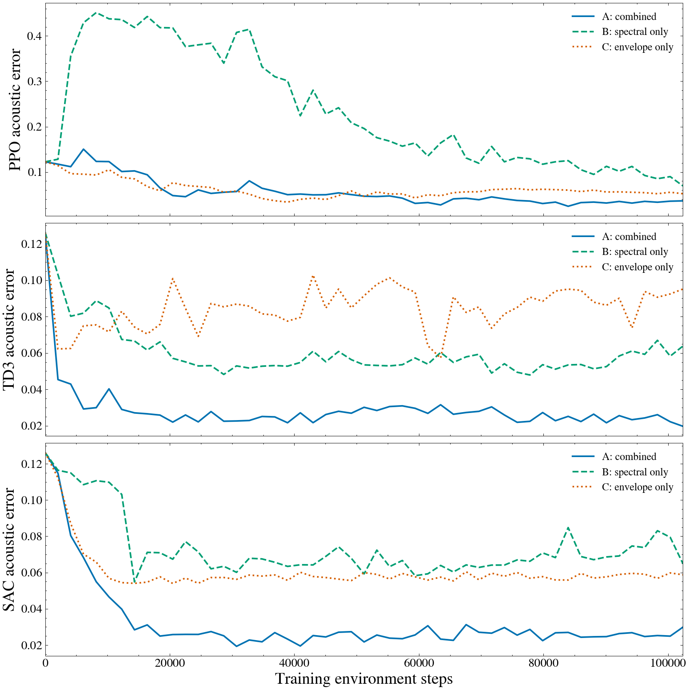

# Issue #15：音響報酬の分解・単独報酬比較

基準ブランチ: `main_deeplearning`、Aのcommit: `45e6ff5e2a8e00b4555452399c5c9123cc5f514d`。mainの旧4,096-step版ではなく、保存済み102,400-step版を対照に使用。

Aは既存の合算報酬、Bはスペクトル単独、Cは包絡単独。B/Cのみ各3手法×3 seed、102,400ステップをゼロから学習した。Aは再学習していない。目標・音生成・観測・行動・seed管理・ネットワーク・学習率等は共通で、学習スカラーに含める報酬項だけを変更。評価は全条件で同じ合算距離と周波数/振幅MAE。

## 最終結果（3 seed平均±標本SD）

| 条件 | 手法 | 全区間E_spec | 全区間E_env | 全区間E_total | 周波数MAE[Hz] | 振幅MAE |
| --- | --- | --- | --- | --- | --- | --- |
| combined | PPO | 0.025365 ± 0.004764 | 0.005515 ± 0.002071 | 0.030880 ± 0.006337 | 95.655313 ± 45.024431 | 0.007045 ± 0.003484 |
| combined | TD3 | 0.017919 ± 0.001664 | 0.002664 ± 0.000117 | 0.020582 ± 0.001583 | 30.511174 ± 3.710069 | 0.001885 ± 0.000500 |
| combined | SAC | 0.026500 ± 0.003916 | 0.002500 ± 0.000414 | 0.029000 ± 0.004149 | 68.668266 ± 25.824969 | 0.001744 ± 0.001159 |
| spectral_only | PPO | 0.029663 ± 0.002657 | 0.032263 ± 0.004570 | 0.061926 ± 0.006444 | 83.118484 ± 10.174400 | 0.045653 ± 0.006534 |
| spectral_only | TD3 | 0.034100 ± 0.004340 | 0.022840 ± 0.003344 | 0.056940 ± 0.005956 | 22.030499 ± 18.069128 | 0.033296 ± 0.004778 |
| spectral_only | SAC | 0.038568 ± 0.005640 | 0.031839 ± 0.005209 | 0.070406 ± 0.010367 | 16.956161 ± 7.346066 | 0.046826 ± 0.007473 |
| envelope_only | PPO | 0.060182 ± 0.020108 | 0.004501 ± 0.000576 | 0.064683 ± 0.019779 | 481.629505 ± 318.413993 | 0.005762 ± 0.000794 |
| envelope_only | TD3 | 0.082382 ± 0.011573 | 0.002528 ± 0.000222 | 0.084909 ± 0.011404 | 703.457807 ± 147.545014 | 0.001849 ± 0.000816 |
| envelope_only | SAC | 0.056194 ± 0.000673 | 0.002102 ± 0.000102 | 0.058296 ± 0.000578 | 367.754930 ± 1.455243 | 0.000710 ± 0.000246 |

主結果は最終更新後の方策。全27 runの個別値、初期値、途中最良、参考精度への到達点、計算時間は [comparison_per_seed.csv](comparison_per_seed.csv)。到達点は2,048ステップの評価グリッド上の観測値で、真の初到達stepを特定したものではない。0.08は聴覚的同一性の合格基準ではない。

今回、合算報酬Aの最終共通誤差平均が両単独条件より小さかった手法: PPO, TD3, SAC。スペクトル単独では振幅MAEの残存、包絡単独では周波数MAEの増大が見られ、単一成分の一致を模倣全体の成功と同一視できない。

## 学習推移



各パネルはPPO・TD3・SAC、各線はA/B/C。同じ51点を平滑化せず描いた。最終点は最終更新後、最後の更新前callbackは各runに別保存。[3 seed平均±SD](figures/learning_curves_mean_sd.png) と [comparison_curves.csv](comparison_curves.csv) に全seedの推移を示す。

## 再学習なしのA成分分解

既存curve/best/summary JSONだけを読み、追加学習0・追加方策評価0で再分析した。入力hashは [reanalysis/analysis.json](reanalysis/analysis.json)。

| 手法 | step | E_spec平均 | E_env平均 | E_total平均 |
| --- | --- | --- | --- | --- |
| TD3 | 2048 | 0.041397 | 0.008920 | 0.050318 |
| TD3 | 102400 | 0.017919 | 0.002664 | 0.020582 |
| SAC | 30720 | 0.019710 | 0.002590 | 0.022300 |
| SAC | 102400 | 0.026500 | 0.002500 | 0.029000 |

SACの30,720→最終の悪化は主にスペクトル項の増大で、包絡項は同程度。この記述だけでは包絡報酬の干渉が原因だとはいえない。[seed 0成分曲線](reanalysis/components_seed0.png)、[3 seed平均±SD](reanalysis/components_mean_sd.png)、[初期・20,480・51,200・最終・各seed最良の比較](reanalysis/selected_points.csv) を保存した。

E_specは80 dBで正規化した対数パワースペクトル差であり、周波数制御誤差そのものではない。E_envは約5 ms RMS包絡差であり、振幅制御誤差そのものではない。両者は現行scale=1では無次元でもオーダーや学習寄与は同じとは限らず、周波数MAE[Hz]と無次元振幅MAEを別に比較した。

例えばTD3のBでは周波数MAEがAの30.51 Hzから22.03 Hzへ小さくなったが、E_specは0.01792から0.03410へ大きくなった。スペクトル項を周波数制御誤差と置き換えて説明できない具体例である。

## 実際の学習報酬とスケール

学習器には毎step一つのスカラーを渡す。Bは−E_spec、Cは−E_envで、除いた項もinfoとtraining_traceへ記録。評価環境では常に合算報酬を使用する。共通の主評価は完成0.35秒波形の距離であり、35個の10 ms局所報酬の和とは異なる。

[training_reward_distributions.csv](training_reward_distributions.csv) に実報酬のmin/mean/SD/分位点/maxとB/C局所成分を記録。Aは既存training_traceのスカラー分布を利用し、未記録だったAの局所成分は再生成・推定していない。報酬項の除去は数値スケールやSACのentropy項との相対関係も変えるため、差を項の干渉だけへ帰属しない。

| 条件 | 手法 | 報酬mean | 報酬SD | p05 | p95 |
| --- | --- | --- | --- | --- | --- |
| combined | PPO | -0.171278 | 0.116061 | -0.423241 | -0.055921 |
| combined | TD3 | -0.073927 | 0.031794 | -0.127322 | -0.031826 |
| combined | SAC | -0.076369 | 0.059764 | -0.181310 | -0.030085 |
| spectral_only | PPO | -0.076098 | 0.035082 | -0.135839 | -0.035029 |
| spectral_only | TD3 | -0.046442 | 0.019474 | -0.082222 | -0.019741 |
| spectral_only | SAC | -0.050472 | 0.026189 | -0.095500 | -0.019618 |
| envelope_only | PPO | -0.092981 | 0.087923 | -0.280843 | -0.005737 |
| envelope_only | TD3 | -0.027009 | 0.021978 | -0.065834 | -0.003075 |
| envelope_only | SAC | -0.019143 | 0.048087 | -0.114548 | -0.001827 |

上表は各seedの全102,400学習stepを混ぜた報酬分布の統計を3 seedで平均した値で、学習終盤だけの分布ではない。SDはstep分布のSDであり、最終性能表のseed間標本SDとは区別する。

## 代表スペクトログラムと制御

全図はseed 0の最終更新後の同じモデル・音声・制御。既存SciencePlots系スタイル、0–2500 Hz、Blackman–Harris窓、表示専用10 MHz、gray_r、−50〜−20 dB、図中タイトルなしを維持。

- spectral_only / PPO: [スペクトログラム](figures/spectral_only_PPO_seed0_spectrogram.png)、[周波数・振幅](figures/spectral_only_PPO_seed0_controls.png)
- spectral_only / TD3: [スペクトログラム](figures/spectral_only_TD3_seed0_spectrogram.png)、[周波数・振幅](figures/spectral_only_TD3_seed0_controls.png)
- spectral_only / SAC: [スペクトログラム](figures/spectral_only_SAC_seed0_spectrogram.png)、[周波数・振幅](figures/spectral_only_SAC_seed0_controls.png)
- envelope_only / PPO: [スペクトログラム](figures/envelope_only_PPO_seed0_spectrogram.png)、[周波数・振幅](figures/envelope_only_PPO_seed0_controls.png)
- envelope_only / TD3: [スペクトログラム](figures/envelope_only_TD3_seed0_spectrogram.png)、[周波数・振幅](figures/envelope_only_TD3_seed0_controls.png)
- envelope_only / SAC: [スペクトログラム](figures/envelope_only_SAC_seed0_spectrogram.png)、[周波数・振幅](figures/envelope_only_SAC_seed0_controls.png)

Aの図は親のfigures/をそのまま利用する。特にCの周波数追従は、合計誤差や包絡項が小さいことだけから成功と判断せず、上のHz単位のMAEと制御図を確認する。

## 重みλ・カリキュラムの判断

今回、合算報酬Aの最終共通誤差平均が両単独条件より小さかった手法: PPO, TD3, SAC。スペクトル単独では振幅MAEの残存、包絡単独では周波数MAEの増大が見られ、単一成分の一致を模倣全体の成功と同一視できない。

この共通評価・予算では両項を維持するAを当面の基準とし、今回の結果から直ちに重みを変更する必要性は認めない。ただし最適な正のλは同定しておらず、合算報酬の普遍的な必須性やλ=1の最適性を証明したものではない。Bはλ=0に相当し、Cはスペクトル係数を0にした対照で、正のλ探索とは区別する。段階的切替・新しい正のλの追加学習は未検証で見送り、将来実施する場合は値・予算・seedを事前固定する。判断は [decision.json](decision.json) に記録。

## 計算費用・検証

B/C新規学習: 18 run、学習1,843,200、run内評価32,760環境ステップ。実行wall 1009.332秒、CPU各1スレッド・独立6プロセス。図・比較表生成は約14.978秒で別計上。厳密な速度順位は評価しない。

[audit.json](audit.json) では全モデルの再読み込み、最終音声/制御/曲線/指標の一致、実更新数、全stepの報酬分解、有限値、評価中に学習器を更新しない署名を検査。Oracle・同一目標・再現性・共通評価のテストはtest_results.json/txtを参照。Aと同じライブラリ版を使用し、差異一覧はmanifestに記録した。

## 保存構造と再実行

Phase 0の親はphase0_fixed_target_20261108/の一つ。保存名の日付は歴史的な名前で、実行日ではない。Aは親直下、B/Cはこのreward_ablation内、旧ランダム目標の全固有データは親のlegacy_random_target/。移設前後の全hash/サイズ・Git復元経路・参照の扱いはlegacy_inventory.json、reference_inventory.json、integration.jsonを参照。

初回実行（既存の同名B/C成果は上書きしない）:

```bash
PYTHONDONTWRITEBYTECODE=1 Deeplearning/.venv-rl/bin/python -m Deeplearning.issue15 --workers 6
```

保存済みの値・図だけを再生成:

```bash
PYTHONDONTWRITEBYTECODE=1 Deeplearning/.venv-rl/bin/python -m Deeplearning.issue15_report
```

本結果は目標f/Aが観測される固定正弦波のin-target追従課題。鳴管の逆推定、実録音、左右相互作用、未知音への汎化は示さない。3 seedの有限予算・途中最良の選択バイアス・学習報酬スケールの違いを保ったまま解釈する。
