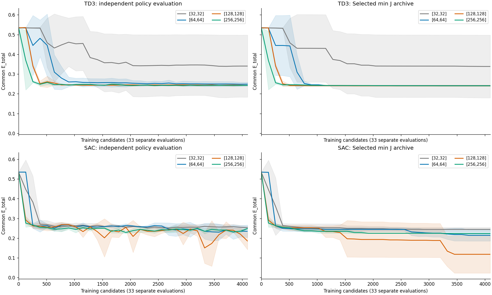
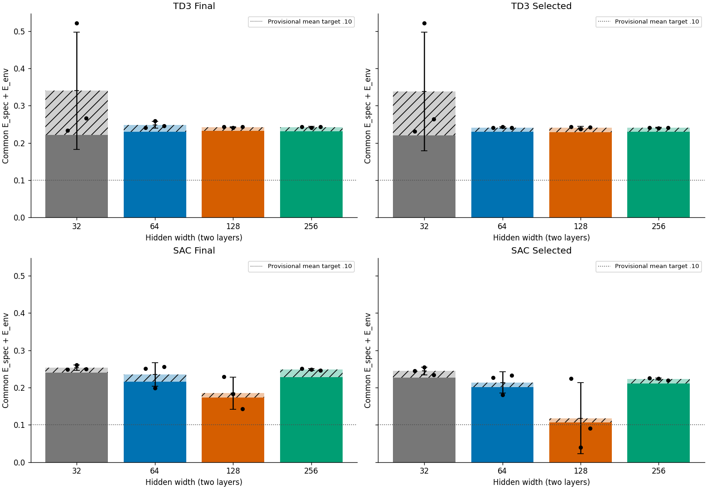
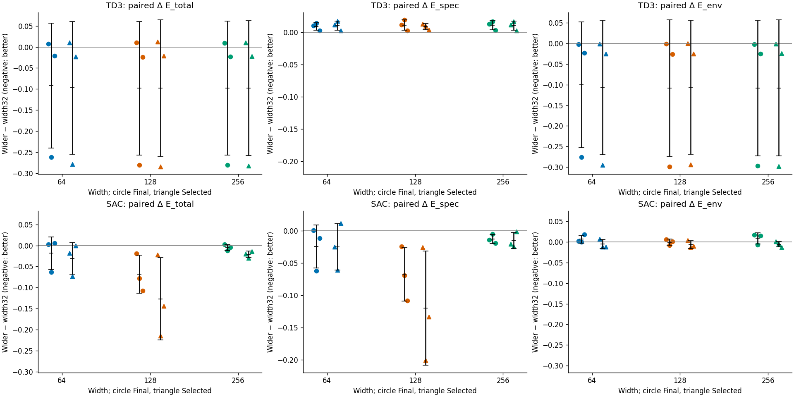
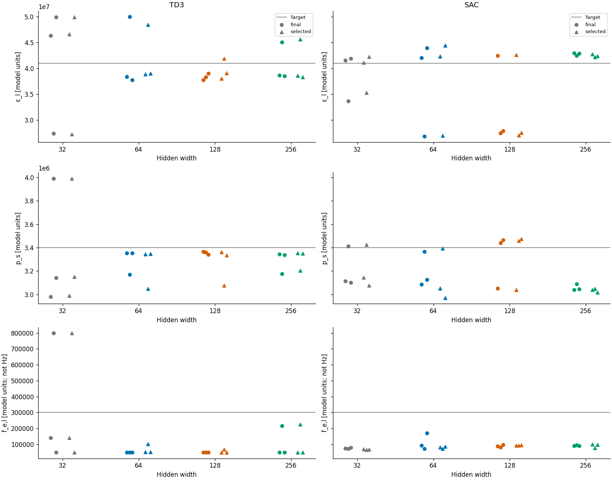
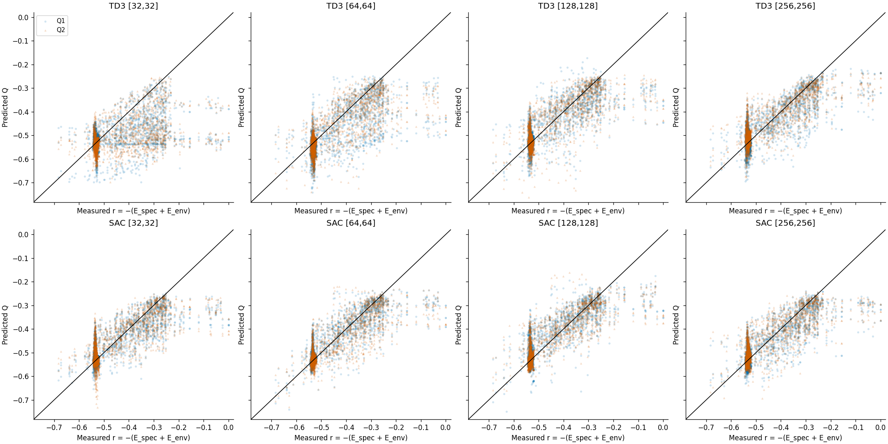
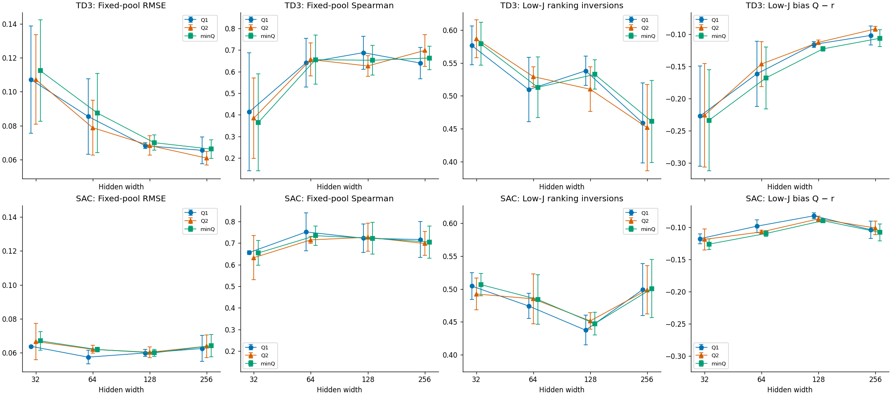
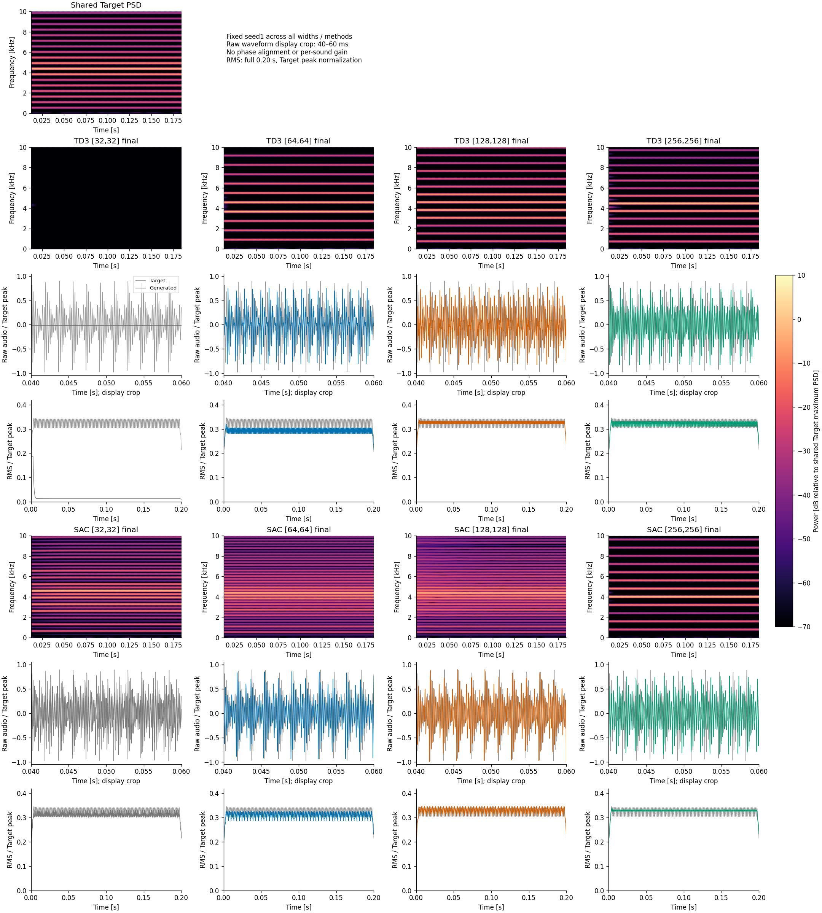
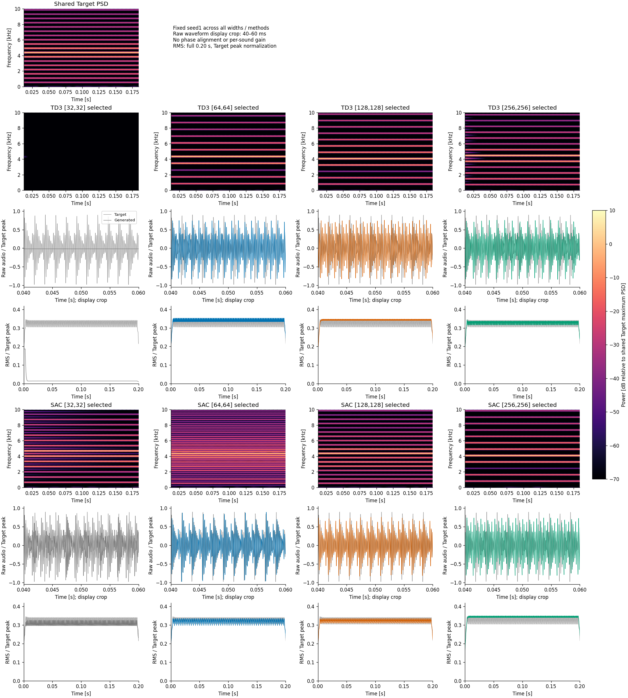

# Issue21 — Case A・一定3Dのネットワーク幅比較

## 結果と判断

今回の幅変更では、Final平均E_total≤0.10かつ持続発声3/3の暫定目標を満たす条件はなかった。

TD3：Final平均が最小だった幅は256（0.24254 ± 0.00158、持続3/3）。32幅の0.34029 ± 0.15741に対する平均差は-0.09776。

SAC：Final平均が最小だった幅は128（0.18515 ± 0.04347、持続3/3）。32幅の0.25334 ± 0.00692に対する平均差は-0.06819。

ネット幅だけでは暫定目標を達成できなかったため、次Issueで探索幅を1要因として比較する価値がある。TD3の物理量ごとのσは事前固定し、ネット幅・LR・報酬は同時変更しない。SACの分散/entropyは別の設計として扱う。ただし今回の結果だけから探索ノイズが唯一の原因とは断定できない。

今回のTD3では、拡幅した全条件で持続発声3/3となったが、32→256幅の平均E_specは0.22094→0.23157で、平均E_envの0.11936→0.01097が共通誤差の改善を支えている。発声回復とスペクトル模倣の改善を同一視しない。128/256幅のFinal平均差は約0.000028と小さく、256幅が明確に優れるとは判断できない。

SACは128幅でFinal平均E_specが0.24065→0.17329へ下がり、共通誤差も3seedすべてで32幅より改善した。しかし256幅のFinal平均は0.24870に戻り、幅を増やすほど良くなる結果ではなかった。128幅のseed1/2ではSelectedが0.04017/0.09013まで下がった一方、Finalは0.18355/0.14250だった。途中の低誤差解を最終方策が保持したとは言えず、暫定目標をSelectedで代用しない。

幅以外の実効設定が一致することを全runで確認した。ActorとCriticを同時に拡幅し、それに伴って学習データの分布も変わるため、性能差を「Criticの表現力不足だけが原因だった」と因果的に断定しない。3seedの探索的比較であり、有意差や唯一の最適幅を主張しない。Selectedの改善をFinalの改善と混同しない。

固定観測・1行動の課題なので、Actorは同じ初期観測に対して3値を返す。拡幅しても可制御次元や物理範囲は増えず、近似・最適化・探索データの変化を含む実験として解釈する。

## 固定条件・保護

Case Aのみ、0.20秒・50kHz・10000sample、native dt=1e-7、初期状態/遅延履歴0、右側α_r=β_r=0。目標は既存波形/hashを参照し、制御は `[4.1e7,3.5e7,3.4e6,3e5,4.9e4]`。可制御はε_l∈[2.5e7,5e7]、p_s∈[2.5e6,4e6]、f0_l∈[49000,800000]。右のε_r=3.5e7、f0_r=4.9e4固定。f0_lはHzの基本周波数ではなく開閉外力係数。ε_lとp_sも直接測定された張力やPaと同一とはせず、図はモデル内部単位とした。

研究設定x0=.02 cm,D=.01とCase Aの右結合ゼロを実際のC++ resetで検証。Issue19で数値一致を確認したnative library/hashを保持し、目標と基準4波形を再生して全サンプル一致した。[事前検証](preflight.json)。実効設定の初回照合ではJSON listとPython tupleの表記差で停止し、JSON表現に揃えて再確認した。学習前の2回・計10音を[事前検証回数](preflight_attempts.json)に記録している。

新規は[64,64]/[128,128]/[256,256]×TD3/SAC×seed0/1/2の18run。32幅はIssue18のrestricted3D・λ=1を読み取り専用利用し、再学習・再描画・旧ファイル更新を行わない。Issue20案、Case B、時変制御、4D/5D、実録音、DEの新規計算およびDEの比較図は本Issueの対象外。[条件・依存版・source hash](manifest.json) / [着手前の旧ファイルhash](protected_before.csv)。着手時はクリーン、未pushコミットなし。

## 幅以外の学習設定

lr=3e-4、batch32、gamma1、buffer50000、warmup16、train_freq1、gradient_steps1、CPU・worker内1thread。TD3は正規化σ=.1の既存探索ノイズ、policy_delay2、SACはent_coef=auto_0.01。報酬は `r=−(E_spec+E_env)`。先生の別提案 `−{λ E_spec+(1−λ)E_env}` やIssue19のλ=.5は導入していない。

ActorとQ1/Q2双方、target networkの実際のLinear層を検査し、baselineとの実効設定差がnet_archだけであることを確認した。NN形状の変更では初期重み・乱数消費・学習軌跡は変わる。同じseedは同じ候補列の意味ではないが、学習前warmup16行動はbaselineと完全一致した。[設定と層の事前確認](preflight.json) / [各runの実効設定](runs/) / [監査](audit.json)。

| 手法 | 幅（2層） | Actorパラメータ数 | Critic Q1+Q2パラメータ数 |
| --- | --- | --- | --- |
| TD3 | 32 | 1443 | 2946 |
| TD3 | 64 | 4931 | 9986 |
| TD3 | 128 | 18051 | 36354 |
| TD3 | 256 | 68867 | 138242 |
| SAC | 32 | 1542 | 2946 |
| SAC | 64 | 5126 | 9986 |
| SAC | 128 | 18438 | 36354 |
| SAC | 256 | 69638 | 138242 |

パラメータ数はonline networkのみで、target/optimizerの保存容量を含まない。

各runは4096学習候補・Critic更新4080回。TD3のActor更新2040回、SACのActor更新4080回。独立評価は0,128,...,4096の33回で、128〜3968は直前の勾配更新後、4096は最終更新後。評価前後のモデル・optimizer・buffer・RNG署名が同じであることを検査した。

## 共通評価

主指標はFinalの `E_total=E_spec+E_env`、平均±標本SD（ddof=1、3seed）。Selectedは33回の独立評価の最初のminJ。今回はλ=1なのでJ=E_totalだが、Finalと途中Selectedを分離する。失敗/非持続seedを除かない。暫定目標はFinal平均≤.10かつ持続3/3であり、全seedのE_total≤.10や聴覚的同一性を保証する条件ではない。持続proxyは末尾1000sampleのAC標準偏差/Target peak>.05かつ数値失敗なし。

| 手法 | 幅 | 採用 | E_total 平均±SD | E_spec 平均±SD | E_env 平均±SD | 持続/3 | 暫定目標 |
| --- | --- | --- | --- | --- | --- | --- | --- |
| TD3 | 32 | final | 0.34029 ± 0.15741 | 0.22094 ± 0.00907 | 0.11936 ± 0.16460 | 2 | 未達 |
| TD3 | 32 | selected | 0.33843 ± 0.15896 | 0.21983 ± 0.00798 | 0.11861 ± 0.16523 | 2 | 副評価 |
| TD3 | 64 | final | 0.24869 ± 0.00958 | 0.22964 ± 0.00346 | 0.01905 ± 0.01264 | 3 | 未達 |
| TD3 | 64 | selected | 0.24149 ± 0.00147 | 0.22988 ± 0.00087 | 0.01160 ± 0.00234 | 3 | 副評価 |
| TD3 | 128 | final | 0.24256 ± 0.00117 | 0.23180 ± 0.00086 | 0.01076 ± 0.00080 | 3 | 未達 |
| TD3 | 128 | selected | 0.24074 ± 0.00328 | 0.22853 ± 0.00595 | 0.01221 ± 0.00277 | 3 | 副評価 |
| TD3 | 256 | final | 0.24254 ± 0.00158 | 0.23157 ± 0.00243 | 0.01097 ± 0.00088 | 3 | 未達 |
| TD3 | 256 | selected | 0.24052 ± 0.00114 | 0.22988 ± 0.00140 | 0.01064 ± 0.00039 | 3 | 副評価 |
| SAC | 32 | final | 0.25334 ± 0.00692 | 0.24065 ± 0.00293 | 0.01269 ± 0.00399 | 3 | 未達 |
| SAC | 32 | selected | 0.24465 ± 0.01004 | 0.22639 ± 0.01338 | 0.01826 ± 0.00694 | 3 | 副評価 |
| SAC | 64 | final | 0.23492 ± 0.03171 | 0.21594 ± 0.03045 | 0.01898 ± 0.00829 | 3 | 未達 |
| SAC | 64 | selected | 0.21401 ± 0.02855 | 0.20143 ± 0.02636 | 0.01258 ± 0.00424 | 3 | 副評価 |
| SAC | 128 | final | 0.18515 ± 0.04347 | 0.17329 ± 0.04135 | 0.01185 ± 0.00346 | 3 | 未達 |
| SAC | 128 | selected | 0.11805 ± 0.09498 | 0.10659 ± 0.09204 | 0.01146 ± 0.00345 | 3 | 副評価 |
| SAC | 256 | final | 0.24870 ± 0.00281 | 0.22767 ± 0.00992 | 0.02103 ± 0.00936 | 3 | 未達 |
| SAC | 256 | selected | 0.22323 ± 0.00297 | 0.21086 ± 0.00337 | 0.01236 ± 0.00326 | 3 | 副評価 |

同じseedの拡幅−32幅の差。負なら誤差改善。平均差と対応差のSDを分け、seed別の符号は[CSV](paired_width_deltas.csv)に保持した。

| 手法 | 幅 | 採用 | ΔE_total 平均±SD | ΔE_spec 平均±SD | ΔE_env 平均±SD |
| --- | --- | --- | --- | --- | --- |
| TD3 | 64 | final | -0.09161 ± 0.14792 | +0.00870 ± 0.00578 | -0.10031 ± 0.15196 |
| TD3 | 64 | selected | -0.09695 ± 0.15751 | +0.01006 ± 0.00728 | -0.10701 ± 0.16291 |
| TD3 | 128 | final | -0.09773 ± 0.15854 | +0.01087 ± 0.00823 | -0.10860 ± 0.16494 |
| TD3 | 128 | selected | -0.09769 ± 0.16223 | +0.00871 ± 0.00459 | -0.10640 ± 0.16255 |
| TD3 | 256 | final | -0.09776 ± 0.15897 | +0.01064 ± 0.00720 | -0.10839 ± 0.16373 |
| TD3 | 256 | selected | -0.09792 ± 0.16007 | +0.01005 ± 0.00697 | -0.10797 ± 0.16495 |
| SAC | 64 | final | -0.01842 ± 0.03854 | -0.02471 ± 0.03338 | +0.00629 ± 0.00967 |
| SAC | 64 | selected | -0.03064 ± 0.03770 | -0.02496 ± 0.03631 | -0.00568 ± 0.01104 |
| SAC | 128 | final | -0.06819 ± 0.04489 | -0.06735 ± 0.04173 | -0.00084 ± 0.00713 |
| SAC | 128 | selected | -0.12660 ± 0.09741 | -0.11980 ± 0.08825 | -0.00680 ± 0.00938 |
| SAC | 256 | final | -0.00464 ± 0.00735 | -0.01298 ± 0.00720 | +0.00834 ± 0.01335 |
| SAC | 256 | selected | -0.02142 ± 0.00783 | -0.01553 ± 0.01245 | -0.00589 ± 0.00675 |

学習中のfloat32報酬と独立方策評価を混ぜない。全73728学習サンプルは[圧縮CSV](new_training_samples.csv.gz)、独立評価は[方策評価CSV](policy_evaluations.csv)、Final/Selectedの成分・制御・物理誤差は[各seed CSV](comparison_per_seed.csv)。物理NRMSEは従来の全域幅と今回の制限幅の両方を明示し、音響的に近い制御が唯一の物理的正解とは主張しない。

1D/2Dの[既存参照値](lower_dimensional_reference.csv)も保存JSONから抽出した。1D/2Dでは非学習変数、特にf0_lを正解に固定しているため、3Dとの差を次元数だけの効果と解釈しない。これらの新規学習は行っていない。

## Critic/Actor診断

Issue19と同一hashの1005候補プールを参照。新しい候補抽選や鳴管計算は0。発声/非持続格子・保存Random・既存DEの高精度3点を含むが、DEを新規学習したり比較手法の曲線/図へ掲載したりしていない。既知oracle点もあるため、Actor比較の最良候補はoracle除外（E_total>1e-8）も別記した。各モデルの学習点128点は別集計。完全一致しない行動点を統計的に独立とみなさず、低誤差を厚く選ぶ層別抽出の反転率を物理空間の発生確率とは解釈しない。

観測は固定 `[-1,0,0,0,0,0,0,0]`、VecNormalizeなし。行動は同じ[-1,1]の3Dから制限範囲へ写像。Criticはfloat32のpolicy.scale_action、実測は保存された元のfloat64物理行動のもの（丸め差最大1.2e-7）。32幅で既存診断のRMSE・相関・反転率・biasが再現されることも確認した。[推論記録](critic_execution.json)。

終端1stepなのでTD targetの(1−done)=0で、TD3/SACの両Criticの教師はr。TD3のtarget minQとSACの次状態entropy項は消える。TD3 ActorはQ1を最大化し、SAC Actorは現在行動のminQとentropyを使う確率的方策を学習する。SACの決定論的Finalが候補内最大minQとずれることだけでActorの欠陥とはしない。

指標は各seedで計算して平均±標本SD。順位反転は実測/予測の順位が逆の候補対（真値または予測の同値対を除く）。低J biasは固定プールの下位10%でのQ−rで、負なら良い候補を過小評価。表と図ではQ1/Q2/minQを区別する。全幅で同じ報酬尺度なのでRMSEを同じ単位で比較できるが、Actorと学習サンプル分布も変わるため容量だけの因果評価ではない。

| 手法 | 幅 | Critic | RMSE | Spearman | 固定pool反転率 | 低J bias |
| --- | --- | --- | --- | --- | --- | --- |
| TD3 | 32 | Q1 | 0.1071 ± 0.0317 | 0.4138 ± 0.2735 | 0.3493 ± 0.1030 | -0.2273 ± 0.0782 |
| TD3 | 32 | Q2 | 0.1072 ± 0.0264 | 0.3846 ± 0.1867 | 0.3721 ± 0.0681 | -0.2260 ± 0.0806 |
| TD3 | 32 | minQ | 0.1124 ± 0.0300 | 0.3650 ± 0.2241 | 0.3768 ± 0.0809 | -0.2339 ± 0.0788 |
| TD3 | 64 | Q1 | 0.0854 ± 0.0222 | 0.6415 ± 0.1136 | 0.2732 ± 0.0497 | -0.1615 ± 0.0509 |
| TD3 | 64 | Q2 | 0.0788 ± 0.0163 | 0.6559 ± 0.0763 | 0.2695 ± 0.0319 | -0.1463 ± 0.0350 |
| TD3 | 64 | minQ | 0.0875 ± 0.0234 | 0.6554 ± 0.1134 | 0.2673 ± 0.0500 | -0.1679 ± 0.0479 |
| TD3 | 128 | Q1 | 0.0682 ± 0.0016 | 0.6880 ± 0.0764 | 0.2484 ± 0.0450 | -0.1158 ± 0.0046 |
| TD3 | 128 | Q2 | 0.0683 ± 0.0057 | 0.6263 ± 0.0483 | 0.2834 ± 0.0258 | -0.1126 ± 0.0036 |
| TD3 | 128 | minQ | 0.0700 ± 0.0045 | 0.6528 ± 0.0693 | 0.2696 ± 0.0366 | -0.1227 ± 0.0034 |
| TD3 | 256 | Q1 | 0.0654 ± 0.0079 | 0.6399 ± 0.0730 | 0.2716 ± 0.0333 | -0.1017 ± 0.0149 |
| TD3 | 256 | Q2 | 0.0609 ± 0.0040 | 0.6983 ± 0.0734 | 0.2391 ± 0.0376 | -0.0916 ± 0.0040 |
| TD3 | 256 | minQ | 0.0662 ± 0.0056 | 0.6632 ± 0.0548 | 0.2598 ± 0.0271 | -0.1061 ± 0.0132 |
| SAC | 32 | Q1 | 0.0637 ± 0.0005 | 0.6567 ± 0.0086 | 0.2682 ± 0.0094 | -0.1177 ± 0.0076 |
| SAC | 32 | Q2 | 0.0666 ± 0.0106 | 0.6327 ± 0.1029 | 0.2790 ± 0.0484 | -0.1187 ± 0.0162 |
| SAC | 32 | minQ | 0.0669 ± 0.0055 | 0.6547 ± 0.0575 | 0.2714 ± 0.0294 | -0.1261 ± 0.0086 |
| SAC | 64 | Q1 | 0.0573 ± 0.0040 | 0.7518 ± 0.0878 | 0.2151 ± 0.0448 | -0.0981 ± 0.0100 |
| SAC | 64 | Q2 | 0.0619 ± 0.0024 | 0.7151 ± 0.0161 | 0.2363 ± 0.0109 | -0.1071 ± 0.0028 |
| SAC | 64 | minQ | 0.0618 ± 0.0013 | 0.7344 ± 0.0448 | 0.2261 ± 0.0237 | -0.1095 ± 0.0044 |
| SAC | 128 | Q1 | 0.0598 ± 0.0021 | 0.7228 ± 0.0656 | 0.2269 ± 0.0358 | -0.0820 ± 0.0044 |
| SAC | 128 | Q2 | 0.0602 ± 0.0031 | 0.7272 ± 0.0651 | 0.2257 ± 0.0372 | -0.0868 ± 0.0044 |
| SAC | 128 | minQ | 0.0599 ± 0.0021 | 0.7228 ± 0.0727 | 0.2267 ± 0.0417 | -0.0896 ± 0.0034 |
| SAC | 256 | Q1 | 0.0624 ± 0.0077 | 0.7167 ± 0.0834 | 0.2336 ± 0.0464 | -0.1037 ± 0.0135 |
| SAC | 256 | Q2 | 0.0637 ± 0.0067 | 0.6983 ± 0.0557 | 0.2465 ± 0.0277 | -0.1009 ± 0.0107 |
| SAC | 256 | minQ | 0.0641 ± 0.0065 | 0.7050 ± 0.0750 | 0.2405 ± 0.0403 | -0.1078 ± 0.0132 |

本プールではTD3 Q1の平均RMSEが32幅0.10711→256幅0.06543、低J biasが−0.22734→−0.10174へ改善したが、低J順位反転率は256幅でも0.459。SACのminQは平均RMSEが32幅0.06690→128幅0.05987となった一方、256幅は0.06406で、低J biasも128幅−0.08956から256幅−0.10784へ戻った。近似指標の一部は改善したが、低誤差領域の順位付けを解決したとは言えない。

TD3 256幅のseed1/2では、実測が良い非oracle候補（共通誤差約3.7e-5）がQ1で3位/8位まで上がったのに、Actorの共通誤差は0.24072/0.24358。候補内最大Q1−Actor Q1は+0.00293/+0.02938で、Actorの選択・局所的な勾配・探索被覆も検討する必要がある。一方seed0は同候補97位で、Actor Q1が候補内最大Q1より高く、Critic側の課題も残る。固定候補内の比較から連続空間のActor最適化の成否を断定はできない。

[全候補Qの圧縮CSV](critic_predictions.csv.gz) / [seed・subset別の診断](critic_metrics.csv) / [Actor制御と良い候補の順位・Q gap](actor_diagnostics.csv)。有限の診断候補内最大Qは連続空間の大域最大ではない。最終モデルの回顧診断から学習途中の因果関係は特定できない。

## 代表音

全幅・両手法でseed1を固定し、Final/Selectedを分けた。Target最大full-band PSDを共通参照として、全48endpointを覆う同じdB範囲・同じカラーバー。RMSは共通Target peak基準、5ms窓。波形は位相合わせせず40–60msだけを表示し、これは描画範囲の切出しで報酬や保存音の短縮ではない。表示PSDは10MHzへ再サンプリング、Blackman-Harris窓245760・overlap184320、有効窓のみ、0–10kHz。[表示条件と図hash](figure_sources.json)。

全新規runのFinal/Selectedは元振幅float64 NPZとモデルを保持。聴取用の[新規音WAV ZIP](new_listening_audio.zip)は全音に同じTarget由来gainを使い、完全同一WAVは[対応表](listening_audio.json)で共用する。旧32幅音声は[既存の元データ参照](endpoint_sources.json)を使い、コピーしない。ZIP化と描画に追加シミュレーションはない。

## 全seed

| 手法 | 幅 | seed | Final E_total | Selected E_total | 採用試行 | Final持続 | Selected持続 |
| --- | --- | --- | --- | --- | --- | --- | --- |
| TD3 | 32 | 0 | 0.2334936 | 0.2308455 | 3712 | True | True |
| TD3 | 32 | 1 | 0.5210673 | 0.5210231 | 3968 | False | False |
| TD3 | 32 | 2 | 0.2663199 | 0.2634312 | 3968 | True | True |
| TD3 | 64 | 0 | 0.2410357 | 0.2407104 | 896 | True | True |
| TD3 | 64 | 1 | 0.2594326 | 0.2431855 | 768 | True | True |
| TD3 | 64 | 2 | 0.2455879 | 0.2405603 | 1152 | True | True |
| TD3 | 128 | 0 | 0.2436213 | 0.243252 | 1280 | True | True |
| TD3 | 128 | 1 | 0.2413073 | 0.2370235 | 384 | True | True |
| TD3 | 128 | 2 | 0.2427657 | 0.2419434 | 1664 | True | True |
| TD3 | 256 | 0 | 0.2433193 | 0.2410456 | 3200 | True | True |
| TD3 | 256 | 1 | 0.2407161 | 0.2392147 | 2432 | True | True |
| TD3 | 256 | 2 | 0.2435754 | 0.2412932 | 2048 | True | True |
| SAC | 32 | 0 | 0.248693 | 0.245489 | 3072 | True | True |
| SAC | 32 | 1 | 0.2612972 | 0.254243 | 2304 | True | True |
| SAC | 32 | 2 | 0.2500312 | 0.2342144 | 768 | True | True |
| SAC | 64 | 0 | 0.2507814 | 0.2274126 | 3712 | True | True |
| SAC | 64 | 1 | 0.1984113 | 0.1812219 | 3456 | True | True |
| SAC | 64 | 2 | 0.2555598 | 0.2333918 | 384 | True | True |
| SAC | 128 | 0 | 0.2293956 | 0.223864 | 3072 | True | True |
| SAC | 128 | 1 | 0.1835459 | 0.04017159 | 3456 | True | True |
| SAC | 128 | 2 | 0.1424988 | 0.09012543 | 1536 | True | True |
| SAC | 256 | 0 | 0.2512448 | 0.2254335 | 1024 | True | True |
| SAC | 256 | 1 | 0.2491616 | 0.2244002 | 1792 | True | True |
| SAC | 256 | 2 | 0.2456898 | 0.2198489 | 3328 | True | True |

## 回数・時間・再現性

18runすべて4096試行、計73728学習音。独立評価594音、学習後replay36音。[実行記録](execution.json)のwall時間は852.38秒、worker数18。事前整合は計10音、テストのモデル評価140回（注入失敗1回を含む）は研究runと分離。追加監査は1回48音、実行累計48音。Critic診断は0音。全48endpointを保存モデルから再生し、行動・物理制御・波形・成分・発声判定が完全一致した。[再生監査](endpoint_replays.csv) / [監査結果](audit.json) / [14件のテスト記録](tests.json)。

| 手法 | 幅 | 学習wall秒：平均±標本SD |
| --- | --- | --- |
| TD3 | 32 | 797.81 ± 0.28 |
| TD3 | 64 | 821.45 ± 1.41 |
| TD3 | 128 | 821.59 ± 1.49 |
| TD3 | 256 | 827.95 ± 2.12 |
| SAC | 32 | 805.21 ± 0.75 |
| SAC | 64 | 825.12 ± 0.05 |
| SAC | 128 | 831.08 ± 1.95 |
| SAC | 256 | 838.07 ± 1.98 |

旧32幅は歴史的な12worker実行、新規は18worker実行で競合条件が異なる。上表は実測時間の記録であり、NN幅のみの純粋な速度比較とはしない。全runはCPU1thread、同じ予算・学習設定。処理CPU時間・評価音数は[run別記録](run_accounting.csv)に保持した。

着手前の全旧成果・既存コードはhash照合し、変更/削除0。root READMEの索引とignoreだけを更新した。不要な途中checkpointやseedごとのPNGを出力せず、主要図8枚に集約した。過去の履歴やバイナリの書換え、commit/push、Issueのクローズは行っていない。[最終整合](integrity.json) / [成果物hash](artifact_checksums.json) / [変更前容量](storage_before.json) / [変更後容量](storage_after.json)。

## 次Issueへの判断

ネット幅だけでは暫定目標を達成できなかったため、次Issueで探索幅を1要因として比較する価値がある。TD3の物理量ごとのσは事前固定し、ネット幅・LR・報酬は同時変更しない。SACの分散/entropyは別の設計として扱う。ただし今回の結果だけから探索ノイズが唯一の原因とは断定できない。

正規化TD3σ=.1の物理換算は `[1.25e6,7.5e4,3.755e4]`。これは最大変化量や離散刻みではなく標準偏差で、境界ではクリップされる。ノイズの調整例や報酬式の変更は未検証の別仮説とし、この追試に追加しない。Case Aの人工持続音用f0_l≤800000を実音声・無音/閉鎖・Case Bへ無条件に適用しない。今回の指示は[Issue21](https://github.com/tatsukawa0353/Birdsong_tatsukawa/issues/21)、研究管理メモは[Notion](https://app.notion.com/p/41f6906b3ff081c3ba69e92cedfafb95)（参照のみ）。

<!-- ISSUE21_STORAGE_BEGIN -->
| 対象 | 着手前 | 完了時 |
| --- | --- | --- |
| 作業ツリー通常ファイル数 | 7038 | 7234 |
| 論理容量（ignored含む） | 639.91 MB | 719.71 MB |
| Git新規追加候補 | 0（クリーン） | 191個 / 79.78 MB |
| 既存追跡ファイルの変更 / 削除 | 0 / 0 | 2 / 0 |
<!-- ISSUE21_STORAGE_END -->
