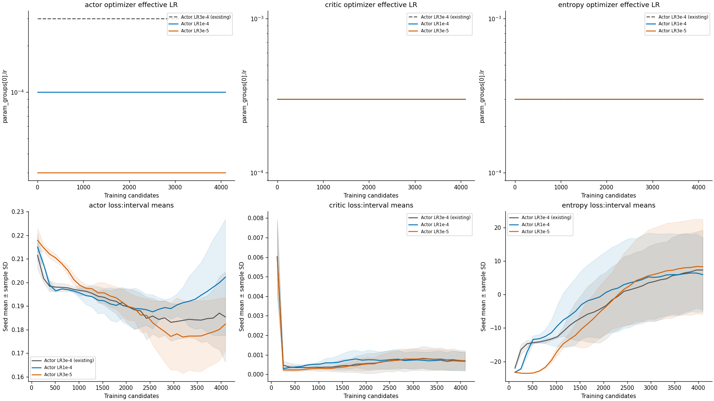
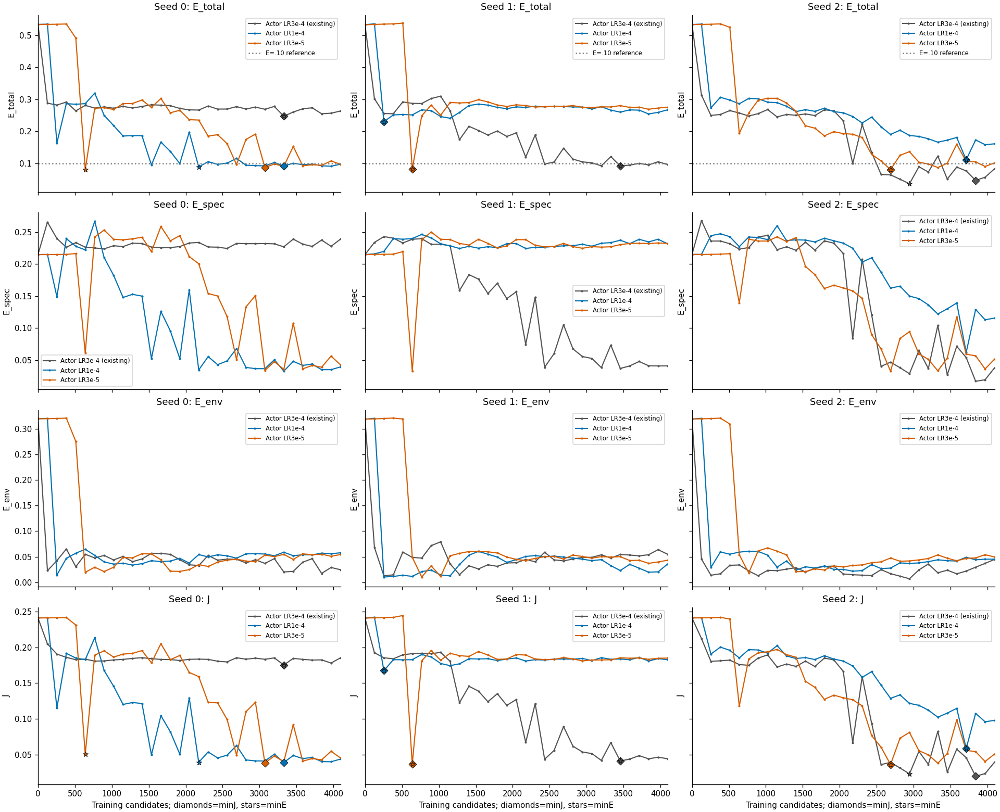
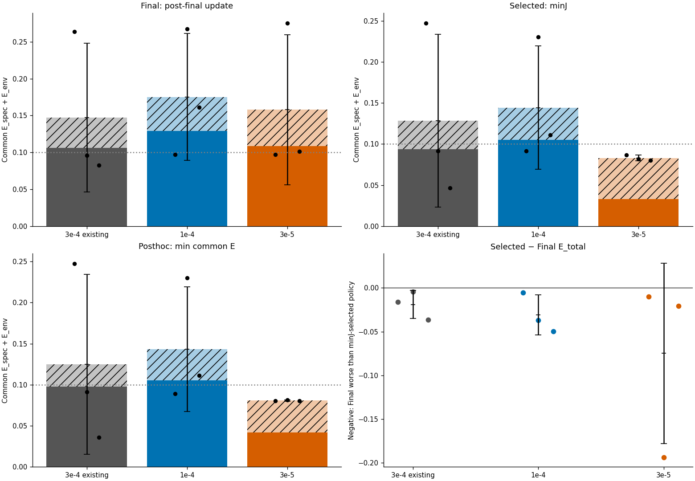
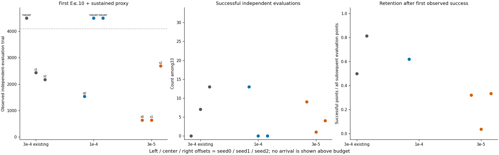
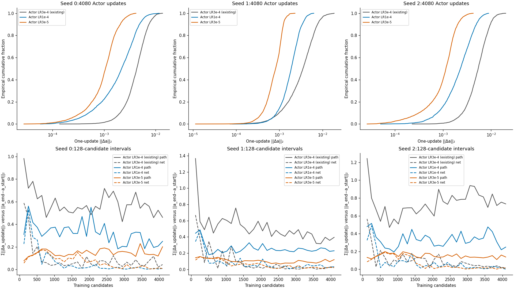
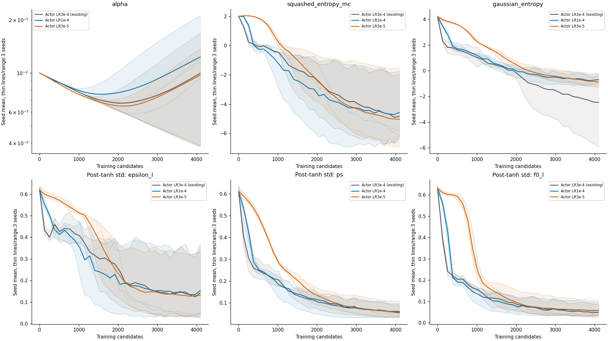
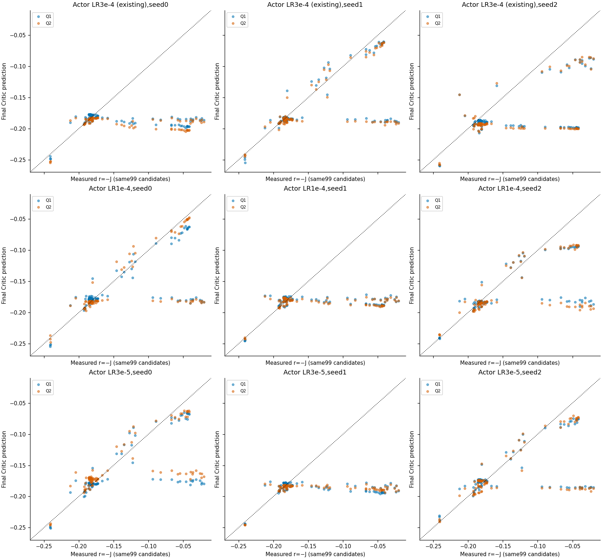
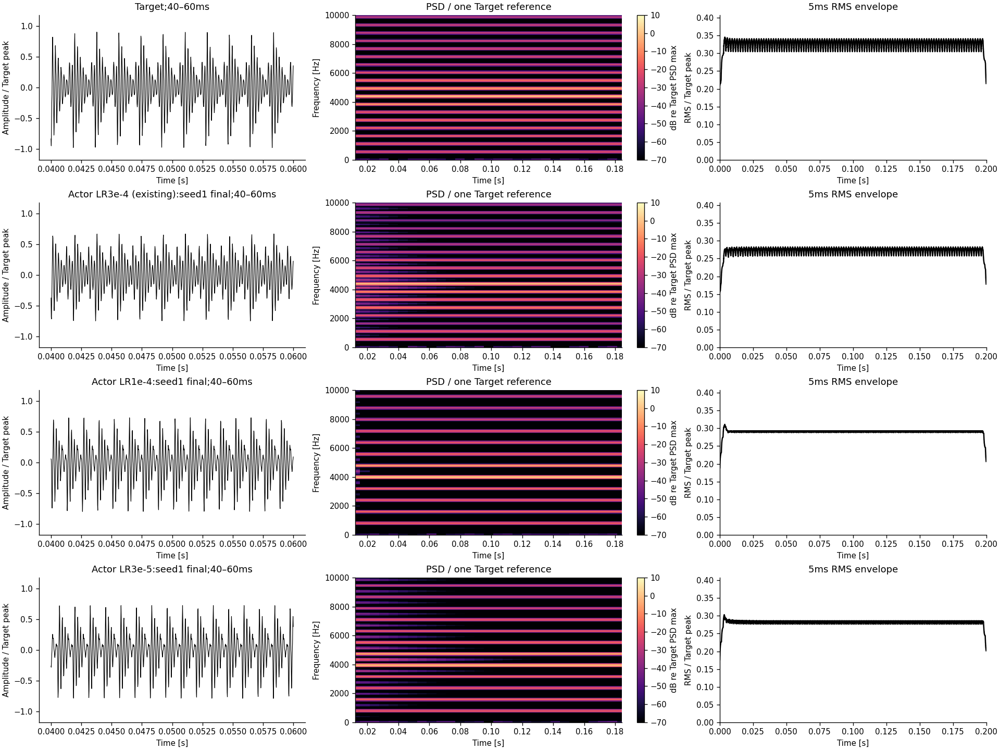
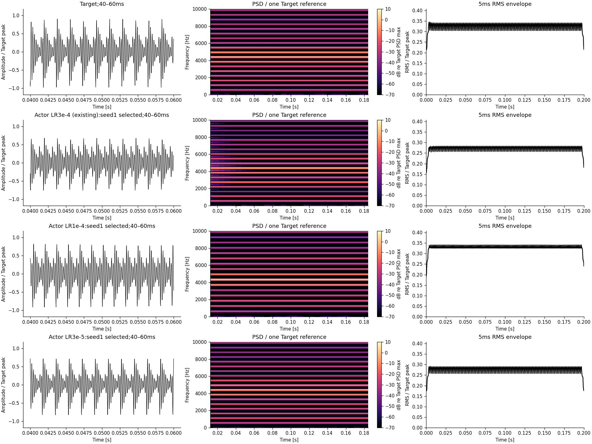

# Issue24 — SAC128・λ=.75・Actorだけの学習率介入

## 結果と判断

今回の3条件は暫定目標（Final平均E_total≤.10・持続3/3）を満たさなかった。

Final平均E_totalは、基準Actor3e-4が**.14745±.10074**、1e-4が**.17514±.08594**、3e-5が**.15783±.10179**（3seed、標本SD）。全条件のFinalは持続3/3だが、どれも平均≤.10を満たさない。基準への対応seed差の平均は1e-4が+.02769、3e-5が+.01039で、低LRへの置換を支持する平均改善は得られなかった。現時点では3e-4を比較基準として維持する。3seedから一般的な最適LRを断定したものではない。

**seed0の到達は改善した。** 基準は良い学習サンプルが1個あっても、決定論的方策の33評価ではE≤.10に未到達、Final .26352だった。1e-4では良い学習サンプル390個、独立方策の初回到達1536・成功13点、Final .09720。3e-5では273個、初回640・成功9点、Final .09699。低LRで必ず到達が遅くなるわけでもなく、このseedでは探索経験とActorへの定着の双方が改善した。ただし同seedでも変更後の経験軌跡は別であり、1個の旧経験をそのまま学習し直した比較ではない。全新規runで基準との学習サンプルの最初の差は18試行目だった。

**seed1/2には代償が出た。** seed1は基準の初回2432・成功7点・Final .09599に対し、1e-4は独立方策が一度も≤.10にならずFinal .26730。3e-5は640試行で.08167へ到達したが、その1点だけで、以後Final .27535まで悪化した。保持率は1/28=.036で、基準の7/14=.50より低い。seed2は基準の初回2176・成功13点・Final .08283に対し、1e-4は未到達でFinal .16091、3e-5は初回2688へ遅れ、成功4点、Final .10117だった。最後の値は閾値をわずかに上回り、事前の基準どおり成功に数えない。低LRで到達・維持が全seed一様に良くなる結果ではない。

**1更新は小さくなったが、安定性改善とは一致しなかった。** ||Δa||中央値の対基準比は、LR比1/3の1e-4で.428–.535、LR比1/10の3e-5で.213–.247。最大値の比も.338–.862と.124–.305で、LR比に比例しない。全4080更新の経路長比はそれぞれ.450–.549と.205–.252に減った。一方、seed2の初期→Final正味距離は基準.59120から1e-4/3e-5で1.45307/1.47038へ増えた。短い更新を積み重ねても、最終的な移動先は大きく異なり得る。3e-5・seed1は最大1更新でも.00231と小さいのに保持を失ったため、単に大きな1回の更新だけを原因とする説明は合わない。

**最良方策の保持には別の利得がある。** 3e-5のSelected/minJ平均Eは.08295±.00353、posthoc/minE平均は.08077±.00078で、いずれも全seedの途中解を保存できた。だがFinal平均は.15783であり、研究目標達成にすり替えない。Selected−Finalの共通E差の平均は基準−.01904、1e-4で−.03082、3e-5で−.07488と、今回の低LRでは平均の乖離がむしろ大きくなった。3e-5・seed0のminEは640試行、minJは3072試行で、基準が異なるので別の重みを残した。保存だけで更新が改善したとは言えない。

温度と探索も単調な説明にはならない。3e-5・seed1では、良かった640時点からFinalまでalphaが.008310→.003886、tanh後stdが[.54849,.43473,.58673]→[.33202,.10523,.10520]へ縮小し、entropyも1.686→−1.577 natsへ下がった。それでも決定論的中心は悪化した。一方、Finalのseed0は基準よりalphaが大きく、stdが小さく、精度が良い。Actor LRはmeanだけでなくlog_stdの学習にも作用するが、温度上昇＝探索std増大、縮小＝高精度維持という同一視はできない。

Final Criticの99固定候補診断でも誤差・誤順位が残った。特にseed1のminQと実測rのSpearmanρは基準+.332に対し、1e-4で−.088、3e-5で−.296。3e-5の同seedの誤順位率は.622だった。99候補中の真のminJ候補（基準seed2の3840時点）は、新規条件のFinal Criticで55–85位と低い順位だった。これは回顧的な固定候補に対する予測の問題で、低LRがCriticの局所勾配を修正した根拠はない。新LRの訪問点で真の局所勾配を追加測定したわけでもなく、Critic誤差が全ての失敗の原因だと確定してはいない。

## 次Issueの優先順位と未解決事項

次は**Critic学習率／近似精度**を優先する。Actorを小さく更新してもseed1の保持を失い、固定候補の順位にも大きな誤りが残ったためである。まずActor/温度LR・幅・報酬・範囲を固定し、Critic LRだけを1要因として介入する設計が候補になる。Critic指標の改善とFinal改善を別々に判定し、seed0の到達、seed1の逸脱、seed2の獲得速度を全seedで追う。今回の結果から有効なCritic LR値までは決められず、Actor LRをさらに細かく一括探索する根拠にもならない。

続いてSAC温度・探索、局所探索／制御値変化制限、パラメータ別探索範囲の順に独立したIssueで検討する。3e-5でも保持が崩れたため、変化量制限を入れれば必ず解決するとは言わない。既存36音の急な局所感度は参考になるが、新LRの全訪問領域や大域的な探索幅へ一般化しない。これらの追加要因は本Issueで投入していない。

## Actor以外を変更しない実装と監査

新規研究runはActor LR=1e-4/3e-5×seed0/1/2の6run×4096候補。3e-4は[Issue23の完全再現済み3seed](../phase1_caseA_sac128_stability_diagnostics/REPORT.md)を読み取り専用で参照し、新規学習しなかった。4番目のLRや一括最適化は追加していない。

Actor optimizerは平均出力だけでなく、共通MLPとlog_std headも含む。今回のLR変更はそれら全Actorパラメータに適用され、探索stdの学習速度も変わり得る。平均だけを変更する別の介入は加えていない。

`issue24_agent.ActorRateSAC`はSB3の`SAC.train`を継承したまま、`_update_learning_rate`で標準処理を呼んだ後にActor optimizerのLRだけを指定値にする。共通learning_rateとlr_scheduleは3e-4で固定し、Criticと温度optimizerも3e-4。初期param_groupsの変更だけで終わらず、学習中のschedulerによる上書き後に毎回適用する。標準loggerのtrain/learning_rate=3e-4は共通schedule値であり、Actor実効LRとは区別する。

[実際のSB3実装](sb3_learning_rate_source.txt) / [事前検証](preflight.json) / [manifest](manifest.json)。実効設定はActor optimizerのlrを3e-4に戻してから既存基準と機械比較し、その他全項目が一致。温度optimizerを含むparam_groupsの全オプションも初期化時に一致した。初期policy・Torch/NumPy/Python RNG・初期温度が同一、warmup16の学習行動・報酬も同一だった。Actor介入後の方策、経験分布、Critic重みやalphaの軌跡は変わり得るため、その一致は要求しない。

各新規runの4080更新で3optimizer全ての直前/直後LRを検査し、Actor更新ログに3LRの実測値を保存した。各33評価点にも実効param_groups[].lrを保存。新規6runで各optimizer24480回の検査が成功し、更新回数もActor/Critic/温度それぞれ24480。基準Issue23には3optimizerの実効LRの時系列がないため、[LR CSV](optimizer_learning_rates.csv.gz)の基準行は凍結された設定・標準schedulerによるprovenanceと明示し、新たな実測ログとして捏造しない。

テストでは、基準3e-4で新実装と標準SACの32step後の重み・optimizer・RNG・Replayが完全一致した。初回更新ではLR変更条件でもCriticと温度重みがbit単位で一致し、Actorだけ差が生じた。schedulerのprogress1/.8/.1/0と実際のoptimizer.stepでも指定LRを検査。独立評価・統計計算・checkpoint保存の前後で学習器/optimizer/RNG/Replay署名が全198点一致した。

## 固定条件と評価の定義

Case A（右の音響寄与α_r=β_r=0）、一定3D・1episode1行動、0.20s/50kHz/10000sample、native dt=1e-7、x0=.02cm/D=.01、初期状態/遅延履歴0。同じ人工Target波形/hash・模型・音響計算を保持した。可変はε_l[2.5e7,5e7]、p_s[2.5e6,4e6]、f0_l[49000,800000]、右ε_r=3.5e7/f0_r=49000固定。f0_lはHzでなくラビア開閉外力係数。モデル内部量を実測張力やPaと同一視しない。

SAC Actor/Critic[128,128]、Critic/温度LR3e-4、ent_coef=auto_0.01、target_entropy=-3、batch32、buffer50000、warmup16、gamma1、train_freq1、gradient_steps1、tau/target更新・正規化・更新回数・CPU1threadを固定。範囲縮小・変化量上限・ノイズ/entropy目標・報酬・batch・幅の変更はない。報酬はr=−J、J=.75E_spec+.25E_env、2倍補正なし。主評価は共通E_total=E_spec+E_env。

独立評価は0,128,...,4096の33点で、4096は最終更新後。評価経験はReplayに追加しない。Final=最終更新後の決定論的方策、Selected=33点の最初のminJ、posthoc=同33点の最初のmin共通E（学習目標とは別の事後選別）。最良方策を戻す/教師にする学習は行わない。持続発声proxyは末尾1000sampleのAC標準偏差/Target peak>.05かつ数値失敗なしで、生理的な有声判定ではない。失敗・非持続seedを除外しない。

## Finalを最優先した比較

| Actor LR | 採用 | E_total平均±SD | E_spec平均±SD | E_env平均±SD | J平均±SD | 持続/3 | 失敗/3 |
| --- | --- | --- | --- | --- | --- | --- | --- |
| 0.0003 | final | 0.14745 ± 0.10074 | 0.10602 ± 0.11515 | 0.04142 ± 0.01547 | 0.08987 ± 0.08274 | 3 | 0 |
| 0.0003 | selected | 0.12841 ± 0.10537 | 0.09367 ± 0.11591 | 0.03474 ± 0.01763 | 0.07894 ± 0.08415 | 3 | 0 |
| 0.0003 | posthoc | 0.12484 ± 0.10961 | 0.09762 ± 0.11213 | 0.02723 ± 0.02444 | 0.08002 ± 0.08303 | 3 | 0 |
| 0.0001 | final | 0.17514 ± 0.08594 | 0.12898 ± 0.09683 | 0.04615 ± 0.01112 | 0.10828 ± 0.06990 | 3 | 0 |
| 0.0001 | selected | 0.14431 ± 0.07504 | 0.10490 ± 0.10057 | 0.03941 ± 0.02557 | 0.08853 ± 0.06904 | 3 | 0 |
| 0.0001 | posthoc | 0.14338 ± 0.07603 | 0.10551 ± 0.09992 | 0.03788 ± 0.02391 | 0.08860 ± 0.06897 | 3 | 0 |
| 3e-05 | final | 0.15783 ± 0.10179 | 0.10883 ± 0.10696 | 0.04900 ± 0.00563 | 0.09387 ± 0.07892 | 3 | 0 |
| 3e-05 | selected | 0.08295 ± 0.00353 | 0.03307 ± 0.00065 | 0.04988 ± 0.00290 | 0.03727 ± 0.00120 | 3 | 0 |
| 3e-05 | posthoc | 0.08077 ± 0.00078 | 0.04210 ± 0.01628 | 0.03867 ± 0.01661 | 0.04124 ± 0.00806 | 3 | 0 |

平均±SDは3seedの標本SD（ddof=1）。暫定目標はFinal平均≤.10かつ持続3/3で、各seed全てのE≤.10とは別。SelectedやposthocをFinalへ差し替えない。[集約CSV](comparison_summary.csv) / [全seed・全endpointの成分と物理量](comparison_per_seed.csv)。

| Actor LR | seed | 採用 | 試行 | E_total | E_spec | E_env | J | 持続proxy |
| --- | --- | --- | --- | --- | --- | --- | --- | --- |
| 0.0003 | 0 | final | 4096 | 0.2635241 | 0.2389780 | 0.0245461 | 0.1853700 | True |
| 0.0003 | 0 | selected | 3328 | 0.2472917 | 0.2270093 | 0.0202824 | 0.1753276 | True |
| 0.0003 | 0 | posthoc | 3328 | 0.2472917 | 0.2270093 | 0.0202824 | 0.1753276 | True |
| 0.0003 | 1 | final | 4096 | 0.0959900 | 0.0410592 | 0.0549308 | 0.0445271 | True |
| 0.0003 | 1 | selected | 3456 | 0.0913670 | 0.0369829 | 0.0543841 | 0.0413332 | True |
| 0.0003 | 1 | posthoc | 3456 | 0.0913670 | 0.0369829 | 0.0543841 | 0.0413332 | True |
| 0.0003 | 2 | final | 4096 | 0.0828301 | 0.0380335 | 0.0447966 | 0.0397243 | True |
| 0.0003 | 2 | selected | 3840 | 0.0465625 | 0.0170123 | 0.0295501 | 0.0201468 | True |
| 0.0003 | 2 | posthoc | 2944 | 0.0358706 | 0.0288536 | 0.0070170 | 0.0233944 | True |
| 0.0001 | 0 | final | 4096 | 0.0971958 | 0.0394703 | 0.0577255 | 0.0440341 | True |
| 0.0001 | 0 | selected | 3328 | 0.0916202 | 0.0328469 | 0.0587733 | 0.0393285 | True |
| 0.0001 | 0 | posthoc | 2176 | 0.0888296 | 0.0346646 | 0.0541650 | 0.0395397 | True |
| 0.0001 | 1 | final | 4096 | 0.2673027 | 0.2317646 | 0.0355381 | 0.1827080 | True |
| 0.0001 | 1 | selected | 256 | 0.2302240 | 0.2197950 | 0.0104289 | 0.1674535 | True |
| 0.0001 | 1 | posthoc | 256 | 0.2302240 | 0.2197950 | 0.0104289 | 0.1674535 | True |
| 0.0001 | 2 | final | 4096 | 0.1609112 | 0.1157130 | 0.0451982 | 0.0980843 | True |
| 0.0001 | 2 | selected | 3712 | 0.1110964 | 0.0620578 | 0.0490386 | 0.0588030 | True |
| 0.0001 | 2 | posthoc | 3712 | 0.1110964 | 0.0620578 | 0.0490386 | 0.0588030 | True |
| 3e-05 | 0 | final | 4096 | 0.0969884 | 0.0426437 | 0.0543448 | 0.0455690 | True |
| 3e-05 | 0 | selected | 3072 | 0.0869424 | 0.0338164 | 0.0531260 | 0.0386438 | True |
| 3e-05 | 0 | posthoc | 640 | 0.0803955 | 0.0608886 | 0.0195069 | 0.0505432 | True |
| 3e-05 | 1 | final | 4096 | 0.2753496 | 0.2322271 | 0.0431225 | 0.1849510 | True |
| 3e-05 | 1 | selected | 640 | 0.0816705 | 0.0326833 | 0.0489872 | 0.0367593 | True |
| 3e-05 | 1 | posthoc | 640 | 0.0816705 | 0.0326833 | 0.0489872 | 0.0367593 | True |
| 3e-05 | 2 | final | 4096 | 0.1011662 | 0.0516185 | 0.0495476 | 0.0511008 | True |
| 3e-05 | 2 | selected | 2688 | 0.0802419 | 0.0327149 | 0.0475271 | 0.0364179 | True |
| 3e-05 | 2 | posthoc | 2688 | 0.0802419 | 0.0327149 | 0.0475271 | 0.0364179 | True |

基準3e-4に対する対応seed差。負のΔFinal E_totalは改善を表す。LR比と、実測された行動移動量の比を別列にした。条件変更後は異なる経験分布・勾配・Adam状態を持つため、移動量がLR比に比例するとは仮定しない。

| Actor LR | seed | ΔFinal E_total | ΔE_spec | ΔE_env | ΔJ | LR比 | 1更新中央値の比 | 1更新最大の比 | 累積経路長の比 |
| --- | --- | --- | --- | --- | --- | --- | --- | --- | --- |
| 0.0001 | 0 | -0.166328 | -0.199508 | +0.033179 | -0.141336 | 0.3333 | 0.5087 | 0.8615 | 0.5493 |
| 0.0001 | 1 | +0.171313 | +0.190705 | -0.019393 | +0.138181 | 0.3333 | 0.5353 | 0.3379 | 0.5013 |
| 0.0001 | 2 | +0.078081 | +0.077679 | +0.000402 | +0.058360 | 0.3333 | 0.4276 | 0.4412 | 0.4504 |
| 3e-05 | 0 | -0.166536 | -0.196334 | +0.029799 | -0.139801 | 0.1000 | 0.2469 | 0.3046 | 0.2523 |
| 3e-05 | 1 | +0.179360 | +0.191168 | -0.011808 | +0.140424 | 0.1000 | 0.2327 | 0.1242 | 0.2053 |
| 3e-05 | 2 | +0.018336 | +0.013585 | +0.004751 | +0.011377 | 0.1000 | 0.2135 | 0.2111 | 0.2048 |

## 到達・維持・学習経験を区別する

Aは学習サンプル（Replayに入る経験）、Bは独立評価された決定論的Actor、CはFinalでの成功。Eの閾値だけの数と、持続proxyも満たす数を両方保存した。初回時刻は評価した33点の中での最初であり、128点間の真の到達時刻ではない。未到達は右打切りとして表示し、平均から除外して高速到達と解釈しない。

| Actor LR | seed | A:学習E≤.10数/4096 | A:持続成功数 | A:初回持続成功 | B:初回E≤.10評価 | B:初回持続成功 | B:持続成功数/33 | C:Final成功 | 到達後の保持率 |
| --- | --- | --- | --- | --- | --- | --- | --- | --- | --- |
| 0.0003 | 0 | 1 | 1 | 2290 | 未到達 | 未到達 | 0 | False | 未定義（未到達） |
| 0.0003 | 1 | 288 | 288 | 302 | 2432 | 2432 | 7 | True | 7/14 = 0.500 |
| 0.0003 | 2 | 358 | 358 | 116 | 2176 | 2176 | 13 | True | 13/16 = 0.812 |
| 0.0001 | 0 | 390 | 390 | 576 | 1536 | 1536 | 13 | True | 13/21 = 0.619 |
| 0.0001 | 1 | 4 | 4 | 230 | 未到達 | 未到達 | 0 | False | 未定義（未到達） |
| 0.0001 | 2 | 189 | 189 | 37 | 未到達 | 未到達 | 0 | False | 未定義（未到達） |
| 3e-05 | 0 | 273 | 273 | 464 | 640 | 640 | 9 | True | 9/28 = 0.321 |
| 3e-05 | 1 | 6 | 6 | 292 | 640 | 640 | 1 | False | 1/28 = 0.036 |
| 3e-05 | 2 | 285 | 285 | 485 | 2688 | 2688 | 4 | False | 4/12 = 0.333 |

保持率=独立評価で初めてE≤.10かつ持続を満たした点からFinalまでの成功点数/同期間の全評価点数（初回を含む）。一度も到達しない場合は未定義で、成功維持率0/1と同列に扱わない。Final成功と、途中何度も成功したことも別である。Selected−Finalは符号付きで、負ならFinalの共通Eが悪い。minJとminEが違う場合、Selected共通EがFinalより高くても保存ミスではない。[到達・保持・経験CSV](stability_and_acquisition.csv)。

## Actorの1更新・累積・正味移動

| Actor LR | seed | \|\|Δa\|\|中央値 | p90 | 最大 | Σ\|\|Δa\|\| | 初期→Final正味距離 |
| --- | --- | --- | --- | --- | --- | --- |
| 0.0003 | 0 | 0.004312 | 0.007443 | 0.013678 | 18.728728 | 0.953489 |
| 0.0003 | 1 | 0.003510 | 0.007655 | 0.018585 | 16.482816 | 1.454228 |
| 0.0003 | 2 | 0.005384 | 0.009643 | 0.020126 | 23.672680 | 0.591202 |
| 0.0001 | 0 | 0.002193 | 0.004854 | 0.011784 | 10.287738 | 1.472457 |
| 0.0001 | 1 | 0.001879 | 0.003395 | 0.006279 | 8.263551 | 1.067291 |
| 0.0001 | 2 | 0.002302 | 0.004941 | 0.008879 | 10.662733 | 1.453074 |
| 3e-05 | 0 | 0.001065 | 0.002073 | 0.004167 | 4.725654 | 1.479834 |
| 3e-05 | 1 | 0.000817 | 0.001243 | 0.002308 | 3.383129 | 1.038684 |
| 3e-05 | 2 | 0.001149 | 0.002023 | 0.004248 | 4.848186 | 1.470381 |

固定観測[-1,0,...,0]に対するActor optimizer直前/直後のtanh(mean)を記録。フック時点では当該stepのCritic/温度は更新済みで、Actor前後のQ評価には同じCriticを使う。log_std・alphaも含めて保存し、ログが乱数や重みに影響しないことを監査した。学習ごとの音響Eは確率的行動の経験であり、Actor更新前後の決定論的行動のEを毎回計算したわけではない。

128試行ごとの経路長Σ||Δa_update||₂と正味距離||a_end−a_start||₂を比較した。更新差の和と独立評価間の差はfloat32の1.2e-7以内で一致。経路長−正味距離や経路長/正味距離は折返しの記述で、失敗率や因果効果ではない。正規化行動は[-1,1]、全域幅に対する差はΔa/2。物理差はΔa×[12500000,750000,375500]で、ε_l/p_s/f0_lを異なる単位のままL2合成しない。

単位を分けた1更新の物理差（各模型単位）：

| Actor LR | seed | \|Δε_l\|中央値 / 最大 | \|Δp_s\|中央値 / 最大 | \|Δf0_l\|中央値 / 最大 |
| --- | --- | --- | --- | --- |
| 0.0003 | 0 | 27539.58 / 151718.78 | 1700.22 / 7743.01 | 456.37 / 4319.95 |
| 0.0003 | 1 | 4013.26 / 154644.34 | 2161.66 / 12774.76 | 142.23 / 4286.92 |
| 0.0003 | 2 | 31843.83 / 175222.34 | 1908.05 / 13139.42 | 798.54 / 5285.72 |
| 0.0001 | 0 | 1206.99 / 57876.11 | 1329.91 / 8833.56 | 51.81 / 1754.11 |
| 0.0001 | 1 | 10529.16 / 52169.34 | 767.05 / 4405.06 | 200.80 / 1595.02 |
| 0.0001 | 2 | 5410.61 / 52843.62 | 1348.80 / 6655.67 | 86.25 / 2034.37 |
| 3e-05 | 0 | 2005.04 / 28641.71 | 445.14 / 3119.08 | 38.42 / 585.57 |
| 3e-05 | 1 | 3714.11 / 24169.87 | 253.90 / 1508.53 | 88.69 / 521.24 |
| 3e-05 | 2 | 1190.93 / 24755.30 | 508.76 / 3184.93 | 25.11 / 614.37 |

[1更新の分布・物理差の要約](movement_per_seed.csv) / [全36720 Actor更新のCSV](actor_updates.csv.gz) / [128試行ごとの経路・正味・物理差](update_intervals.csv)。

## 温度・座標別探索std・loss

全33点のalpha、tanh後std、pre-tanh log_std、entropyを保存した。固定の局所NumPy RNG seed220026・4096標準正規サンプルでstd/entropyを推定し、グローバルRNGは消費しない。Gaussianとtanh後の微分entropyは別で、負になり得る。alphaは探索stdそのものではなく、増減の方向が一致するとは仮定しない。

Actor/Critic/温度lossは実際のbatch32の更新で計算された値。図は128試行区間内の平均のseed平均±標本SDで、保存された各update値から再計算できる。温度のoptimizer LRを固定しても、alpha自体は変化する。[33評価点](policy_evaluations.csv) / [温度・std・log_std](policy_dynamics.csv) / [実効LR](optimizer_learning_rates.csv.gz)。

## Final Criticの固定候補診断

同じIssue23の99保存候補と実測r=−Jを全条件に使用した。候補・基準native波形を再生成せず、各runのFinal Q1/Q2/minQを比較。終端1stepのためCritic targetはrだが、SAC Actorの目的には確率的行動に対する期待minQとentropyが残る。決定論的1点のQと同一の目的ではない。

| Actor LR | seed | 集合 | minQ RMSE | Q−r bias | Spearmanρ | 誤順位率 |
| --- | --- | --- | --- | --- | --- | --- |
| 0.0003 | 0 | all99 | 0.08288 | -0.05087 | -0.24390 | 0.57431 |
| 0.0003 | 0 | lowJ10 | 0.15747 | -0.15730 | 0.27273 | 0.40000 |
| 0.0003 | 1 | all99 | 0.05786 | -0.02555 | 0.33244 | 0.36199 |
| 0.0003 | 1 | lowJ10 | 0.15145 | -0.14542 | -0.33333 | 0.62222 |
| 0.0003 | 2 | all99 | 0.06519 | -0.04091 | 0.14683 | 0.45764 |
| 0.0003 | 2 | lowJ10 | 0.07758 | -0.07137 | 0.36970 | 0.40000 |
| 0.0001 | 0 | all99 | 0.05474 | -0.02397 | 0.68165 | 0.23129 |
| 0.0001 | 0 | lowJ10 | 0.14382 | -0.13824 | -0.32121 | 0.62222 |
| 0.0001 | 1 | all99 | 0.07652 | -0.04358 | -0.08764 | 0.55700 |
| 0.0001 | 1 | lowJ10 | 0.14859 | -0.14841 | 0.34545 | 0.37778 |
| 0.0001 | 2 | all99 | 0.05985 | -0.02934 | 0.44882 | 0.29705 |
| 0.0001 | 2 | lowJ10 | 0.15270 | -0.14905 | -0.34545 | 0.64444 |
| 3e-05 | 0 | all99 | 0.05289 | -0.02045 | 0.67118 | 0.25459 |
| 3e-05 | 0 | lowJ10 | 0.13893 | -0.13398 | -0.38182 | 0.64444 |
| 3e-05 | 1 | all99 | 0.07985 | -0.04790 | -0.29573 | 0.62235 |
| 3e-05 | 1 | lowJ10 | 0.15647 | -0.15625 | 0.33333 | 0.40000 |
| 3e-05 | 2 | all99 | 0.05787 | -0.02353 | 0.33513 | 0.37126 |
| 3e-05 | 2 | lowJ10 | 0.14936 | -0.14456 | -0.41818 | 0.66667 |

all99、同seedの基準33候補、lowJ上位10%でRMSE・バイアス・Spearman・誤順位率を別に算出した。固定候補は旧方策の回顧集合で、一様な探索空間標本や独立な汎化テストではない。低LRでFinalの値や順位が変わっても、Criticの誤勾配を修正したという介入結果ではない。[全Q指標](critic_metrics.csv) / [候補順位](critic_ranks.csv) / [全予測](critic_predictions.json.gz)。

Issue23の[局所36音](../phase1_caseA_sac128_stability_diagnostics/local_sensitivity.csv)と[局所勾配](../phase1_caseA_sac128_stability_diagnostics/local_gradients.csv)はhashを固定して参照した。基準seed2の2944/3840/4096近傍、正規化刻み±.002/.01の結果で、今回は新たな局所鳴管計算0。新LRの訪問領域が同じ感度を持つとは言えず、そこでの勾配精度を新たに測ったとは主張しない。

## 音声・方策の保持と独立再生

9cohort×3基準の27モデルをロードし、同じ行動なら再生を共用して21個の音を生成した。決定論的行動・20ブロックの制御・元振幅float64波形・E_total/J・温度/stdとFinal固定候補Qが保存値と一致。[監査](audit.json) / [再生CSV](endpoint_replays.csv) / [modelとaudioのhash索引](checkpoint_index.json)。推論用重みはActor+online twin Criticのみで、optimizer/Replay/target Criticを保存しないため再開学習用ではない。

保存したminJ/minE/Finalの方策を保持しても、学習中の更新やFinal精度が自動的に改善したことにはならない。今回の介入の主評価は、あくまで実際のFinalである。

聴取用[WAV ZIP](listening.zip)にはTargetと全27endpointを含め、同一波形を重複除去して22音を保存した。[索引CSV](listening_index.csv)で全endpointへ対応付く。全音に同じTarget peak逆数gainを掛けたfloat32、個別正規化・クリップ・位相合わせは0。元波形float64は各runのNPZに残す。代表図のseed1は結果を見ず固定し、全27音で共通のPSD基準・色・振幅/RMS軸を使った。PSD表示の10MHz補間は情報を増やさず、完全窓の中心域だけ表示する。

## 計算量・保護・再現

新規6runの壁時間882.9s。学習24576音、独立評価198音、独立再生21音、計24795音。完了native stepは49,590,000,000。研究runの数値失敗0件、非有限学習値0。元の3e-4の学習3runは再実行せず、局所感度の追加音も0。Critic集計・CSV/図生成で鳴管計算や更新はしない。[実行数](execution.json) / [run別会計](run_accounting.csv)。

5テスト成功。nativeテストは32候補×2条件=64学習音、6独立評価、6endpoint再生の76音で、研究runと別。scheduler/標準実装比較には鳴管を使わない合成終端envを179episode使い、基準の研究予算を消費していない。[テスト記録](test_execution.json)。

既存5701ファイルのhashが一致し、変更・削除0。root READMEと.gitignoreに索引・作業ログ除外だけを追加した。[元成果保護](integrity.json) / [実装hash](implementation_checksums.json) / [成果物hash](artifact_checksums.json)。主図9枚、保存場所は本専用ディレクトリ。commit/push/Issue更新は未実施。[再現・オフライン利用手順](REPRODUCE.md)。

<!-- ISSUE24_STORAGE_BEGIN -->
| 対象 | 着手前 | 完了時 |
| --- | --- | --- |
| 作業ツリー通常ファイル数 | 7462 | 7591 |
| 論理容量（ignored含む） | 767.47 MB | 790.59 MB |
| Git新規追加候補 | 0（クリーン） | 128個 / 23.11 MB |
| 既存追跡ファイルの変更 / 削除 | 0 / 0 | 2 / 0 |
<!-- ISSUE24_STORAGE_END -->
