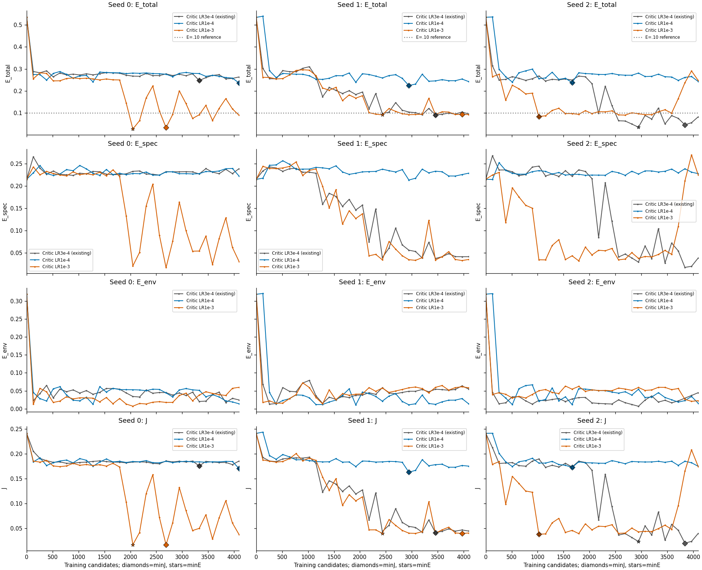
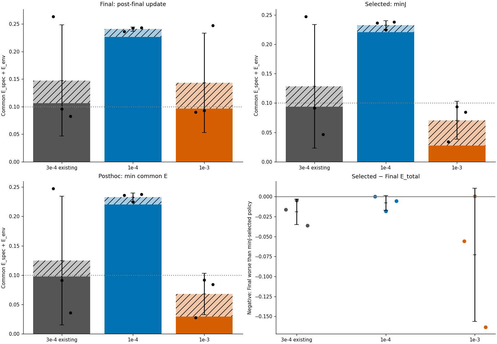
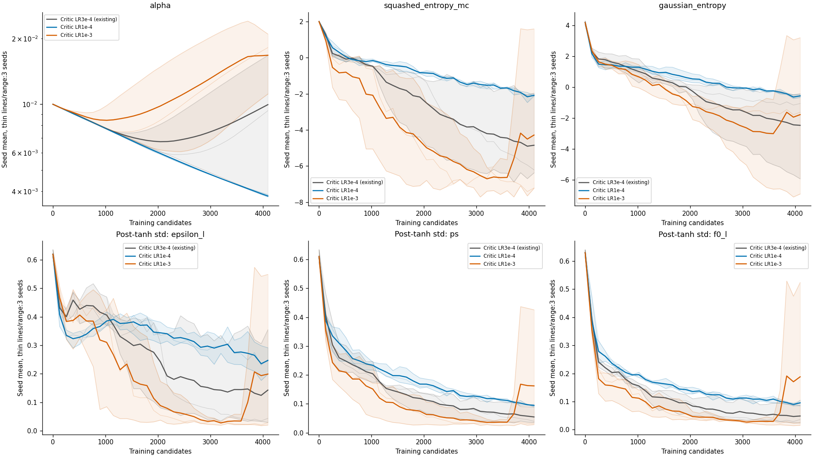
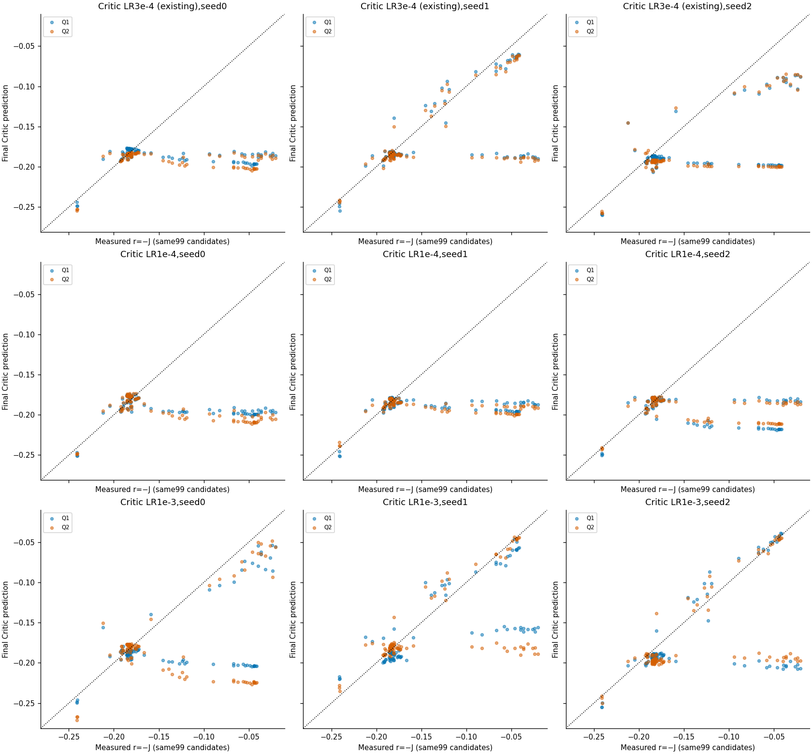
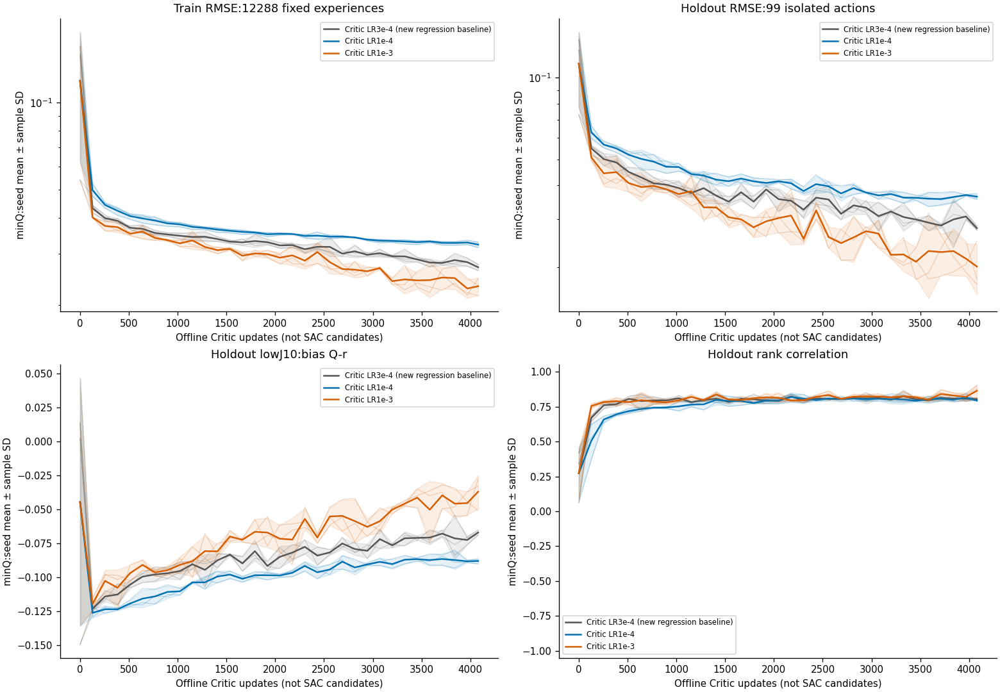
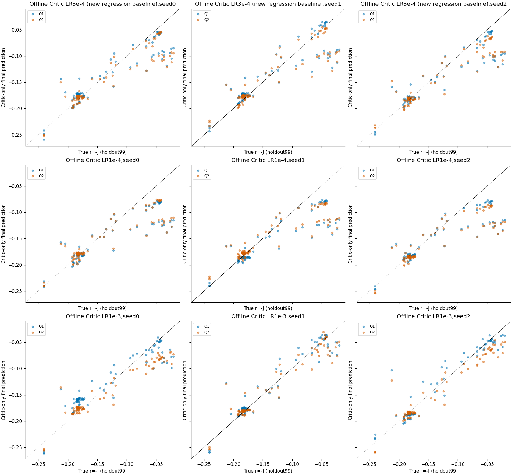
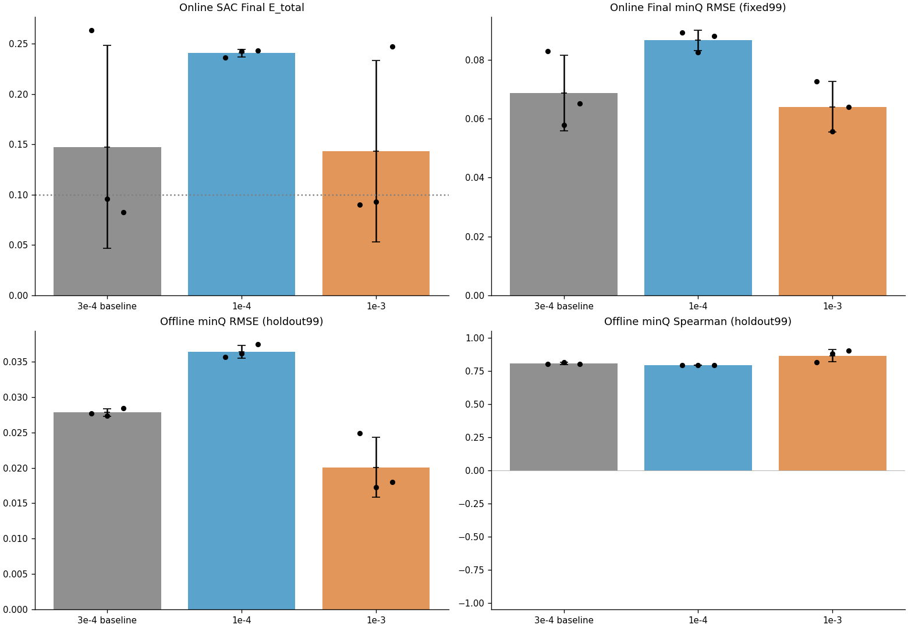
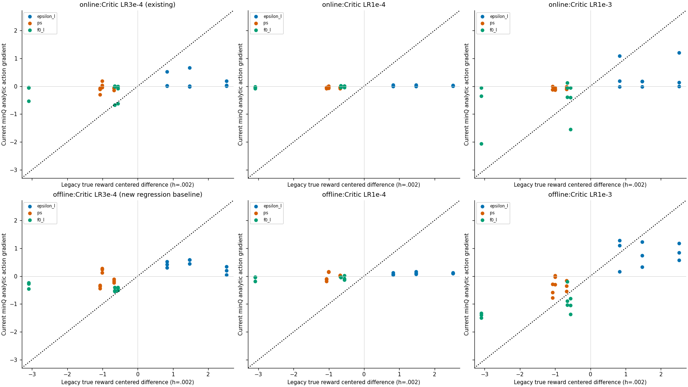
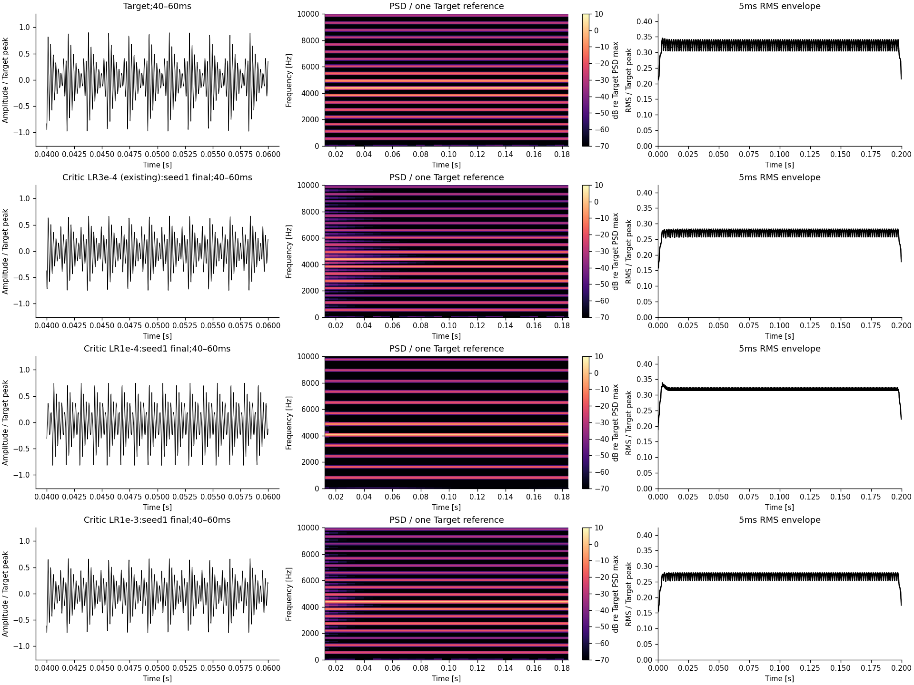

# Issue25 — Critic LR：オンラインSACと固定データ回帰を分けた比較

## 結果と判断

今回、Final平均E_total≤.10かつ持続3/3の暫定目標を満たす条件はなかった。

オンラインFinal平均E_totalは、既存Critic3e-4が**.14745±.10074**、低LR1e-4が**.24062±.00385**、高LR1e-3が**.14348±.09009**（3seed、標本SD）。全条件のFinalは持続3/3、数値失敗0だった。高LRの対応seed差の平均は−.00396だが、差の標本SDは.16916と大きく、安定した改善や一般的な最適LRを示す結果ではない。1e-3は次段階の比較候補として保持し、恒常的な既定値の採用は確定しない。

低LR1e-4は全seedで決定論的Actorが33評価中E≤.10に到達せず、Finalは[.23619,.24255,.24312]。ただし学習経験にはE≤.10が[1,7,6]個あり、「良い制御を全く試さなかった」とは言えない。自身の4096経験へのFinal minQ RMSE平均は.01299と基準.02395より小さいのに、固定99へのRMSEは.06864→.08655へ悪化し、固定99のρは全seed負だった。停滞した訪問領域への当てはまりの良さを、高精度解への到達や広い領域の予測精度と混同しない。

高LR1e-3はseed0/1のFinalが.08987/.09308で、基準.26352/.09599から改善。一方seed2は.08283→.24750へ悪化した。seed2は1024試行で.08427に到達し、基準の初回2176より早かったが、最良解をFinalまで保持できなかった。学習経験中のE≤.10数は高LRの3seedで[445,365,386]、独立Actorの成功点数は[8,10,12]。高LRは到達を助けたseedがある一方、到達後の安定性を一様には改善しない。

高LRのSelected/minJ平均Eは.07070、posthoc/minE平均は.06786だが、Final平均.14348を置き換えて目標達成とは扱わない。特にseed2のSelected .08427→Final .24750の差は大きい。seed1ではSelected E=.09371よりFinal E=.09308のほうが小さいが、採用基準がJなので保存失敗ではない。Final、minJ、minE、初回成功の重み・制御・元波形を別に保持し、更新へ復帰させなかった。

オンラインの固定99 minQ RMSE平均は3e-4/1e-4/1e-3で.06864/.08655/.06403。高LRでは全99のρ平均も.078→.317へ改善したが、lowJ10のRMSE平均は.12883→.12655と僅かな差にとどまり、lowJ10のρ平均は+.103→−.107だった。真のminJ候補の順位は高LRseed0で64位→3位に改善し、seed2では3位→94位へ悪化した。全99での改善を、最も良い候補の正確な順位付けまで改善したと解釈できない。

**固定データ回帰では高LRの効果がより明確だった。** 同じ12288経験・初期Critic・mini-batch列・4080更新で、holdout99 minQ RMSE平均±SDは3e-4が.02781±.00052、1e-4が.03639±.00092、1e-3が.02006±.00421。高LRは全3回帰seedで基準よりRMSEが低く、ρ平均も.805→.864へ改善した。train RMSE平均は.02699/.03233/.02320だった。holdoutとtrainは分布が異なり、holdout誤差が小さいことを未知領域の一般化能力と呼ばない。

holdout低J10のRMSE平均も高LRで.06993→.03923へ改善したが、同領域のρ平均は.095にとどまり、biasも負のまま残った。固定データでの近似精度改善を、オンラインActorへ接続した成果やFinal改善と同一視しない。onlineはseed個別の増加するReplay、offlineは3source seed混合の全12288経験を最初から使うため、両者の誤差差はActorの有無だけの効果ではない。trainにはholdout低J10のJ境界以下が372点（3.03%）あり、source seed0の良い経験は1点だけだった。完全重複0でも同じTarget・方策軌道の近傍重複と偏りを共有し、今回のholdoutは新Targetの独立検証ではない。

既存3anchorの勾配でも、offline高LRの誤差は改善した。h=.002の旧真の中心差分に対するRMSEはoffline基準1.3513→高LR.9573、符号一致は24/27→26/27。これは同じ9成分（3anchor×3変数）を3モデルで照会した27値で、27個の独立した鳴管測定ではない。オンライン高LRはRMSE1.4635→1.3213、符号一致23/27のまま。現在の訪問点の真の勾配を新たに測ったとは言えず、近似誤差が乖離の唯一の原因と証明されたわけではない。

高LRseed2の終盤では探索分布の急変も観測した。3584時点はE=.09952、alpha=.02352、std=[.05813,.04548,.04111]、entropy=−5.649。3840時点はE=.23738、alpha=.02317、std=[.57393,.43670,.52887]、entropy=1.608へ変化した。alphaはこの間に減少しており、alpha上昇＝std拡大という説明では合わない。Critic LRだけの介入でも、期待Q・Actorのmean/log_std・温度・訪問分布が相互作用し得るという観測で、entropyを原因として確定する介入はしていない。

数値的な正常性と模倣精度も別だった。全6runは緊急停止なく完了し、高LRのCritic最大勾配L2は.72671、最大重み絶対値1.96386と有限だった。一方、Actor最大勾配L2は低LR群.21113に対し高LR群7.05117となった。Actor LRは3e-4のままだが、Criticの更新がActorへ与える勾配まで固定されるわけではない。この群ごとの最大値だけから特定の悪化更新の原因を特定しない。

## 次に検証する要因

まず**SACの探索・entropyと訪問経験の関係**を1要因ずつ検証する。固定データでは高LRで近似が改善した一方、オンラインではseed2の保持を失い、std/entropyの急変を伴ったためである。次のIssueではCritic LRを事前に1つへ固定し、entropy目標または温度設定のいずれか1つだけを変え、良い経験の数、決定論的Actorの到達、Finalの維持を再び分ける。1e-3は比較候補だが、今回の3seedで恒常採用する根拠は不足している。追加seed/別Targetによる確認は今回の固定予算に含めていない。

次点は**局所探索／制御値変化制限**。保存された高精度方策を起点にする追加探索と、オンライン更新の制限は別の介入として予算・採用規則を固定する。途中解を採用する利得を学習改善と呼ばず、過去のActor低LRでも保持が崩れたことから、小さな更新だけで必ず解決するとは仮定しない。

**パラメータ別探索幅の変更はその後**とする。既存36音は3近傍に限られ、新条件の訪問分布を網羅していない。経験密度や局所感度を追加検証せず、特定変数の幅を恒久的に狭める根拠はない。今回、サンプル補充・優先Replay・再重み付け・offline CriticのActorへの接続・最良方策への復帰は行っていない。

## Stage Aと変更要因の監査

[計算前に凍結したPLAN](PLAN.md)と[manifest](manifest.json)に、データ分割・更新数・選択規則・数値停止基準・局所追加0音を記録した。Issue24が参照した基準manifestがIssue23の完全再現済み3seedと一致することも照合。基準Critic3e-4は読み取り専用で参照し、新規フル学習0。新規オンラインはCritic1e-4/1e-3×3seedの6run、Actor/温度/共通scheduleは3e-4。

専用CriticRateSACはSAC.trainを標準実装から継承し、_update_learning_rateの標準処理の後にCritic optimizerだけを指定値へ戻す。Actor/温度LR・Adam設定・構造・更新則は変えない。初期の実効設定はCritic LRを基準に戻すと全項目一致。初期policy・RNG・温度が一致し、warmup16の行動/報酬も一致した。基準LRでの短い同seed検査では重み・optimizer・RNG・Replay（行動/報酬含む）が完全一致。Critic LR変更後はActor勾配や経験分布も変わり得るため軌跡一致は要求しない。[事前検証](preflight.json) / [実効LR全履歴](optimizer_learning_rates.csv.gz)。

全optimizer更新直前/直後と33評価点でLRを検査。勾配/重み/Adam状態を観測し、非有限値、負の二次moment、または勾配L2>1e6・重み絶対値>1e6・moment絶対値>1e12で停止する。これは緊急停止基準で、クリップや収束判定ではない。失敗時は使用予算・失敗理由を保持し、条件を削除/置換せず、途中方策をFinalにしない。実際のオンラインは完了6、失敗0run。[run会計](run_accounting.csv) / [実行記録](execution.json)。

## 固定した課題・目標

Case A（右音源の寄与α_r=β_r=0）、一定3D、1episode1行動、0.20s/50kHz/10000sample、native dt=1e-7、x0=.02cm/D=.01、初期状態/遅延履歴0。Target・物理/音響コード・実ライブラリhashは既存と同じ。ε_l[2.5e7,5e7]、p_s[2.5e6,4e6]、f0_l[49000,800000]、右ε_r=3.5e7/f0_r=49000。f0_lは基本周波数Hzではなくラビア開閉外力係数。模型内部量を実測Paや張力と同一視しない。

報酬r=−J、J=.75E_spec+.25E_env、係数和1・2倍補正なし。共通主評価E_total=E_spec+E_env。SAC Actor/Critic[128,128]、Actor/温度LR3e-4、ent_coef=auto_0.01、target_entropy=-3、batch32、buffer50000、warmup16、gamma1、train_freq1、gradient_steps1、tau/target更新/Replay方式/CPU1threadを固定。範囲・entropy目標・ノイズ・優先Replay・batch・幅・報酬・Case B・時変・実録音・教師づけ・最良方策への復帰を追加していない。

## 実験I — オンラインSAC：Finalが主評価

Final=4096候補の最終更新後。Selected=0,128,...,4096の33独立評価の最初のminJ。posthoc=同33点の最初のmin共通Eで、学習目標とは別の事後選別。初回のE≤.10かつ持続方策も必要最小限の追加checkpointとして保持する。独立評価はReplayに入れず、保存方策へ戻さない。

| Critic LR | 採用 | E_total平均±SD | E_spec平均±SD | E_env平均±SD | J平均±SD | 持続/3 | 失敗run |
| --- | --- | --- | --- | --- | --- | --- | --- |
| 0.0003 | final | 0.14745 ± 0.10074 | 0.10602 ± 0.11515 | 0.04142 ± 0.01547 | 0.08987 ± 0.08274 | 3 | 0 |
| 0.0003 | selected | 0.12841 ± 0.10537 | 0.09367 ± 0.11591 | 0.03474 ± 0.01763 | 0.07894 ± 0.08415 | 3 | 0 |
| 0.0003 | posthoc | 0.12484 ± 0.10961 | 0.09762 ± 0.11213 | 0.02723 ± 0.02444 | 0.08002 ± 0.08303 | 3 | 0 |
| 0.0001 | final | 0.24062 ± 0.00385 | 0.22624 ± 0.00345 | 0.01438 ± 0.00088 | 0.17328 ± 0.00267 | 3 | 0 |
| 0.0001 | selected | 0.23279 ± 0.00728 | 0.22054 ± 0.00650 | 0.01225 ± 0.00146 | 0.16847 ± 0.00505 | 3 | 0 |
| 0.0001 | posthoc | 0.23279 ± 0.00728 | 0.22054 ± 0.00650 | 0.01225 ± 0.00146 | 0.16847 ± 0.00505 | 3 | 0 |
| 0.001 | final | 0.14348 ± 0.09009 | 0.09658 ± 0.11113 | 0.04690 ± 0.02104 | 0.08416 ± 0.07809 | 3 | 0 |
| 0.001 | selected | 0.07070 ± 0.03203 | 0.02763 ± 0.00976 | 0.04307 ± 0.02266 | 0.03149 ± 0.01280 | 3 | 0 |
| 0.001 | posthoc | 0.06786 ± 0.03507 | 0.02946 ± 0.00790 | 0.03840 ± 0.02723 | 0.03170 ± 0.01270 | 3 | 0 |

3seed平均±標本SD（ddof=1）。失敗runを含む条件の3seed Final平均は未定義とし、完了seedだけの平均へ置換しない。持続proxyは末尾1000sampleのAC標準偏差/Target peak>.05かつ数値失敗なしで、生理的な有声判定ではない。暫定目標はFinal平均≤.10かつ持続3/3で、途中最良や全seed個別の閾値とは別。[全成分と制御CSV](comparison_per_seed.csv) / [対応seed差](paired_differences.csv)。

| Critic LR | seed | 採用 | 試行 | E_total | E_spec | E_env | J | 持続 |
| --- | --- | --- | --- | --- | --- | --- | --- | --- |
| 0.0003 | 0 | final | 4096 | 0.2635241 | 0.2389780 | 0.0245461 | 0.1853700 | True |
| 0.0003 | 0 | selected | 3328 | 0.2472917 | 0.2270093 | 0.0202824 | 0.1753276 | True |
| 0.0003 | 0 | posthoc | 3328 | 0.2472917 | 0.2270093 | 0.0202824 | 0.1753276 | True |
| 0.0003 | 1 | final | 4096 | 0.0959900 | 0.0410592 | 0.0549308 | 0.0445271 | True |
| 0.0003 | 1 | selected | 3456 | 0.0913670 | 0.0369829 | 0.0543841 | 0.0413332 | True |
| 0.0003 | 1 | posthoc | 3456 | 0.0913670 | 0.0369829 | 0.0543841 | 0.0413332 | True |
| 0.0003 | 2 | final | 4096 | 0.0828301 | 0.0380335 | 0.0447966 | 0.0397243 | True |
| 0.0003 | 2 | selected | 3840 | 0.0465625 | 0.0170123 | 0.0295501 | 0.0201468 | True |
| 0.0003 | 2 | posthoc | 2944 | 0.0358706 | 0.0288536 | 0.0070170 | 0.0233944 | True |
| 0.0001 | 0 | final | 4096 | 0.2361897 | 0.2222966 | 0.0138932 | 0.1701957 | True |
| 0.0001 | 0 | selected | 4096 | 0.2361897 | 0.2222966 | 0.0138932 | 0.1701957 | True |
| 0.0001 | 0 | posthoc | 4096 | 0.2361897 | 0.2222966 | 0.0138932 | 0.1701957 | True |
| 0.0001 | 1 | final | 4096 | 0.2425452 | 0.2287041 | 0.0138411 | 0.1749884 | True |
| 0.0001 | 1 | selected | 2944 | 0.2244401 | 0.2133449 | 0.0110952 | 0.1627825 | True |
| 0.0001 | 1 | posthoc | 2944 | 0.2244401 | 0.2133449 | 0.0110952 | 0.1627825 | True |
| 0.0001 | 2 | final | 4096 | 0.2431226 | 0.2277239 | 0.0153987 | 0.1746426 | True |
| 0.0001 | 2 | selected | 1664 | 0.2377498 | 0.2259779 | 0.0117719 | 0.1724264 | True |
| 0.0001 | 2 | posthoc | 1664 | 0.2377498 | 0.2259779 | 0.0117719 | 0.1724264 | True |
| 0.001 | 0 | final | 4096 | 0.0898738 | 0.0301604 | 0.0597134 | 0.0375486 | True |
| 0.001 | 0 | selected | 2688 | 0.0341120 | 0.0164021 | 0.0177099 | 0.0167291 | True |
| 0.001 | 0 | posthoc | 2048 | 0.0275937 | 0.0203388 | 0.0072550 | 0.0170678 | True |
| 0.001 | 1 | final | 4096 | 0.0930815 | 0.0347032 | 0.0583783 | 0.0406220 | True |
| 0.001 | 1 | selected | 3968 | 0.0937123 | 0.0323954 | 0.0613169 | 0.0396257 | True |
| 0.001 | 1 | posthoc | 2432 | 0.0917135 | 0.0339671 | 0.0577465 | 0.0399119 | True |
| 0.001 | 2 | final | 4096 | 0.2474986 | 0.2248763 | 0.0226222 | 0.1743128 | True |
| 0.001 | 2 | selected | 1024 | 0.0842728 | 0.0340884 | 0.0501843 | 0.0381124 | True |
| 0.001 | 2 | posthoc | 1024 | 0.0842728 | 0.0340884 | 0.0501843 | 0.0381124 | True |

### 到達と保持・Replay経験

| Critic LR | seed | 学習でE≤.10 /4096 | Actor初回E≤.10 | Actor成功数/33 | Final成功 | 到達後保持率 | Selected−Final E |
| --- | --- | --- | --- | --- | --- | --- | --- |
| 0.0003 | 0 | 1 | 未到達 | 0 | False | 未定義 | -0.016232 |
| 0.0003 | 1 | 288 | 2432 | 7 | True | 7/14=0.500 | -0.004623 |
| 0.0003 | 2 | 358 | 2176 | 13 | True | 13/16=0.812 | -0.036268 |
| 0.0001 | 0 | 1 | 未到達 | 0 | False | 未定義 | +0.000000 |
| 0.0001 | 1 | 7 | 未到達 | 0 | False | 未定義 | -0.018105 |
| 0.0001 | 2 | 6 | 未到達 | 0 | False | 未定義 | -0.005373 |
| 0.001 | 0 | 445 | 2048 | 8 | True | 8/17=0.471 | -0.055762 |
| 0.001 | 1 | 365 | 2304 | 10 | True | 10/15=0.667 | +0.000631 |
| 0.001 | 2 | 386 | 1024 | 12 | False | 12/25=0.480 | -0.163226 |

学習経験の良い1候補、独立評価の決定論的Actorの到達、Finalの維持を区別する。保持率は初回E≤.10かつ持続の評価点からFinalまでの成功点数/全評価点数（初回含む）。未到達は未定義、33点の間の未評価状態を捏造しない。純E閾値と持続条件付きの両方は[到達CSV](stability_and_acquisition.csv)に残す。Selected−Finalが負ならFinalの共通Eが悪いが、minJとminEの違いも別途解釈する。

全Actor更新前後の固定観測からのtanh(mean)、正規化3D行動差・物理差・3optimizer LR・数値状態・実際のbatch32 lossを記録した。Δ物理量=Δa×[12500000,750000,375500]で、単位の異なる差を直接L2合成しない。128候補の経路長Σ||Δa||と正味距離||a_end−a_start||を分ける。Actor optimizerの前後では当該stepのCritic/温度更新は済んでおり、決定論的1点のQと、確率的batchで計算したActor lossは同じではない。[更新要約](movement_per_seed.csv) / [全更新CSV](actor_updates.csv.gz) / [区間差・loss](update_intervals.csv)。

alpha/std/entropyは同じ33時点で記録。tanh後stdとentropyはlocal NumPy seed220026の同じ4096サンプルで推定し、学習RNGを消費しない。alphaを探索stdと同一視せず、微分entropyは負になり得る。[方策推移](policy_dynamics.csv)。

### オンラインCritic

同じ既存99行動のQ1/Q2/minQを全33時点で記録した。全99、lowJ10、同seedの基準33候補、実際の自身の学習4096経験、直近1024、学習lowJ10を分ける。訪問経験への当てはまりと、旧候補への予測は同じ集合ではない。[指標CSV](critic_metrics.csv) / [時系列](critic_time_metrics.csv) / [最良候補の順位](critic_ranks.csv) / [自身の訪問点予測](own_visit_predictions.npz)。

## 実験II — 固定データ上のCritic回帰

既存Issue23の学習経験3seed×4096=12288件をtrain、独立評価済み99行動をholdoutに隔離した。Issue23はIssue22 λ=.75の完全再現なので両方を重複投入しない。各回帰seedは同じ全3source seedのtrainを使い、初期Criticとbatch列だけのseedを指す。[データ監査](dataset_audit.json) / [点ごとのhash・出典](offline_points.csv.gz) / [固定配列](offline_data.npz) / [固定batch列](offline_batches.npz)。

raw行動とCritic入力のtrain内・holdout内完全重複は0、train/holdout完全重複も0。ただし近傍重複は存在し、holdoutからtrainへの全域幅比L2距離の中央値は0.0074869、最小0.0007141。同じTarget・旧方策軌道・領域の偏りを共有し、独立な新Targetや一様3D汎化テストとは呼ばない。[全候補の近傍距離・半径内経験数](holdout_nearest_neighbors.csv)。

holdout低J10%のJ境界は0.0419851。それ以下のtrain点は372件（3.03%）で、低J密度は偏る。これはこの訪問データ内の比率であり、物理領域の体積確率ではない。補充・低J重み付け・holdoutの学習混入は0。

MLP/twin-Q/入力11特徴量（reset観測8＋正規化行動3）・Adam・batch32・損失・4080更新を固定し、LR3e-4/1e-4/1e-3×3seedの9本を学習した。各seed内で初期Criticとmini-batch index列のhashが全LR一致。batchは事前local seed250025+seedの一様復元抽出、全LRで同じ列。目標はSB3 Replayと同じfloat32(r)、損失0.5*(MSE(Q1,r)+MSE(Q2,r))。報告誤差は元float64 rに対して計算する。1step終端なのでbootstrap/次状態entropyは0。

回帰のActor/温度/target Criticは更新せず、Actorへ接続しない。グローバルRNGも学習前後一致。更新数・LRはholdout結果で変更せず、早期停止や最良holdout checkpoint選抜もない。33診断時点の最後は4080**回帰更新**で、オンラインの4096候補とは別の軸。[全回帰時系列](offline_history.csv) / [Final全指標](offline_final_metrics.csv) / [対応差](offline_paired_differences.csv) / [9本の実行数](offline_execution.json)。

## 並列の評価軸：Critic誤差とFinal音響精度

| Critic LR | seed | Online Final E | Online固定99 RMSE | Onlineρ | Offline train RMSE | Offline holdout RMSE | Offlineρ | Offline lowJ RMSE | lowJ bias | 最良候補順位 |
| --- | --- | --- | --- | --- | --- | --- | --- | --- | --- | --- |
| 0.0003 | 0 | 0.26352 | 0.08288 | -0.24390 | 0.02630 | 0.02770 | 0.79989 | 0.07004 | -0.06713 | 17 |
| 0.0003 | 1 | 0.09599 | 0.05786 | 0.33244 | 0.02706 | 0.02735 | 0.81427 | 0.06882 | -0.06493 | 17 |
| 0.0003 | 2 | 0.08283 | 0.06519 | 0.14683 | 0.02760 | 0.02838 | 0.79988 | 0.07093 | -0.06859 | 17 |
| 0.0001 | 0 | 0.23619 | 0.08911 | -0.53927 | 0.03158 | 0.03564 | 0.79289 | 0.08818 | -0.08632 | 19 |
| 0.0001 | 1 | 0.24255 | 0.08258 | -0.36280 | 0.03245 | 0.03611 | 0.79468 | 0.08921 | -0.08729 | 19 |
| 0.0001 | 2 | 0.24312 | 0.08796 | -0.34764 | 0.03296 | 0.03741 | 0.79351 | 0.09166 | -0.08997 | 19 |
| 0.001 | 0 | 0.08987 | 0.07263 | 0.09619 | 0.02470 | 0.02491 | 0.81336 | 0.05188 | -0.05081 | 5 |
| 0.001 | 1 | 0.09308 | 0.05561 | 0.61529 | 0.02152 | 0.01725 | 0.87934 | 0.03637 | -0.03281 | 13 |
| 0.001 | 2 | 0.24750 | 0.06386 | 0.24099 | 0.02337 | 0.01803 | 0.90058 | 0.02944 | -0.02704 | 2 |

列は異なる目的で、足し合わせた総合scoreを作らない。online固定99とoffline holdout99は同じ真のr、offline trainは固定12288、online自身の経験は各runで異なる4096である。RMSE/MAE/bias/ρ/誤順位率を全て保存し、lowJ subsetも別列にした。訓練誤差の低下を未知領域の汎化やSACのFinal改善と呼ばない。[並列表CSV](parallel_online_offline.csv)。

onlineは各seed個別に増えていくReplayを使う。offlineは3source seedを混合した12288経験が最初から全て利用可能で、batch列もonlineとは別である。両実験の誤差差を、LRだけの因果差やActorを取り除いた純粋な効果とは扱わない。LRの1要因比較は各実験内で成立する。

lowJ10は各集合内の上位10%を指す。train/holdout/各online訪問経験ではJ境界が異なるため、同じ名前でも同じ点集合ではない。固定99とoffline holdout99のlowJ10だけは同一集合である。

今回の3LR・4080更新・3seedは実行前に固定したが、このholdoutの結果から次の候補を選ぶ議論は事後の候補選びであり、新しい独立検証で確定した最適LRではない。

## 局所勾配の参照範囲

新規局所鳴管計算は0。Issue23の既存36音（seed2の2944/3840/4096行動、正規化刻み±.002/.01）をhash固定して参照した。現在のonline/offline Criticをその同じ固定点で微分し、旧真の中心差分と比較した。新条件の訪問点の真の勾配を測ったとは言わない。minQの折れ点、有限差分の刻み・非線形性のため、中心autogradと有限差分は同じ量の厳密測定ではない。[online勾配](online_gradient_comparison.csv) / [offline勾配](offline_gradient_comparison.csv) / [集約](gradient_summary.csv)。

## 波形・重み・音・監査

オンラインは30保存方策をロードし、異なる行動だけで21音を独立再生。行動・20ブロック制御・元float64波形・E/J・alpha/std・Finalの99予測・勾配が一致した。offlineは9個のCritic-onlyをロードし、train/holdout全予測と勾配、実際の更新数・batch/初期hashを照合した。ロギング・独立評価・Q照会・保存前後の学習器/optimizer/RNG/Replay署名も一致。[オンライン監査](audit.json) / [offline監査](offline_audit.json)。

オンライン推論用Actor+online twin Criticと、offline Critic-onlyは別の保存形式。どちらもoptimizer/Replayを含む再開学習用完全checkpointではない。offline CriticをSAC Actorへ接続していない。[オンラインmodel/audio索引](checkpoint_index.json) / [offline model索引](offline_checkpoint_index.json)。

[聴取ZIP](listening.zip)はTargetと全保存endpoint・新規初回成功方策を含み、同一波形を重複除去して22音。[索引](listening_index.csv)あり。全音に同じTarget peak逆数gainを掛けたfloat32で、個別正規化・クリップ・位相合わせは0。元float64波形/制御は各run NPZ、代表図は事前固定seed1で共通PSD/色/振幅/RMS軸を使う。10MHzへの補間は表示のみで新たな周波数情報は増えない。

## 実行会計・保護・再現

オンライン6run壁時間835.9s、実学習候補24576、独立評価198、再生21、計24795音、完了native step49,590,000,000。基準の再学習0、追加局所音0。offlineは完了9・失敗0、実更新36720、壁時間44.6s、native/Actor/温度更新0。2実験の更新・計算量を混ぜない。

8種類のテスト成功。nativeテスト171音=145学習候補（うち停止注入run17候補）+14独立評価+12再生。高LR初期nativeテストは3seed各32候補で成功し、停止注入は研究結果ではない。合成終端env179episode、短いofflineテスト3本計96更新はnative0。圧縮ログのreader引数を本計算前に修正し、該当offlineテストを再実行した。[テスト記録](test_execution.json)。

既存5829ファイルのhash一致、変更/削除0。root READMEと.gitignoreのみ索引/作業ログ除外を追加。主図10枚、全成果物は専用ディレクトリ、commit/push/Issue更新は未実施。[元成果保護](integrity.json) / [実装hash](implementation_checksums.json) / [成果物hash](artifact_checksums.json) / [再現・オフライン確認](REPRODUCE.md)。

<!-- ISSUE25_STORAGE_BEGIN -->
| 対象 | 着手前 | 完了時 |
| --- | --- | --- |
| 作業ツリー通常ファイル数 | 7591 | 7808 |
| 論理容量（ignored含む） | 790.59 MB | 827.86 MB |
| Git新規追加候補 | 0（クリーン） | 215個 / 37.27 MB |
| 既存追跡ファイルの変更 / 削除 | 0 / 0 | 2 / 0 |
<!-- ISSUE25_STORAGE_END -->
