# Issue27再改訂 — Case B左右外力18点・SAC/TD3/PPO

2026-11-26 JST。[今回参照したIssue本文](issue_snapshot.json)（[GitHub #27](https://github.com/tatsukawa0353/Birdsong_tatsukawa/issues/27)）は左右外力18点へ再改訂されている。前の左49000のみ9点の依頼に続く「再度取り組む」をこの最新版に従って実施した。旧①9音は読み取り専用、新規②③各9音を計算し、**18/18が持続proxyを満たした。Targetを学習前に確定し、3手法×3seedの9runを各4096step、計36864学習候補で完了した。** 失敗runの差し替えや追加探索はない。

Targetは **b3_c00、[ε_l, ε_r, p_s, f0_l, f0_r]=[3.0e7,3.5e7,3.0e6,49000,49000]**。独立B oracleは音声・20block状態・native運動mean/stdが完全一致し、E_spec/E_env/E_total/Jは全て0。実学習Finalの3seed平均±標本SDは **SAC 0.204963 ± 0.054527、TD3 0.206477 ± 0.048037、PPO 0.403819 ± 0.000000**。これは今回の固定Targetと予算での観測であり、一般的優劣やCase A/Bの構造優位を示すものではない。

[Target WAV](audio/Target.wav) / [生音・状態NPZ](preflight/target.npz) / [選定理由](preflight/target_choice.json) / [事前計画](PLAN.md) / [manifest](manifest.json)。

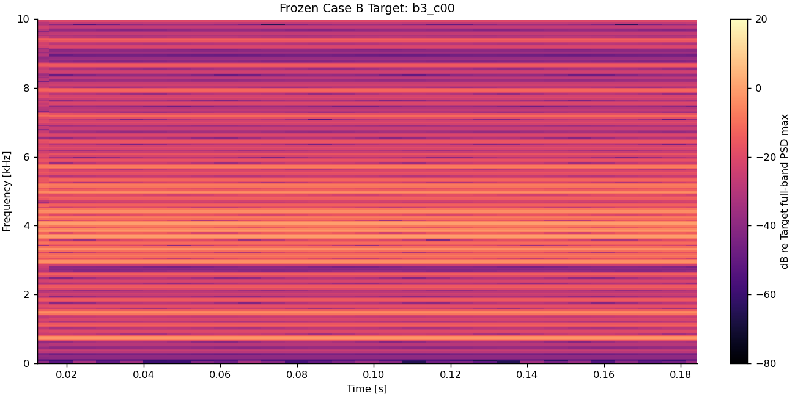

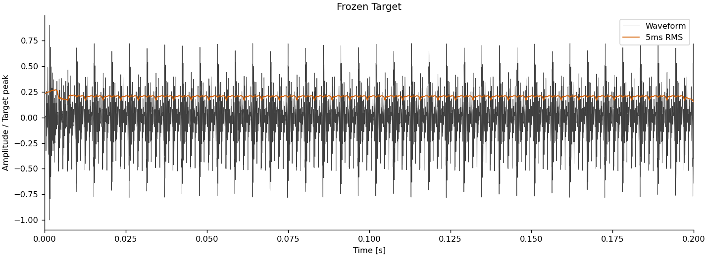

## Targetの選定と物理モデル

p_s=3.0e6を優先し、③の左右の持続変動を確認。同p_s候補ではε_l=3.0e7がspectral entropy約0.621・PSD peak30と複数の周波数成分を持つ。末尾proxy0.206・直線除去後も適格で、対称ε=3.5e7の単純な調波構造より複雑な自己Targetを選んだ。6候補の波形と共通PSD図を学習前に確認し、RL精度は未観測。 持続proxy=0.2060366645、直線除去後=0.2060157277。entropy=0.621000、peak数=30。entropyは末尾0.10sのWelch PSD（100–10000Hz）における正規化Shannon entropy、peak数はコード記載のprominence/強度閾値による記述量で、生理学的複雑性指標とは区別する。候補間の物理表示を確認後、方法別smokeと正式学習の前に選定した。選定後の差し替えはない。

元native/model.cppとmodel.py、既存libbirdsong.soは変更していない。[同一ソース再ビルドのbyte/hash一致](native/build.json)。Case B native condition=1、左右α=1.2e6/β=1500、右ε=3.5e7、x0=.02cm/D=.01、dt=1e-7を実メモリで検査した。元BirdModel('B')のPython制御処理は右f0を1e7へ固定するため、独立ConfiguredCaseB subclassの_controlsのみでIssue指定の右固定値を設定した。元Bのコンストラクタ・native reset/式/固定係数はそのままで、Aへの置換や右αβのゼロ化はない。[初回REPORT](../phase1_caseB_self_target_020s_sac128/REPORT.md)と[前回9点REPORT](../phase1_caseB_self_target_020s_methods/REPORT.md)の停止理由と次案を確認して着手した。

各音0.20s、2,000,000 native step、50kHz/10000sample。初期4状態、遅延履歴、16次15kHz lowpass状態を0にし、200分の1にデシメートする。左右f0は外力係数であり音響基本周波数Hzではない。学習では右f0=49000を全run固定する一方、左f0は[49000,800000]を探索させた。

## Stage A：18点と前回9点

①左300000/右1e7（前回保存9音）、②左49000/右1e7（新9音）、③左右49000（新9音）。ε_l×p_sの9点は同一。数値失敗0、generated_silent0、②③とも適格9/9。

| 候補 | ε_l | p_s | f0_r | 末尾AC/自身peak | 直線除去後 | entropy | peak数 | 左/右変動proxy | 適格 |
| --- | --- | --- | --- | --- | --- | --- | --- | --- | --- |
| b2_c00 | 30000000.0 | 3000000.0 | 10000000.0 | 0.154722 | 0.154719 | 0.597443 | 17 | True/False | True |
| b2_c01 | 30000000.0 | 3400000.0 | 10000000.0 | 0.178616 | 0.178616 | 0.692244 | 22 | True/False | True |
| b2_c02 | 30000000.0 | 3800000.0 | 10000000.0 | 0.191863 | 0.191861 | 0.477234 | 12 | True/False | True |
| b2_c10 | 35000000.0 | 3000000.0 | 10000000.0 | 0.165260 | 0.165253 | 0.480009 | 10 | True/False | True |
| b2_c11 | 35000000.0 | 3400000.0 | 10000000.0 | 0.227360 | 0.227360 | 0.595067 | 16 | True/False | True |
| b2_c12 | 35000000.0 | 3800000.0 | 10000000.0 | 0.225370 | 0.225368 | 0.637026 | 21 | True/False | True |
| b2_c20 | 41000000.0 | 3000000.0 | 10000000.0 | 0.193526 | 0.193526 | 0.407356 | 6 | True/False | True |
| b2_c21 | 41000000.0 | 3400000.0 | 10000000.0 | 0.287179 | 0.287177 | 0.283977 | 4 | True/False | True |
| b2_c22 | 41000000.0 | 3800000.0 | 10000000.0 | 0.289197 | 0.289190 | 0.672220 | 22 | True/False | True |
| b3_c00 | 30000000.0 | 3000000.0 | 49000.0 | 0.206037 | 0.206016 | 0.621000 | 30 | True/True | True |
| b3_c01 | 30000000.0 | 3400000.0 | 49000.0 | 0.149979 | 0.149978 | 0.781758 | 50 | True/True | True |
| b3_c02 | 30000000.0 | 3800000.0 | 49000.0 | 0.162827 | 0.162827 | 0.753504 | 46 | True/True | True |
| b3_c10 | 35000000.0 | 3000000.0 | 49000.0 | 0.302914 | 0.302906 | 0.383887 | 9 | True/True | True |
| b3_c11 | 35000000.0 | 3400000.0 | 49000.0 | 0.250003 | 0.250002 | 0.629153 | 15 | True/True | True |
| b3_c12 | 35000000.0 | 3800000.0 | 49000.0 | 0.220694 | 0.220694 | 0.690508 | 27 | True/True | True |
| b3_c20 | 41000000.0 | 3000000.0 | 49000.0 | 0.230069 | 0.230068 | 0.529255 | 22 | True/True | True |
| b3_c21 | 41000000.0 | 3400000.0 | 49000.0 | 0.168887 | 0.168887 | 0.775458 | 51 | True/True | True |
| b3_c22 | 41000000.0 | 3800000.0 | 49000.0 | 0.150015 | 0.150014 | 0.789522 | 64 | True/True | True |

一次持続proxyは末尾1000sample（20ms）のAC std/自身全期間peak>.05。直線除去後ratio>.05も学習前のドリフト除外確認とした。左右変動proxyは末尾traceの線形傾向除去後std/元std>.5かつstd/全期間state幅>.001をx/y双方で確認した記述的判定であり、周期軌道の数学的証明ではない。末尾native全刻み統計は10ms・100000刻み、traceによる指標は20ms・50kHzで、窓と統計を混同しない。

[全18点指標](candidate_summary.csv) / [末尾左右運動](tail_motion.csv) / [左右音響寄与](source_statistics.csv) / [全時系列CSV.gz](timeseries/) / [生波形・全刻みblock統計](preflight/candidates/) / [全WAV索引](audio_index.csv)。

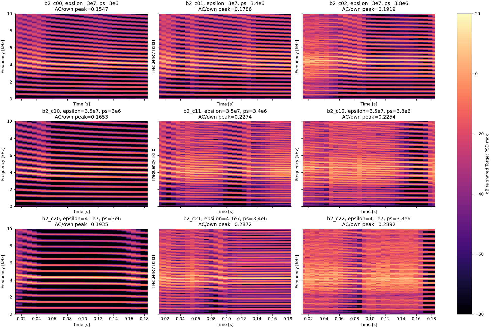

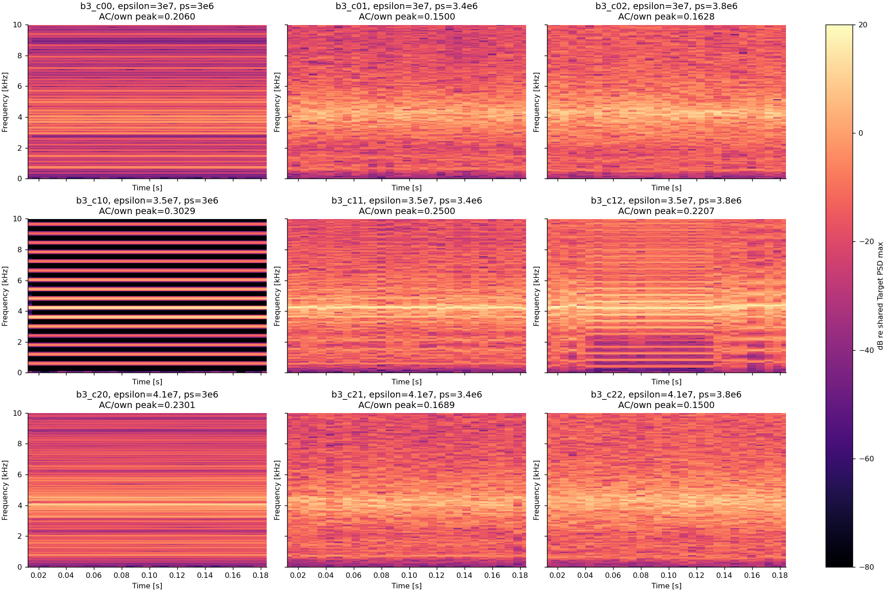

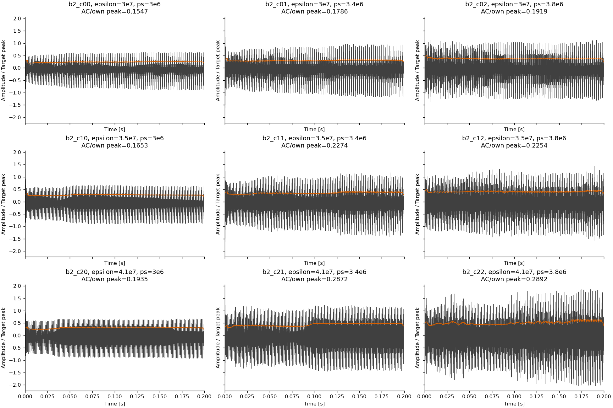

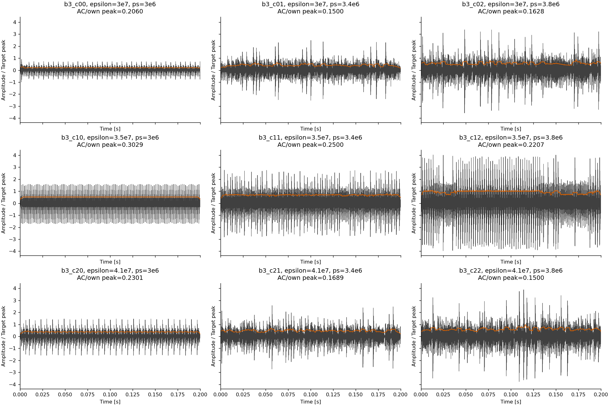

②③のPSDは共通Targetの全周波数PSD最大を基準とし同一色軸。①②③の次図は**前回のPSD基準と色軸[-80,40]dBをそのまま保持**し、27音の時間・周波数軸も統一した。新しい強い成分の飽和率は[表示設定](display_settings.json)に保存し、同じ旧PSD基準で上限だけ27音共通にした[補助図](figures/three_groups_joint_color.png)も用意した。個別正規化はしていない。STFTは従来通り10MHzへ表示用resample、Blackman-Harris窓245760/noverlap184320、PSD density、detrend constant、complete windowのみ、0–10kHz。報酬用50kHz STFTと表示用STFTは別処理である。

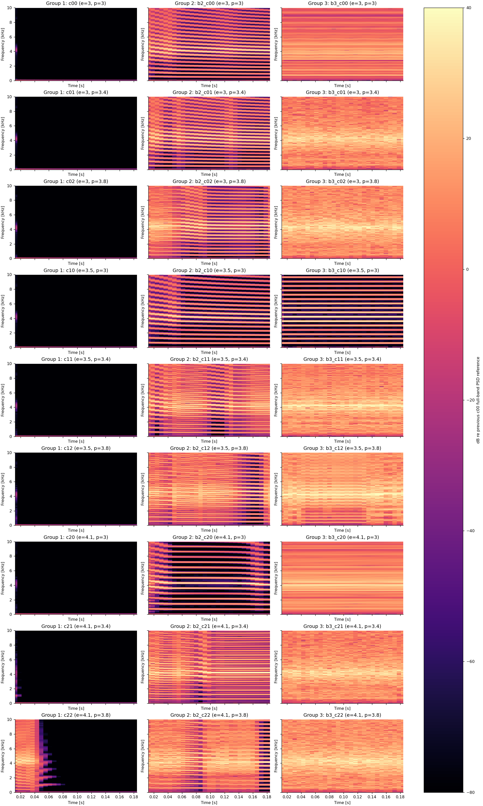

## 左右振動と非線形減衰の変化

同じε_l=3e7、p_s=3e6で①→②→③を比較する。元の式をA=1で整理した瞬時速度係数は k_y=b+c x²−D(p_s−π̃)、b=2e4、c=2e8、D=.01。以下は末尾20msの50kHz traceによる値である。

| 音 | 側 | 末尾x平均 | 末尾x std | c x²平均 | 速度係数平均 | 速度係数<0の割合 |
| --- | --- | --- | --- | --- | --- | --- |
| old_c00 | left | -0.01499477 | 2.9805812e-05 | 44968.804 | 33468.645 | 0 |
| old_c00 | right | -0.22223483 | 0.0013880928 | 9878049 | 9866548.9 | 0 |
| b2_c00 | left | -0.0086661306 | 0.0091971745 | 31937.968 | 20473.442 | 0.222 |
| b2_c00 | right | -0.22218398 | 0.0013875089 | 9873529 | 9862064.5 | 0 |
| b3_c00 | left | -0.0040765918 | 0.011130648 | 28101.984 | 18049.387 | 0.198 |
| b3_c00 | right | -0.0043455894 | 0.011094159 | 28392.901 | 18340.304 | 0.224 |

①は左右ともドリフト主体で、左の|x|とc x²が大きく、k_yは全サンプルで正だった。①→②では左f0を下げたことで左の変位範囲・速度が変わり、振動中にk_y<0となる区間が現れ、左の持続変動と音圧proxy増大が観測された。右は外力1e7による大きい負変位と強いc x²を保ち、周期的変動proxyは不合格でも右source/outputは非ゼロで圧力結合へ寄与している。

②→③では右外力も下げると右の平均変位の絶対値と非線形減衰が大幅に小さくなり、左右とも持続変動を示した。選定Targetでは左右のεが異なり、複数の周波数成分を持つ。正の平均k_yだけから非発声とは判定できず、振動中の符号変化・連成・遅延と一緒に見る必要がある。この整理は計算された0.20s内の挙動の解釈で、遅延連成全系の安定性解析や全領域の発声保証ではない。

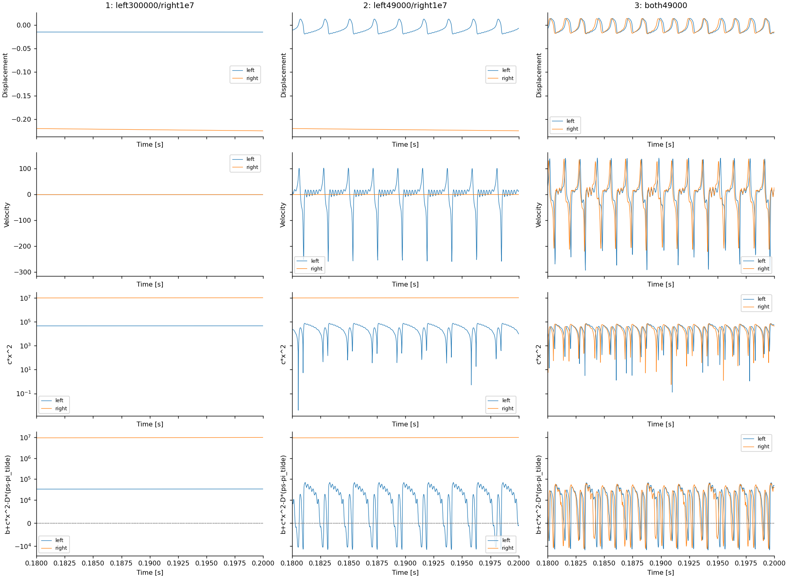

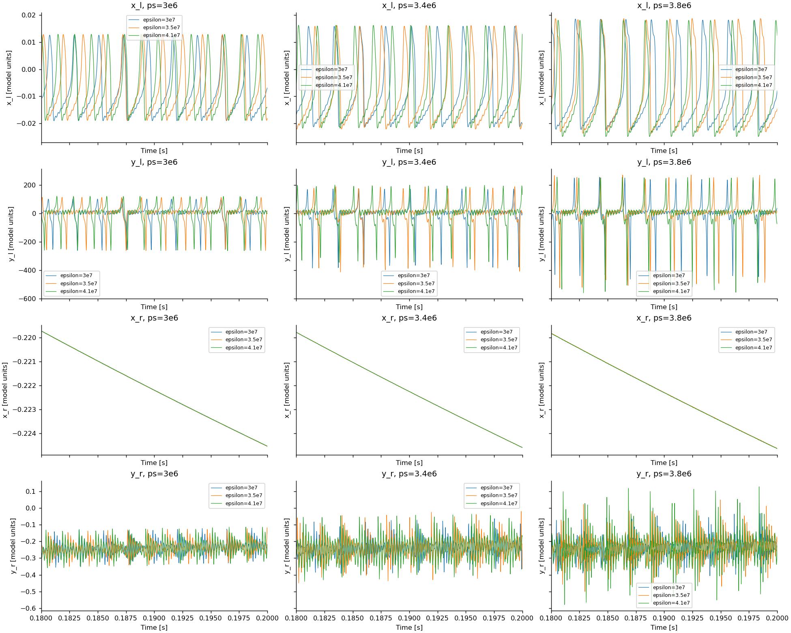

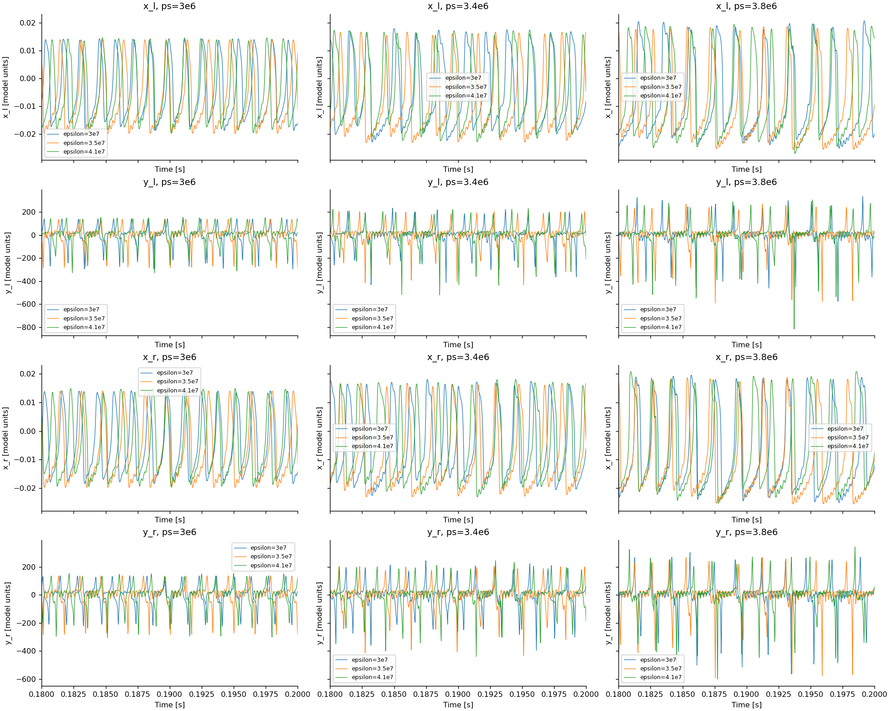

[②全時間の左右状態](figures/group2_motion_full.png) / [③全時間の左右状態](figures/group3_motion_full.png) / [②左右source/output全時間](figures/group2_sources_full.png) / [③左右source/output全時間](figures/group3_sources_full.png) / [②末尾寄与](figures/group2_sources_tail.png) / [③末尾寄与](figures/group3_sources_tail.png)。source_j=α_j(x_j−τ_j y_j)+β_j y_j、output_j=source_j−β_j τ_j dy_j/dt、feedback=−γπ(t−T)。output_l+output_r+feedback=未フィルタ音圧を丸め誤差範囲で検査した。これは連成した同じ状態での代数的分解で、単独発声させた音や因果的寄与率ではない。右の受動応答・ドリフトも保存しclampしていない。

## 学習の凍結条件と事前検査

一定3D：[ε_l,p_s,f0_l]を[2.5e7–5e7,2.5e6–4e6,49000–800000]で探索。1episode=1action=0.20s、観測8D/reset[-1,0,…]。報酬−J、J=.75E_spec+.25E_env、共通E_total=E_spec+E_env。Target共通peakで評価し、ゲイン・位相調整はしない。学習時の持続proxyはTarget peak基準、Stage Aは各候補自身peak基準である。

SAC/TD3は128×128 ReLU、PPOは方策/価値別128×128 Tanh。全てCPU1thread、LR3e-4、gamma1、batch32。SAC/TD3はbuffer50000/warmup16/train_freq1/gradient_steps1/tau.005。SACはauto_0.01/target_entropy−3。TD3は探索Normal(0,.1)、policy_delay2、target noise.2/clip.5。PPOはn_steps128/n_epochs10/clip.2/gae.95/vf_coef.5/ent_coef0/max_grad_norm.5/normalize_advantage=True/target_kl=None。Adam epsはSAC/TD3=1e-8、PPO=1e-5。全実効設定・バージョンは各run configとmanifestに保存した。

| 手法 | Actor/方策 | Critic/価値 | target Actor | target twin Critic | policy合計 | 更新回数/run |
| --- | --- | --- | --- | --- | --- | --- |
| SAC | 18438 | 36354 | 0 | 36354 | 91146 | {'actor': 4080, 'critic': 4080, 'entropy': 4080} |
| TD3 | 18051 | 36354 | 18051 | 36354 | 108810 | {'actor': 2040, 'critic': 4080} |
| PPO | 18054 | 17793 | 0 | 0 | 35847 | {'policy_value': 1280} |

SACの温度1parameterはpolicy合計の外。隠れ層幅が同じでもパラメータ数・活性化・更新量・計算時間は異なる。PPOは32rollout×4minibatch×10epoch=1280 optimizer step、内部_n_updatesはepoch数320。SAC actor/critic/entropy各4080、TD3 critic4080/actor2040を実測した。実層構造と各parameter数をassertした。

[事前検査](preflight/tests.json)：標準SB3と監査付き実装を3手法×128stepで比較し、重み・optimizer・Buffer・RNGが完全一致。9初期seedの独立性・構造・制御マッピングも検査。物理smokeは各128学習音+2評価+4保存結果再生、計402音。本学習へ混入しない。最初のsynthetic検査はTD3のfloat32逆変換の1ULP差を監査側が誤検出して停止した。元のaction/Replay値は変えず、標準の順方向unscale一致を検査するよう観測コードを修正し、全照合を再実施した。[最初の停止記録](preflight/synthetic_precision_failure.json)。syntheticは不成功検査・再現確認も含め計1282episodeでnative音生成0。SAC/TD3は実行action・Replay・reward・終端を、PPOは元Gaussian raw行動/rolloutと環境clip行動を区別して全36864行を検査した。

全optimizer更新で実効LR、有限性、勾配/parameter/Adam momentの既存数値停止条件を検査。PPOの標準grad clip.5以外に学習を変えるclampは追加していない。独立評価前後の重み・optimizer・Buffer・RNG・training_bestのsignature不変を297回確認した。PPOも128stepの全更新後に評価し、最終評価はlearn終了後である。

## 学習曲線と評価結果

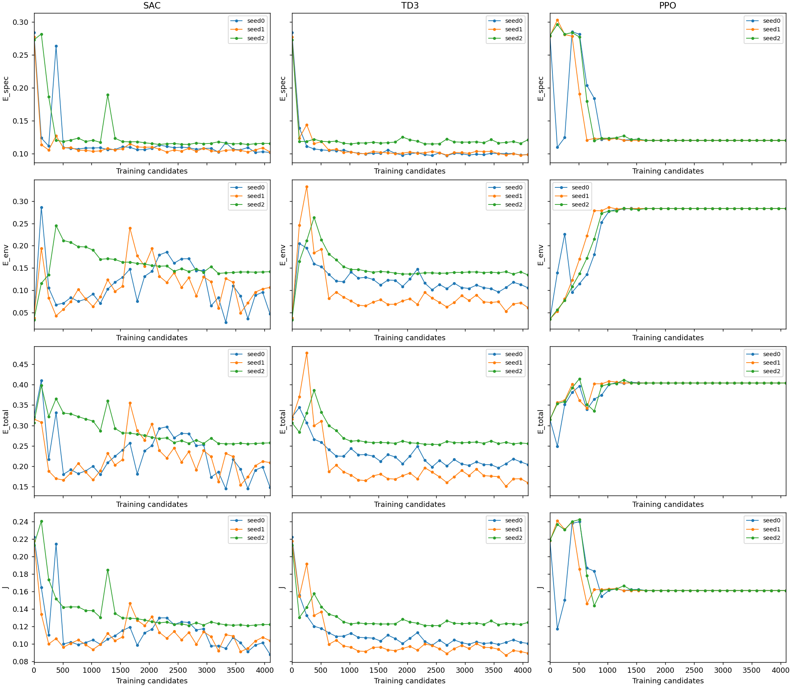

Final=4096step終了後の決定論的方策。Selected=33点中最初のminJ方策、posthoc=同33点中最初のminE_total方策、training_best=4096学習候補中最初のminJ行動で、保存Actorとは区別する。各役割を独立に36音再生し、波形・状態・制御・音響誤差の一致を確認した。[独立監査](audit/endpoints.json)。

| 手法 | 役割 | E_spec 平均±SD | E_env 平均±SD | E_total 平均±SD | J 平均±SD |
| --- | --- | --- | --- | --- | --- |
| SAC | final | 0.106681 ± 0.007729 | 0.098282 ± 0.048028 | 0.204963 ± 0.054527 | 0.104581 ± 0.017075 |
| SAC | selected | 0.106937 ± 0.006318 | 0.078953 ± 0.053753 | 0.185890 ± 0.059913 | 0.099941 ± 0.018079 |
| SAC | training_best | 0.085391 ± 0.008828 | 0.022483 ± 0.008713 | 0.107874 ± 0.016798 | 0.069664 ± 0.008523 |
| SAC | posthoc | 0.111958 ± 0.006172 | 0.072792 ± 0.059990 | 0.184750 ± 0.061002 | 0.102166 ± 0.016192 |
| TD3 | final | 0.106274 ± 0.013005 | 0.100203 ± 0.036918 | 0.206477 ± 0.048037 | 0.104756 ± 0.018048 |
| TD3 | selected | 0.103499 ± 0.009783 | 0.097628 ± 0.043283 | 0.201127 ± 0.051462 | 0.102031 ± 0.017271 |
| TD3 | training_best | 0.095623 ± 0.021260 | 0.060861 ± 0.049131 | 0.156485 ± 0.066884 | 0.086933 ± 0.026580 |
| TD3 | posthoc | 0.104590 ± 0.009190 | 0.095601 ± 0.042734 | 0.200190 ± 0.051261 | 0.102343 ± 0.017207 |
| PPO | final | 0.120169 ± 0.000000 | 0.283650 ± 0.000000 | 0.403819 ± 0.000000 | 0.161039 ± 0.000000 |
| PPO | selected | 0.116710 ± 0.006121 | 0.192296 ± 0.045910 | 0.309006 ± 0.052030 | 0.135607 ± 0.016068 |
| PPO | training_best | 0.088939 ± 0.011018 | 0.018842 ± 0.004500 | 0.107781 ± 0.015274 | 0.071415 ± 0.009313 |
| PPO | posthoc | 0.222707 ± 0.097898 | 0.070053 ± 0.060070 | 0.292760 ± 0.037828 | 0.184544 ± 0.058406 |

3seed、標本SDはddof=1。[全役割の平均・SD（制御値と持続率を含む）](method_summary.csv)。

SACとTD3のFinal平均差は約0.00151で、各手法のseed標本SD（約0.055、0.048）より小さい。この3seedから両者の明確な優劣は断定できない。PPOのFinalではE_env=0.283650が大きく、SAC/TD3の約0.098/0.100との違いがE_total差の主成分だった。全36役割音の音圧持続proxyは真だが、左右の運動状態は別にendpoint_motion/sourceへ記録した。持続することとTargetを精密に模倣することは別の評価である。

PPOは3seedともFinalの実行行動が[-1,1,1]、物理値[ε_l,p_s,f0_l]=[2.5e7,4e6,8e5]になり、同一の音・誤差になった。3seedの最終重みhashは異なり、同じ学習結果を複製したものではない。方策Gaussian平均は各seedで[-1,1]の範囲外へ移り、決定論的実行時のclipにより同じ境界点へ写った。これは学習を停止する数値異常ではなく、今回の標準PPOで得られた方策の挙動である。

PPOのtraining_best平均E≈0.10778に対しFinal≈0.40382で、良い探索候補が方策Finalへ保持されたとは言えない。SACもtraining_best≈0.10787とFinal≈0.20496に隔たりがあった。PPO seed1/2ではposthocのminEが初期step0、minJのSelectedはそれぞれ640/768だった。J=.75E_spec+.25E_envの改善と、E_total=E_spec+E_envの改善が同義ではないこともこの結果に現れている。

| 手法 | seed | 役割 | 試行 | E_spec | E_env | E_total | J | 持続proxy | ε_l | p_s | f0_l |
| --- | --- | --- | --- | --- | --- | --- | --- | --- | --- | --- | --- |
| SAC | 0 | final | 4096 | 0.101795 | 0.046726 | 0.148521 | 0.088028 | True | 27693335.7 | 3109141.96 | 142351.719 |
| SAC | 0 | selected | 4096 | 0.101795 | 0.046726 | 0.148521 | 0.088028 | True | 27693335.7 | 3109141.96 | 142351.719 |
| SAC | 0 | training_best | 3828 | 0.082560 | 0.025485 | 0.108045 | 0.068291 | True | 26222644.7 | 3159180.85 | 173720.035 |
| SAC | 0 | posthoc | 3328 | 0.116857 | 0.028244 | 0.145101 | 0.094704 | True | 27837587.1 | 3173657.98 | 149568.895 |
| SAC | 1 | final | 4096 | 0.102656 | 0.106364 | 0.209019 | 0.103583 | True | 28139580.8 | 3158426.84 | 132405.675 |
| SAC | 1 | selected | 3584 | 0.105026 | 0.049128 | 0.154154 | 0.091052 | True | 27849991.6 | 3123976.05 | 144150.994 |
| SAC | 1 | training_best | 573 | 0.078326 | 0.012666 | 0.090991 | 0.061911 | True | 25964213.9 | 3076540.69 | 62868.6119 |
| SAC | 1 | posthoc | 3584 | 0.105026 | 0.049128 | 0.154154 | 0.091052 | True | 27849991.6 | 3123976.05 | 144150.994 |
| SAC | 2 | final | 4096 | 0.115592 | 0.141756 | 0.257348 | 0.122133 | True | 33168548.3 | 3607359.83 | 717187.571 |
| SAC | 2 | selected | 3712 | 0.113989 | 0.141006 | 0.254995 | 0.120743 | True | 32674577.1 | 3603877.43 | 714732.494 |
| SAC | 2 | training_best | 79 | 0.095287 | 0.029298 | 0.124585 | 0.078790 | True | 28477434.8 | 2965850.17 | 112505.259 |
| SAC | 2 | posthoc | 3712 | 0.113989 | 0.141006 | 0.254995 | 0.120743 | True | 32674577.1 | 3603877.43 | 714732.494 |
| TD3 | 0 | final | 4096 | 0.098940 | 0.105328 | 0.204268 | 0.100537 | True | 38533185.4 | 3061629.98 | 49091.4734 |
| TD3 | 0 | selected | 2432 | 0.097412 | 0.101177 | 0.198589 | 0.098353 | True | 38211149 | 3056115.4 | 49452.331 |
| TD3 | 0 | training_best | 222 | 0.078481 | 0.056308 | 0.134789 | 0.072938 | True | 33886054.2 | 2843822.32 | 56202.6495 |
| TD3 | 0 | posthoc | 3584 | 0.100331 | 0.095976 | 0.196307 | 0.099242 | True | 38082778.5 | 3050997.44 | 49146.6215 |
| TD3 | 1 | final | 4096 | 0.098593 | 0.060990 | 0.159582 | 0.089192 | True | 26440243.4 | 3188326.09 | 49713.6579 |
| TD3 | 1 | selected | 3712 | 0.098302 | 0.052680 | 0.150981 | 0.086896 | True | 26806215.2 | 3155406.53 | 50462.813 |
| TD3 | 1 | training_best | 2758 | 0.088977 | 0.014165 | 0.103142 | 0.070274 | True | 25832027.9 | 3055442.48 | 60395.0708 |
| TD3 | 1 | posthoc | 3712 | 0.098302 | 0.052680 | 0.150981 | 0.086896 | True | 26806215.2 | 3155406.53 | 50462.813 |
| TD3 | 2 | final | 4096 | 0.121290 | 0.134290 | 0.255580 | 0.124540 | True | 35663581.6 | 3603227.44 | 665667.405 |
| TD3 | 2 | selected | 2432 | 0.114784 | 0.139027 | 0.253811 | 0.120845 | True | 35819765.2 | 3630565.58 | 626968.551 |
| TD3 | 2 | training_best | 3617 | 0.119412 | 0.112111 | 0.231523 | 0.117587 | True | 33627284.3 | 3524508.54 | 724961.71 |
| TD3 | 2 | posthoc | 2560 | 0.115137 | 0.138146 | 0.253282 | 0.120889 | True | 35413746.5 | 3625579 | 627648.01 |
| PPO | 0 | final | 4096 | 0.120169 | 0.283650 | 0.403819 | 0.161039 | True | 25000000 | 4000000 | 800000 |
| PPO | 0 | selected | 128 | 0.109665 | 0.139416 | 0.249081 | 0.117103 | True | 36930659.6 | 3412398.18 | 355730.294 |
| PPO | 0 | training_best | 1489 | 0.089516 | 0.021043 | 0.110560 | 0.072398 | True | 25000000 | 3055945.49 | 209292.948 |
| PPO | 0 | posthoc | 128 | 0.109665 | 0.139416 | 0.249081 | 0.117103 | True | 36930659.6 | 3412398.18 | 355730.294 |
| PPO | 1 | final | 4096 | 0.120169 | 0.283650 | 0.403819 | 0.161039 | True | 25000000 | 4000000 | 800000 |
| PPO | 1 | selected | 640 | 0.120722 | 0.221976 | 0.342697 | 0.146035 | True | 29146558 | 3898670.03 | 505290.973 |
| PPO | 1 | training_best | 465 | 0.077645 | 0.013664 | 0.091309 | 0.061650 | True | 29629823.6 | 2983062.54 | 49000 |
| PPO | 1 | posthoc | 0 | 0.278924 | 0.035359 | 0.314283 | 0.218032 | True | 37527688.2 | 3246876.43 | 425310.889 |
| PPO | 2 | final | 4096 | 0.120169 | 0.283650 | 0.403819 | 0.161039 | True | 25000000 | 4000000 | 800000 |
| PPO | 2 | selected | 768 | 0.119744 | 0.215496 | 0.335240 | 0.143682 | True | 29111223.7 | 3916537.17 | 462212.611 |
| PPO | 2 | training_best | 173 | 0.099658 | 0.021817 | 0.121475 | 0.080198 | True | 25000000 | 2992844.1 | 49000 |
| PPO | 2 | posthoc | 0 | 0.279533 | 0.035384 | 0.314917 | 0.218496 | True | 37445917.3 | 3247918.51 | 422643.741 |

[全seedの評価CSV](endpoints.csv) / [33点学習曲線CSV](learning_curves.csv) / [学習ログ・3役割モデル・生音](runs/) / [左右内部状態・寄与](endpoint_motion.csv) / [音響項](endpoint_sources.csv)。保存.ptは方策・価値・targetネットとSAC温度の推論用重みで、optimizer/Replayを含む学習再開checkpointではない。Final/Selected/posthocの27モデルとtraining_bestの9行動を保存している。全36864学習候補の行動・物理値・音響指標はtraining_trace.json.gzへ保存した。各候補のWAVや全時刻重みを全て保存したものではなく、WAV/生音は18候補、Target、4役割×9runを保存している。

## 獲得・保持と探索候補の区別

| 手法 | seed | 初期E | 初期E半減の初回評価step | Final−Selected E | Final−training_best E |
| --- | --- | --- | --- | --- | --- |
| SAC | 0 | 0.320447 | 3328 | 0.000000 | 0.040476 |
| SAC | 1 | 0.315529 | 3584 | 0.054865 | 0.118028 |
| SAC | 2 | 0.306714 | None | 0.002353 | 0.132763 |
| TD3 | 0 | 0.320447 | None | 0.005679 | 0.069479 |
| TD3 | 1 | 0.315529 | 3712 | 0.008601 | 0.056440 |
| TD3 | 2 | 0.306714 | None | 0.001769 | 0.024057 |
| PPO | 0 | 0.314555 | None | 0.154738 | 0.293260 |
| PPO | 1 | 0.314283 | None | 0.061122 | 0.312510 |
| PPO | 2 | 0.314917 | None | 0.068580 | 0.282345 |

初期Eの半減時点は33評価点のうち最初の観測点であり、連続時間の到達時刻ではない。SelectedとFinalの差は途中の方策獲得を最終時点で保持したかを見る記述値。training_bestとのギャップは探索で見つけた行動とActorへの取り込みを区別するための値で、異なる目的J/minEを同じ選択と見なさない。E_total≤.10による合否・再試行・追加予算は用いていない。

| 手法 | seed | 学習持続率 | 左f0の実最小–最大 | 左f0≤100000の率 | 左f0=49000の率 | 実行行動の境界率 |
| --- | --- | --- | --- | --- | --- | --- |
| SAC | 0 | 1.000000 | 51056.62–797904.64 | 0.224854 | 0.000000 | 0.000000 |
| SAC | 1 | 1.000000 | 51503.76–789829.24 | 0.173584 | 0.000000 | 0.000000 |
| SAC | 2 | 1.000000 | 58968.52–798040.67 | 0.002686 | 0.000000 | 0.000000 |
| TD3 | 0 | 1.000000 | 49000.00–799622.87 | 0.853271 | 0.438477 | 0.438477 |
| TD3 | 1 | 1.000000 | 49000.00–800000.00 | 0.797363 | 0.400391 | 0.504639 |
| TD3 | 2 | 1.000000 | 121748.48–773014.53 | 0.000000 | 0.000000 | 0.022217 |
| PPO | 0 | 1.000000 | 49000.00–800000.00 | 0.069092 | 0.055908 | 0.907959 |
| PPO | 1 | 1.000000 | 49000.00–800000.00 | 0.051514 | 0.041992 | 0.934082 |
| PPO | 2 | 1.000000 | 49000.00–800000.00 | 0.066650 | 0.053467 | 0.917236 |

左f0は学習中に固定されず、3制御全ての実行範囲が非ゼロであることを各runで検査した。[探索の実範囲・行動分散・SAC温度](exploration_summary.csv)。Targetの左f0は探索下限にあり、SACのtanh方策、TD3のclip付き探索、PPOのGaussianと環境clipでは境界へ到達する性質が異なる。上表は実行された行動の観測であり、この差だけで性能差の因果を決めるものではない。PPOのraw行動をclip済み行動に置き換えて学習させる変更はしていない。

## Target最上段の音・内部状態比較

全図の列はseed0/1/2、上段Target、その下にSAC/TD3/PPO。4役割で同じ時間・周波数・Target PSD基準・色軸を使用。波形/RMS/WAVは全て同じTarget peakの逆数によるgainで、個別正規化・クリップ・位相合わせはない。float32 WAVには1を超える値もそのまま保持し、聴取環境によるclipと保存波形の一致を混同しない。主観的な聴取評価は実施していない。

代表seed1のFinal音：[SAC](audio/SAC_s1_final.wav) / [TD3](audio/TD3_s1_final.wav) / [PPO](audio/PPO_s1_final.wav)。Selected音：[SAC](audio/SAC_s1_selected.wav) / [TD3](audio/TD3_s1_selected.wav) / [PPO](audio/PPO_s1_selected.wav)。[全55 WAVと対応生音の索引](README.md)に全seed・全役割を掲載した。

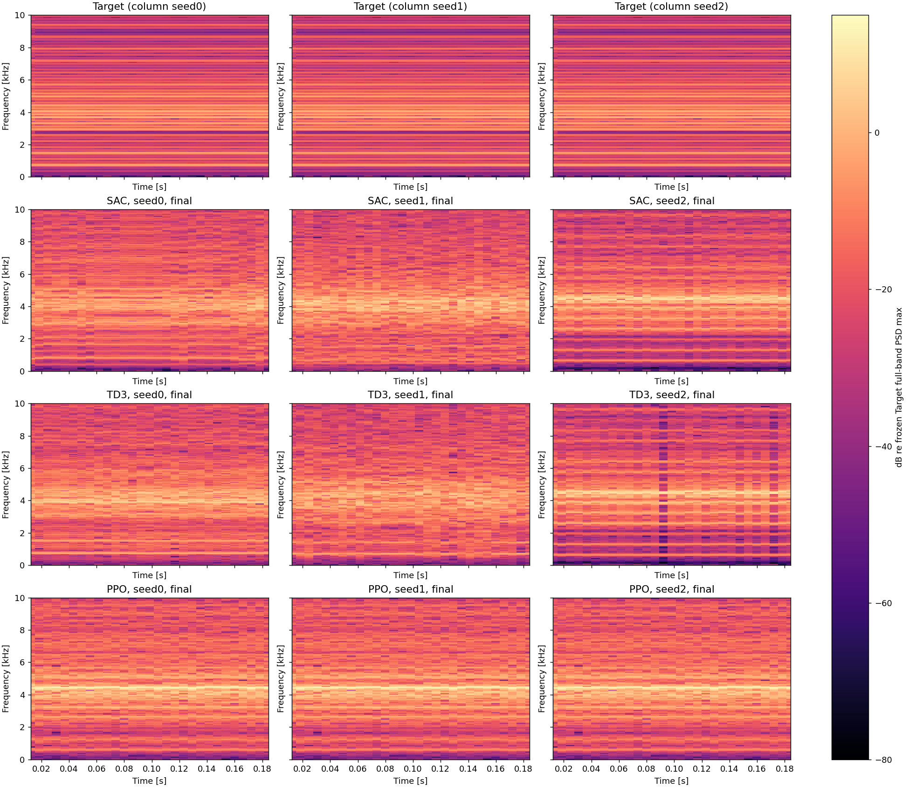

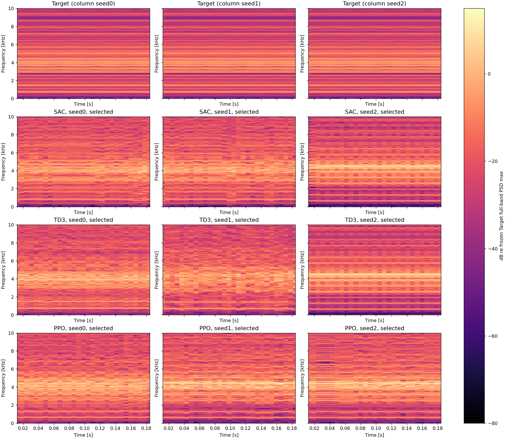

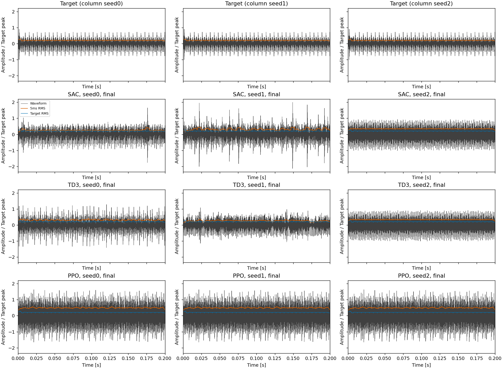

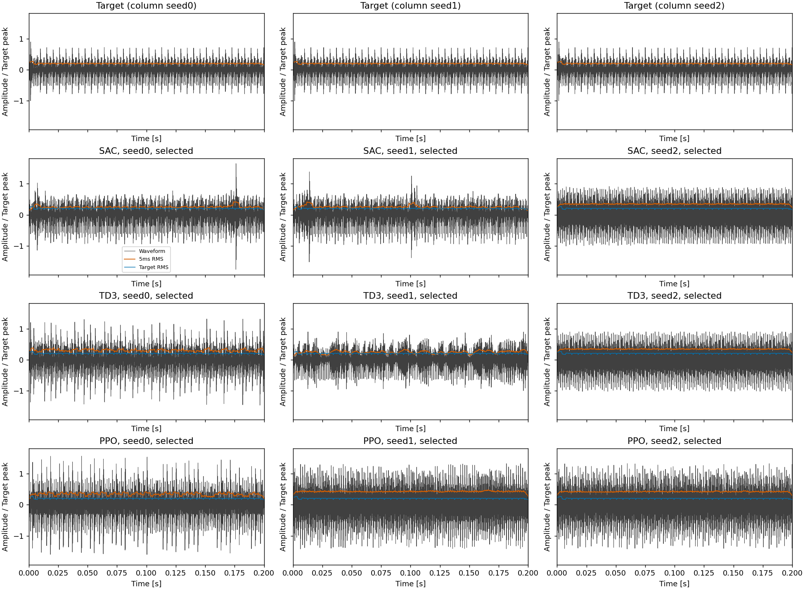

[training_best PSD](figures/training_best_spectrograms.png) / [training_best 波形](figures/training_best_waveforms.png) / [posthoc PSD](figures/posthoc_spectrograms.png) / [posthoc 波形](figures/posthoc_waveforms.png)。

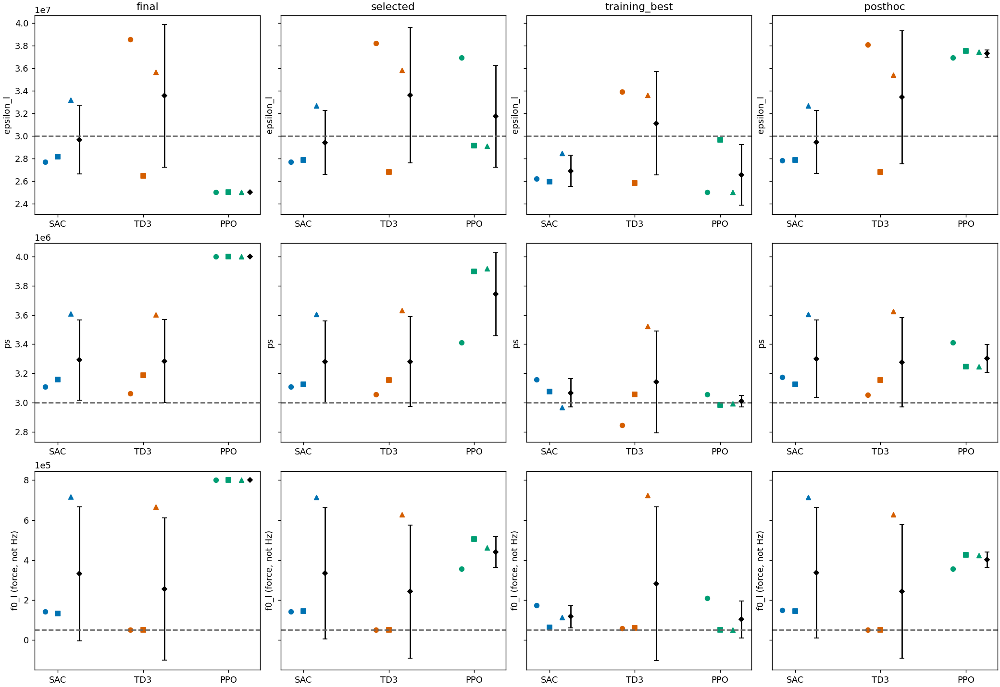

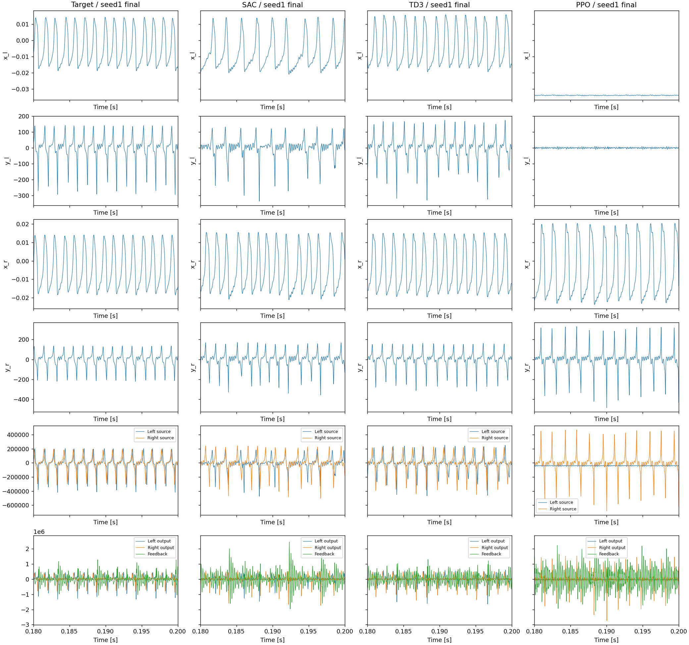

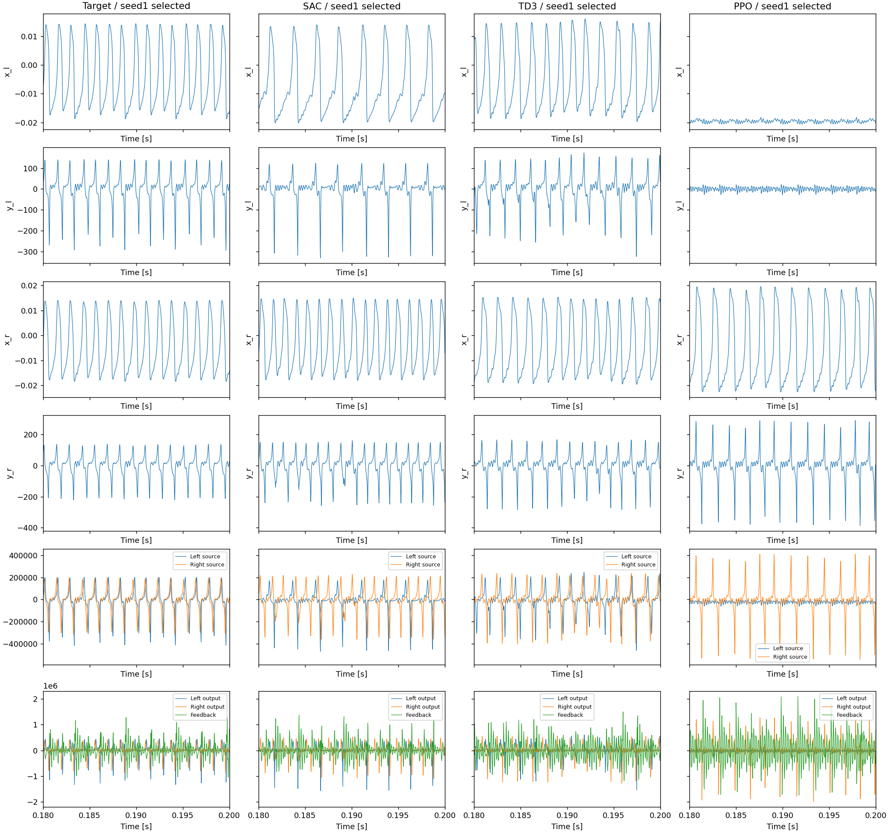

内部状態代表図は事前固定seed1を用い、良いseedの事後選択はしない。全seed全役割の詳細traceは[audit NPZ](audit/)と[timeseries CSV.gz](timeseries/)、末尾統計は[endpoint_motion](endpoint_motion.csv)と[endpoint_sources](endpoint_sources.csv)。似た音響誤差が得られても、制御値の一意復元や唯一の振動状態を主張しない。

## 実行会計・時間

| 手法 | seed | 学習step | 独立評価 | 学習wall秒 | 評価wall秒 | process CPU秒 | 非持続学習候補 | 数値失敗 |
| --- | --- | --- | --- | --- | --- | --- | --- | --- |
| SAC | 0 | 4096 | 33 | 826.556342 | 6.580759 | 834.735115 | 0 | 0 |
| SAC | 1 | 4096 | 33 | 818.058993 | 6.574061 | 826.113013 | 0 | 0 |
| SAC | 2 | 4096 | 33 | 826.822744 | 6.571936 | 835.047277 | 0 | 0 |
| TD3 | 0 | 4096 | 33 | 813.765825 | 6.489022 | 821.350508 | 0 | 0 |
| TD3 | 1 | 4096 | 33 | 816.864997 | 6.583403 | 824.772194 | 0 | 0 |
| TD3 | 2 | 4096 | 33 | 811.796187 | 6.584015 | 819.715573 | 0 | 0 |
| PPO | 0 | 4096 | 33 | 803.045038 | 6.509384 | 810.700009 | 0 | 0 |
| PPO | 1 | 4096 | 33 | 803.863575 | 6.585471 | 811.593330 | 0 | 0 |
| PPO | 2 | 4096 | 33 | 803.655768 | 6.522649 | 811.046128 | 0 | 0 |

9run並列実行の全体wall=838.612秒。個別training wallはそのrunのlearn区間から独立評価・保存時間を差し引いた値、CPUはrun process全体であり一致する量ではない。

| 区分 | 実際の音生成回数 | native step |
|---|---:|---:|
| 新規Stage A候補 | 18 | 36000000 |
| 選定後の独立B oracle | 1 | 2000000 |
| 方法別smoke学習 | 384 | 768000000 |
| smoke独立評価 | 6 | 12000000 |
| smoke保存モデル/候補再生 | 12 | 24000000 |
| 正式学習 | 36864 | 73728000000 |
| 正式独立方策評価 | 297 | 594000000 |
| 終了後の独立詳細監査 | 36 | 72000000 |
| 合計 | **37618** | **75236000000** |
| 旧①9点の再生成 / 新規A音 / synthetic音 | 0 / 0 / 0 | 0 |

全新規音のnative積分時間合計7523.6秒。各計算は2,000,000stepで、実時間のwallとは異なる。追加探索・最適化・時間延長・failed run差し替え0。[正式会計](execution.json) / [smoke会計](preflight/smoke_audit.json) / [Stage A ledger](preflight/ledger.json) / [終了後ledger](audit/ledger.json)。

## 保存・監査と限界

旧Issue17〜27の6362保護対象ファイルを開始時にhash化し、終了時に全件不変・削除0を検査する。[旧成果照合](integrity.json)。初回非持続3音と前回非持続9音・0runの報告はそのまま残した。新規実装、PLAN、Target、実library、ソース、全モデル/ログ/CSV/WAV/図のhashを保存する。開始時inventoryには前の中断で作られた2つの新規agentファイルがあり、clean-startへの補正根拠を[storage_before](storage_before.json)に明記した。

今回の目的は**Case B内部・同じ自己生成Targetでの3手法比較**。Case Aは異なるTargetのためA/B誤差から2音源構造の優位を結論しない。3seed・単一Target・固定予算での結果に限られる。TQC、DE/GA/CMA-ES、5D、時変制御、共通実録音比較、追加grid、長時間発声、全遅延系の安定性解析は未実施。commit/push/Issue更新も行っていない。

[再現手順](REPRODUCE.md) / [実装hash](implementation_checksums.json) / [成果物hash](artifact_checksums.json) / [保存容量](storage_after.json)。

<!-- STORAGE_BEGIN -->
| 対象 | 開始前 | 完了時 |
| --- | --- | --- |
| ファイル数 | 8132 | 8585 |
| 論理bytes | 887824649 | 1061614259 |
| 新規Git候補 | 0 | 451 / 173743457 bytes |
| 追跡変更/削除 | 0/0 | 1/0 |
<!-- STORAGE_END -->
