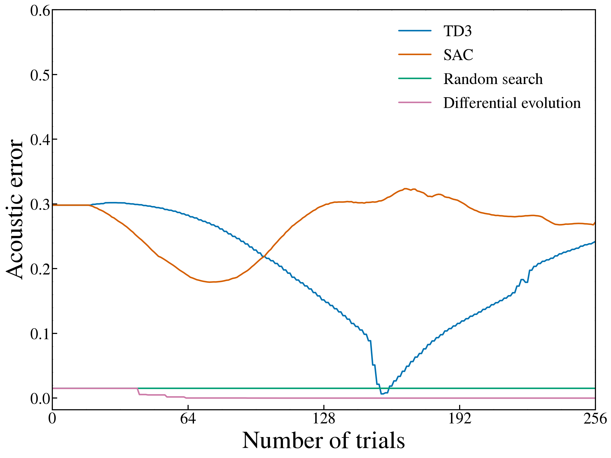
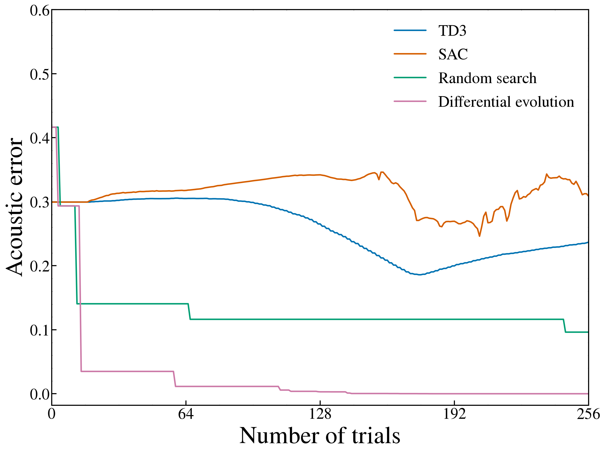

# Issue #13：一定制御の1変数・2変数比較

モデルCase Aの同じ0.35秒のモデル内生成目標に対し、一定1変数と一定2変数の制御をTD3・SAC・ランダム探索・差分進化で比較した。各条件・手法・seedで256本の訓練候補音を生成し、seed 0/1/2の計24 runを新しいフォルダに保存した。実録音は使用せず、既存結果は変更していない。

## 条件と評価

| 条件名 | 可動値 | 1試行の決定 | 候補音 | 訓練予算/seed |
| --- | --- | --- | --- | --- |
| constant_1d | ε_l | 1回決めて全区間保持 | 0.35秒 | 256 episode / 候補 |
| constant_2d | ε_l と p_s | 2値を1回決めて全区間保持 | 0.35秒 | 256 episode / 候補 |

両条件は1 episode・1行動の一定制御課題で、35個の時変行動を学ぶ課題とは異なる。モデルCase A/B/Cという音源条件とも別の分類で、今回は全runがCase Aである。非学習変数は目標生成時の値へ固定し、初期状態・遅延履歴・出力フィルタを揃える。2変数化は左の係数と共通圧力を動かすことであり、左右2音源の比較ではない。

主評価は既存 `acoustics.distance()` の全0.35秒の対数PSD誤差＋5 ms RMS包絡誤差。小さいほどよく、生成音ごとのゲイン・位相調整はしない。γ=1の報酬和はこの全区間誤差の負値に一致する。SACの訓練にはentropy項もあるため、全手法の学習目的の全てが同一とは述べない。balanced等の別診断値を主指標と混同しない。物理範囲・目標・学習条件の完全記録は [manifest.json](manifest.json)。

## seed 0の学習曲線

次の2図は**seed 0のみ**の4本の曲線で、seed平均・標準偏差ではない。横軸は `Number of trials`、縦軸は `Acoustic error`。SciencePlotsの字体・軸ラベル46 pt・目盛と凡例30 pt・線幅2.8を使い、両図の縦軸範囲を共通にした。凡例はグラフ内右上の余白に置き、データ線との非重なりを確認した。タイトル、seed表記、0.08線、帯は画像に入れていない。原点の目盛文字が重ならないよう下端に共通の余白を設けるが、実測誤差はすべて非負である。



図1：一定1変数・seed 0。



図2：一定2変数・seed 0。

trial 0は学習・探索前の独立評価。RLでは未学習の決定論的actor、直接法では初期ランダム候補であり、同じ初期音ではない。trial 1〜256は生成済みの訓練episode／候補数を表す。RLは各時点の決定論的actor、直接法はその時点までの最良候補（best-so-far）を描くため、直接法の曲線は単調でもRLの曲線は単調でない場合がある。直接法の各試行そのものの値は `candidate_error` としてJSONに残しており、図の線はそれとは異なる。

RLの中間episode 1〜255の評価は `_on_rollout_end` のgradient更新前、最後の256は最終更新後。各recordの `evaluation_phase`・`gradient_updates` を参照する。図はJSONの257点をそのまま結び、補間・平滑化・点の間引きはしない。Matplotlibの `path.simplify=False` とし、描画時の頂点省略も無効にする。描画した座標は [seed0_learning_curve_points.csv](seed0_learning_curve_points.csv)、軸・書式・入力ハッシュは [plot_metadata.json](figures/plot_metadata.json)。

## 最終性能と最良観測

次表は全3 seedの平均±標本標準偏差。最終はRLの最終actor、直接法は返された最良候補である。最良観測は257評価点の最小値で、最終性能の維持とは別に扱う。初期・最終・最良の全seed値は [per_seed.csv](per_seed.csv)、集計は [aggregate.csv](aggregate.csv)。

| 条件 | 手法 | 初期誤差 | 最終誤差 | 最良観測誤差 |
| --- | --- | --- | --- | --- |
| constant_1d | TD3 | 0.2715931 ± 0.0494 | 0.2193975 ± 0.0301 | 0.002503752 ± 0.00352 |
| constant_1d | SAC | 0.2715931 ± 0.0494 | 0.3001667 ± 0.0259 | 0.2306625 ± 0.0611 |
| constant_1d | Random search | 0.1958584 ± 0.157 | 0.007563262 ± 0.00651 | 0.007563262 ± 0.00651 |
| constant_1d | Differential evolution | 0.1958584 ± 0.157 | 3.531329e-11 ± 1.04e-11 | 3.531329e-11 ± 1.04e-11 |
| constant_2d | TD3 | 0.2596716 ± 0.11 | 0.1756284 ± 0.0549 | 0.121516 ± 0.0697 |
| constant_2d | SAC | 0.2596716 ± 0.11 | 0.247558 ± 0.106 | 0.1949136 ± 0.111 |
| constant_2d | Random search | 0.4147598 ± 0.00373 | 0.1283039 ± 0.0835 | 0.1283039 ± 0.0835 |
| constant_2d | Differential evolution | 0.4147598 ± 0.00373 | 0.0007384369 ± 0.00124 | 0.0007384369 ± 0.00124 |

## seed 0：初期・最終・最良の差

| 条件 | 手法 | 初期 | 最良観測 | 最良時trial | 最終 | 最終−最良 | 最終物理制御 |
| --- | --- | --- | --- | --- | --- | --- | --- |
| constant_1d | TD3 | 0.2981623 | 0.006563203 | 155 | 0.2419812 | 0.235418 | ε_l=4.318784e+07; p_s=3400000 |
| constant_1d | SAC | 0.2981623 | 0.1791825 | 74 | 0.2718124 | 0.09262984 | ε_l=3.30763e+07; p_s=3400000 |
| constant_1d | Random search | 0.01507498 | 0.01507498 | 0 | 0.01507498 | 0 | ε_l=4.092404e+07; p_s=3400000 |
| constant_1d | Differential evolution | 0.01507498 | 2.898795e-11 | 248 | 2.898795e-11 | 0 | ε_l=4.1e+07; p_s=3400000 |
| constant_2d | TD3 | 0.2994746 | 0.1859312 | 175 | 0.2369053 | 0.0509741 | ε_l=3.809587e+07; p_s=3172684 |
| constant_2d | SAC | 0.2994746 | 0.2461642 | 204 | 0.3087728 | 0.06260853 | ε_l=3.019558e+07; p_s=3692246 |
| constant_2d | Random search | 0.4164736 | 0.09628333 | 245 | 0.09628333 | 0 | ε_l=4.059757e+07; p_s=3387854 |
| constant_2d | Differential evolution | 0.4164736 | 3.981526e-05 | 251 | 3.981526e-05 | 0 | ε_l=4.099983e+07; p_s=3399992 |

constant_1dの最小最終誤差は 2.898795e-11 （DE、seed 0）。単一seedの最小値だけで手法の優位性を判断せず、上表の3 seedのばらつきと併せて読む。

constant_2dの最小最終誤差は 9.980622e-06 （DE、seed 2）。単一seedの最小値だけで手法の優位性を判断せず、上表の3 seedのばらつきと併せて読む。

最良観測の値と、その時点の制御・音声・方策の保存は区別する。今回のRLは `best_observed/agent.zip` と `best_observed/rollout.npz`、初期は `initial/rollout.npz`、最終はrun直下の `agent.zip`・`rollout.npz` に対応する。直接法は方策ネットワークを学習しないため、生成制御列と目的値を参照する。対応する初期・最良・最終recordと保存artifactの評価時点を確認し、最終図を途中最良の図として扱わない。

## 旧Phase 1・Task Aとの比較

参照先は `Deeplearning/results/phase1_validation_20261031`。旧Task Aも一定1変数の256 episode課題だが、以下は既存記録との補助比較であり、旧実験の再描画・追加学習はしていない。とくに旧曲線9点と新曲線257点では最良値を観測する密度が違う。新しい最良観測値が小さい場合も、記録点数の増加だけでは学習法の改善を証明できない。最良方策の保存を追加したことと、学習の安定性が改善したことも区別する。

| 手法 | seed | 旧A最終 | 新1変数最終 | 旧A最良観測 | 新1変数最良観測 | 旧/新曲線点数 | 旧時点すべて完全一致 | 共通時点の最大絶対差 |
| --- | --- | --- | --- | --- | --- | --- | --- | --- |
| TD3 | 0 | 0.2419812 | 0.2419812 | 0.01858076 | 0.006563203 | 9/257 | True | 0 |
| TD3 | 1 | 0.1852449 | 0.1852449 | 0.04857496 | 0.0003791324 | 9/257 | True | 0 |
| TD3 | 2 | 0.2309664 | 0.2309664 | 0.07735713 | 0.0005689197 | 9/257 | True | 0 |
| SAC | 0 | 0.2718124 | 0.2718124 | 0.1891928 | 0.1791825 | 9/257 | True | 0 |
| SAC | 1 | 0.3060927 | 0.3060927 | 0.2145758 | 0.2145758 | 9/257 | True | 0 |
| SAC | 2 | 0.322595 | 0.322595 | 0.2985172 | 0.2982292 | 9/257 | True | 0 |
| random_search | 0 | 0.01507498 | 0.01507498 | 0.01507498 | 0.01507498 | 9/257 | True | 0 |
| random_search | 1 | 0.004113278 | 0.004113278 | 0.004113278 | 0.004113278 | 9/257 | True | 0 |
| random_search | 2 | 0.003501528 | 0.003501528 | 0.003501528 | 0.003501528 | 9/257 | True | 0 |
| DE | 0 | 2.898795e-11 | 2.898795e-11 | 2.898795e-11 | 2.898795e-11 | 9/257 | True | 0 |
| DE | 1 | 4.732632e-11 | 4.732632e-11 | 4.732632e-11 | 4.732632e-11 | 9/257 | True | 0 |
| DE | 2 | 2.962559e-11 | 2.962559e-11 | 2.962559e-11 | 2.962559e-11 | 9/257 | True | 0 |

旧評価時点の全値と完全一致したrunは 12/12。照合した共通時点は合計 108 点で、うち 108 点が浮動小数点値として完全一致した。完全一致の判定は許容誤差による近似比較ではない。各時点の旧値・新値・絶対差は [historical_A_shared_checkpoints.csv](historical_A_shared_checkpoints.csv)。共通時点が一致しても、新しい密な評価で見つかった途中最良を学習条件の改善とは扱わない。

元の初期値・訓練/評価費用・出典ハッシュは [historical_A_reference.csv](historical_A_reference.csv)。新旧のハイパーパラメータ等の一致はmanifestの記録を確認する。一定2変数は旧Aから可動自由度を増やした別課題で、旧Aの単純な再実行とは扱わない。

## 計算量と評価・選択の費用

訓練episode／候補は各256本で、0.35秒×256=89.6秒のモデル時間を積分する。1試行1行動のため訓練decision stepも256。RLは初期＋各episode後の257回を独立に評価し、評価積分は89.95秒/runとなる。直接法の曲線は訓練で算出した目的値を再利用し、初期と最終だけを独立に評価するため、評価2本・0.7秒/runである。曲線点数が同じでも独立再生の本数は同じではない。最良方策の保存処理が学習器の行動・重み更新にフィードバックする実験とは区別する。

| 条件 | 手法 | seed | 訓練行動 | 訓練episode | 訓練積分[s] | 評価episode | 評価積分[s] | 訓練実時間[s] | 評価実時間[s] | failure |
| --- | --- | --- | --- | --- | --- | --- | --- | --- | --- | --- |
| constant_1d | TD3 | 0 | 256 | 256 | 89.6 | 257 | 89.95 | 81.40822 | 81.75733 | 0 |
| constant_1d | TD3 | 1 | 256 | 256 | 89.6 | 257 | 89.95 | 81.40132 | 81.82495 | 0 |
| constant_1d | TD3 | 2 | 256 | 256 | 89.6 | 257 | 89.95 | 81.47206 | 81.7939 | 0 |
| constant_1d | SAC | 0 | 256 | 256 | 89.6 | 257 | 89.95 | 79.62872 | 81.88974 | 0 |
| constant_1d | SAC | 1 | 256 | 256 | 89.6 | 257 | 89.95 | 79.11827 | 81.15636 | 0 |
| constant_1d | SAC | 2 | 256 | 256 | 89.6 | 257 | 89.95 | 79.4143 | 81.31118 | 0 |
| constant_1d | random_search | 0 | 256 | 256 | 89.6 | 2 | 0.7 | 81.01245 | 0.6404866 | 0 |
| constant_1d | random_search | 1 | 256 | 256 | 89.6 | 2 | 0.7 | 80.95712 | 0.6240234 | 0 |
| constant_1d | random_search | 2 | 256 | 256 | 89.6 | 2 | 0.7 | 80.95673 | 0.6476889 | 0 |
| constant_1d | DE | 0 | 256 | 256 | 89.6 | 2 | 0.7 | 84.78518 | 0.7119348 | 0 |
| constant_1d | DE | 1 | 256 | 256 | 89.6 | 2 | 0.7 | 84.09614 | 0.7209003 | 0 |
| constant_1d | DE | 2 | 256 | 256 | 89.6 | 2 | 0.7 | 84.52126 | 0.6743983 | 0 |
| constant_2d | TD3 | 0 | 256 | 256 | 89.6 | 257 | 89.95 | 81.17854 | 81.79206 | 0 |
| constant_2d | TD3 | 1 | 256 | 256 | 89.6 | 257 | 89.95 | 81.1845 | 81.64657 | 0 |
| constant_2d | TD3 | 2 | 256 | 256 | 89.6 | 257 | 89.95 | 81.10002 | 81.49549 | 0 |
| constant_2d | SAC | 0 | 256 | 256 | 89.6 | 257 | 89.95 | 78.96763 | 81.04332 | 0 |
| constant_2d | SAC | 1 | 256 | 256 | 89.6 | 257 | 89.95 | 78.95191 | 81.11867 | 0 |
| constant_2d | SAC | 2 | 256 | 256 | 89.6 | 257 | 89.95 | 78.84849 | 80.91434 | 0 |
| constant_2d | random_search | 0 | 256 | 256 | 89.6 | 2 | 0.7 | 80.66454 | 0.6312972 | 0 |
| constant_2d | random_search | 1 | 256 | 256 | 89.6 | 2 | 0.7 | 80.60939 | 0.6489483 | 0 |
| constant_2d | random_search | 2 | 256 | 256 | 89.6 | 2 | 0.7 | 80.29952 | 0.6315385 | 0 |
| constant_2d | DE | 0 | 256 | 256 | 89.6 | 2 | 0.7 | 80.9375 | 0.638922 | 0 |
| constant_2d | DE | 1 | 256 | 256 | 89.6 | 2 | 0.7 | 80.73982 | 0.6392561 | 0 |
| constant_2d | DE | 2 | 256 | 256 | 89.6 | 2 | 0.7 | 80.6237 | 0.6221689 | 0 |

会計の全値は [compute.csv](compute.csv)。native_stepsは元の積分刻み数、integration_sはモデル時間、wall_sは実時間であり別の単位である。図・音声artifactの保存や準備の費用は各summary・manifestの記録を参照。実時間は共有計算機上の測定で、同時処理・損失計算・ネットワーク更新・保存処理の影響を受ける。シミュレーション予算を揃えても全計算量・実時間が等しいとは述べない。

## 元データとartifactの索引

runの配置は `runs/<condition>/<method>/seed_<seed>/`。条件は `constant_1d`／`constant_2d`、手法は `TD3`／`SAC`／`random_search`／`DE`、seedは0/1/2。

| ファイル | 用途 |
| --- | --- |
| manifest.json | 目標・物理範囲・固定値・学習条件・予算・旧結果参照先 |
| runs/.../curve.json | 257点の生記録、評価時点・更新回数、直接法の各候補とbest-so-far |
| runs/.../summary.json | 初期・最終・最良の完全record、訓練/評価会計 |
| runs/.../initial/rollout.npz | 初期音・適用制御・行動 |
| runs/.../best_observed/rollout.npz | 最良観測時点の音・適用制御・行動 |
| runs/.../best_observed/agent.zip | RL最良観測時点の方策 |
| runs/.../rollout.npz | 最終音・目標音・適用制御・行動、float64の正本 |
| runs/.../spectrogram.png | 最終のTarget/Generated比較、最良時点と区別 |
| figures/<condition>_<method>_final_spectrogram.png | seed 0・trial 256の発表用比較。両段とも画像内タイトルなし |
| runs/.../amplitude_envelope.png; controls.png | 元振幅の包絡と実際の一定制御 |
| runs/.../target_raw.wav; generated_raw.wav | 振幅を個別正規化しないIEEE float32の評価用音声 |

具体的なseed 0の元データ：

- [constant_1d/TD3 curve](runs/constant_1d/TD3/seed_0/curve.json)、[summary](runs/constant_1d/TD3/seed_0/summary.json)、[最終スペクトログラム](runs/constant_1d/TD3/seed_0/spectrogram.png)、[発表用・タイトルなし最終スペクトログラム](figures/constant_1d_TD3_final_spectrogram.png)、[最終NPZ](runs/constant_1d/TD3/seed_0/rollout.npz)、[最終生成WAV](runs/constant_1d/TD3/seed_0/generated_raw.wav)
- [constant_1d/SAC curve](runs/constant_1d/SAC/seed_0/curve.json)、[summary](runs/constant_1d/SAC/seed_0/summary.json)、[最終スペクトログラム](runs/constant_1d/SAC/seed_0/spectrogram.png)、[発表用・タイトルなし最終スペクトログラム](figures/constant_1d_SAC_final_spectrogram.png)、[最終NPZ](runs/constant_1d/SAC/seed_0/rollout.npz)、[最終生成WAV](runs/constant_1d/SAC/seed_0/generated_raw.wav)
- [constant_1d/random_search curve](runs/constant_1d/random_search/seed_0/curve.json)、[summary](runs/constant_1d/random_search/seed_0/summary.json)、[最終スペクトログラム](runs/constant_1d/random_search/seed_0/spectrogram.png)、[発表用・タイトルなし最終スペクトログラム](figures/constant_1d_random_search_final_spectrogram.png)、[最終NPZ](runs/constant_1d/random_search/seed_0/rollout.npz)、[最終生成WAV](runs/constant_1d/random_search/seed_0/generated_raw.wav)
- [constant_1d/DE curve](runs/constant_1d/DE/seed_0/curve.json)、[summary](runs/constant_1d/DE/seed_0/summary.json)、[最終スペクトログラム](runs/constant_1d/DE/seed_0/spectrogram.png)、[発表用・タイトルなし最終スペクトログラム](figures/constant_1d_DE_final_spectrogram.png)、[最終NPZ](runs/constant_1d/DE/seed_0/rollout.npz)、[最終生成WAV](runs/constant_1d/DE/seed_0/generated_raw.wav)
- [constant_2d/TD3 curve](runs/constant_2d/TD3/seed_0/curve.json)、[summary](runs/constant_2d/TD3/seed_0/summary.json)、[最終スペクトログラム](runs/constant_2d/TD3/seed_0/spectrogram.png)、[発表用・タイトルなし最終スペクトログラム](figures/constant_2d_TD3_final_spectrogram.png)、[最終NPZ](runs/constant_2d/TD3/seed_0/rollout.npz)、[最終生成WAV](runs/constant_2d/TD3/seed_0/generated_raw.wav)
- [constant_2d/SAC curve](runs/constant_2d/SAC/seed_0/curve.json)、[summary](runs/constant_2d/SAC/seed_0/summary.json)、[最終スペクトログラム](runs/constant_2d/SAC/seed_0/spectrogram.png)、[発表用・タイトルなし最終スペクトログラム](figures/constant_2d_SAC_final_spectrogram.png)、[最終NPZ](runs/constant_2d/SAC/seed_0/rollout.npz)、[最終生成WAV](runs/constant_2d/SAC/seed_0/generated_raw.wav)
- [constant_2d/random_search curve](runs/constant_2d/random_search/seed_0/curve.json)、[summary](runs/constant_2d/random_search/seed_0/summary.json)、[最終スペクトログラム](runs/constant_2d/random_search/seed_0/spectrogram.png)、[発表用・タイトルなし最終スペクトログラム](figures/constant_2d_random_search_final_spectrogram.png)、[最終NPZ](runs/constant_2d/random_search/seed_0/rollout.npz)、[最終生成WAV](runs/constant_2d/random_search/seed_0/generated_raw.wav)
- [constant_2d/DE curve](runs/constant_2d/DE/seed_0/curve.json)、[summary](runs/constant_2d/DE/seed_0/summary.json)、[最終スペクトログラム](runs/constant_2d/DE/seed_0/spectrogram.png)、[発表用・タイトルなし最終スペクトログラム](figures/constant_2d_DE_final_spectrogram.png)、[最終NPZ](runs/constant_2d/DE/seed_0/rollout.npz)、[最終生成WAV](runs/constant_2d/DE/seed_0/generated_raw.wav)

発表用スペクトログラムのcaption：**上段が目標音（Target）、下段が最終生成音（Generated）。すべてseed 0・trial 256の最終recordで、途中最良の図ではない。**画像内・上側・枠外のタイトルを置かず、両段の周波数軸46 pt・目盛30 pt、時間軸を `Time [s]` とする。元のrun内 `spectrogram.png` は変更せず、保存済み最終NPZだけから別画像として描いた。元NPZ・summaryと各PNGの対応ハッシュは [presentation_spectrograms_metadata.json](figures/presentation_spectrograms_metadata.json)。この描画で主音響誤差の再計算や物理モデルの再積分は行っていない。

元振幅のNPZ/WAVは保持する。既存スペクトログラムの表示専用ピーク正規化は学習・評価には適用しない。出力はモデルの単位で、SI音圧への校正や公式SAP評価を実施したことにはならない。

## 判断の範囲と未解決事項

一定1/2変数の単一固定目標・初期状態における実験である。最終誤差、途中最良、最良artifactの保存、その後の性能維持を分けて判断する。新しい図のseed 0だけで3 seed全体の性質を代表させない。パラメータ一致は音響的成功の必須条件ではなく、異なる制御で近い音が出る可能性を残す。結果が悪い場合も有限の予算・探索/entropy・関数近似・候補選択・観測条件の影響が残り、RL一般の不可能性やモデル表現力不足とは結論しない。

今回の結果は時変目標、複数目標、未知の初期状態、実録音への一般化を検証していない。左右音源の使用条件を変えた実験でもなく、左右2音源の優位性を主張しない。0.08等の過去の比較線は知覚的な合格基準ではなく、今回の図には描いていない。

## 保存結果の監査

最終監査：**PASS**、確認数 107130。[final_audit.json](final_audit.json) の保存値を掲載する。このレポートの再生成は学習・数値積分を追加せず、既存の監査結果を読み込む。

| 監査項目 | 件数・保存値 |
| --- | --- |
| runs_expected | 24 |
| runs_found | 24 |
| curves_checked | 24 |
| curve_points | 6168 |
| rollouts_checked | 74 |
| acoustic_recomputations | 74 |
| wav_files_checked | 148 |
| balanced_recomputations | 74 |
| oracles_checked | 4 |
| policy_predictions_checked | 24 |
| protected_files_checked | 1543 |
| source_hashes_checked | 22 |
| training_episodes | 6144 |
| evaluation_episodes | 3108 |
| training_integration_s | 2150.4 |
| evaluation_integration_s | 1087.8 |

## 完全な条件記録

```json
{
  "workflow": "issue13_constant_control_reproduction",
  "issue_url": "https://github.com/tatsukawa0353/Birdsong_tatsukawa/issues/13",
  "experiment_id": "reproduction_v1",
  "created_utc": "2026-11-07T08:08:08.072820+00:00",
  "client_date_jst": "2026-11-07",
  "settings": {
    "experiment_id": "reproduction_v1",
    "seeds": [
      0,
      1,
      2
    ],
    "methods": [
      "TD3",
      "SAC",
      "random_search",
      "DE"
    ],
    "conditions": [
      "constant_1d",
      "constant_2d"
    ],
    "episodes": 256,
    "eval_every_episodes": 1,
    "warmup_episodes": 16,
    "learning_rate": 0.0003,
    "batch_size": 32,
    "net_arch": [
      32,
      32
    ],
    "gamma": 1.0,
    "sac_ent_coef": "auto_0.01",
    "td3_noise_std": 0.1,
    "de_population": 8,
    "de_mutation": [
      0.5,
      1.0
    ],
    "de_recombination": 0.7,
    "historical_reference_directory": "Deeplearning/results/phase1_validation_20261031"
  },
  "source_hashes": {
    "issue13.py": "298d634860c490b76c2cec86d85762cf2ba95bf243a93725d0f5ab76d1ad7417",
    "issue13_env.py": "8b642acf71974e79bd444d383d3b235e9c4596edc8b4bbf0ae317c37b397f918",
    "configs/issue13_reproduction.json": "0da29a411d110120fbbd998b27c0c854071fb6e22c88baa437036b000e804596",
    "phase1_validation.py": "6bed9436fe31ac309fa4d31d1175201eee2cc5c4c9f3a3c4dec9a513a1d4144c",
    "phase1_validation_env.py": "324da3797ffc3028c9b6823ded00d472fe7eabb107a6d0f3e44b1976bfaca2ce",
    "model.py": "478e9a34dfe5ff5cbb1d07212f5f1f8342f09303667c695fbd40531fca9614ef",
    "model_env.py": "5b2457e9b4d179bdd9d0cb8ceac9a0ec6d6c6c95060cfd26ce59ee0621650636",
    "acoustics.py": "bc330d6229cbdb523728bc5cc1291d59abda76c24ce596402de270230c1d7bf5",
    "objectives.py": "3c93b55fb0641736d32e52d0e5e6bd962f1c90965368f2c1da903a19fa23fdf0",
    "native/model.cpp": "999f8e9b35c90ac46b8bc671a48fc7386f1de40ba02ce72186e54206203f8755",
    "requirements-lock.txt": "fe5b981f2880c7e60d488b06a1dfb5172ea016e5c76b167e21c17fea17ea01b1"
  },
  "historical_reference_directory": "/home/tatsukawa0353/Birdsong_tatsukawa/Birdsong_tatsukawa/Deeplearning/results/phase1_validation_20261031",
  "condition": "A",
  "target": "same constant model-generated waveform as historical Task A; no recordings",
  "target_controls": [
    41000000.0,
    35000000.0,
    3400000.0,
    49000.0,
    49000.0
  ],
  "fixed_controls": [
    41000000.0,
    35000000.0,
    3400000.0,
    49000.0,
    49000.0
  ],
  "physical_low": [
    25000000.0,
    25000000.0,
    2500000.0,
    49000.0,
    49000.0
  ],
  "physical_high": [
    50000000.0,
    50000000.0,
    4000000.0,
    10000000.0,
    10000000.0
  ],
  "duration_s": 0.35,
  "sample_rate": 50000,
  "native_dt": 1e-07,
  "control_interval_s": 0.01,
  "initial_state": [
    0,
    0,
    0,
    0
  ],
  "delay_history": "all zeros",
  "decimator_state": "all zeros",
  "source_target_sha256": "ed21b9a41fdf01850901fcedca597d73f19ef84adb93544f5d58f14d14e7ab6d",
  "copied_target_sha256": "ed21b9a41fdf01850901fcedca597d73f19ef84adb93544f5d58f14d14e7ab6d",
  "target_generation": {
    "episodes": 0,
    "integration_s": 0,
    "note": "copied saved target, no new generation"
  },
  "reward": "whole_acoustic_prefix_potential_gamma1; NOT baseline_context or balanced_aligned",
  "reward_identity": "-sum(r_t) = full acoustic error; gamma=1",
  "primary": "full 0.35 s acoustics.distance; balanced is audit only",
  "optimizer_space": {
    "constant_1d": [
      0
    ],
    "constant_2d": [
      0,
      2
    ]
  },
  "budget_unit": "256 training sound generations per method/condition/seed",
  "evaluation_schedule": "RL: 0 plus each episode 1..256; direct: objective/best-so-far for every candidate",
  "evaluation_timing": "same historical pre-gradient rollout-end at 1..255; final 256 post-final-update",
  "differences_from_historical": [
    "evaluation interval 32 to 1",
    "retain evaluation actions and best checkpoint/audio",
    "new constant two-variable condition; no hyperparameter improvement"
  ],
  "native_library_sha256": "f7ac977eefb4effb2b5cf7b5853a1cdb4ab0b44449737389414722fb07d9f759",
  "package_versions": {
    "numpy": "2.5.4",
    "scipy": "1.18.1",
    "torch": "2.14.1+cpu",
    "stable-baselines3": "2.9.2",
    "gymnasium": "1.4.0"
  }
}
```
