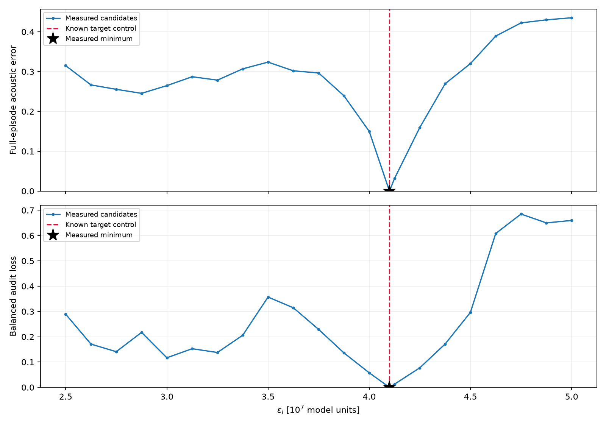
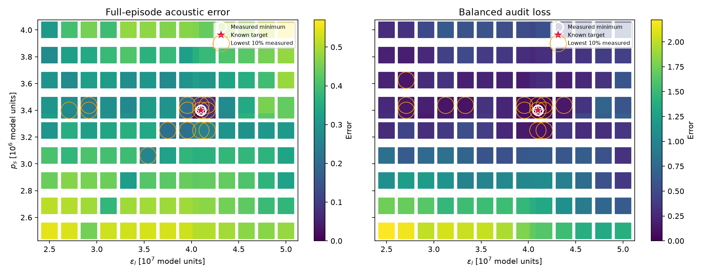
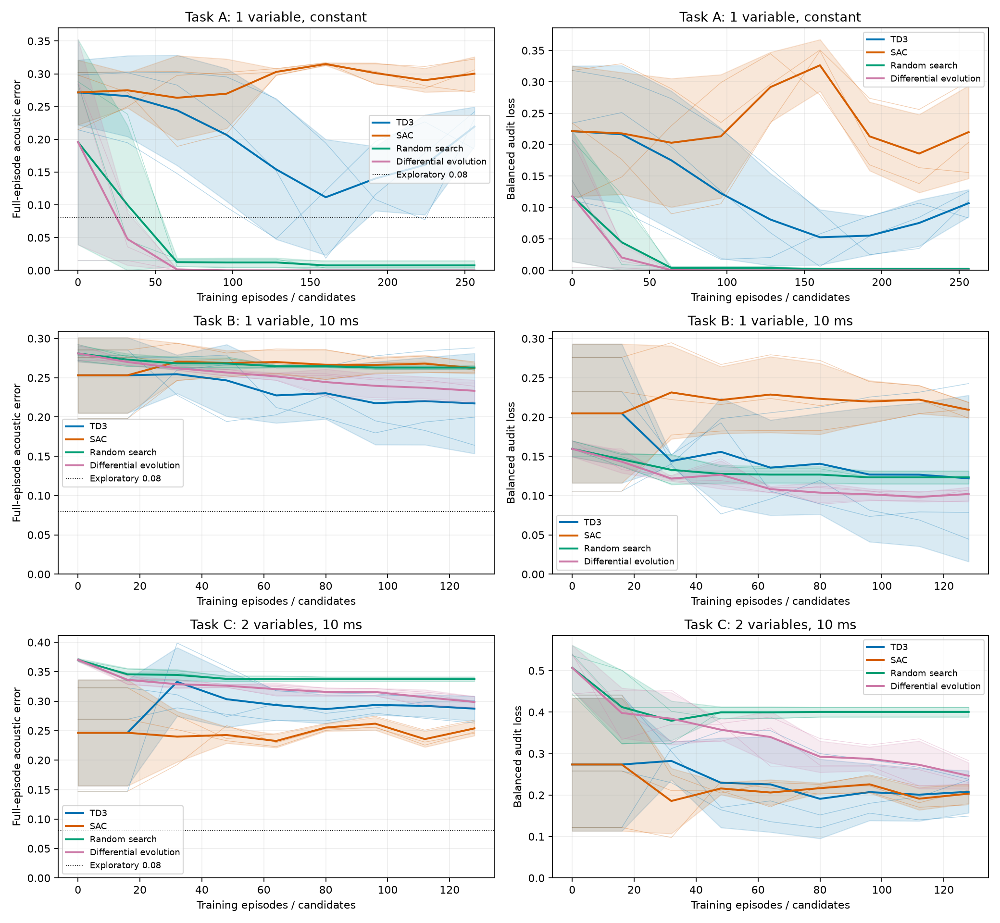

# Phase 1: 既知制御による基礎検証と手法比較

[結果の判断・未解決事項と補足計算量](DISCUSSION.md)｜[独立監査](final_audit.json)

鳴管モデル内で既知制御から生成した Case A・0.35秒の一定目標音を対象に、到達可能性、制御実装の整合性、誤差分布、TD3・SAC・ランダム探索・差分進化を確認した。Phase 2の実録音は使用していない。既存結果を上書きせず、このフォルダに実験証拠を保存した。

## 結果の読み方

主評価は既存 `acoustics.distance()` の **0.35秒全区間 acoustic_error**（log-spectral誤差 + 5 ms RMS包絡誤差）。targetの共通振幅スケールを用い、生成音ごとのゲイン調整・位相調整は行わない。balanced_error は独立した診断値として併記する。両者の数値を同一尺度として比較しない。parameter_nrmse は学習対象の物理範囲で正規化した正解制御からの誤差で、音響的成功の必要条件ではない。

今回の逐次RL報酬は γ=1 の全区間主評価へのprefix potential差分であり、過去の `baseline_context` や `balanced_aligned` の報酬とは異なる。過去の実験結果と今回の値を同一訓練条件としてまとめていない。0.08は探索的な比較線で、聴覚的同一性を検証済みの閾値ではない。

## 実装整合性とOracle

既知目標の制御値は次のとおり。1変数課題でも非学習の p_s を目標生成時の値に固定し、decode時に既定値へ戻る不整合を避ける。元モデル・RK4・遅延計算は変更しない。

| ε_l | ε_r | p_s | f_e,l | f_e,r |
| --- | --- | --- | --- | --- |
| 4.1e+07 | 3.5e+07 | 3.4e+06 | 49000 | 49000 |

| 制御 | 許容下限 | 許容上限 | 非学習時の固定値 |
| --- | --- | --- | --- |
| ε_l | 2.5e+07 | 5e+07 | 4.1e+07 |
| ε_r | 2.5e+07 | 5e+07 | 3.5e+07 |
| p_s | 2.5e+06 | 4e+06 | 3.4e+06 |
| f_e,l | 49000 | 1e+07 | 49000 |
| f_e,r | 49000 | 1e+07 | 49000 |

| 再生条件 | 全区間音響誤差 | balanced | parameter NRMSE |
| --- | --- | --- | --- |
| historical_1d_decode_mismatch | 0.392859 | 0.743907 | 1.43051e-08 |
| A_oracle_float64 | 0 | 0 | 0 |
| A_oracle_float32 | 3.04496e-09 | 8.30642e-10 | 5.96046e-10 |
| B_oracle_float64 | 0 | 0 | 0 |
| B_oracle_float32 | 3.04496e-09 | 8.30642e-10 | 5.96046e-10 |
| C_oracle_float64 | 0 | 0 | 0 |
| C_oracle_float32 | 1.16347e-08 | 1.89107e-09 | 1.13484e-09 |

Oracleの再生条件・初期状態・判定値は [oracles.json](diagnostics/oracles.json)、全実験条件は [manifest.json](manifest.json) に保存した。初期状態と遅延履歴はすべて0で、リセット時に音声デシメータの状態も0とする。制御のfloat32 action変換に由来する丸めがある場合、完全一致の物理制御再生と区別する。

## 学習前の誤差マップ

粗い1次元・2次元の候補をそれぞれ0.35秒数値積分し、同じ全区間評価を行った。図の既知正解位置と測定最小点を比較する。2次元図の色は実際に測定した候補の値であり、橙色の枠は測定値の下位10%を表す。候補間に未測定の極小がないことは保証しない。

| 探索 | 候補数 | 積分時間[s] | 候補評価実時間[s] | 最小音響誤差 | その ε_l | その p_s | 最小balanced |
| --- | --- | --- | --- | --- | --- | --- | --- |
| 1d | 22 | 7.7 | 6.32823 | 0 | 4.1e+07 | 3.4e+06 | 0 |
| 2d | 140 | 49 | 41.353 | 0 | 4.1e+07 | 3.4e+06 | 0 |





診断ゲートの判定: **PASS**。準備段階の実時間 57.4256 秒、Oracleの積分時間 2.45 秒。既知正解の到達性確認のための粗い探索で、適応的な細分化や誤差マップを使う最適化器初期化は行わない。診断が通過してから、事前に定めた予算でA→B→Cの順に進む。詳細は [diagnostics_review.json](diagnostics_review.json)。

探索に含めた既知正解点が最小でも、他の低誤差領域への収束の容易さやパラメータの一意性を証明するものではない。追加細分化の有無と診断後の学習実施判断はmanifestの診断記録を参照。

## 手法比較

Aは1変数の一定制御（1エピソード1行動）、Bは1変数の10 msごとの制御、Cは2変数の10 msごとの制御。Aはバンディット型の別課題で、B/Cの逐次制御と同一のRL問題ではない。各課題内で同じ目標・物理範囲・全区間評価・候補音の長さを使用する。ランダム探索と差分進化はそれぞれの課題と同じ制御次元を最適化する。直接最適化の初期値は独立したランダム候補、RLの初期値は未学習の決定論的方策であり、同一の初期音を意味しない。

| 課題 | 訓練episode / 候補予算 | 評価間隔[episode] | 最適化次元 |
| --- | --- | --- | --- |
| A | 256 | 32 | 1 |
| B | 128 | 16 | 35 |
| C | 128 | 16 | 70 |

seed=[0, 1, 2]。RLのwarm-upは 16 episode、SACのentropy係数設定は `auto_0.01`。差分進化の個体数は 8。B/Cの35/70次元に対してこの個体数・候補予算は小さく、差分進化の十分な収束を保証しない。各候補が独立に全区間の時間列を直接探索する方法と、観測に応じて行動する方策を学習するRLには表現と計算の違いが残る。エピソード予算を揃えても勾配更新費用や実時間は等しくない。

同じ評価で確認した基準音の結果を示す。neutralは正規化action=0、random_controlは探索で選択しない単一のランダム制御で、最良候補を選択するrandom_searchとは異なる。neutralを複数seedで再生した標準偏差0は独立した性能実験のばらつきを意味しない。

| 課題 | 基準 | 本数 | 音響誤差 | balanced | parameter NRMSE |
| --- | --- | --- | --- | --- | --- |
| A | neutral | 3 | 0.296613 ± 0 | 0.229032 ± 3.4e-17 | 0.14 ± 0 |
| A | random_control | 3 | 0.17712 ± 0.135 | 0.102179 ± 0.0957 | 0.0676434 ± 0.0596 |
| B | neutral | 3 | 0.296613 ± 0 | 0.229032 ± 3.4e-17 | 0.14 ± 0 |
| B | random_control | 3 | 0.286855 ± 0.0132 | 0.166134 ± 0.0417 | 0.310946 ± 0.0209 |
| C | neutral | 3 | 0.207867 ± 3.4e-17 | 0.247283 ± 0 | 0.121655 ± 1.7e-17 |
| C | random_control | 3 | 0.370537 ± 0.0114 | 0.484612 ± 0.0516 | 0.311044 ± 0.0163 |

基準音の全値は [baselines/summary.json](baselines/summary.json)。

平均 ± 標本標準偏差（seed間）。各seedの初期・最終値と計算量は [per_seed.csv](per_seed.csv)。

| 課題 | 手法 | seed | 初期音響誤差 | 最終音響誤差 | 最終balanced | 最終parameter NRMSE | ≤0.08のseed数 |
| --- | --- | --- | --- | --- | --- | --- | --- |
| A | TD3 | 0,1,2 | 0.271593 ± 0.0494 | 0.219398 ± 0.0301 | 0.106998 ± 0.0217 | 0.0770379 ± 0.0121 | 0 |
| A | SAC | 0,1,2 | 0.271593 ± 0.0494 | 0.300167 ± 0.0259 | 0.220148 ± 0.0739 | 0.286468 ± 0.033 | 0 |
| A | Random search | 0,1,2 | 0.195858 ± 0.157 | 0.00756326 ± 0.00651 | 0.00202215 ± 0.00176 | 0.00149626 ± 0.00134 | 3 |
| A | Differential evolution | 0,1,2 | 0.195858 ± 0.157 | 3.53133e-11 ± 1.04e-11 | 9.59487e-12 ± 2.83e-12 | 6.88682e-12 ± 2.03e-12 | 3 |
| B | TD3 | 0,1,2 | 0.253105 ± 0.048 | 0.217312 ± 0.0638 | 0.122015 ± 0.106 | 0.260184 ± 0.323 | 0 |
| B | SAC | 0,1,2 | 0.253105 ± 0.048 | 0.262281 ± 0.007 | 0.20929 ± 0.00997 | 0.157736 ± 0.0115 | 0 |
| B | Random search | 0,1,2 | 0.280881 ± 0.0104 | 0.262957 ± 0.00213 | 0.123305 ± 0.00822 | 0.307664 ± 0.0202 | 0 |
| B | Differential evolution | 0,1,2 | 0.280881 ± 0.0104 | 0.233397 ± 0.0138 | 0.102091 ± 0.00872 | 0.228963 ± 0.0293 | 0 |
| C | TD3 | 0,1,2 | 0.246463 ± 0.09 | 0.28744 ± 0.0213 | 0.207988 ± 0.0509 | 0.215622 ± 0.0492 | 0 |
| C | SAC | 0,1,2 | 0.246463 ± 0.09 | 0.253838 ± 0.0123 | 0.203412 ± 0.024 | 0.108977 ± 0.0129 | 0 |
| C | Random search | 0,1,2 | 0.370113 ± 0.0026 | 0.337348 ± 0.00347 | 0.400556 ± 0.0118 | 0.289584 ± 0.0213 | 0 |
| C | Differential evolution | 0,1,2 | 0.370113 ± 0.0026 | 0.298696 ± 0.00954 | 0.246417 ± 0.0317 | 0.224991 ± 0.0136 | 0 |

課題Aの最小最終音響誤差は 2.89879e-11 （DE、seed 0）。全12 run中6 runが探索線0.08以下だった。最小の単一seedだけで手法の優位性を判断せず、上表の平均とばらつきを併せて読む。

課題Bの最小最終音響誤差は 0.164076 （TD3、seed 2）。全12 run中0 runが探索線0.08以下だった。最小の単一seedだけで手法の優位性を判断せず、上表の平均とばらつきを併せて読む。

課題Cの最小最終音響誤差は 0.245763 （SAC、seed 1）。全12 run中0 runが探索線0.08以下だった。最小の単一seedだけで手法の優位性を判断せず、上表の平均とばらつきを併せて読む。



学習曲線の横軸は訓練エピソード数（直接最適化では候補数）。太線はseed平均、帯は標本標準偏差、細線は各seed。評価間隔が異なる場合は表示用に線形補間する。曲線を含む評価のシミュレーション費用は訓練とは別に計上する。

## 計算量と資源制約

decision_stepsはエージェント/探索器が選んだ制御行動数、episodesは生成した候補音の本数。integration_sは数値積分したモデル時間、native_stepsは元のRK4積分刻み数を表す。Aの1行動も0.35秒を積分するため、AとB/Cのstep数だけを比較して計算量が等しいとは扱わない。実時間にはPython・損失計算・方策更新などの費用も含まれ、同時処理の有無によって変動する。

| 課題 | 手法 | seed | 次元 | 訓練行動 | 訓練episode | 訓練積分[s] | 評価episode | 評価積分[s] | 訓練実時間[s] | 評価実時間[s] | run実時間[s] | failure数 |
| --- | --- | --- | --- | --- | --- | --- | --- | --- | --- | --- | --- | --- |
| A | TD3 | 0 | 1 | 256 | 256 | 89.6 | 9 | 3.15 | 84.8311 | 3.02435 | 87.8554 | 0 |
| A | TD3 | 1 | 1 | 256 | 256 | 89.6 | 9 | 3.15 | 85.0905 | 2.98988 | 88.0804 | 0 |
| A | TD3 | 2 | 1 | 256 | 256 | 89.6 | 9 | 3.15 | 84.805 | 3.01197 | 87.817 | 0 |
| A | SAC | 0 | 1 | 256 | 256 | 89.6 | 9 | 3.15 | 79.646 | 2.91083 | 82.5568 | 0 |
| A | SAC | 1 | 1 | 256 | 256 | 89.6 | 9 | 3.15 | 79.5685 | 2.89737 | 82.4659 | 0 |
| A | SAC | 2 | 1 | 256 | 256 | 89.6 | 9 | 3.15 | 79.5997 | 2.87868 | 82.4784 | 0 |
| A | random_search | 0 | 1 | 256 | 256 | 89.6 | 9 | 3.15 | 81.2279 | 2.8778 | 84.1057 | 0 |
| A | random_search | 1 | 1 | 256 | 256 | 89.6 | 9 | 3.15 | 81.0784 | 2.89171 | 83.9701 | 0 |
| A | random_search | 2 | 1 | 256 | 256 | 89.6 | 9 | 3.15 | 81.2633 | 2.91859 | 84.1819 | 0 |
| A | DE | 0 | 1 | 256 | 256 | 89.6 | 9 | 3.15 | 81.3967 | 2.88053 | 84.2773 | 0 |
| A | DE | 1 | 1 | 256 | 256 | 89.6 | 9 | 3.15 | 80.9459 | 2.90428 | 83.8502 | 0 |
| A | DE | 2 | 1 | 256 | 256 | 89.6 | 9 | 3.15 | 81.3687 | 2.90565 | 84.2743 | 0 |
| B | TD3 | 0 | 35 | 4480 | 128 | 44.8 | 9 | 3.15 | 62.5977 | 3.79715 | 66.3949 | 0 |
| B | TD3 | 1 | 35 | 4480 | 128 | 44.8 | 9 | 3.15 | 62.6043 | 3.87416 | 66.4785 | 0 |
| B | TD3 | 2 | 35 | 4480 | 128 | 44.8 | 9 | 3.15 | 62.5304 | 3.86218 | 66.3926 | 0 |
| B | SAC | 0 | 35 | 4480 | 128 | 44.8 | 9 | 3.15 | 65.8258 | 3.88571 | 69.7115 | 0 |
| B | SAC | 1 | 35 | 4480 | 128 | 44.8 | 9 | 3.15 | 65.6632 | 3.96539 | 69.6286 | 0 |
| B | SAC | 2 | 35 | 4480 | 128 | 44.8 | 9 | 3.15 | 65.6672 | 3.91794 | 69.5852 | 0 |
| B | random_search | 0 | 35 | 4480 | 128 | 44.8 | 9 | 3.15 | 52.8888 | 3.77322 | 56.662 | 0 |
| B | random_search | 1 | 35 | 4480 | 128 | 44.8 | 9 | 3.15 | 53.0417 | 3.78324 | 56.8249 | 0 |
| B | random_search | 2 | 35 | 4480 | 128 | 44.8 | 9 | 3.15 | 52.8494 | 3.79526 | 56.6446 | 0 |
| B | DE | 0 | 35 | 4480 | 128 | 44.8 | 9 | 3.15 | 53.2256 | 3.76564 | 56.9913 | 0 |
| B | DE | 1 | 35 | 4480 | 128 | 44.8 | 9 | 3.15 | 53.5291 | 3.74203 | 57.2711 | 0 |
| B | DE | 2 | 35 | 4480 | 128 | 44.8 | 9 | 3.15 | 53.3915 | 3.7418 | 57.1333 | 0 |
| C | TD3 | 0 | 70 | 4480 | 128 | 44.8 | 9 | 3.15 | 63.747 | 3.91858 | 67.6655 | 0 |
| C | TD3 | 1 | 70 | 4480 | 128 | 44.8 | 9 | 3.15 | 63.8393 | 3.94448 | 67.7837 | 0 |
| C | TD3 | 2 | 70 | 4480 | 128 | 44.8 | 9 | 3.15 | 63.9706 | 3.93652 | 67.9071 | 0 |
| C | SAC | 0 | 70 | 4480 | 128 | 44.8 | 9 | 3.15 | 65.4073 | 3.93651 | 69.3438 | 0 |
| C | SAC | 1 | 70 | 4480 | 128 | 44.8 | 9 | 3.15 | 65.5259 | 3.95505 | 69.4809 | 0 |
| C | SAC | 2 | 70 | 4480 | 128 | 44.8 | 9 | 3.15 | 65.4331 | 3.86264 | 69.2957 | 0 |
| C | random_search | 0 | 70 | 4480 | 128 | 44.8 | 9 | 3.15 | 53.2009 | 3.74668 | 56.9476 | 0 |
| C | random_search | 1 | 70 | 4480 | 128 | 44.8 | 9 | 3.15 | 53.2962 | 3.81247 | 57.1086 | 0 |
| C | random_search | 2 | 70 | 4480 | 128 | 44.8 | 9 | 3.15 | 53.3639 | 3.82505 | 57.1889 | 0 |
| C | DE | 0 | 70 | 4480 | 128 | 44.8 | 9 | 3.15 | 53.5434 | 3.71344 | 57.2568 | 0 |
| C | DE | 1 | 70 | 4480 | 128 | 44.8 | 9 | 3.15 | 53.4296 | 3.76776 | 57.1973 | 0 |
| C | DE | 2 | 70 | 4480 | 128 | 44.8 | 9 | 3.15 | 53.4301 | 3.7809 | 57.211 | 0 |

| 区分 | 行動数 | episode | 積分[s] | native刻み数 | 実時間の合計[s] | failure |
| --- | --- | --- | --- | --- | --- | --- |
| training | 110592 | 6144 | 2150.4 | 2.1504e+10 | 2392.82 | 0 |
| evaluation | 7668 | 324 | 113.4 | 1.134e+09 | 127.195 | 0 |

上記合計はrun内の訓練・評価の集計。目標生成、Oracle、誤差マップ、図の描画は別費用で、全体の実行実時間・診断費用はmanifestの記録を参照。有限の予算で得た結果であり、未収束の結果からRL一般の不可能性は結論しない。

## 保存物・SAP評価への準備

各runの `rollout.npz` はtarget/audioをfloat64で保持し、`target_raw.wav` と `generated_raw.wav` はIEEE float32で元振幅を保持する。音声の個別ピーク正規化やクリップは行わない。モデル出力単位であり、物理的な音圧への校正は行っていない。±1を超えるWAVは再生側でクリップされる場合があるため、定量解析の正本はNPZとする。

`spectrogram.png` は既存描画関数を使用し、10 MHzへの表示用再サンプリング、nperseg=245760、noverlap=184320、Blackman–Harris、gray_r、−50〜−20 dB、0〜10 kHz。完全に含まれる窓の中心時刻のみを表示して両端の外挿を避ける。スペクトログラムのピーク正規化は表示専用なので、振幅差は共通の元単位を使う `amplitude_envelope.png` で確認する。`controls.png` は適用した5制御の時間推移を示す。

SAPは本実験では未実施で、独立した将来の評価とする。音響誤差・balanced loss・独自の記述特徴を公式SAPスコアとは呼ばない。

## 確認できる範囲と未解決事項

Oracleと誤差マップは、既知制御の目標が同じモデル・初期状態・固定制御の下で再現可能かを検証する。学習結果は、その限られた到達可能な目標と訓練予算に対する制御獲得性能を示す。時変制御の方策が良好でも目標自体は一定制御で生成されており、複雑な時変目標への十分性は未検証である。パラメータ誤差が残って音響誤差が小さい場合は識別の非一意性を検討し、音響的成功を直ちに否定しない。

この結果から実録音への一般化や左右2音源の優位性は主張しない。seed数は小さく、ハイパーパラメータ選択と計算予算の影響が残る。失敗例・未到達の閾値・数値失敗は表中に残し、成功したseedだけを選んだ結論にはしない。

## 実験条件の完全記録

主な追加は [検証環境](../../phase1_validation_env.py)、[実験runner](../../phase1_validation.py)、[描画・レポート](../../phase1_validation_report.py)、[実験設定](../../configs/phase1_validation.json)。固定制御の明示、全区間主評価に一致する報酬、課題別の行動次元と計算量記録を追加した。既存の元モデルと既存結果の保存先を変更しない。再実行コマンド・予算・初期状態・reward定義・診断から学習への判断は以下のmanifestで確認できる。

既存ファイル保存の検査: PASS、対象 683 ファイル。詳細は [preservation_check.json](preservation_check.json)。

```json
{
  "created_utc": "2026-10-31T06:23:44.790821+00:00",
  "settings": {
    "seeds": [
      0,
      1,
      2
    ],
    "methods": [
      "TD3",
      "SAC",
      "random_search",
      "DE"
    ],
    "tasks": {
      "A": {
        "episodes": 256,
        "eval_every_episodes": 32
      },
      "B": {
        "episodes": 128,
        "eval_every_episodes": 16
      },
      "C": {
        "episodes": 128,
        "eval_every_episodes": 16
      }
    },
    "landscape_epsilon_points_1d": 21,
    "landscape_epsilon_points_2d": 13,
    "landscape_pressure_points_2d": 9,
    "warmup_episodes": 16,
    "learning_rate": 0.0003,
    "batch_size": 32,
    "net_arch": [
      32,
      32
    ],
    "gamma": 1.0,
    "sac_ent_coef": "auto_0.01",
    "td3_noise_std": 0.1,
    "de_population": 8,
    "de_mutation": [
      0.5,
      1.0
    ],
    "de_recombination": 0.7,
    "exploratory_acoustic_threshold": 0.08,
    "oracle_tolerance_float64": 1e-10,
    "oracle_tolerance_float32": 1e-05
  },
  "source_hashes": {
    "phase1_validation.py": "6bed9436fe31ac309fa4d31d1175201eee2cc5c4c9f3a3c4dec9a513a1d4144c",
    "phase1_validation_env.py": "324da3797ffc3028c9b6823ded00d472fe7eabb107a6d0f3e44b1976bfaca2ce",
    "phase1_validation_report.py": "cf73dca7dc83551345e3c905f3be6de4829d38d0592330cbc983d7dcccd82ff1",
    "configs/phase1_validation.json": "6bac34252370f8501ca88ace1d86747ef7e12e52dc328c8b1a67dc12be725393"
  },
  "condition": "A",
  "target": "constant model-generated, never real recordings",
  "duration_s": 0.35,
  "control_interval_s": 0.01,
  "sample_rate": 50000,
  "native_dt": 1e-07,
  "target_controls": [
    41000000.0,
    35000000.0,
    3400000.0,
    49000.0,
    49000.0
  ],
  "fixed_controls": [
    41000000.0,
    35000000.0,
    3400000.0,
    49000.0,
    49000.0
  ],
  "physical_low": [
    25000000.0,
    25000000.0,
    2500000.0,
    49000.0,
    49000.0
  ],
  "physical_high": [
    50000000.0,
    50000000.0,
    4000000.0,
    10000000.0,
    10000000.0
  ],
  "initial_state": [
    0,
    0,
    0,
    0
  ],
  "delay_history": "all zeros",
  "decimator_state": "all zeros",
  "target_generation": {
    "integration_s": 0.35,
    "native_steps": 3500000,
    "wall_s": 0.30142670299392194
  },
  "reward": "whole_acoustic_prefix_potential_gamma1; NOT baseline_context or balanced_aligned",
  "reward_identity": "-sum(r_t) = full acoustic error; potential=(n/N)*distance(prefix)",
  "primary": "acoustics.distance over the complete 0.35 s",
  "balanced": "audit only, not training/selection",
  "optimizer_space": {
    "A": "one constant epsilon_l",
    "B": "35 independent epsilon_l blocks",
    "C": "35 independent (epsilon_l,ps) blocks"
  },
  "budget_unit": "training episodes of 0.35 s, equal within each task",
  "evaluation_schedule": "initial plus 8 checkpoints; evaluation integration excluded from training budget",
  "runtime": {
    "python": "3.12.3",
    "platform": "Linux-6.18.54.1-microsoft-standard-WSL2-x86_64-with-glibc2.39",
    "package_versions": {
      "numpy": "2.5.4",
      "scipy": "1.18.1",
      "torch": "2.14.1+cpu",
      "stable-baselines3": "2.9.2",
      "gymnasium": "1.4.0"
    },
    "torch_threads": 1,
    "comparison_workers": 3,
    "requirements_lock_sha256": "fe5b981f2880c7e60d488b06a1dfb5172ea016e5c76b167e21c17fea17ea01b1"
  },
  "reproduction_commands": [
    "MPLCONFIGDIR=/tmp/birdsong-mpl OPENBLAS_NUM_THREADS=1 OMP_NUM_THREADS=1 Deeplearning/.venv/bin/python -m Deeplearning.phase1_validation prepare",
    "MPLCONFIGDIR=/tmp/birdsong-mpl OPENBLAS_NUM_THREADS=1 OMP_NUM_THREADS=1 Deeplearning/.venv/bin/python -m Deeplearning.phase1_validation baselines",
    "MPLCONFIGDIR=/tmp/birdsong-mpl OPENBLAS_NUM_THREADS=1 OMP_NUM_THREADS=1 Deeplearning/.venv/bin/python -m Deeplearning.phase1_validation compare --task A",
    "MPLCONFIGDIR=/tmp/birdsong-mpl OPENBLAS_NUM_THREADS=1 OMP_NUM_THREADS=1 Deeplearning/.venv/bin/python -m Deeplearning.phase1_validation compare --task B",
    "MPLCONFIGDIR=/tmp/birdsong-mpl OPENBLAS_NUM_THREADS=1 OMP_NUM_THREADS=1 Deeplearning/.venv/bin/python -m Deeplearning.phase1_validation compare --task C",
    "MPLCONFIGDIR=/tmp/birdsong-mpl OPENBLAS_NUM_THREADS=1 OMP_NUM_THREADS=1 Deeplearning/.venv/bin/python -m Deeplearning.phase1_validation report"
  ]
}
```
